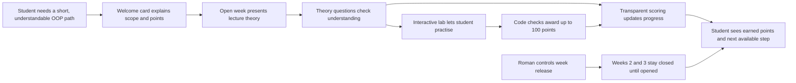
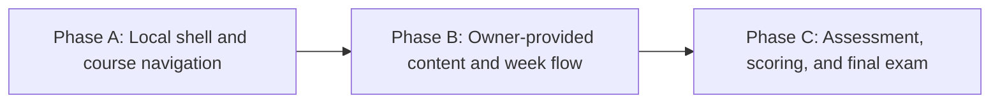

# HL — OOP_20261014-215543_INIT: Initialize New Instructional TFW

> **Date**: 2026-10-14
> **Author**: Coordinator
> **Title**: Initialize New Instructional TFW
> **Abbreviation**: INIT
> **Status**: 🔬 RES — master contract frozen; research is in progress
> **Contract**: 🔒 FROZEN — approved by Roman 2026-10-14
> **Frozen**: §1 · §3 · §4 · §5 · §6 · §7 — locked on owner approval
> **Free**: §2 · §7.2 · §8 · §9 · §10 · §11 — research updates these directly
> **Append-only**: §12 Amendment Log — the only channel for changing a frozen section
> **Baseline**: commit `freeze` scope for this task, recorded in Git history
> **Project North Star**: [NorthStar.md](../../../NorthStar.md) §Purpose · §Learner experience · §Assessment contract · §Product boundaries · §Success

---

## 1. Vision 🔒 FROZEN

OOPoman gives second-year students a short, clear path through a three-week introduction to object-oriented programming. A student can understand the course before starting, move through theory and interactive practice, see how points are awarded, and use the site locally without an account. Roman can use the project to learn TFW Full while keeping the course material and implementation understandable and easy to continue.

**Impact:** Students can follow the available course in order and understand their progress; Roman can build and inspect a small educational web project while retaining control of course content, assessment policy, and the opening of later weeks.

> **Imagined student quote:** “I can see what this course expects, what I can do this week, and how my work earns points.”

## 2. Current State (As-Is) 🟢 FREE

- The repository has TFW Full v3.9.2, the owner-approved North Star and trace, one initial UML context diagram, and the INIT task. Sources: `../../NorthStar.md`, `../../TRACE.md`, `../../architecture/context.puml`, and this task's `status.md`.
- No site implementation or course source files have been added. Roman will provide course files later; the root `OOP-course/` directory is not to be populated before then.
- The requested score arithmetic is partly defined: code 100 + theory 8 × 25 = 200 + practical work totaling 200 = 500. The individual practical split and rubrics remain open. The exam's content and relationship to that total remain open.
- The application stack, safe client-side code checking, and whether progress persists between browser sessions are undecided. No project-owned server, database, authentication, registration, or deployment is authorized.
- The initial experience is defined at a product level: Week 1 starts open; Weeks 2 and 3 remain closed until Roman says to open them.

## 3. Target State (To-Be) 🔒 FROZEN

**As-Is → To-Be:** An empty, traceable TFW project with the product intent preserved → a locally usable, three-week OOP mini-LMS that presents the course clearly, guides students through the material currently open to them, awards transparent points, and remains simple to inspect and maintain.

The product has a welcoming course entry, visible weekly progress, theory lessons, interactive labs, assessments, and an understandable score explanation. Course files live in root `OOP-course/` after Roman provides them. Application structure and UML diagrams remain in the project and `architecture/`, respectively. The site is run locally and is not deployed.

### 3.1 Result Visualization

Illustrative first-screen state; course wording and earned points are placeholders, not authored course content.

```text
┌──────────────────────────────────────────────────────────┐
│ OOPoman                         Прогресс: 0/3 недель      │
│                                                          │
│ Изучаем ООП за 3 недели                                  │
│ Короткий курс: теория, практика и понятные критерии.     │
│ Всего за курс можно набрать 500 баллов.                  │
│ [Начать курс]                                            │
├──────────────────────────────────────────────────────────┤
│ Неделя 1 · Открыта                                       │
│ Теория → Проверка знаний → Интерактивная лабораторная    │
│ Баллы: 0/…                                               │
│                                                          │
│ Неделя 2 · Закрыта до решения владельца                  │
│ Неделя 3 · Закрыта до решения владельца                  │
└──────────────────────────────────────────────────────────┘
```

| Before | After | Value visible in the same view |
|---|---|---|
| No course site or course files in the project. | A student sees the course purpose, the currently available week, the next learning action, and the course point ceiling. | The student can begin without registration and knows what is available. |
| Point rules and later-week access are not implemented. | Criteria appear before an assessment; scores and progress are shown; later weeks remain closed until Roman opens them. | Students understand credit and Roman retains release control. |

### 3.2 Value Flow



## 4. Phases 🔒 FROZEN

The master direction has three future product phases. Each phase receives its own approved TS before implementation; this INIT task creates no site code or course content.

### 4.1 Coordination Selection 🔒 FROZEN

| Activation source | Accountable owner | Task Coordinator unit | Phase Coordinator rule | Mandate scope / role reach | Upward route | Dialogue | Reporting | Reservations / controls | Amendment authority | Immutable epoch |
|---|---|---|---|---|---|---|---|---|---|---|
| delegated | Roman (`roman`) | `codex:thread:local:01a13b48-ed98-7631-85cb-e7691c6a01b3` | One task Coordinator remains responsible for task scope; future product phases get distinct Phase Coordinators only after their plans are approved. | One directly addressable Researcher role in INIT may run focused research iterations 1–2 (iteration 3 only for a material unresolved gap, within config max 3) and write only its RES/stage artifacts. One directly addressable Reviewer may perform exactly one independent review of this INIT's fixed RF and EV, writing only `review/` stage artifacts and REVIEW. The Reviewer may not change the RF, EV, product files, config, status, frozen HL, or delegate further. | `owner:roman` | `tfw-gates-only`; Researcher's required stage dialogue applies | `native-gates` | No branch/worktree; use the existing checkout serially. Roman reserves product scope, stack, score split/rubrics, exam design, code-execution safety, persistence, and opening Weeks 2–3. Stop and return any scope change or decision requiring Roman. | `none` | `TRACE.md @ 66456b4e749ab2a694f1dfc9d4418f0fd13f3888` |

### Phase Dependencies



| Phase | Depends on | Shared files | Can run in parallel with |
|---|---|---|---|
| A | Research findings and an approved phase TS | application shell, `architecture/` | — |
| B | A; Roman supplies the course source files | application shell, root `OOP-course/` | — |
| C | B; Roman resolves the open score and exam decisions; safe code-checking approach is approved | assessment flow, score model, course content | — |

### Phase A: Local shell and course navigation 🔴

- A simple, welcoming local site shell and course entry.
- A navigable three-week course outline that marks Week 1 open and Weeks 2–3 closed by default.
- A readable local run path; no project-owned server, database, account system, or deployment.
- Updated UML views under `architecture/` when the approved design is known.

### Phase B: Owner-provided content and week flow 🟡

- Integrate only course files Roman provides in root `OOP-course/`.
- Present each week's theory, interactive practice, and one-hour homework in an understandable sequence.
- Preserve owner-controlled release of Weeks 2 and 3 and show the current availability clearly.

### Phase C: Assessment, scoring, and final exam 🟢

- Show assessment criteria before work begins and explain awarded points.
- Implement the approved 500-point accounting: 100 code points, 200 theory points from eight 25-point questions, and 200 practical points across three exercises.
- Implement the safe local code-checking and score-progress behavior selected after research and owner approval.
- Design and add the one final exam only after Roman approves its content, format, and place in the 500-point total.

## 5. Definition of Done (DoD) 🔒 FROZEN

- ✅ 1. TFW Full project state preserves the approved OOPoman purpose, constraints, open decisions, and continuation route.
- ✅ 2. The local site can be started and used without deployment, a project-owned server or database, registration, or authentication.
- ✅ 3. A student sees the course purpose, weekly progression, assessment criteria, score progress, and the next available action without having to infer them.
- ✅ 4. Week 1 is open by default; Weeks 2 and 3 remain unavailable until Roman explicitly opens them.
- ✅ 5. Course content is kept in root `OOP-course/` and is sourced from Roman; no course lessons are invented to fill a missing source.
- ✅ 6. Theory, interactive lab/practice, homework, and an owner-approved final exam fit the three-week course structure and stated time budget.
- ✅ 7. The maximum score is exactly 500 with the approved category totals; practical rubrics and exam accounting are explicit before an assessment is attempted.
- ✅ 8. Code checking is locally usable, constrained by a reviewed safety design, and explains how points are earned.
- ✅ 9. UML architecture and structure diagrams are stored under `architecture/`; project files remain easy to navigate.
- ✅ 10. Final review and evidence show the result is ready for Roman's acceptance; no unapproved deploy or external service is required.

## 6. Definition of Failure (DoF) 🔒 FROZEN

- ❌ 1. The experience requires a project-owned backend, database, account, or deployment to complete the course.
- ❌ 2. Weeks 2 or 3 become available without Roman's explicit release.
- ❌ 3. The assessment maximum is inconsistent with 500, criteria are hidden until after work, or points cannot be explained.
- ❌ 4. Arbitrary student code can damage the host environment or access unrelated local data through an unreviewed execution design.
- ❌ 5. Missing course files are replaced with invented lessons or the course's source material is mixed into application code.
- ❌ 6. A phase begins implementation before its scope and acceptance criteria are approved.

**On failure:** stop the affected phase, preserve its trace and evidence, return the decision to Roman, and revise only through the applicable TFW gate.

## 7. Principles 🔒 FROZEN

1. **Understandable before extensive** — keep the course and interface small enough for a second-year student to follow and maintain.
2. **Local by design** — meet the learning goal without a project-owned server, database, accounts, or deployment.
3. **Explain the score** — tell students the criteria before an assessment and show how results contribute to progress.
4. **Owner controls release** — later weeks stay closed until Roman opens them.
5. **Source course content from Roman** — keep it at `OOP-course/`; do not invent missing course material.
6. **Prove safe code checks** — do not execute arbitrary code without an approved, bounded local design.
7. **Use only necessary structure** — keep diagrams and project organization clear without creating process or architecture for its own sake.

### 7.2 Knowledge Citations 🟢 FREE

| # | Source | Item | How it applies |
|---|---|---|---|
| P0 | [NorthStar.md](../../../NorthStar.md) | Purpose; Learner experience; Assessment contract; Product boundaries; Success | Defines what OOPoman is for and the constraints no phase may contradict. |
| P1 | [.tfw/README.md](../../../.tfw/README.md#ns1--purpose) | NS1 — Purpose | TFW decisions must preserve human-governed, inspectable continuity instead of producing artifacts without a continuation path. |
| P1 | [.tfw/README.md](../../../.tfw/README.md#ns2--principles) | NS2 — Principles | Require purpose before activity, explicit uncertainty, selected traces, bounded delegation, and assurance proportional to risk. |
| P1 | [.tfw/README.md](../../../.tfw/README.md#success-criteria) | Success Criteria | Each accepted phase needs resumable state, traceable material decisions, qualified findings, and a complete inspectable result. |
| P2 | `knowledge/philosophy.md` | Absent | No separate validated project philosophy exists yet. |
| P3 | [KNOWLEDGE.md](../../../KNOWLEDGE.md) §1 Architecture Map | No project architecture decisions recorded | Do not treat the initial context diagram as an approved implementation architecture. |
| P4 | [.tfw/conventions.md](../../../.tfw/conventions.md#hl-contract) | HL Contract | Keep frozen direction separate from free research; use amendments for later contract changes. |

## 8. Dependencies 🟢 FREE

| Dependency | Status |
|---|---|
| Roman's source files for root `OOP-course/` | ⬜ Roman will provide later |
| Research on safe local browser code checking | ⬜ Open; no runner selected |
| Persistence expectation for progress and points | ⬜ Open; decide before implementation |
| Three practical exercises' point split and rubrics | ⬜ Open; total is fixed at 200 |
| Final exam scope, format, and score accounting | ⬜ Open; design later with Roman |
| Application language, build tools, and local start command | ⬜ Open; decide during the next planning step |

## 9. Risks 🟢 FREE

| Risk | Probability | Impact | Mitigation |
|---|---|---|---|
| Browser-local code evaluation provides weak isolation or permits resource exhaustion | Medium | High | Research current browser security options; require an approved bounded design before code execution. |
| Local scores disappear between sessions | Medium | Medium | Research the persistence tradeoff and ask Roman to select a policy before implementation. |
| Course content is unavailable when the shell is ready | Medium | Medium | Build only the approved empty structure until Roman supplies sources; keep content separate. |
| Practical score split or exam accounting makes the 500-point total confusing | Medium | High | Keep these decisions open and present a complete point table for Roman's approval before assessments. |

## 10. RESEARCH Case 🟢 FREE

### Blind Spots

- The supported browser/runtime and whether students execute course code locally are unknown.
- Browser restrictions on local files, code isolation, resource limits, and persistence need authoritative verification.
- The exam may be part of the 500-point total or a separate completion check; the owner has not decided.
- The real course source files and their formats have not been supplied.

### Hypotheses

| # | Hypothesis | Status |
|---|---|---|
| H1 | A browser-local site can deliver the requested learning flow without a project-owned server or database, but the exact way it loads owner-provided course files may constrain packaging. | open |
| H2 | Multi-stage code checks can run locally in a browser only with explicit isolation and resource limits; an ordinary same-page evaluator is insufficient for untrusted code. | open |
| H3 | Local progress persistence is possible without a project database, but persistence choice changes privacy, portability, and recovery behavior. | open |
| H4 | The course can account for exactly 500 points while leaving the three practical splits and exam accounting open until Roman approves them. | open |
| H5 | Content in a separate root `OOP-course/` directory can remain distinct from application code and still support clear lesson and week gating. | open |

### Risks of Not Researching

The project could choose an unsafe code runner, promise a local file flow the browser cannot provide, lose student progress unexpectedly, or implement an assessment whose displayed total conflicts with the owner's 500-point rule.

### Proposed RESEARCH Focus

1. **Gather**: Verify local browser delivery, local-file/content loading constraints, browser code-execution isolation, and persistence options from primary browser documentation.
2. **Extract**: Compare only approaches compatible with the owner's no-server/no-database/no-account boundary; identify decisions that block the first site skeleton.
3. **Challenge**: Test the strongest reason the browser-only direction might fail, distinguish facts from assumptions, and return unresolved owner decisions without choosing them.

### Why Not Just...?

| Approach | Value | Adoption / operating burden | Risks / tradeoffs | Decision and reason |
|---|---|---|---|---|
| Local browser application with separate owner-provided content | Meets the local, small-course direction and keeps course sources inspectable. | Roman starts it locally; no service administration. | Local file loading, persistence, and safe code execution require evidence and design. | Recommended for research because it fits the owner's explicit boundaries while preserving open technical decisions. |
| Static course pages with manually reviewed practice | Very small and easy to run. | Low setup, but Roman must assess code and manage points manually. | Does not meet the requested multi-stage site-based code checks and transparent automatic scoring. | Keep only as a fallback if safe local code evaluation proves infeasible. |
| Hosted LMS with backend, accounts, and database | Mature user management and durable cross-device records. | Requires hosting and administration. | Directly conflicts with the no-deploy, no-project-server/database, and no-authentication constraints. | Excluded by owner boundary. |

**Leave unchanged:** students have no guided, visible course progression in this project; the course remains a later manual activity and Roman cannot practise building the requested local learning site.

**Critical challenge:** A browser page that executes student code cannot automatically be assumed safe merely because it runs locally. If a sufficiently bounded design cannot meet the grading need, the code-checking promise or assessment format must return to Roman before implementation.

## 11. Strategic Insights (Planning) 🟢 FREE

| # | Insight | Category | Source |
|---|---|---|---|
| S1 | Roman is both the owner of course release and a student learning TFW Full; the project must teach through its traceable development as well as serve the eventual learner. | user goal | Roman, initial OOPoman request; recorded in `TRACE.md` |

## 12. Amendment Log 🟢 APPEND-ONLY

| # | Date | § | Type | Proposer | Proposed change | Evidence | Cost | Alternatives considered | Verdict |
|---|------|---|------|----------|-----------------|----------|------|------------------------|---------|
| A1 | 2026-10-14 | §4.1 | `EXTEND` | Roman (owner) | Add one directly addressable Reviewer for one independent review of INIT RF/EV, limited to review stages and REVIEW; prohibit product/config/RF/EV/status/HL changes and further delegation; use shared checkout serially, with no branch/worktree. | INIT RF and EV are complete; TFW Init requires independent review before closure; Roman explicitly approved “ограниченный Review” after these exact limits were presented. | One role task plus review traces and one review/authorization commit; no product implementation. | Leave INIT at RF without closure, or self-review; the former leaves required TFW setup incomplete and the latter is not independent. | `✅ APPROVED — Roman, 2026-10-14` |

### Material handover at this return

Owner's written product requirements are in [NorthStar.md](../../../NorthStar.md) and `TRACE.md`; the current verified repository state is listed in §2. Research hypotheses remain open. Researcher may test only H1–H5 under the bounded mandate in §4.1. No implementation or course-content creation is included in INIT.

---

*HL — OOP_20261014-215543_INIT: Initialize New Instructional TFW | 2026-10-14*
