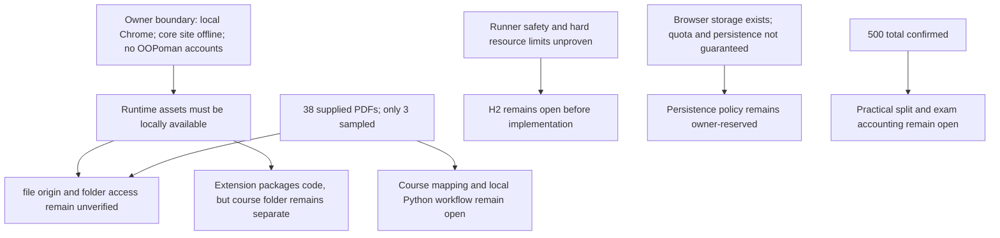

# RES — OOP_20261014-215543_INIT: Исследование INIT: подтверждение рамок и открытых решений OOPoman

> **Date**: 2026-10-14
> **Author**: Codex
> **Status**: ✅ RES — Complete (iteration 1; Coordinator continuation decision pending)
> **Parent HL**: [HL-OOP_20261014-215543_INIT.md](../../HL-OOP_20261014-215543_INIT.md) _(pipeline)_
> **Mode**: Pipeline / focused
> **Producer unit**: `codex:thread:local:01a13b5e-61b2-7df3-93b1-3dcc6579acb9`
> **Parent Coordinator**: `codex:thread:local:01a13b48-ed98-7631-85cb-e7691c6a01b3`
> **Activation / dispatch source**: `journal/20261014-222832__dispatch__9ac4.md @ f29e83302ce885e8cbe9c13156d496c6a3728ca0`
> **Coordination authority**: `HL-OOP_20261014-215543_INIT.md @ 353e1f31f82bb18d5c4dc59473e3ecee820c5b20`
> **Originating proposer**: `{principal: roman, unit: owner:roman}`

---

## Research Context

Focused iteration 1 examined whether OOPoman's approved local course flow can fit Google Chrome, how the separate owner-supplied course files could be reached, and what browser documentation does or does not establish about code isolation and local progress. Roman confirmed that the site must work fully offline after local launch, external reference links may require Internet, and OOPoman itself must not use accounts, registration, or authentication; third-party authentication is outside the website boundary. No stack, runner, persistence policy, scoring detail, course content, site, or extension was selected or built. The frozen HL, NorthStar, owner TRACE, current task routing, and available project knowledge were checked; no independent project knowledge records or approved architecture decisions exist yet.

## Briefing

See [1_briefing.md](1_briefing.md) @ `6dc97b4cfef0f1ecb8fea7aa026fab68c12d2b34`. It preserved H1–H5, scope, questions, and focused research plan. After Gather, it was updated with Roman's offline requirement from `TRACE.md @ 4eab5a8587a75948b6496ef018e418c34faade05`.

## Decisions

| # | Decision | Rationale |
|---|----------|-----------|
| D1 | Google Chrome is the target browser for INIT compatibility research; no minimum Chrome version is specified. | Roman's owner direction, `TRACE.md @ b33390dae5e03823ed64dae3e42e40e6fb4b731a`. |
| D2 | After local launch, the core course site must work fully without an Internet connection. External course-reference links may require Internet. | Roman's owner directions, `TRACE.md @ 4eab5a8587a75948b6496ef018e418c34faade05` and `@ 82afbb12879a7bac588db2d8779a0d9c13f05f6a`. |
| D3 | OOPoman itself has no learner accounts, registration, or authentication. Requirements for third-party accounts such as GitHub are outside the website boundary. | Roman's owner directions, `TRACE.md @ 82afbb12879a7bac588db2d8779a0d9c13f05f6a` and `@ 7aecd0807cf4b502eed8e72a818f8e75daea1bac`. |
| D4 | The score ceiling is 500: 100 code + 8 × 25 theory = 200 + 200 across three practical exercises. Practical split/rubrics and exam accounting remain owner-reserved. | Owner-provided assessment contract in `TRACE.md` and frozen HL §3/§4. |
| D5 | The owner-supplied source remains in root `OOP-course/`; the site must not invent or alter course content. | Roman's initial project direction; source files are now present, but no import or packaging decision is made here. |

## Open Questions

| # | Question | Status | Answer |
|---|----------|--------|--------|
| Q1 | Which local launch and file-access path can serve the separate `OOP-course/` tree without network access? | Open technical gap | `file://` fetch/module behavior is implementation-dependent or unspecified in the cited standards. An extension can contain local package resources, but direct access to the sibling course folder is not established. No end-to-end Chrome scenario was tested. |
| Q2 | Can the staged code-checking workflow be both safe and fully local, including the supplied Python lab requirements? | Open; owner-reserved safety | WHATWG describes sandbox/worker mechanisms but the reviewed documents do not establish a safe runner with hard CPU/memory limits. Lab 1 states Python 3.12+, pytest, Git, and an IDE; no offline browser runner was verified. |
| Q3 | How should progress behave across sessions, profile clearing, or transfer to another device? | Open; owner-reserved persistence | Local storage is available, but quota estimates and persistence are not unconditional. No policy or recovery test was selected. |
| Q4 | How are 200 practical points split and how does the final exam relate to the 500-point ceiling? | Open; owner-reserved | The category arithmetic is consistent; detail remains for Roman. |
| Q5 | How do the supplied materials map to the requested three-week flow and which are in scope? | Open content review | `OOP-course/` contains 38 PDFs. Only a syllabus, Lecture 1, and Lab 1 were inspected in detail; the syllabus and Lab 1 describe a longer course context. |
| Q6 | What is the minimum supported Chrome version and operating-system scope? | Open; out of scope for this iteration | Roman selected Chrome but did not name a version or OS matrix. |

External links and third-party account requirements are not open product questions: Roman explicitly allows Internet-dependent outbound links and placed third-party authentication outside OOPoman's scope.

## Hypotheses (from HL §10)

| # | Hypothesis | HL Status | RES Status | Evidence |
|---|---|---|---|---|
| H1 | A browser-local site can deliver the learning flow without a project-owned server/database, while course-file access may constrain packaging. | open | Partially supported; local asset delivery is plausible, but the separate course-folder path remains unverified. | Gather G1; Extract E1–E2; Challenge C1–C2. Chrome File System Access API requires a secure context/user gesture; exact `file://` and extension pairing was not established. |
| H2 | Multi-stage code checks can run locally only with explicit isolation and resource limits; a same-page evaluator is insufficient for untrusted code. | open | Not established; safety and hard limits remain a material gap. | Gather G2; Extract E4; Challenge C2–C3. WHATWG documents sandbox flags and worker scopes, not a complete safe runner or hard CPU/memory bound. |
| H3 | Local progress storage is possible without a project database, but choice changes privacy, portability, and recovery. | open | Partially supported; browser storage options exist, but retention/recovery behavior is not guaranteed and policy remains open. | Gather G3; Extract E3; Storage Standard's quota estimates, persistence request, and user clearing. |
| H4 | The course can total exactly 500 points while practical allocation and exam accounting remain open. | open | Arithmetic confirmed; product accounting details remain incomplete. | Gather G4; `TRACE.md` and HL §§3–4: 100 + 8 × 25 + 200 = 500. |
| H5 | Separate root `OOP-course/` content can support clear lesson/week gating without being mixed into app code. | open | Partially supported as a source boundary; integration/order/gating are not verified. | Gather G1/G4; Challenge C1–C3. Current folder has 38 PDFs, but only 3 samples were read in detail and no app exists for an end-to-end test. |

## Findings

### F1 — Offline requirement is compatible with local delivery only when runtime dependencies are local

Roman's offline decision applies to OOPoman's core site after local launch; external reference links may require Internet. Chrome's PWA guidance describes cached offline responses, but the first visit without an installed service worker still needs the network to fetch the application shell. A packaged Chrome extension can keep executable code in the package, and Manifest V3 does not allow remotely hosted executable code. These sources show possible delivery constraints, not a selected stack or a validated runtime. [Chrome PWA offline guidance](https://developer.chrome.com/docs/lighthouse/pwa/works-offline?hl=en), [Chrome application shell model](https://developer.chrome.com/docs/workbox/app-shell-model?hl=en), [Chrome extension service-worker basics](https://developer.chrome.com/docs/extensions/develop/concepts/service-workers/basics).

### F2 — `file://` and extension packaging do not yet resolve access to the separate course folder

The current `OOP-course/` inventory contains 38 PDFs across syllabus, lecture, and laboratory folders. Text and metadata were inspected for the 8-page syllabus, 7-page Lecture 1, and 3-page Lab 1; the syllabus contains outbound links, and Lab 1 names Python 3.12+, pytest, Git, and an IDE. The other 35 documents were not content-reviewed. Chrome's directory picker requires a secure context and user gesture, but the reviewed documentation does not establish the exact picker behavior for the proposed `file://` or extension launch origin. Extension access to `file://` pages is a user-controlled permission; package resources are not the same as arbitrary sibling-folder access. Chrome's desktop PDF setting source describes PDFs opened from a site and does not establish local `file://` or extension-resource behavior. No end-to-end Chrome check was run. [File System Access API](https://developer.chrome.com/docs/capabilities/web-apis/file-system-access?hl=en), [extension file URL permission](https://developer.chrome.com/docs/extensions/develop/concepts/declare-permissions), [extension package resources](https://developer.chrome.com/docs/extensions/reference/manifest/web-accessible-resources), [desktop PDF handling](https://support.google.com/chrome/answer/95759?hl=en).

### F3 — Browser isolation primitives do not prove a safe offline runner

WHATWG documents that a same-origin sandboxed iframe must avoid the unsafe combination `allow-scripts` plus `allow-same-origin`; Workers have separate global scopes but are not documented as security boundaries or as having hard resource limits. These mechanisms cannot alone support a safety claim for student code. The supplied Lab 1's Python environment makes the missing local runtime question concrete. The owner reserved the safety model, so this RES records a gap rather than choosing an evaluator. [WHATWG iframe sandbox](https://html.spec.whatwg.org/multipage/iframe-embed-object.html#attr-iframe-sandbox), [WHATWG workers](https://html.spec.whatwg.org/multipage/workers.html).

### F4 — Local progress is possible, durable progress is a separate owner choice

The Storage Standard includes origin-local storage, estimates that are implementation-dependent/approximate, a `persist()` request, and the possibility of user clearing. Thus the browser can store progress without a project database, but this does not guarantee indefinite retention or profile recovery. Storage method and user-facing expectations remain unchosen. [WHATWG Storage Standard](https://storage.spec.whatwg.org/).

### F5 — Score arithmetic is consistent; score design is not complete

The owner-specified category total checks out: 100 code + 200 theory + 200 practical = 500. The three practical allocations/rubrics and exam's relationship to the ceiling remain open owner decisions. No assessment design was attempted.

### F6 — Current PDFs are a source set, not proof of a ready three-week web course

The owner-provided folder is separate from application code as required. The sampled syllabus describes a ten-week context and external references; the sampled Lab 1 says Week 1 of 10 and names a GitHub repository and a local Python/test-tool environment. Roman clarified that external links may require Internet, the site itself must not use accounts, and third-party authentication is outside the product boundary. These material observations do not settle how the 38 PDFs map to the requested three-week experience. The course files were not changed or converted.

## HL Update Recommendations

> The Researcher classifies; the Coordinator applies or escalates. Frozen-section proposals below remain `PROPOSED` until the applicable verdict. No HL file was changed.

### Refinements — free sections, coordinator applies

| # | § | What to update | Source |
|---|---|---|---|
| R1 | §2 Current State | Replace “Roman will provide course files later/no files added” with the current state: Roman has supplied 38 PDFs in `OOP-course/`; note only three were content-inspected. | Current folder inventory and Challenge C1 @ `f64fb5118d797424002ec0d456ff96073c0c5280`. |
| R2 | §8 Dependencies | Close the Chrome target, offline-site requirement, and supplied-course-source dependencies using the current owner TRACE refs; preserve the open minimum Chrome version, runner-safety, persistence, practical-score, and exam items. | `TRACE.md @ b33390dae5e03823ed64dae3e42e40e6fb4b731a`, `@ 4eab5a8587a75948b6496ef018e418c34faade05`, `@ 82afbb12879a7bac588db2d8779a0d9c13f05f6a`, `@ 7aecd0807cf4b502eed8e72a818f8e75daea1bac`; H1–H5 findings. |
| R3 | §9 Risks | Record that `file://`/extension access to the separate course directory is not verified and no documented runner has established hard isolation/resource limits; preserve offline, course-source, and no-account boundaries. | Challenge C2–C3 @ `f64fb5118d797424002ec0d456ff96073c0c5280`; official WHATWG/Chrome sources above. |
| R4 | §10 Research Case | Replace superseded blind spots (“browser/source files unknown”) with the confirmed Chrome/offline/source facts and the remaining origin, runner, persistence, score, and course-mapping gaps. | Decisions D1–D5; Challenge checkpoint @ `f64fb5118d797424002ec0d456ff96073c0c5280`. |
| R5 | §7.2 Knowledge Citations | Add the most relevant primary Chrome/WHATWG references from this RES if they will govern the next planning step; keep the current citations and source identities. | Findings F1–F4; source links in this RES. |

### Amendment Proposals — frozen sections, resolved-ruler verdict required

| # | § | Type | Proposed change | Evidence | Cost | Alternatives considered |
|---|---|---|---|---|---|---|
| A1 | §3 Target State | `EXTEND` | State that after local launch the core OOPoman course site works fully without Internet, while external reference links may require Internet; retain the existing no-account/site boundary. | Roman's explicit offline direction `TRACE.md @ 4eab5a8587a75948b6496ef018e418c34faade05`, clarified external links/no-site-auth at `@ 82afbb12879a7bac588db2d8779a0d9c13f05f6a` and third-party scope at `@ 7aecd0807cf4b502eed8e72a818f8e75daea1bac`. | Requires all core runtime dependencies and locally presented course assets to remain available without a network; adds an explicit compatibility condition to the frozen target. | Keep the current “run locally” wording without a disconnection guarantee; this was superseded by Roman's explicit offline direction. |
| A2 | §5 Definition of Done | `EXTEND` | Add a criterion that the locally launched core course flow remains usable with Internet disconnected; explicitly exclude outbound reference destinations from that guarantee. | Same owner TRACE sources as A1; findings F1–F2 explain the required distinction and current technical gaps. | Requires an observable offline acceptance check and local availability of the resources required for the core flow. | Treat local launch alone as sufficient while Internet remains available; not retained because it would not establish the owner's offline requirement. |

## Fact Candidates

> Human-sourced candidates only; these are not yet verified/promoted knowledge records.

| # | Category | Candidate | Source | Confidence |
|---|---|---|---|---|
| FC1 | `constraint` | OOPoman's core site must work fully without Internet after local launch; external reference links may require Internet. | Roman, `TRACE.md @ 4eab5a8587a75948b6496ef018e418c34faade05` and `@ 82afbb12879a7bac588db2d8779a0d9c13f05f6a`. | High |
| FC2 | `constraint` | The OOPoman site itself must not use learner accounts, registration, or authentication; third-party account requirements are outside the website boundary. | Roman, `TRACE.md @ 82afbb12879a7bac588db2d8779a0d9c13f05f6a` and `@ 7aecd0807cf4b502eed8e72a818f8e75daea1bac`. | High |
| FC3 | `environment` | Google Chrome is the target browser for INIT compatibility work; no minimum version was selected. | Roman, `TRACE.md @ b33390dae5e03823ed64dae3e42e40e6fb4b731a`. | High |

## Strategic Insights (Research)

No additional strategic insight beyond the owner decisions above. Their implications are captured in the findings and amendment proposals without converting them into new owner choices.

## Findings Map



## Iteration Status

- **Iteration:** 1 of 2 (min) / 3 (max)
- **Hypotheses tested:** H1 (partially supported), H2 (not established), H3 (partially supported), H4 (arithmetic confirmed; details open), H5 (source boundary confirmed; integration open).
- **Hypotheses deferred:** None; all five were examined. Implementation-level verification remains out of scope and unperformed.
- **Gaps discovered:** Exact Chrome folder access and offline launch behavior; safe local Python/code runner with resource limits; progress durability; full mapping of the 38 PDFs into three weeks; practical score splits/rubrics and exam accounting; minimum Chrome version/OS.
- **Superseded decisions:** None in iteration 1.

### Open Threads (for next iteration)

| # | Thread | Why it matters | Suggested focus |
|---|---|---|---|
| 1 | Close the Chrome local-file/offline gap for the supplied folder in the authorized launch modes. | The owner has made offline use binding, but no end-to-end Chrome result exists and standards leave file-origin details open. | Focused source check against exact Chrome behavior and the access model; do not build the site or extension. |
| 2 | Establish what a safe, fully local code-checking path can and cannot do for the supplied Python lab. | H2 is safety-critical; workers/iframes alone do not prove isolation or hard limits. | Investigate primary Chrome/platform/runtime documentation; keep safety and stack selection with Roman. |
| 3 | Map the supplied course source to the three-week target and record local runtime dependencies. | Only three of 38 PDFs were content-inspected; the samples refer to a ten-week course and external/local tools. | Review a bounded representative subset and distinguish OOPoman's offline core from permitted external links. |
| 4 | Clarify progress recovery and assessment details before implementation. | Storage choice affects loss/recovery; practical split and exam accounting are still open. | Carry owner-reserved questions to `/tfw-plan`; no policy chosen here. |

### Recommendation

- [ ] **SUFFICIENT** — proceed to `/tfw-plan` to classify these recommendations and write TS
- [x] **MORE NEEDED** — complete the configured minimum second focused iteration; material Chrome file/offline and code-safety gaps remain, and the supplied course set needs bounded review.
- [ ] **BLOCKED** — {specify blocker}

> Coordinator decides whether to continue or proceed. Researcher recommends but does NOT decide.

## Conclusion

Iteration 1 confirms the owner's direction—Google Chrome, offline core operation after local launch, no OOPoman accounts, external reference links allowed to need Internet—and verifies the 500-point category total. Research also shows that local file access, extension package boundaries, code-runner safety/resource limits, and storage durability cannot be claimed from the inspected sources as an end-to-end design. The supplied folder now contains 38 PDFs, but only three were sampled; their material is not yet mapped to the requested three-week course. The research preserved the owner's reserved decisions and did not create or test an application. Self-critique: the focused pass exceeded the soft web-query limit and sampled only a small portion of the course; the next iteration should target the gaps that can change planning rather than repeat broad discovery.

### Material handover at this return

- **Producer/unit:** Researcher `codex:thread:local:01a13b5e-61b2-7df3-93b1-3dcc6579acb9`; parent Coordinator `codex:thread:local:01a13b48-ed98-7631-85cb-e7691c6a01b3`.
- **Source/epoch:** delegated dispatch `journal/20261014-222832__dispatch__9ac4.md @ f29e83302ce885e8cbe9c13156d496c6a3728ca0`; frozen coordination authority `HL-OOP_20261014-215543_INIT.md @ 353e1f31f82bb18d5c4dc59473e3ecee820c5b20`; owner directions in `TRACE.md` through `@ 7aecd0807cf4b502eed8e72a818f8e75daea1bac`.
- **Inspected scope:** NorthStar, HL §§1–10, task status/selection/dispatch, current `KNOWLEDGE.md`, no `knowledge/records/` directory, all four iteration-1 stage artifacts, 38-file PDF inventory, three PDF samples, and cited Chrome/WHATWG references. Knowledge use applied P0 NorthStar, P1 TFW NS1/NS2/Success, P2 absent philosophy, P3 empty architecture map, and P4 HL Contract. No new qualification or architecture record was created.
- **Material:** owner-approved constraints and their resolutions; research findings F1–F6; recommendations A1–A2 and R1–R5; open technical and product questions as listed above.
- **Uncertainty:** no Chrome app/extension exists, so no end-to-end check; exact file-picker behavior for target origins, runner security/limits, storage policy, and full course mapping remain unverified. External links may use Internet; external account requirements are outside OOPoman.
- **Continuation:** Coordinator alone updates `iterations.yaml` and decides the next research iteration. Researcher did not edit task control, status, config, HL, course files, or implementation.

## TRACE: Task economics

Numeric v1 capture collected and validated with `.tfw/economics/tfw_economics.py` (`tfw-economics/1.3`). The source was this Researcher unit's exact Codex rollout, bound by `session_meta.id`; the prefix covers source lines `[0,1850)` and is complete through the finite capture cutoff. Capture file SHA-256: `c3dd15000fc0882a60093c1faa3e7a18c39f217558862997ff548817ac36c1c4` (3 UTF-8 JSONL lines, including final newline). Bound source SHA-256: `ae8534d39f3e1333d0d714ca23e734c73ec68f2d9c7c919cddafd109e18b4722`; source size 6,043,276 bytes. Captured at `2026-10-14T18:25:52.495476+00:00` (cutoff, task timezone `+05:00`). The capture contains 193 native response records compacted to one token aggregate and 12 completed-turn duration records; token total is 22,139,281 (fresh 616,122; cached 21,334,784; output 188,375, reasoning subset 115,524). Duration is 2,542.041 seconds. The source's cumulative `token_count` stream differed (21,629,985); collector diagnostics preserve both totals and select the unique-response native stream reconciled to its thread total. One `task_started` event was unmatched. Token and duration values are separate aggregates; no overlap was added. No rates or cost estimate are asserted.

```jsonl
{"captured_at":"2026-10-14T18:25:52.495476+00:00","collector":"tfw-economics/1.3","complete":true,"coordination_mode":"native-gates","cutoff":"2026-10-14T18:25:52.495476+00:00","extensions":{"tfw.diagnostics":["Codex token_count total 21629985 differs from 193 unique-response native thread total 22139281; chose response stream reconciled to its native thread counter, never added both","unmatched task_started: 1","compacted 205 verified native rows into 2 daily/run/model records"],"tfw.includes_sources":[],"tfw.predecessor_source_prefix_sha256":null},"kind":"manifest","operation_seconds":0.172,"owner":"roman","phase":"iteration-1","predecessor_sha256":null,"project":"OOPoman","range_end":1850,"range_start":0,"revision":1,"role":"researcher","schema_version":1,"source_id":"01a13b5e-61b2-7df3-93b1-3dcc6579acb9","source_label":"Codex local rollout","source_namespace":"codex.rollout","source_sha256":"ae8534d39f3e1333d0d714ca23e734c73ec68f2d9c7c919cddafd109e18b4722","source_size":6043276,"source_version":"0.162.0-alpha.17.2","task":"OOP_20261014-215543_INIT","tfw_version":"3.9.2","timezone":"+05:00","unavailable":{},"unit":"codex:thread:local:01a13b5e-61b2-7df3-93b1-3dcc6579acb9"}
{"consumption_date":"2026-10-14","duration_kind":"completed_turn","duration_seconds":2542.041,"effort":"medium","event_id":"aggregate:2e76fa0e7549c649356cfcab:time","extensions":{"tfw.aggregate_kind":"duration","tfw.native_event_count":12,"tfw.native_ids_sha256":"2e76fa0e7549c649356cfcabb6b29f0cd0f56b0063f3fbd54fcc108ec29ec6f8"},"kind":"usage","model":"gpt-6-luna","observed_at":"2026-10-14T18:17:09.432Z","schema_version":1,"source_index":74,"timezone":"+05:00","tokens":{"cache_write":0,"cache_write_1h":0,"cache_write_5m":0,"cached":0,"fresh":0,"input":0,"output":0,"reasoning":0,"total":0},"unavailable":{}}
{"consumption_date":"2026-10-14","duration_kind":null,"duration_seconds":null,"effort":"medium","event_id":"aggregate:cd45f3792d668308700f3d39:tokens","extensions":{"tfw.aggregate_kind":"tokens","tfw.native_event_count":193,"tfw.native_ids_sha256":"cd45f3792d668308700f3d392a60a2326084b508cdde37dbf942db5cbe4e24bd"},"kind":"usage","model":"gpt-6-luna","observed_at":"2026-10-14T18:25:50.926Z","schema_version":1,"source_index":16,"timezone":"+05:00","tokens":{"cache_write":0,"cache_write_1h":0,"cache_write_5m":0,"cached":21334784,"fresh":616122,"input":21950906,"output":188375,"reasoning":115524,"total":22139281},"unavailable":{"duration_seconds":"duration reported separately at proved native granularity"}}
```

---

*RES — OOP_20261014-215543_INIT: Исследование INIT: подтверждение рамок и открытых решений OOPoman | 2026-10-14*
