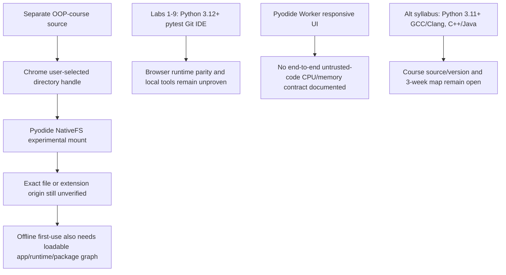

# RES — OOP_20261014-215543_INIT: Исследование INIT, итерация 2

> **Date**: 2026-10-14
> **Author**: Codex
> **Status**: ✅ RES — Complete (iteration 2; Coordinator continuation decision pending)
> **Parent HL**: [HL-OOP_20261014-215543_INIT.md](../../HL-OOP_20261014-215543_INIT.md) _(pipeline)_
> **Mode**: Pipeline / focused
> **Producer unit**: `codex:thread:local:01a13b5e-61b2-7df3-93b1-3dcc6579acb9`
> **Parent Coordinator**: `codex:thread:local:01a13b48-ed98-7631-85cb-e7691c6a01b3`
> **Activation / dispatch source**: `journal/20261014-233141__dispatch__e8ca.md @ a3508fdcc064a0d0d9b28df4a19d3609856c5827`
> **Coordination authority**: `HL-OOP_20261014-215543_INIT.md @ 353e1f31f82bb18d5c4dc59473e3ecee820c5b20`
> **Originating proposer**: `{principal: roman, unit: owner:roman}`

---

## Research Context

Focused iteration 2 examined H1, H2, and H5: whether Chrome can access the separate `OOP-course/` directory under the offline core requirement, whether a fully local Python/code-checking path carries documented safety/resource guarantees, and which local development requirements the supplied coursework actually states. Primary sources document a Chrome File System Access API directory handle that Pyodide can mount through its experimental NativeFS adapter; this advances the file-access hypothesis but leaves exact launch-origin and offline-first-load behavior unverified. All remaining Russian laboratory PDFs state Python 3.12+, pytest, Git, and a Python IDE; the alternate syllabus states Python 3.11+, C/C++ compilers, and a wider multi-language toolchain. No stack, runner, safety, persistence, assessment, or syllabus choice was made, and no app/runtime or course file was built, changed, or tested.

## Briefing

See [1_briefing.md](1_briefing.md). It cites committed dispatch `@ a3508fdcc064a0d0d9b28df4a19d3609856c5827` and predecessor iteration-1 RES `@ 60abca1d48bc39e431628116b2e915b5d6d229ae`; it carries the offline/local/no-OOPoman-account owner boundary and bounded scope H1/H2/H5.

## Decisions

| # | Decision | Rationale |
|---|---|---|
| D1 | No new product or owner decision was made in iteration 2; the owner decisions D1–D5 in iteration-1 RES remain the current recorded decisions. | Researcher authority covers evidence and classification, not a stack/runner/safety/syllabus choice. |
| D2 | The documented Chrome NativeFS route is recorded as a conditional technical possibility, not a selected solution or compatibility claim. | Pyodide documentation calls NativeFS experimental; exact `file://` and `chrome-extension://` behavior and offline entry loading remain untested. |

## Open Questions

| # | Question | Status | Answer |
|---|---|---|---|
| Q1 | Does the exact target Chrome support `showDirectoryPicker()` and Pyodide `mountNativeFS()` from the authorized local `file://` or extension launch context? | Open technical gap | Standards and API docs establish the ingredients but not this complete origin combination; no runtime/browser experiment was performed. |
| Q2 | Can the core entry page, JS modules, WASM/data files, and exact required package set load on the first offline launch? | Open technical gap | Bundle guides describe packaging runtime/wheels for offline use; they do not prove `file://` module loading or an actual offline launch. |
| Q3 | What execution model, if any, safely handles arbitrary student code with meaningful CPU/memory limits? | Open; owner-reserved safety | Worker responsiveness, WebAssembly, and extension sandboxing have documented uses, but reviewed primary sources do not establish a complete untrusted-code contract with hard resource ceilings. |
| Q4 | Which syllabus/toolchain source governs the requested course? | Open content authority | Labs 1–9 state Python 3.12+, pytest, Git, and VS Code/PyCharm; alternate `RF__syllabus_OOP.pdf` says Python 3.11+, GCC/Clang, Git, and IDE choices spanning Python/C++/Java. |
| Q5 | How do the 38 PDFs map to the requested three-week sequence, and which documented lab operations are expected to be automated in-site? | Open content/assessment scope | Local tools and one command-line simulator are identified; content ordering and the boundary between browser support and learner-installed tools remain unreviewed. |

External reference links may require Internet and third-party account/auth requirements remain outside the OOPoman product boundary, per owner decisions in iteration-1 RES; neither is reopened here.

## Hypotheses (from HL §10)

| # | Hypothesis | HL Status | RES Status | Evidence |
|---|---|---|---|---|
| H1 | A browser-local site can deliver the requested learning flow without a project-owned server or database, but the exact way it loads owner-provided course files may constrain packaging. | open | Partially supported: Chrome directory-handle access and Pyodide NativeFS form a documented possible route; origin, cold-offline loading, and end-to-end use remain open. | Gather G1–G2; Extract 1–4; Challenge C1–C3. Chrome File System Access user gesture/secure context, W3C `file:` trust allowance, WHATWG file-origin implementation details, and Pyodide's experimental `mountNativeFS`/local file fetch limits. |
| H2 | Multi-stage code checks can run locally in a browser only with explicit isolation and resource limits; an ordinary same-page evaluator is insufficient for untrusted code. | open | Not established: browser Python execution is technically documented, but reviewed sources do not supply a complete safety contract or hard CPU/memory limits. | Gather G3; Extract 6; Challenge C4. Pyodide Worker separates UI thread and Pyodide exposes Web APIs through JS/Python FFI; Chrome sandbox pages separate origin/restrict extension APIs. These are distinct properties. |
| H5 | Content in a separate root `OOP-course/` directory can remain distinct from application code and still support clear lesson and week gating. | open | Partially supported for separation/access; curriculum mapping and three-week gating remain unverified. | Gather G1/G4–G5; Extract 1–5; Challenge C1–C2/C5. File handles/NativeFS support selected-folder access; 38 PDFs inventoried and 8 remaining Russian labs' local environment fields extracted; no full content map or app test. |

## Findings

### F1 — User-selected directory handles provide a conditional bridge to the separate source tree

Chrome documents `showDirectoryPicker()` returning a handle after a user gesture in a secure context. Pyodide's accessing-files guide documents acquiring such a handle in Chrome and mounting the directory into the Python virtual filesystem using `mountNativeFS()`. This is materially stronger than the first iteration's “folder path unknown” result: a documented capability path exists without bundling course files into application code. The Pyodide page calls NativeFS experimental. W3C says `file:` should generally be treated as potentially trustworthy but expressly allows user agents to exclude it; URL Standard delegates `file:` origin behavior. Neither source proves the picker and mount sequence from the specific `file://` or extension context in this project. [Chrome File System Access API](https://developer.chrome.com/docs/capabilities/web-apis/file-system-access?hl=en), [Pyodide accessing files](https://pyodide.org/en/stable/usage/accessing-files.html), [W3C Secure Contexts](https://www.w3.org/TR/secure-contexts/), [WHATWG URL Standard](https://url.spec.whatwg.org/#origin)

### F2 — The extension file-URL switch does not itself authorize the sibling course directory

Chrome describes the “Allow access to file URLs” setting as allowing an extension to operate on `file://` pages. Extension resources are in the package; an extension sandbox is a unique origin without direct extension API access. Those documented permissions do not say that the extension can recursively open neighboring filesystem paths. A user-selected directory handle is a separate capability and remains subject to its own target-origin support. No extension or site was built to test the possible combination. [Chrome extension permissions](https://developer.chrome.com/docs/extensions/develop/concepts/declare-permissions), [Chrome extension sandbox](https://developer.chrome.com/docs/extensions/reference/manifest/sandbox), [Chrome extension resource packaging](https://developer.chrome.com/docs/extensions/reference/manifest/web-accessible-resources)

### F3 — Offline use requires a locally loadable entry graph plus a complete Python/package bundle

Pyodide browser setup loads runtime files and packages by URL. Official docs describe bundling Pyodide assets and explicitly copying the package wheels needed for offline use. Its FAQ says browser JS cannot `fetch()` arbitrary `file:///` data files due to same-origin rules; NativeFS is a distinct selected-handle route. Iteration 1 also found that PWA caching alone does not serve the first visit before a service worker has been installed. Therefore neither “folder picker works” nor “the runtime is cached later” proves a fully offline first launch from `file://`. Exact app module graph and tested package list must be resolved before claiming the owner's offline requirement is met. [Pyodide FAQ](https://pyodide.org/en/stable/usage/faq.html), [Pyodide package loading](https://pyodide.org/en/stable/usage/loading-packages.html), [Pyodide bundler guidance](https://pyodide.org/en/latest/usage/working-with-bundlers.html), [Chrome PWA offline guidance](https://developer.chrome.com/docs/lighthouse/pwa/works-offline?hl=en)

### F4 — The runner mechanisms document different controls, not an end-to-end safety guarantee

Pyodide supports browser Python and Workers to avoid blocking the UI; its project overview describes a JS/Python FFI and access to browser Web APIs. Chrome extension sandbox pages get unique-origin isolation and no extension APIs, but communicate with the privileged page through messages. The documentation reviewed here does not state that a Worker is a security boundary or that Pyodide/extension execution comes with a hard CPU or memory quota against adversarial student programs. A single-threaded worker, a unique origin, permission restriction, and a resource limit solve different problems. H2 remains open and safety remains with the owner. [Pyodide workers](https://pyodide.org/en/stable/usage/webworker.html), [Pyodide overview](https://github.com/pyodide/pyodide), [Chrome extension sandbox](https://developer.chrome.com/docs/extensions/reference/manifest/sandbox), [Chrome extension security](https://developer.chrome.com/docs/extensions/develop/security-privacy/stay-secure)

### F5 — Lab tasks assume a local Python project environment

All eight remaining Russian labs (Labs 2–9) explicitly list Python 3.12+, pytest, Git, and VS Code/PyCharm; Lab 9 specifies `python presentation/simulator.py`, `pytest tests/ -v`, and Git commit links. With iteration-1 Lab 1, this documents a consistent lab environment expectation. It does not say that those tools are bundled in the site, nor that browser Python can meet the exact CPython/Pytest behavior. The alternate syllabus `RF__syllabus_OOP.pdf` gives Python 3.11+, GCC/Clang, Git, and IDEs for Python/C++/Java while the sampled course labs focus on Python. This unresolved source/version mismatch should be carried forward, not silently reconciled. No GitHub-account requirement is raised as a product decision; owner already put third-party account needs outside website scope.

### F6 — A browser-only course mode and a course-compatible runner are distinct questions

Course reading/lesson delivery can keep `OOP-course/` separate and rely on user-selected file access; automated in-site checks would additionally require a compatible Python 3.12+ and pytest set, local package distribution, and a safety boundary. Alternatively, learner-managed local tools fit the lab instructions but do not provide automatic in-site checks. The evidence exposes this separation but does not select which operations the site must automate or rewrite course tasks.

## HL Update Recommendations

> Researcher classifies; Coordinator applies or escalates. No frozen HL section was changed.

### Refinements — free sections, coordinator applies

| # | § | What to update | Source |
|---|---|---|---|
| R1 | §7.2 Knowledge Citations | Add Chrome File System Access/extension permissions and Pyodide NativeFS/package/runtime docs as primary references for the next planning/verification step; retain source epoch and conditional scope. | Findings F1–F4; stage sources and links in this RES. |
| R2 | §2 Current State | Record that Labs 1–9 list Python 3.12+, pytest, Git, and VS Code/PyCharm; Lab 9 also has a local command-line simulator, and the alternate syllabus lists Python 3.11+, GCC/Clang and a broader language set. State that the 3-week mapping/version authority is unresolved. | Finding F5; inspected `OOP-course/02_Лабораторные/Лабораторная_02`–`09` and `00_Силлабус/RF__syllabus_OOP.pdf`; Lab 1 ref in iteration-1 RES. |
| R3 | §8 Dependencies | Add the need to validate exact launch-origin FSA/NativeFS behavior and make app entry/runtime/WASM/required packages available offline on first use. Preserve uncertainty for `file://` and extension pages. | Findings F1–F3; Chrome FSA, W3C Secure Contexts, Pyodide docs. |
| R4 | §9 Risks | Record that extension `file://` access is not a sibling-directory filesystem grant; Worker responsiveness/unique sandbox origin do not prove hard resource control for untrusted code. | Findings F2/F4; Chrome extension docs and Pyodide overview. |
| R5 | §10 Research Case | Replace only the research blind spot for course-folder access with the conditional NativeFS capability; preserve exact-origin/offline/runner safety and syllabus-scope gaps as hypotheses to verify. | Findings F1–F6; focused iteration 2 evidence. |
| R6 | §11 Open Questions | Carry Q1–Q5 from this RES: exact origin; offline cold launch/package set; runner resource safety; syllabus authority; three-week content mapping/automation boundary. | Current open questions Q1–Q5. |

### Amendment Proposals — frozen sections, resolved-ruler verdict required

**No amendment proposals.** No new owner requirement or frozen-section change is proposed in iteration 2; D1–D5 and A1–A2 from iteration 1 are unchanged.

## Fact Candidates

No new human-only fact candidates. This iteration added technical-source and course-file observations, not new owner statements; prior owner decisions remain cited in iteration-1 RES.

## Strategic Insights (Research)

No new strategic insights. No new human-provided course/product context was added in this iteration.

## Findings Map



## Iteration Status

- **Iteration:** 2 of 2 (min) / 3 (max)
- **Hypotheses tested:** H1 (partially supported; NativeFS possibility documented), H2 (not established; safety/resource guarantees missing), H5 (partially supported; source separation is feasible, curriculum map remains open).
- **Hypotheses deferred:** H3 and H4 are outside this iteration's authorized hypothesis set. No implementation or Chrome experiment was conducted.
- **Gaps discovered:** Exact target-origin picker/NativeFS behavior; first-launch offline asset load; Pyodide/Python 3.12+/pytest compatibility and local package set; safety and hard resource limits for untrusted code; syllabus/version authority; three-week mapping and in-site automation scope.
- **Superseded decisions:** None.

### Open Threads (for next iteration or `/tfw-plan`)

| # | Thread | Why it matters | Suggested focus |
|---|---|---|---|
| 1 | Establish whether FSA/NativeFS works from each candidate Chrome origin and on first disconnected launch. | H1 remains conditional and this can change whether course files can stay separate without violating offline use. | If Coordinator authorizes iteration 3, check current Chrome-primary documentation and a disposable, non-product probe only if permitted; do not build the app/extension. |
| 2 | Resolve the required safety level and whether in-browser execution is in the intended product boundary. | No reviewed source gives a complete adversarial-code/resource-limit guarantee; this is an owner decision. | Route the safety question to Roman or carry it to `/tfw-plan`; do not infer that WebAssembly/Worker alone is safe. |
| 3 | Confirm governing syllabus and map selected labs into three weeks. | Alternate syllabus and lab version/runtime statements differ, and no schedule map was reviewed. | Resolve source authority and course scope before content planning; no PDF edits made. |

### Recommendation

- [ ] **SUFFICIENT** — proceed to `/tfw-plan` to classify these recommendations and write TS
- [x] **MORE NEEDED** — consider the permitted third iteration only if Coordinator judges exact-origin/offline launch or the H2 safety gap can be narrowed without making an owner-reserved decision; the sampled docs do not close either planning risk.
- [ ] **BLOCKED** — no blocker

> Coordinator decides whether to continue or proceed. Researcher recommends but does NOT decide.

## Conclusion

Iteration 2 found a concrete but experimental route for a user-selected Chrome directory to be mounted into Pyodide, so access to separate course files is no longer an entirely undocumented possibility. It also found that extension file-URL permission is not itself a grant to a sibling folder, that offline browser Python needs a complete local entry/runtime/package set, and that the available Worker/sandbox documents do not establish safe untrusted-code execution with hard CPU/memory limits. Labs 1–9 assume a local Python 3.12+/pytest/Git/IDE environment, while an alternate syllabus lists Python 3.11+ and C/C++ tooling; the 3-week mapping remains unresolved. No product decision or implementation was made. Self-critique: the Gather stage exceeded the soft five-query cap (seven search queries); course review was bounded to 13 of 35 not previously inspected PDFs, with keyword-oriented extraction rather than a full pedagogical review.

### Material handover at this return

- **Producer/unit:** Researcher `codex:thread:local:01a13b5e-61b2-7df3-93b1-3dcc6579acb9`; parent Coordinator `codex:thread:local:01a13b48-ed98-7631-85cb-e7691c6a01b3`.
- **Source/epoch:** committed dispatch `journal/20261014-233141__dispatch__e8ca.md @ a3508fdcc064a0d0d9b28df4a19d3609856c5827`; coordination authority `HL-OOP_20261014-215543_INIT.md @ 353e1f31f82bb18d5c4dc59473e3ecee820c5b20`; predecessor RES `research/iter1/RES.md @ 60abca1d48bc39e431628116b2e915b5d6d229ae`.
- **Inspected scope:** Required current status/dispatch/iterations/HL and predecessor RES; `.tfw` research contract, focused mode, templates and selected convention headings; `KNOWLEDGE.md` (no project architecture decisions/qualified records); `OOP-course/` inventory; 13 PDFs (alternate syllabus, Russian Labs 2–9 and RF Labs 2–5), plus prior iteration's syllabus/Lecture 1/Lab 1; Chrome/W3C/WHATWG/Pyodide primary docs. Knowledge handover: P0 NorthStar, P1 TFW NS1/NS2/Success, P2 no philosophy input, P3 architecture map empty, P4 frozen HL contract; no new record created.
- **Material:** conditional NativeFS path and target-origin/offline constraints; distinction between responsiveness, origin isolation, and resource safety; repeated lab environment and syllabus mismatch; open questions and recommendation above.
- **Uncertainty:** no app/extension or disposable browser proof; no test of actual Chrome picker/origin support, offline cold launch, Pyodide Python/pytest compatibility, or malicious code. The selected stage PDFs were text-extracted for explicit tool/runtime references; they were not a complete pedagogical review.
- **Continuation:** Coordinator alone updates `iterations.yaml` and decides whether an authorized iteration 3 is warranted. Researcher did not modify task control, status, config, frozen HL, course PDFs, or implementation.

## TRACE: Task economics

Numeric v1 capture collected and validated with `.tfw/economics/tfw_economics.py` (`tfw-economics/1.3`). This successor continues the same Researcher unit's exact Codex rollout without overlap: previous capture hash `c3dd15000fc0882a60093c1faa3e7a18c39f217558862997ff548817ac36c1c4`, source lines `[1850,2161)`, revision 2, complete through the finite cutoff. Capture file SHA-256 `dd0a28f4c3d4bdb030abeb05550f4d65bf6ea1c6c0cd9a475f5a34187a4d70de` (2 UTF-8 JSONL lines, final newline); bound source SHA-256 `9e4104d75125cbe92c52c6ff8b41b4cbc207ff5dcc583bd7ab0bdf9e860d91b9`, size 7,246,234 bytes. Captured at/cutoff `2026-10-14T18:42:51.709917+00:00` (`2026-10-14 23:42:51.709917`, task timezone `+05:00`). The token aggregate contains 39 verified unique response records: total 3,583,612 (fresh 147,297; cached 3,404,032; output 32,283; reasoning subset 13,307). No completed-turn duration row was available in this range; the collector also reported one completed turn without a usage row and two unmatched `task_started` events. Cumulative `token_count` total (25,095,160) differed from unique-response native total (25,722,893), so the extractor retained the response stream reconciled to its native thread counter and did not add the two streams. No cost or rate is asserted.

```jsonl
{"captured_at":"2026-10-14T18:42:51.709917+00:00","collector":"tfw-economics/1.3","complete":true,"coordination_mode":"native-gates","cutoff":"2026-10-14T18:42:51.709917+00:00","extensions":{"tfw.diagnostics":["completed turn without a measured usage row","Codex token_count total 25095160 differs from 232 unique-response native thread total 25722893; chose response stream reconciled to its native thread counter, never added both","unmatched task_started: 2","compacted 39 verified native rows into 1 daily/run/model records"],"tfw.includes_sources":[],"tfw.predecessor_source_prefix_sha256":null},"kind":"manifest","operation_seconds":0.235,"owner":"roman","phase":"iteration-2","predecessor_sha256":"c3dd15000fc0882a60093c1faa3e7a18c39f217558862997ff548817ac36c1c4","project":"OOPoman","range_end":2161,"range_start":1850,"revision":2,"role":"researcher","schema_version":1,"source_id":"01a13b5e-61b2-7df3-93b1-3dcc6579acb9","source_label":"Codex local rollout","source_namespace":"codex.rollout","source_sha256":"9e4104d75125cbe92c52c6ff8b41b4cbc207ff5dcc583bd7ab0bdf9e860d91b9","source_size":7246234,"source_version":"0.162.0-alpha.17.2","task":"OOP_20261014-215543_INIT","tfw_version":"3.9.2","timezone":"+05:00","unavailable":{},"unit":"codex:thread:local:01a13b5e-61b2-7df3-93b1-3dcc6579acb9"}
{"consumption_date":"2026-10-14","duration_kind":null,"duration_seconds":null,"effort":"medium","event_id":"aggregate:b87cd7b9963d941cd0e97e30:tokens","extensions":{"tfw.aggregate_kind":"tokens","tfw.native_event_count":39,"tfw.native_ids_sha256":"b87cd7b9963d941cd0e97e30ff76cda51f80aa96cebf739106d3c323e380e9b4"},"kind":"usage","model":"gpt-6-luna","observed_at":"2026-10-14T18:42:48.493Z","schema_version":1,"source_index":1857,"timezone":"+05:00","tokens":{"cache_write":0,"cache_write_1h":0,"cache_write_5m":0,"cached":3404032,"fresh":147297,"input":3551329,"output":32283,"reasoning":13307,"total":3583612},"unavailable":{"duration_seconds":"duration reported separately at proved native granularity"}}
```

---

*RES — OOP_20261014-215543_INIT: Исследование INIT, итерация 2 | 2026-10-14*
