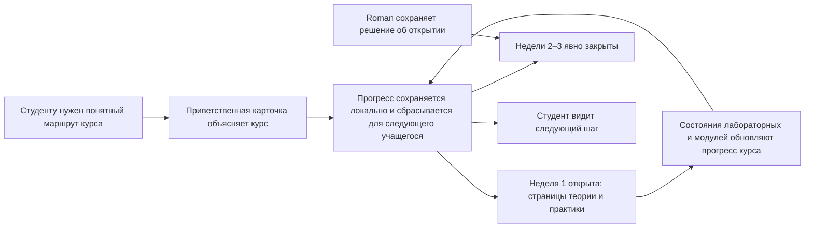

# HL — OOP_20261015-164702_WEB: Каркас сайта OOPoman

> **Дата**: 2026-10-15
> **Автор**: Coordinator
> **Название**: Каркас сайта OOPoman
> **Аббревиатура**: WEB
> **Статус**: 🔬 RES — мастер-контракт заморожен; следующий этап — исследование
> **Контракт**: 🔒 FROZEN — approved by Roman 2026-10-15
> **Замораживаются после утверждения**: §1 · §3 · §4 · §5 · §6 · §7
> **Остаются свободными**: §2 · §7.2 · §8 · §9 · §10 · §11 — эти разделы Research может обновлять напрямую
> **Только добавление**: §12 «Журнал поправок» — единственный способ изменить замороженный раздел
> **Базовая версия**: freeze-коммиты этой задачи; форма восстановления описана в `.tfw/conventions.md` §3, правило 15
> **North Star проекта**: [NorthStar.md](../../../NorthStar.md), разделы Purpose · Learner experience · Product boundaries · Success

---

## 1. Vision / Видение 🔒 FROZEN

У OOPoman есть понятный и приветливый локальный каркас курса. Студент второго курса может увидеть маршрут на три недели, понять, что уже доступно, и найти структуру страниц открытой недели. Сайт сохраняет прогресс учащегося в локальном профиле Google Chrome, показывает его по каждой лабораторной работе и по модулям курса, а со страницы прогресса можно сбросить его для следующего учащегося после обычного подтверждения. Для этого не нужны регистрация или вход. В отдельных задачах Roman сможет добавлять материалы из PDF, квизы и практику, сохраняя за собой решение об открытии следующих недель и не предрешая правила оценивания.

**Ценность:** студент понимает, с чего начать, видит следующий шаг и может продолжить обучение с сохранённым прогрессом. Roman получает небольшой и понятный каркас сайта, который можно развивать, не меняя исходные PDF и не выбирая преждевременно способ запуска или правила выставления баллов.

> **Представленная цитата студента:** «Я вижу, что уже прошёл в каждой лабораторной, насколько продвинулся по курсу, и могу очистить прогресс для следующего человека».

## 2. Текущее состояние (As-Is) 🟢 FREE

- INIT завершён (`workspace/2026/OOP_20261014-215543_INIT/status.md`, `lifecycle: DONE`). Его RF и две итерации RES указывают, что сайт, стек приложения, локальный способ запуска, сохранение баллов и безопасная среда выполнения кода ещё не выбраны и не реализованы.
- В `OOP-course/` находятся 38 исходных PDF. Исследователь INIT изучил ограниченную выборку; материалы ещё не сопоставлены с полной программой трёх недель. В источниках используются разные версии Python и наборы инструментов. PDF остаются исходными материалами и не изменяются.
- `NorthStar.md` задаёт локальный режим работы, Google Chrome, отсутствие учётных записей, собственного сервера, развёртывания, длительность курса в три недели и общий максимум в 500 баллов. Там пока не определены распределение практических баллов, учёт экзамена, сохранение баллов, проверка кода и архитектура приложения. Roman решил сохранять прогресс в профиле Chrome без регистрации и входа; конкретный браузерный механизм и его поведение при выбранном локальном запуске требуют исследования.
- `architecture/context.puml` — начальная контекстная схема, а не утверждённая архитектура приложения. В конфигурации проекта нет выбранного runtime приложения или команд сборки и тестирования.
- В рамках этой задачи Roman поручил подготовить структуру страниц первой недели и оставить области контента пустыми. Материалы из PDF, квизы и практика относятся к отдельным будущим задачам, которые начнёт Roman. Недели 2 и 3 в этой задаче остаются закрытыми; открытие и наполнение будут выполнены только в будущих задачах Roman.
- Прогресс учащегося должен сохраняться в локальном профиле Chrome, сбрасываться с экрана прогресса после стандартного подтверждения, отображаться для каждой лабораторной и суммироваться по модулям. Регистрация и вход не используются. Открытие пустой страницы лабораторной автоматически переводит её в состояние «просмотрена/начата». Завершение не отмечается, пока не появится реальный квиз или практическое задание и учащийся его не выполнит. Точный браузерный механизм хранения и его работа при выбранном локальном запуске требуют исследования; сохранение баллов и правила оценивания — отдельные нерешённые вопросы.

## 3. Целевое состояние (To-Be) 🔒 FROZEN

**Было → станет:** проект с исходными PDF, но без сайта и утверждённого стека → удобный локальный каркас курса с приветствием, понятной навигацией и тремя модулями-неделями, существующими в общем прогрессе с самого начала. Первая неделя открыта, две следующие закрыты. В каркасе есть пустые области для теории и практики; прогресс по лабораторным и трём модулям сохраняется в профиле Chrome и сбрасывается прямо со страницы прогресса после подтверждения. PDF не изменяются; правила начисления баллов не выдумываются.

### 3.1. Визуализация результата

Пример экрана первой итерации. Содержание страниц и количество лабораторных пока условные и уточнятся после сопоставления PDF с программой курса. Отображение баллов зависит от утверждённых правил оценивания.

```text
OOPoman                          Прогресс курса: 0 / 3 модулей завершено
┌─────────────────────────────────────────────────────────────────────┐
│ ООП за 3 недели                                                     │
│ Лекция · практика · домашнее задание — маршрут курса                │
│ [Перейти к неделе 1]                                                │
└─────────────────────────────────────────────────────────────────────┘

Маршрут курса
  1 · Неделя 1       Открыта       Теория → Практика → Домашнее задание
     Лабораторная 1                 Просмотрена/начата
     Лабораторная 2                 Не начата
  2 · Неделя 2       Закрыта       Материалы появятся в будущей задаче
  3 · Неделя 3       Закрыта       Материалы появятся в будущей задаче

Прогресс первой недели: 0 / N лабораторных завершено
[Сбросить прогресс для следующего учащегося]
Баллы: отображаются только по утверждённым правилам оценивания
```

| Сейчас | Предлагаемый результат | Польза для учащегося |
|---|---|---|
| Нет сайта и навигации; исходные PDF отделены от кода приложения. | Каркас первой недели содержит приветствие, маршрут, пустые области для контента и закрытые будущие недели. | Студент понимает, с чего начать; сайт не выдумывает содержание курса. |
| Прогресс ещё не реализован. | Прогресс лабораторных и трёх модулей-недель сохраняется в профиле Chrome. Кнопка на странице прогресса запускает обычное подтверждение сброса. Закрытые недели сразу входят в знаменатель как незавершённые; баллы показываются только по утверждённым правилам. | Учащийся видит общий итог курса и может продолжить обучение или очистить прогресс без перехода в настройки; неподтверждённые баллы и критерии не появляются. |

### 3.2. Поток ценности



## 4. Этапы 🔒 FROZEN

Для первой итерации предлагается один этап: навигационный локальный каркас курса. Он остаётся единым, пока ценная для пользователя часть ограничена небольшим интерфейсом и маршрутом. Делить его следует только в том случае, если утверждённый владельцем объём или требования к доказательствам окажутся слишком велики для одного цикла выполнения.

### 4.1. Выбор координации 🔒 FROZEN

| Источник активации | Ответственный владелец | Задача Coordinator | Правило для Phase Coordinator | Объём мандата и роли | Маршрут возврата | Диалог | Отчётность | Резервы и ограничения | Полномочие на поправки | Неизменяемый источник |
|---|---|---|---|---|---|---|---|---|---|---|
| owner-direct | Roman (`roman`) | `codex:thread:local:01a13f5a-13e0-72d3-a394-b2054fc7c90f` | Для одного этапа не нужен. | Текущий Coordinator планирует и координирует задачу. Roman создаёт или запускает отдельные ролевые задачи на соответствующих gates; эта запись не активирует роли. | `owner:roman` | `tfw-gates-only` | `native-gates` | Roman утверждает замороженный HL, точный TS и итоговую приёмку. Преобразование PDF, открытие недель 2–3, объём и распределение баллов, экзамен, сохранение баллов, безопасное выполнение кода и расширение объёма зарезервированы для отдельного решения Roman. Требования сохранять и сбрасывать прогресс заданы владельцем. Roman разрешил отдельный worktree для WEB; принятые коммиты нужно перенести в основную локальную историю fast-forward без merge-коммита, после чего Roman сможет отправить их в GitHub. Каждый возвращающийся участник привязывает замер экономики к собственному точному источнику и диапазону этой задачи; недоступные счётчики указываются с конкретной причиной, без нулей и оценок. | `none` | `../../../TRACE.md @ eafde5305449618cf081dda08d26992ce9cbea9c` |

### Этап A. Локальный каркас курса 🔴

- Создать приветствие, маршрут на три недели, структуру страниц теории и практики первой недели с пустыми областями для контента, а также сохраняемые в профиле Chrome и сбрасываемые состояния прогресса по лабораторным и трём модулям-неделям.
- Неделя 1 открыта по умолчанию; недели 2 и 3 закрыты, пока Roman явно не решит их открыть.
- Все три недели заведены как модули в общем прогрессе с самого начала. Закрытые и ещё не наполненные недели учитываются как незавершённые; знаменатель курса остаётся равен трём. Модуль становится завершённым, когда выполнены его реальные лабораторные задания.
- Не изменять исходные PDF из `OOP-course/`. Преобразование материалов, квизов и практики выполняется в будущих задачах Roman и не входит в TS этой задачи.
- Общий прогресс с самого начала охватывает три модуля, соответствующие трём неделям курса. Закрытые недели входят в знаменатель как незавершённые; добавление контента не меняет знаменатель. Не придумывать количество ещё не сопоставленных лабораторных внутри недель.
- Разместить действие сброса на экране прогресса, без перехода в настройки. После нажатия показывать обычное подтверждение с действиями «Отмена» и «Сбросить»; по подтверждению очищать локально сохранённый прогресс, без регистрации или входа.
- Диаграммы хранить в `architecture/`; обновлять UML только после определения утверждённой структуры приложения.
- Не добавлять в эту итерацию выполнение произвольного кода учащихся, полную логику оценивания или итоговый экзамен, если Roman отдельно не утвердит расширение объёма.

## 5. Критерии готовности (DoD) 🔒 FROZEN

- ✅ 1. По приветственному экрану студент понимает цель курса и с чего начать.
- ✅ 2. Маршрут показывает три недели; первая открыта, недели 2–3 недоступны до явного решения Roman.
- ✅ 3. Для первой недели созданы отдельные структуры страниц теории и практики с пустыми областями для будущего утверждённого контента.
- ✅ 4. Прогресс сохраняется между запусками в профиле Chrome без регистрации и входа; действие сброса доступно прямо на экране прогресса и требует обычного подтверждения. Прогресс виден по каждой лабораторной и суммируется по трём модулям-неделям с самого начала; закрытые недели учитываются как незавершённые. Открытие пустой лабораторной отмечает её как «просмотрена/начата»; завершение модуля отмечается после выполнения его реальных лабораторных заданий, а отдельной лабораторной — по фактически выполненному квизу или практике.
- ✅ 5. Раздел прогресса и баллов сообщает только подтверждённые сведения и не выдумывает распределение практических баллов, знаменатель шкалы, сохранение баллов или учёт экзамена.
- ✅ 6. Результат работает в утверждённом локальном режиме Google Chrome и офлайн, без собственного сервера, базы данных, регистрации, аутентификации или развёртывания.
- ✅ 7. Исходные PDF не меняются; по файлам приложения можно переходить, UML хранится в `architecture/`.
- ✅ 8. Независимый Reviewer может проверить зафиксированный результат и доказательства на соответствие утверждённому TS и North Star.

## 6. Критерии неудачи (DoF) 🔒 FROZEN

- ❌ 1. Для основной локальной работы каркасу нужен собственный сервер, учётная запись или развёртывание.
- ❌ 2. Неделя 2 или 3 показана открытой без явного решения Roman.
- ❌ 3. Интерфейс незаметно вводит баллы, веса практики, баллы экзамена или сохранение оценок, которые Roman не утверждал; либо не сохраняет и не сбрасывает прогресс по его требованиям.
- ❌ 4. Исходные PDF изменены или лабораторные превращены в интерактивные задания вне утверждённого объёма.
- ❌ 5. Произвольный код учащихся выполняется без отдельно утверждённого и проверенного решения по безопасности.
- ❌ 6. Реализация началась до утверждения владельцем HL и точного TS.

**При неудаче:** остановить затронутую работу, сохранить её следы и вернуть конкретное решение по зафиксированному маршруту TFW.

## 7. Принципы 🔒 FROZEN

1. **Понятный следующий шаг** — навигация ясно показывает последовательность и доступность материалов.
2. **Локальное сохранение прогресса** — сохранять прогресс в профиле Chrome без сервера OOPoman, регистрации или входа; сброс доступен на экране прогресса и защищён обычным подтверждением.
3. **Открытие недель решает владелец** — эта задача открывает только первую неделю; открытие и наполнение следующих недель относятся к будущим задачам Roman.
4. **Сохранность исходных материалов** — не менять предоставленные материалы курса; оставить области контента пустыми до отдельной утверждённой задачи по преобразованию.
5. **Прозрачные правила баллов** — показывать утверждённые правила, не придумывая отсутствующее распределение баллов и учёт оценивания.
6. **Соразмерная структура** — использовать только необходимую для этой итерации архитектуру и интерфейс, сохраняя возможность понятного продолжения работы.

### 7.2. Ссылки на знания 🟢 FREE

| № | Источник | Раздел | Применение |
|---|---|---|---|
| P0 | [NorthStar.md](../../../NorthStar.md) | Purpose; Learner experience; Product boundaries; Success | Определяет ценность локального обучения, аудиторию, формат на три недели и границы проекта. Более позднее решение Roman в `TRACE.md` устанавливает сохранение и сброс прогресса; открытым остаётся только сохранение баллов. После утверждения направления соответствующий пункт North Star нужно обновить через `/tfw-docs`. |
| P1 | [.tfw/README.md](../../../.tfw/README.md#ns1--purpose) | NS1 — Purpose | Работа должна приносить пользу и допускать продолжение; понятный каркас сохраняет полномочия владельца и проверяемое состояние проекта. |
| P1 | [.tfw/README.md](../../../.tfw/README.md#ns2--principles) | NS2 — Principles | Уточнять значимую неопределённость, сохранять необходимые следы, ограничивать роли и соразмерять проверку риску реализации. |
| P2 | `knowledge/philosophy.md` | Отсутствует | В проекте нет отдельного документа с философией, который задавал бы принципы этого продукта. |
| P3 | [KNOWLEDGE.md](../../../KNOWLEDGE.md) §1 «Карта архитектуры» | Компоненты и архитектурные решения не зарегистрированы | `architecture/context.puml` считать только контекстной схемой; не выводить из неё стек приложения. |
| P4 | [.tfw/conventions.md](../../../.tfw/conventions.md#hl-contract) | Контракт HL | Сохранять различие между черновиком и утверждённой базовой версией; после утверждения менять замороженные разделы только через gate поправки. |
| RES-1 | [RES iteration 1](research/iter1/RES.md): [Chrome — Load unpacked](https://developer.chrome.com/docs/extensions/get-started/tutorial/hello-world), [`chrome.storage`](https://developer.chrome.com/docs/extensions/reference/api/storage), [file URL permissions](https://developer.chrome.com/docs/extensions/develop/concepts/declare-permissions), [extension CSP](https://developer.chrome.com/docs/extensions/reference/manifest/content-security-policy), [WHATWG Web Storage](https://html.spec.whatwg.org/multipage/webstorage.html#the-localstorage-attribute), [WHATWG URL Origin](https://url.spec.whatwg.org/#origin) | Gather–Challenge, H1/H2 | Уточняют официальные ограничения запуска, storage и permissions; это свойства платформы, не доказательство поведения пакета OOPoman. Шесть конфигураций остаются кандидатами до прототипной проверки. |
| RES-2 | [RES iteration 2](research/iter2/RES.md) и её Briefing, Gather, Extract, Challenge | H1/H2; протокол будущей проверки | Зафиксировать целевые Chrome build/profile/policy и локальные ресурсы; проверить холодный офлайн-запуск/перезапуск, same-profile сохранение, Cancel/Confirm по прогрессу и unrelated sentinel, точный PDF-путь. Для C4/C6 сначала пробовать навигацию без file URL grant; выдавать минимальный grant только если его требует выполнение расширения. Это будущий протокол, не подтверждение поведения OOPoman. |

## 8. Зависимости 🟢 FREE

| Зависимость | Состояние |
|---|---|
| Требования Roman к первой итерации, сохранению и сбросу прогресса, семантике завершения, знаменателю 3 модуля и доступности будущих недель | ✅ Зафиксированы в `TRACE.md` |
| Выводы INIT о Chrome, офлайн-запуске, локальных файлах и безопасности непроверенного кода | ✅ Изучены; неопределённость остаётся |
| Утверждённый объём каркаса и точный TS | ⬜ Нужны согласование HL и утверждение точного TS |
| Worktree и изоляция будущих меняющих файлы ролей | ✅ Roman разрешил worktree для WEB; сохранить линейную историю через fast-forward без merge-коммита |
| Хранение прогресса в профиле Chrome, отсутствие регистрации/входа и подтверждение сброса с экрана прогресса | ✅ Решено Roman; точный механизм хранения и поведение при выбранном офлайн-запуске требуют исследования |
| Правило завершения пустой страницы | ✅ Открытие отмечает «просмотрена/начата»; завершение откладывается до выполнения реального квиза или практики |
| Знаменатель баллов курса и практическая рубрика | ⬜ Требуется решение владельца; не включать в оценивание этой итерации |
| Незакрытый пункт North Star о сохранении прогресса | ⬜ Обновить через `/tfw-docs` после утверждения направления; неопределённость по сохранению баллов оставить |

## 9. Риски 🟢 FREE

| Риск | Вероятность | Влияние | Снижение риска |
|---|---|---|---|
| Ни один из шести кандидатов C1–C6 не проверен в целевом Chrome; первый холодный и повторный запуск OOPoman без сети не доказаны. | Средняя | Высокое | До заявлений об офлайн-работе применить протокол RES-2 к выбранному кандидату: записать целевые build/profile/policy и локальные ресурсы, затем получить наблюдения холодного запуска и перезапуска без сети. |
| Пустые области первой недели могут не дать студенту учиться до появления материалов. | Средняя | Среднее | Ясно обозначить заглушки; преобразование PDF, квизы и практику оставить будущим задачам Roman. |
| Сохранение и выборочный сброс прогресса в профиле Chrome не испытаны: для `file://` не подтверждено поведение `localStorage`/IndexedDB; для расширения `chrome.storage.local` документирован, но интерфейс «Отмена / Сбросить» и повторный запуск OOPoman не проверены. | Средняя | Высокое | Сохранить это как обязательные проверки прототипа; после обычного подтверждения удалять только ключи прогресса OOPoman. |
| Интерфейс расширения может не открыть PDF из `OOP-course/` без ручного разрешения file URLs; загрузка unpacked extension требует Developer mode. | Средняя | Среднее | Проверить минимальный путь установки, доступ к точным PDF и последствия разрешения в целевом профиле; не изменять исходные PDF. |
| Коммиты в изолированном worktree отделены от основной копии, пока результат не принят и не перенесён. | Средняя | Среднее | Зафиксировать принятый кандидат, перенести его fast-forward в основную локальную историю без merge-коммита, затем Roman сможет отправить его в GitHub. |

## 10. Основания для RESEARCH 🟢 FREE

### Неизвестные вопросы

- Не выбран локальный способ запуска, который поддерживает офлайн-работу в Chrome и доступ к отдельной папке с исходными материалами курса.
- Нужно выяснить, какой механизм Chrome хранит данные в профиле для выбранного локального источника страницы, сохраняются ли данные между запусками офлайн и как сбрасывать только данные OOPoman.
- Итерация 1 сохранила шесть конфигураций C1–C6. `chrome.storage.local` — наиболее документированный кандидат для extension; ни один вариант не доказал требуемое поведение OOPoman без прототипа.
- У unpacked extension требуется ручной первый setup через Developer mode; доступ к PDF как file URLs требует отдельного разрешения и не доказывает конечный просмотр в интерфейсе.
- Итерация 2 подготовила и оспорила протокол для C1–C6: целевые Chrome build/profile/policy, локальные ресурсы, полный офлайн-перезапуск, сравнение прогресса и unrelated sentinel до/после Cancel и Confirm, а также точный PDF-путь и необходимость минимального grant. Это не результаты испытания OOPoman.
- Области контента пусты намеренно; преобразование PDF в материалы, квизы и практику запланировано для будущих задач.
- Знаменатель общего прогресса задан: три недели считаются тремя модулями с самого начала, включая закрытые. Полного списка лабораторных внутри недель пока нет.
- Помимо заданных категорий общей шкалы, знаменатель баллов не утверждён. Безопасная модель выполнения кода в браузере также не определена.

### Гипотезы

| № | Гипотеза | Состояние |
|---|---|---|
| H1 | Минимальный локальный каркас может удовлетворить требованию офлайн-работы в Chrome без собственного сервера или HTTP-службы запуска. | открыта; документы подтверждают только локальные механизмы. RES-2 требует целевой build/profile, локальные ресурсы и холодный offline start/restart; поведение OOPoman не проверено. |
| H2 | Выбранный локальный источник страницы позволяет Chrome сохранять прогресс в профиле между офлайн-запусками и очищать только данные OOPoman без сервера и учётной записи. | открыта; RES-2 требует same-profile restart и проверки Cancel/Confirm по прогрессу и unrelated sentinel. Persistence и UI reset OOPoman не испытаны; `file://` storage не подтверждено. |

### Риски отказа от исследования

Если выбрать способ запуска или хранения по памяти, сайт может не запуститься офлайн или потерять прогресс. Эта задача не исследует и не реализует выполнение произвольного кода; для будущей задачи по среде выполнения потребуется отдельный анализ безопасности.

### Результат RESEARCH и оставшаяся проверка

Итерации 1–2 завершены; RES итерации 2 рекомендует `SUFFICIENT` для подготовки протокола. Третья исследовательская итерация не требуется. В будущей реализации и приёмке сохранить H1/H2 открытыми до выполнения протокола: зафиксировать целевые Windows/Chrome build, профиль и policy; перечислить локальные ресурсы; выполнить холодный запуск и перезапуск без сети; сравнить прогресс и unrelated sentinel до/после Cancel и Confirm; записать точный PDF-путь и необходимость минимального file URL grant. Анализ документации и подготовка протокола не заменяют эти наблюдения.

### Почему не сделать иначе?

| Вариант | Ценность | Стоимость и нагрузка | Риски и компромиссы | Решение и причина |
|---|---|---|---|---|
| **Каркас первой недели с сохраняемым прогрессом — рекомендуется** | Даёт студенту понятный маршрут, повторно используемые области для контента и видимый сохраняемый прогресс. | Небольшая структурная итерация; PDF-контент и оцениваемые активности появятся в будущих задачах Roman. | Пустые области ещё не образуют полноценный курс; способ локального хранения требует исследования. | Соответствует последовательности Roman, сохраняет исходники и не предрешает оценивание. |
| Сразу преобразовать PDF и создать все активности | Позволило бы быстрее получить наполненный курс первой недели. | Нужны сопоставление PDF с программой, преобразование, подготовка квизов и практики, а также утверждённый объём контента. | Можно случайно изменить исходники, добавить материалы будущих недель или смешать активности с неутверждёнными правилами оценивания. | Откладывается, поскольку Roman явно поручил сначала сделать каркас, а контент — отдельными будущими задачами. |

**Что останется без изменений:** у студентов по-прежнему не будет локального маршрута по сайту, а Roman не сможет посмотреть предполагаемый учебный процесс и состояния доступности.

**Критический вопрос:** каркас с пустыми областями сам по себе не обучает ООП. Он оправдан как первый результат, только если даёт надёжную навигацию и переиспользуемую модель прогресса, упрощая последующее добавление контента. Иначе будущие задачи по наполнению могут выявить необходимость переделать структуру.

## 11. Стратегические выводы (планирование) 🟢 FREE

| № | Вывод | Категория | Источник |
|---|---|---|---|
| S1 | Roman хочет, чтобы последовательность задач и ролей TFW объяснялась понятно, а сайт курса был доступен пониманию студента второго курса. | контекст процесса и продукта | Запрос владельца в этой задаче |
| S2 | Roman ожидает отдельный замер экономики для возврата каждой роли и хочет получать конкретное объяснение, если измерение недоступно. | рабочее предпочтение | Запрос владельца и `TRACE.md` |
| S3 | Сначала нужен каркас; затем в отдельных задачах PDF будут превращены в материалы сайта, квизы и практику. Прогресс хранится в профиле Chrome без входа, сбрасывается с экрана прогресса после обычного подтверждения; три недели считаются тремя модулями с самого начала. | последовательность продукта и контекст учащегося | Распоряжения владельца в `TRACE.md` и поправка A1 |

### Замер экономики этой задачи

**TRACE — исходный Coordinator, `binding_unavailable`** (`codex:thread:local:01a13f5a-13e0-72d3-a394-b2054fc7c90f`; задача `OOP_20261015-164702_WEB`; владелец `roman`; роль `coordinator`; Codex local task): до передачи не имел доступного адресуемого rollout-файла или ID источника. Исходная привязка и извлечение не выполнялись; измеренный ноль не заявлялся.

**TRACE — текущий Coordinator, `binding_unavailable`** (`codex:thread:local:01a142c4-8754-7c41-89cc-52429a51ac3b`; та же задача/владелец/роль/поверхность; наблюдение 2026-10-16): extraction attempted `false`. Доступный интерфейс идентифицирует рабочую единицу, но не показывает точный rollout `session_meta.id`, locator, версию источника или начало диапазона. ID задачи не подменяет ID источника; usage JSONL или измеренный ноль не заявляются, сессии других участников не читались. Следующие возвраты должны ссылаться на собственный точный источник и диапазон по `.tfw/economics/README.md`.

### Передача контекста по итогам этой работы

- **Передача Coordinator:** исходный Coordinator `codex:thread:local:01a13f5a-13e0-72d3-a394-b2054fc7c90f` передаёт задачу successor Coordinator `codex:thread:local:01a142c4-8754-7c41-89cc-52429a51ac3b` по распоряжению Roman в `../../../TRACE.md` от 2026-10-16. Новый чат прочитал task status и HL и подтвердил состояние `RES` и следующий исследовательский шаг.
- **Ответственный владелец и источник полномочий:** Roman; owner-only, `tfw-gates-only`, `native-gates`, `upstream_route: owner:roman`; immutable `coordination_authority` остаётся `../../../TRACE.md @ eafde5305449618cf081dda08d26992ce9cbea9c`.
- **Источник и версия задачи:** `OOP_20261015-164702_WEB`, актуальный commit перед передачей `9961239`.
- **Изученный материал:** `NorthStar.md`, `TRACE.md`, `README.md`, `KNOWLEDGE.md`, конфигурация проекта, контекстная UML-схема, status/HL/RF/REVIEW завершённой INIT и обе итерации RES, список исходных PDF, действующие требования TFW к планированию и чтению, выбранный профиль Coordinator.
- **Известные факты:** сайт, runtime и способ запуска не выбраны; 38 PDF остаются исходными материалами; эта итерация создаёт пустые области контента первой недели и сохраняемый/сбрасываемый прогресс. Открытие пустой лабораторной отмечает её как «просмотрена/начата»; завершение ожидает реальный квиз или практическое задание.
- **Неопределённость:** результаты будущего выполнения прототипа по H1/H2, целевые Chrome build/profile/policy, точный PDF-путь и необходимость grant; также стек и правила баллов.
- **Возврат Researcher:** iteration 1 `RES` сохранён в `research/iter1/RES.md` (commit `eef989f46c7314b96c3ee6d1d0d76c4b6e2ae843`); изучены четыре stage-файла и первичные Chrome/WHATWG источники. Неизвестными остаются поведение реального OOPoman пакета, offline cold-start/restart, профильное сохранение и подтверждённый выборочный reset, а также открытие PDF из отдельной папки. Исследование не запускало код и не меняло frozen claims.
- **Продолжение:** iterations 1 и 2 закрыты в `research/iterations.yaml`. RES iteration 2 рекомендует `SUFFICIENT`; новых вопросов, требующих ещё одной research-итерации, нет. Следующий Coordinator шаг — подготовить TS и запросить у Roman точное одобрение TS и знаменателя. H1/H2 остаются открытыми до испытания продукта. Ролевые активации остаются owner-only; это закрытие возврата не активирует Researcher или Executor. Roman разрешил изоляцию worktree для WEB и сохраняет fast-forward без merge-коммита при интеграции.

## 12. Журнал поправок 🟢 APPEND-ONLY

| № | Дата | Раздел | Тип | Инициатор | Предлагаемое изменение | Обоснование | Цена принятия | Рассмотренные альтернативы | Решение |
|---|---|---|---|---|---|---|---|---|---|
| A1 | 2026-10-15 | §3, §4, §5 | `SUPERSEDE` | Coordinator | Считать три недели тремя модулями с самого начала; включать закрытые и не наполненные недели в знаменатель как незавершённые; не менять знаменатель при добавлении материалов; считать модуль завершённым после выполнения его реальных лабораторных заданий. | Roman подтвердил предложенную модель: «да, такая модель подходит». | В общем прогрессе будет отображаться `0/3`, пока все три недельных модуля не завершены; закрытые или пустые модули остаются незавершёнными. | Считать только доступные/наполненные модули — отвергнуто, поскольку знаменатель менялся бы при открытии недель и добавлении контента. | `✅ APPROVED — Roman, 2026-10-15` |
| A2 | 2026-10-15 | §1, §3, §4, §5, §7 | `SUPERSEDE` | Roman | Уточнить, что прогресс хранится в профиле Chrome без регистрации и входа; действие сброса находится прямо на экране прогресса и после нажатия показывает обычное подтверждение «Отмена / Сбросить». | Roman подтвердил профиль Chrome, отказ от файла в папке проекта и обычное подтверждение; требование быстрого сброса без перехода в настройки дано ранее в этой задаче. | Данные локальны для браузерного профиля и не синхронизируются автоматически с другими устройствами; будущему учащемуся нужно подтвердить сброс на том же профиле. | Хранить файл в папке проекта — отвергнуто; сброс без подтверждения — отвергнут; дополнительный ввод для подтверждения — не требуется. | `✅ APPROVED — Roman, 2026-10-15` |

---

*HL — OOP_20261015-164702_WEB: Каркас сайта OOPoman | 2026-10-15*
