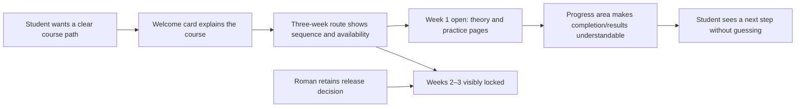

# HL — OOP_20261015-164702_WEB: Каркас сайта OOPoman

> **Date**: 2026-10-15
> **Author**: Coordinator
> **Title**: Каркас сайта OOPoman
> **Abbreviation**: WEB
> **Status**: 📝 HL_DRAFT — Awaiting owner discussion
> **Contract**: 📝 DRAFT — not yet approved
> **Frozen**: §1 · §3 · §4 · §5 · §6 · §7 — locked on owner approval
> **Free**: §2 · §7.2 · §8 · §9 · §10 · §11 — research updates these directly
> **Append-only**: §12 Amendment Log — the only channel for changing a frozen section
> **Baseline**: freeze commits — recovery form in `.tfw/conventions.md` §3 rule 15
> **Project North Star**: [NorthStar.md](../../../NorthStar.md) §Purpose · §Learner experience · §Product boundaries · §Success

---

## 1. Vision 🔒 FROZEN

OOPoman has a clear, welcoming local course shell that lets a second-year student understand the three-week route, see what is open, and find the theory and practice for the available week. Roman can inspect and extend the structure while keeping the supplied course files intact and retaining control over later-week release and unresolved assessment rules.

**Impact:** Students can orient themselves and see a sensible next step; Roman gets a small, understandable first site structure that can grow into the course without prematurely choosing its runtime or inventing curriculum and scoring details.

> **Imagined student quote:** “I can see how the course is organized, what I can open now, and where my progress will appear.”

## 2. Current State (As-Is) 🟢 FREE

- INIT is complete (`workspace/2026/OOP_20261014-215543_INIT/status.md`, `lifecycle: DONE`). Its RF and two RES iterations report that no site, app stack, local launch mode, score persistence, or safe code runner has been implemented or selected.
- `OOP-course/` contains 38 supplied PDF files. INIT Research reviewed a bounded subset; the materials have not been mapped into a complete three-week course. The Researcher observed differing Python versions/toolchains across course sources. These files are source material and remain untouched.
- `NorthStar.md` states the local-first, Chrome, no-account/backend/deployment boundaries, the three-week course, and the 500-point total. It leaves exact practical score allocation, exam accounting, code checking, persistence, and application architecture open.
- `architecture/context.puml` is an initial context view, not an approved application architecture. The project config has no app runtime or build/test commands.
- Roman requests this task to plan the first site skeleton. Its first-iteration content depth, progress behavior, and owner mechanism for opening later weeks are still awaiting his answers.

## 3. Target State (To-Be) 🔒 FROZEN

**As-Is → To-Be:** An initialized project with course PDFs but no site or approved implementation stack → a locally usable, clearly navigable first-iteration shell that introduces the course, presents a three-week route, distinguishes open and locked weeks, and gives progress and scoring a comprehensible place without silently deciding unresolved curriculum or assessment policy.

### 3.1 Result Visualization

Illustrative first-iteration screen; sample wording and zero progress are placeholders, and the exact score display remains subject to Roman's answer.

```text
OOPoman                                      Прогресс: пока нет результатов
┌─────────────────────────────────────────────────────────────────────┐
│ ООП за 3 недели                                                     │
│ Лекция · практика · домашнее задание — маршрут курса                │
│ [Перейти к неделе 1]                                                │
└─────────────────────────────────────────────────────────────────────┘

Маршрут курса
  1 · Неделя 1       Открыта       Теория → Практика → Домашнее задание
  2 · Неделя 2       Закрыта       Откроется по решению владельца
  3 · Неделя 3       Закрыта       Откроется по решению владельца

Мои результаты
  Выполнено: —          Баллы: —          Состав оценки: будет показан ясно
```

| Before | Proposed after | Value visible in the same view |
|---|---|---|
| No site or navigation; source PDFs are separate from app code. | A course welcome, three-week route, available/locked states, and an identified progress area. | A student knows where to start and what remains unavailable. |
| Progress and scoring behavior are unresolved. | The shell reserves a clear place for results; working tracking and exact score mechanics follow the owner's decision and approved scoring policy. | The UI does not imply a score split or persistence policy that Roman has not approved. |

### 3.2 Value Flow



## 4. Phases 🔒 FROZEN

One first-iteration phase is proposed: a navigable local course shell. Keep it as one phase if its value-bearing scope remains a small interface and route; split only if owner-approved scope or evidence needs make one execution cycle too large.

### 4.1 Coordination Selection 🔒 FROZEN

| Activation source | Accountable owner | Task Coordinator unit | Phase Coordinator rule | Mandate scope / role reach | Upward route | Dialogue | Reporting | Reservations / controls | Amendment authority | Immutable epoch |
|---|---|---|---|---|---|---|---|---|---|---|
| owner-direct | Roman (`roman`) | `codex:thread:local:01a13f5a-13e0-72d3-a394-b2054fc7c90f` | None proposed for one phase. | Current unit plans and coordinates this task. Roman creates/starts each distinct role task at its gate; no role is activated by this record. | `owner:roman` | `tfw-gates-only` | `native-gates` | Roman approves frozen HL, exact TS and final acceptance; reserves content transformation, week release, score scope/split, exam, persistence, code-execution safety and any scope increase. Preserve the recorded no-branch/no-worktree constraint; before a future mutating role starts, resolve its conflict with TFW's separate-worktree isolation rule through the owner gate. Each returning unit must bind its own task-local economics source and range; unavailable counters are reported with the concrete reason, never as zero or estimate. | `none` | `../../../TRACE.md @ eafde5305449618cf081dda08d26992ce9cbea9c` |

### Phase A: Local course shell 🔴

- Build only the owner-approved first-iteration welcome, three-week route, theory/practice page structure, availability states, and progress/score presentation.
- Week 1 is available by default; Weeks 2 and 3 remain closed until Roman's explicit release decision.
- Keep the supplied `OOP-course/` PDFs unchanged. Any content selection, transcription, or lab conversion needs an approved scope.
- Keep diagrams in `architecture/`; update the UML only when the approved application structure is known.
- Do not implement arbitrary-code execution, full assessment logic, or the final exam in this iteration unless Roman later approves a new scope.

## 5. Definition of Done (DoD) 🔒 FROZEN

- ✅ 1. A student can identify the course purpose and start point from the welcome view.
- ✅ 2. The course route presents three weeks, with Week 1 open and Weeks 2–3 visibly unavailable until Roman authorizes opening them.
- ✅ 3. The approved shell provides clear navigation and distinct theory/practice page structure for the scope Roman selects.
- ✅ 4. The progress/score area communicates only approved facts and does not invent the practical split, score denominator, persistence, or exam accounting.
- ✅ 5. The result works in the approved local Chrome/offline launch arrangement without a project-owned server, database, registration, authentication, or deployment.
- ✅ 6. Supplied PDFs remain unchanged; application files are navigable and UML remains under `architecture/`.
- ✅ 7. An independent Reviewer can inspect the fixed result and evidence against the approved TS and North Star.

## 6. Definition of Failure (DoF) 🔒 FROZEN

- ❌ 1. The shell requires a project-owned backend, account, or deployment for its core local use.
- ❌ 2. Week 2 or 3 is presented as available without Roman's explicit decision.
- ❌ 3. The UI silently assigns points, practical weights, exam credit, or a persistence promise that Roman has not approved.
- ❌ 4. Supplied course PDFs are edited or labs are transformed into interactive exercises outside the approved scope.
- ❌ 5. Arbitrary student code is executed without a separately approved, reviewed safety design.
- ❌ 6. Implementation begins before the owner approves the governing HL and exact TS.

**On failure:** stop the affected work, preserve its trace, and return the concrete decision through the recorded TFW route.

## 7. Principles 🔒 FROZEN

1. **A clear next step** — course navigation should make sequence and availability obvious.
2. **Local-first** — core use must not depend on an OOPoman server, database, account, or Internet connection after launch.
3. **Owner-controlled release** — later weeks stay closed until Roman opens them.
4. **Source fidelity** — keep supplied course material intact; do not fill gaps with invented lessons.
5. **Transparent, undecided scoring** — communicate approved rules without creating missing ones.
6. **Proportional structure** — use only architecture and UI needed for this iteration; preserve clear continuation for later work.

### 7.2 Knowledge Citations 🟢 FREE

| # | Source | Item | How it applies |
|---|---|---|---|
| P0 | [NorthStar.md](../../../NorthStar.md) | Purpose; Learner experience; Product boundaries; Success | Defines local-first learning value, student audience, three-week form, and project boundaries. |
| P1 | [.tfw/README.md](../../../.tfw/README.md#ns1--purpose) | NS1 — Purpose | Keep the work useful and continuable; a polished shell must preserve owner authority and inspectable project state. |
| P1 | [.tfw/README.md](../../../.tfw/README.md#ns2--principles) | NS2 — Principles | Ask about consequential uncertainty, retain selected traces, bound role work, and scale assurance to the implementation risk. |
| P2 | `knowledge/philosophy.md` | Absent | No separate project philosophy is available to govern this product task. |
| P3 | [KNOWLEDGE.md](../../../KNOWLEDGE.md) §1 Architecture Map | No project components or architecture decisions recorded | Treat `architecture/context.puml` as context only; do not infer an implementation stack from it. |
| P4 | [.tfw/conventions.md](../../../.tfw/conventions.md#hl-contract) | HL Contract | Keep this draft distinct from an approved baseline; changes after approval must follow the amendment gate. |

## 8. Dependencies 🟢 FREE

| Dependency | Status |
|---|---|
| Roman's answers on first-week source content, progress behavior/persistence, and owner week-release mechanism | ⬜ Awaiting owner |
| INIT findings on Chrome, offline load, local files, and untrusted-code safety | ✅ Read; gaps remain open |
| Approved site-shell scope and TS | ⬜ Requires HL agreement and exact TS approval |
| Worktree/isolation route for future mutating role tasks | ⬜ Conflict with recorded no-worktree constraint; resolve before such a role starts |
| Approved score denominator and practical rubric, if the first-iteration display depends on them | ⬜ Owner decision required |

## 9. Risks 🟢 FREE

| Risk | Probability | Impact | Mitigation |
|---|---|---|---|
| Exact local Chrome entry and complete offline first-launch path are unproven. | Medium | High | Research primary-source constraints and validate the selected route under an approved implementation task before claiming offline success. |
| A structural shell may not serve a learner if no real Week 1 content is included. | Medium | High | Ask Roman whether to include selected source material; map only approved files and preserve PDFs. |
| Progress UI could imply persistence or scoring behavior that is not selected. | Medium | Medium | Make the distinction explicit; implement only the behavior Roman approves and scoring rules support. |
| Role isolation requirements conflict with the owner's recorded ban on branches/worktrees. | High | High | Stop before launching a mutating role; report the precise gate and obtain an allowed route without bypass. |

## 10. RESEARCH Case 🟢 FREE

### Blind Spots

- Which local launch route can satisfy offline use in Chrome while reading the separate course source directory is unresolved.
- The first-iteration amount of actual Week 1 content and the behavior of completion/progress are owner questions.
- The mechanism by which Roman opens later weeks is not yet selected.
- No scoring denominator beyond the stated category totals or safe browser code-execution model is approved.

### Hypotheses

| # | Hypothesis | Status |
|---|---|---|
| H1 | A minimal local shell can satisfy the offline Chrome requirement while keeping `OOP-course/` separate, without a project-owned server. | open |
| H2 | A navigable structural shell is valuable before full course-content conversion, provided at least the owner-approved first-week pages are understandable. | open; settle content depth with owner before research |
| H3 | Progress can be represented without committing to persistence or unapproved score mechanics. | open; settle behavior with owner before research |
| H4 | A simple owner-controlled release mechanism can keep later weeks closed without adding accounts or a backend. | open; settle owner interaction before research |

### Risks of Not Researching

Choosing a stack or launch path from memory may fail the first offline Chrome launch or force course files into the app; treating a Worker or browser runtime as a security boundary may create an unsafe code runner.

### Proposed RESEARCH Focus

1. **Gather**: Check current primary documentation for candidate local launch modes and offline dependency packaging in Chrome.
2. **Extract**: Compare only options compatible with the owner-approved shell and separate course sources; document hard limits and unproven behavior.
3. **Challenge**: Test whether the simplest candidate is enough for a genuinely usable first-week shell, and identify claims that still require a real browser implementation proof.

### Why Not Just...?

| Approach | Value | Adoption / operating burden | Risks / tradeoffs | Decision and reason |
|---|---|---|---|---|
| **Minimal navigable shell — recommended for this plan** | Gives students an understandable route and gives Roman an inspectable starting site. | Small first iteration; content and scoring can follow approved decisions. | May feel empty if it contains no real Week 1 material; progress might initially be display-only. | Fits the explicit skeleton request and avoids guessing content, stack, scoring, or persistence. |
| Complete course and assessment in the first build | Could provide an end-to-end learner experience sooner. | Requires substantial PDF mapping, content transformation, lab conversion, score/rubric decisions, and safety design. | High risk of invented or mis-scoped content and premature technical commitments. | Defer because those decisions are expressly open and transformations need separate agreement. |

**Leave unchanged:** Students still have no local site route, while Roman cannot inspect the intended learning flow or availability states.

**Critical challenge:** A shell without meaningful Week 1 material may be a visual mock rather than a useful learning product. If Roman expects a learner-ready first-week pilot, the recommendation must expand only to the specific approved source materials and behaviors that make that pilot useful.

## 11. Strategic Insights (Planning) 🟢 FREE

| # | Insight | Category | Source |
|---|---|---|---|
| S1 | Roman wants the TFW task and role sequence explained clearly while building a course site understandable to a second-year student. | workflow / product context | Owner request in this task |
| S2 | Roman expects a task-specific economics capture for every role return and wants unavailable measurements reported honestly. | operating preference | Owner request and `TRACE.md` |

### Task economics capture

At this Coordinator return, the current Codex task surface does not expose an addressable native rollout file or source ID to bind. Extraction was not attempted; this is a pre-extraction binding gap, not measured zero. No other unit's native session was read. Future role returns must use their own exact source, bounded range, and task/role identity under `.tfw/economics/README.md`.

### Material handover at this return

- **Producer/unit:** Coordinator `codex:thread:local:01a13f5a-13e0-72d3-a394-b2054fc7c90f`; accountable owner Roman.
- **Source/epoch:** owner instruction `../../../TRACE.md @ eafde5305449618cf081dda08d26992ce9cbea9c`; new task `OOP_20261015-164702_WEB`.
- **Inspected scope:** project `NorthStar.md`, `TRACE.md`, `README.md`, `KNOWLEDGE.md`, project config, context UML, completed INIT status/HL/RF/REVIEW and both RES iterations, supplied PDF inventory, current TFW planning/read contracts and selected Coordinator profile.
- **Material:** no app/runtime/launch decision exists; 38 PDFs remain source material; exact scope questions remain for Roman.
- **Uncertainty:** exact content, completion and score behavior, owner release control, offline launch proof, stack, and future role isolation.
- **Continuation:** await Roman's answers; then refine this HL draft and present the coherent scope for approval. No Researcher or Executor is activated by this draft.

## 12. Amendment Log 🟢 APPEND-ONLY

No amendments.

---

*HL — OOP_20261015-164702_WEB: Каркас сайта OOPoman | 2026-10-15*
