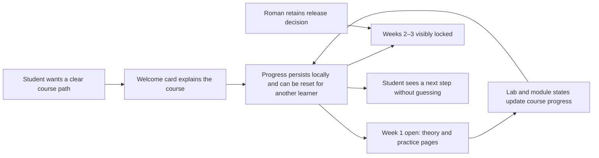

# HL — OOP_20261015-164702_WEB: Каркас сайта OOPoman

> **Date**: 2026-10-15
> **Author**: Coordinator
> **Title**: Каркас сайта OOPoman
> **Abbreviation**: WEB
> **Status**: 📝 HL_DRAFT — Awaiting owner discussion
> **Contract**: 📝 DRAFT — not yet approved
> **Frozen**: §1 · §3 · §4 · §5 · §6 · §7 — locked on owner approval
> **Free**: §2 · §7.2 · §8 · §9 · §10 · §11 — research updates these directly
> **Append-only**: §12 Amendment Log — the only channel for changing a frozen section
> **Baseline**: freeze commits — recovery form in `.tfw/conventions.md` §3 rule 15
> **Project North Star**: [NorthStar.md](../../../NorthStar.md) §Purpose · §Learner experience · §Product boundaries · §Success

---

## 1. Vision 🔒 FROZEN

OOPoman has a clear, welcoming local course shell that lets a second-year student understand the three-week route, see what is open, and find the page structure for the available week. The shell preserves the learner's progress locally, shows it for each lab and across the defined course modules, and lets Roman reset it for another student. Roman can add PDF-derived materials, quizzes, and practice in separately approved follow-up tasks while retaining control over later-week release and unresolved assessment rules.

**Impact:** Students can orient themselves, see a sensible next step, and resume their progress; Roman gets a small, understandable first site structure that can grow into the course without altering the source PDFs or prematurely choosing its runtime or scoring details.

> **Imagined student quote:** “I can see what I have finished in each lab, how far I am through the course, and clear the progress for the next person.”

## 2. Current State (As-Is) 🟢 FREE

- INIT is complete (`workspace/2026/OOP_20261014-215543_INIT/status.md`, `lifecycle: DONE`). Its RF and two RES iterations report that no site, app stack, local launch mode, score persistence, or safe code runner has been implemented or selected.
- `OOP-course/` contains 38 supplied PDF files. INIT Research reviewed a bounded subset; the materials have not been mapped into a complete three-week course. The Researcher observed differing Python versions/toolchains across course sources. These files are source material and remain untouched.
- `NorthStar.md` states the local-first, Chrome, no-account/backend/deployment boundaries, the three-week course, and the 500-point total. It leaves exact practical score allocation, exam accounting, score persistence, code checking, and application architecture open. Roman has now directed that learner progress itself persist locally and be resettable; the technical storage method remains open.
- `architecture/context.puml` is an initial context view, not an approved application architecture. The project config has no app runtime or build/test commands.
- Roman directs this task to build the Week 1 course-shell structure with empty content areas. PDF-derived lesson materials, quizzes, and practice belong to later owner-started tasks. Week 2 and Week 3 stay closed in this task and will be opened and populated only in future tasks Roman starts.
- Learner progress must persist, be resettable for another learner, show each lab's state, and aggregate across modules. Opening an empty lab page automatically changes its progress to “viewed/started”; completion remains unmarked until a real quiz or practice activity exists and its completion is recorded. Exact browser storage remains open; score/rubric persistence remains distinct and unresolved.

## 3. Target State (To-Be) 🔒 FROZEN

**As-Is → To-Be:** An initialized project with course PDFs but no site or approved implementation stack → a locally usable, clearly navigable Week 1 shell that introduces the course, presents a three-week route with later weeks locked, provides empty theory/practice content areas, and tracks persistent, resettable progress per lab and across the modules defined in the site. It does not alter PDFs or invent the still-open scoring rules.

### 3.1 Result Visualization

Illustrative first-iteration screen; page content and counts are placeholders until the PDF mapping is approved. The exact scoring display remains subject to the approved assessment rules.

```text
OOPoman                          Прогресс курса: 0 / N модулей завершено
┌─────────────────────────────────────────────────────────────────────┐
│ ООП за 3 недели                                                     │
│ Лекция · практика · домашнее задание — маршрут курса                │
│ [Перейти к неделе 1]                                                │
└─────────────────────────────────────────────────────────────────────┘

Маршрут курса
  1 · Неделя 1       Открыта       Теория → Практика → Домашнее задание
     Лабораторная 1                 Не начата
     Лабораторная 2                 Не начата
  2 · Неделя 2       Закрыта       Материалы будут добавлены в будущей задаче
  3 · Неделя 3       Закрыта       Материалы будут добавлены в будущей задаче

Прогресс первой недели: 0 / N лабораторных завершено
[Сбросить прогресс для следующего учащегося]
Баллы: отображаются только по утверждённым правилам оценки
```

| Before | Proposed after | Value visible in the same view |
|---|---|---|
| No site or navigation; source PDFs are separate from app code. | A Week 1 shell has course welcome, route, content placeholders, and locked future weeks. | A student knows where to start without the app inventing course material. |
| Progress has no implementation. | Lab-level and course-module progress persists locally and can be reset; exact scoring remains governed by later approved rules. | A learner can resume or clear progress, while no unapproved points or rubric are implied. |

### 3.2 Value Flow



## 4. Phases 🔒 FROZEN

One first-iteration phase is proposed: a navigable local course shell. Keep it as one phase if its value-bearing scope remains a small interface and route; split only if owner-approved scope or evidence needs make one execution cycle too large.

### 4.1 Coordination Selection 🔒 FROZEN

| Activation source | Accountable owner | Task Coordinator unit | Phase Coordinator rule | Mandate scope / role reach | Upward route | Dialogue | Reporting | Reservations / controls | Amendment authority | Immutable epoch |
|---|---|---|---|---|---|---|---|---|---|---|
| owner-direct | Roman (`roman`) | `codex:thread:local:01a13f5a-13e0-72d3-a394-b2054fc7c90f` | None proposed for one phase. | Current unit plans and coordinates this task. Roman creates/starts each distinct role task at its gate; no role is activated by this record. | `owner:roman` | `tfw-gates-only` | `native-gates` | Roman approves frozen HL, exact TS and final acceptance; reserves PDF transformation for later tasks, opening Weeks 2–3, score scope/split, exam, score persistence, code-execution safety and any scope increase. Progress persistence and reset are owner-directed requirements. Preserve the recorded no-branch/no-worktree constraint; before a future mutating role starts, resolve its conflict with TFW's separate-worktree isolation rule through the owner gate. Each returning unit must bind its own task-local economics source and range; unavailable counters are reported with the concrete reason, never as zero or estimate. | `none` | `../../../TRACE.md @ eafde5305449618cf081dda08d26992ce9cbea9c` |

### Phase A: Local course shell 🔴

- Build the welcome and three-week route, Week 1 theory/practice page structure with empty content slots, and persistent/resettable progress data and views at lab and module levels.
- Week 1 is available by default; Weeks 2 and 3 remain closed until Roman's explicit release decision.
- Keep the supplied `OOP-course/` PDFs unchanged. Material, quiz, and practice conversion is deferred to future tasks Roman starts; do not add it to this TS.
- The overall progress view aggregates every module registered in the course structure; as future tasks add real modules, they join that total. The current shell must not invent a count for lessons/labs not yet mapped.
- Provide a clear reset action for the locally stored progress, with a confirmation step so one learner does not erase another's work accidentally.
- Keep diagrams in `architecture/`; update the UML only when the approved application structure is known.
- Do not implement arbitrary-code execution, full assessment logic, or the final exam in this iteration unless Roman later approves a new scope.

## 5. Definition of Done (DoD) 🔒 FROZEN

- ✅ 1. A student can identify the course purpose and start point from the welcome view.
- ✅ 2. The course route presents three weeks, with Week 1 open and Weeks 2–3 visibly unavailable until Roman authorizes opening them.
- ✅ 3. Week 1 has distinct theory/practice page structure with empty content areas for later approved materials.
- ✅ 4. Progress persists between launches, can be reset for another learner, is visible per lab, and aggregates across all modules registered in the course structure. Opening an empty lab marks it “viewed/started”; completion is recorded later from an actual quiz or practice activity.
- ✅ 5. The progress/score area communicates only approved facts and does not invent the practical split, score denominator, score persistence, or exam accounting.
- ✅ 6. The result works in the approved local Chrome/offline launch arrangement without a project-owned server, database, registration, authentication, or deployment.
- ✅ 7. Supplied PDFs remain unchanged; application files are navigable and UML remains under `architecture/`.
- ✅ 8. An independent Reviewer can inspect the fixed result and evidence against the approved TS and North Star.

## 6. Definition of Failure (DoF) 🔒 FROZEN

- ❌ 1. The shell requires a project-owned backend, account, or deployment for its core local use.
- ❌ 2. Week 2 or 3 is presented as available without Roman's explicit decision.
- ❌ 3. The UI silently assigns points, practical weights, exam credit, or score-persistence behavior that Roman has not approved, or fails to persist/reset learner progress as directed.
- ❌ 4. Supplied course PDFs are edited or labs are transformed into interactive exercises outside the approved scope.
- ❌ 5. Arbitrary student code is executed without a separately approved, reviewed safety design.
- ❌ 6. Implementation begins before the owner approves the governing HL and exact TS.

**On failure:** stop the affected work, preserve its trace, and return the concrete decision through the recorded TFW route.

## 7. Principles 🔒 FROZEN

1. **A clear next step** — course navigation should make sequence and availability obvious.
2. **Local-first progress** — preserve progress on the learner's browser without an OOPoman server or account, and provide a deliberate reset for another learner.
3. **Owner-controlled release** — this task opens only Week 1; later-week opening and material are future owner-started tasks.
4. **Source fidelity** — keep supplied course material intact; leave content slots empty until a later approved conversion task.
5. **Transparent, undecided scoring** — communicate approved rules without creating missing point splits or assessment accounting.
6. **Proportional structure** — use only architecture and UI needed for this iteration; preserve clear continuation for later work.

### 7.2 Knowledge Citations 🟢 FREE

| # | Source | Item | How it applies |
|---|---|---|---|
| P0 | [NorthStar.md](../../../NorthStar.md) | Purpose; Learner experience; Product boundaries; Success | Defines local-first learning value, student audience, three-week form, and project boundaries. Roman's newer TRACE decision resolves progress persistence/reset; only score persistence remains open and NorthStar should be reconciled through its documentation workflow after the task direction is approved. |
| P1 | [.tfw/README.md](../../../.tfw/README.md#ns1--purpose) | NS1 — Purpose | Keep the work useful and continuable; a polished shell must preserve owner authority and inspectable project state. |
| P1 | [.tfw/README.md](../../../.tfw/README.md#ns2--principles) | NS2 — Principles | Ask about consequential uncertainty, retain selected traces, bound role work, and scale assurance to the implementation risk. |
| P2 | `knowledge/philosophy.md` | Absent | No separate project philosophy is available to govern this product task. |
| P3 | [KNOWLEDGE.md](../../../KNOWLEDGE.md) §1 Architecture Map | No project components or architecture decisions recorded | Treat `architecture/context.puml` as context only; do not infer an implementation stack from it. |
| P4 | [.tfw/conventions.md](../../../.tfw/conventions.md#hl-contract) | HL Contract | Keep this draft distinct from an approved baseline; changes after approval must follow the amendment gate. |

## 8. Dependencies 🟢 FREE

| Dependency | Status |
|---|---|
| Roman's first-iteration content, progress persistence/reset, completion semantics, and future-week boundaries | ✅ Answered in `TRACE.md` |
| INIT findings on Chrome, offline load, local files, and untrusted-code safety | ✅ Read; gaps remain open |
| Approved site-shell scope and TS | ⬜ Requires HL agreement and exact TS approval |
| Worktree/isolation route for future mutating role tasks | ⬜ Conflict with recorded no-worktree constraint; resolve before such a role starts |
| Local browser storage mechanism and cold-offline behavior | ⬜ Research required; no mechanism selected |
| Progress completion rule for empty placeholders | ✅ Opening an empty lab marks it “viewed/started”; completion is deferred until a real quiz or practice activity is completed |
| Course score denominator and practical rubric | ⬜ Owner decision required; keep outside this iteration's scoring behavior |
| NorthStar progress-persistence open item | ⬜ Reconcile after approved direction through `/tfw-docs`; retain score-persistence uncertainty |

## 9. Risks 🟢 FREE

| Risk | Probability | Impact | Mitigation |
|---|---|---|---|
| Exact local Chrome entry and complete offline first-launch path are unproven. | Medium | High | Research primary-source constraints and validate the selected route under an approved implementation task before claiming offline success. |
| Empty Week 1 content slots may make the shell unsuitable for actual learning until follow-up content tasks. | Medium | Medium | Label placeholders clearly; keep PDF conversion, quizzes, and practice in later owner-started tasks. |
| The local file origin may not preserve progress across launches or support offline use. | Medium | High | Research storage/origin constraints and verify the selected path before implementation claims. |
| Role isolation requirements conflict with the owner's recorded ban on branches/worktrees. | High | High | Stop before launching a mutating role; report the precise gate and obtain an allowed route without bypass. |

## 10. RESEARCH Case 🟢 FREE

### Blind Spots

- Which local launch route can satisfy offline use in Chrome while keeping the separate course source directory is unresolved.
- Whether local storage works across the selected Chrome launch origin and how reset can clear only OOPoman progress need technical research.
- Content slots are empty by design; PDF conversion into materials, quizzes, and practice is planned for future tasks.
- The progress denominator covers every module registered in the course structure, including locked modules once defined; the final module/lab map is not available yet.
- No scoring denominator beyond the stated category totals or safe browser code-execution model is approved.

### Hypotheses

| # | Hypothesis | Status |
|---|---|---|
| H1 | A minimal local shell can satisfy the offline Chrome requirement without a project-owned server or an HTTP launch service. | open |
| H2 | Lab and module progress can persist and be reset locally across launches from the selected offline Chrome origin without a backend or learner account. | open |

### Risks of Not Researching

Choosing a launch or storage path from memory may fail offline startup or lose progress unexpectedly. This task does not research or implement arbitrary student-code execution; any later code-runner task needs its own safety scope.

### Proposed RESEARCH Focus

1. **Gather**: Check current primary documentation for local launch modes, offline asset loading, and browser-local persistence/reset in Chrome.
2. **Extract**: Compare options compatible with no server/account and separate course sources; document origin, persistence, and clearing limits.
3. **Challenge**: Identify which local behavior remains unproven until a disposable implementation probe; make no code-runner or scoring claim.

### Why Not Just...?

| Approach | Value | Adoption / operating burden | Risks / tradeoffs | Decision and reason |
|---|---|---|---|---|
| **Week 1 shell with persistent progress — recommended** | Gives students an understandable route, reusable content slots, and visible resumable progress. | Small structural iteration; PDF content and assessed activities follow in future owner-started tasks. | Empty slots are not yet a full learning experience; local storage needs research. | Matches Roman's sequence and preserves source material and undecided scoring. |
| Convert PDFs and build all activities now | Could offer a fuller Week 1 course sooner. | Requires PDF mapping, conversion, quiz/practice authoring, and approved content scope. | Risks changing source material, adding future-week content, and conflating activities with unapproved score rules. | Defer because Roman explicitly ordered the skeleton first and content in later tasks. |

**Leave unchanged:** Students still have no local site route, while Roman cannot inspect the intended learning flow or availability states.

**Critical challenge:** A shell with empty content slots does not itself teach OOP. It is the right first result only if it provides a sound, navigable structure and reusable progress model that make later content work simpler; otherwise the separate content tasks could reveal that the shell needs rework.

## 11. Strategic Insights (Planning) 🟢 FREE

| # | Insight | Category | Source |
|---|---|---|---|
| S1 | Roman wants the TFW task and role sequence explained clearly while building a course site understandable to a second-year student. | workflow / product context | Owner request in this task |
| S2 | Roman expects a task-specific economics capture for every role return and wants unavailable measurements reported honestly. | operating preference | Owner request and `TRACE.md` |
| S3 | Roman wants the shell first, then separate work to turn PDFs into website materials, quizzes, and practice; progress must persist, reset, and appear per lab and across modules. | product sequencing / learner context | Owner instruction recorded in `TRACE.md` |

### Task economics capture

At this Coordinator return, the current Codex task surface does not expose an addressable native rollout file or source ID to bind. Extraction was not attempted; this is a pre-extraction binding gap, not measured zero. No other unit's native session was read. Future role returns must use their own exact source, bounded range, and task/role identity under `.tfw/economics/README.md`.

### Material handover at this return

- **Producer/unit:** Coordinator `codex:thread:local:01a13f5a-13e0-72d3-a394-b2054fc7c90f`; accountable owner Roman.
- **Source/epoch:** owner instruction `../../../TRACE.md @ b15836edc05aed1bf9eb3edfb737596fb90db2d3`; new task `OOP_20261015-164702_WEB`.
- **Inspected scope:** project `NorthStar.md`, `TRACE.md`, `README.md`, `KNOWLEDGE.md`, project config, context UML, completed INIT status/HL/RF/REVIEW and both RES iterations, supplied PDF inventory, current TFW planning/read contracts and selected Coordinator profile.
- **Material:** no app/runtime/launch decision exists; 38 PDFs remain source material; this iteration uses empty Week 1 content slots and persistent/resettable progress. An opened empty lab is “viewed/started”; completion waits for a real quiz/practice activity.
- **Uncertainty:** completion semantics for empty placeholders, score behavior, offline launch/storage proof, stack, and future role isolation.
- **Continuation:** refine this HL draft, then present the coherent scope for approval. No Researcher or Executor is activated by this draft. Before any mutating role task starts, Roman must resolve the recorded no-worktree constraint against TFW's separate-worktree rule.

## 12. Amendment Log 🟢 APPEND-ONLY

No amendments.

---

*HL — OOP_20261015-164702_WEB: Каркас сайта OOPoman | 2026-10-15*
