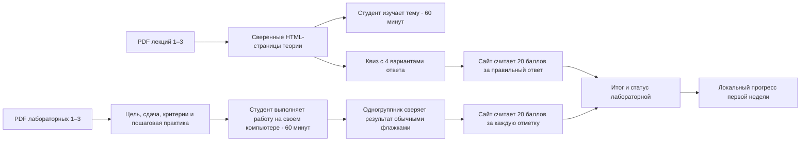

# HL — OOP_20261016-155027_CONTENT: Наполнение курса OOPoman

> **Date**: 2026-10-16
> **Author**: Coordinator
> **Title**: Наполнение курса OOPoman
> **Abbreviation**: CONTENT
> **Status**: 🔒 FROZEN — approved by Roman 2026-10-16
> **Contract**: 🔒 FROZEN — approved by Roman 2026-10-16
> **Frozen**: §1 · §3 · §4 · §5 · §6 · §7 — locked on owner approval
> **Free**: §2 · §7.2 · §8 · §9 · §10 · §11 — research updates these directly
> **Append-only**: §12 Amendment Log — the only channel for changing a frozen section
> **Baseline**: freeze commits — recovery form in `conventions.md` §3, rule 15
> **Project North Star**: [NorthStar.md](../../../NorthStar.md) §§ Purpose, Learner experience, Product boundaries, Success

---

## 1. Vision 🔒 FROZEN

Студент открывает первую неделю OOPoman и находит три самостоятельные HTML-страницы теории и три страницы лабораторных, связанные по темам. За 60 минут на теорию он изучает структурированный материал, а за 60 минут на практику получает цель, требования, критерии, короткий квиз, подробные шаги выполнения и чек-лист взаимной проверки. После ответов и отметок система считает баллы и сохраняет завершённость лабораторной в его локальном профиле Chrome.

**Impact:** первая неделя становится учебным маршрутом, а не каталогом пустых страниц и PDF. Студент понимает, что изучить и сделать; владелец курса сохраняет контроль над будущими неделями и исходными материалами.

> Представленная цитата студента: «Я могу изучить тему, выполнить лабораторную у себя и вместе с одногруппником проверить результат; сайт показывает баллы и завершённые работы».

## 2. Current State (As-Is) 🟢 FREE

- Завершённая задача [WEB](../OOP_20261015-164702_WEB/RF__OOP_20261015-164702_WEB.md) создала `course/` — локальный каркас с тремя модулями, первой неделей открытой, неделями 2 и 3 закрытыми. В текущем `course/app.js` есть маршруты модуля, прогресса и лабораторной, но отдельной страницы лекции нет; содержание и активности пусты.
- `course/data.js` сопоставляет неделе 1 канонические PDF лекций и лабораторных 01–03, неделе 2 — 04–06, неделе 3 — 07–09. Нумерация этих материалов в PDF обозначает 10-недельный исходный курс; недельная структура сайта следует принятой владельцем модели из трёх модулей, а не исходным значениям недели в самих PDF.
- `course/storage.js` сохраняет только `started` в ключе `oopoman.progress.v1`. Там пока нет ответов квиза, отметок чек-листа, баллов или завершённого статуса.
- Канонические источники находятся в `OOP-course/01_Лекции/` и `OOP-course/02_Лабораторные/`. Изученные пары первой недели: лекция 1 — классы, идентичность/состояние/поведение, инкапсуляция, инварианты, богатая и анемичная модели; лабораторная 1 — Bus/Route, TransitCard/SingleTripTicket и тесты инвариантов. Лекция 2 — отношения между объектами и композиция вместо наследования; лабораторная 2 — компонентный движок тарифов, политики и параметризованные тесты. Лекция 3 — полиморфизм, duck typing, ABC и Protocol; лабораторная 3 — типизированные события, диспетчер, обработчики и их тесты.
- В PDF лекции рассчитаны примерно на 90 минут, лабораторные — на 135 минут. Новый формат 60 минут на теорию и 60 минут на практику задан владельцем и требует содержательной адаптации, а не слепой копии исходной длительности.
- В PDF есть требования к сдаче, практические задания, контрольные вопросы и чек-листы; каждый из трёх изученных PDF лабораторных также содержит старое распределение «20 баллов за работу». Текущая инструкция владельца заменяет способ начисления: 20 баллов за правильный вопрос квиза и 20 за каждый отмеченный выполненный пункт чек-листа. Сами критерии и смысл заданий сохраняются; старый общий предел из PDF не применяется как новый итог лабораторной.
- `NorthStar.md` содержит раннюю модель общего курса на 500 баллов; в текущем разговоре владелец указал на общий объём 500+ и поручил рассчитывать лабораторные по числу вопросов и пунктов. Эта задача охватывает только лабораторные 1–3. Итог всех девяти лабораторных и общий курсной знаменатель не выводятся из трёх работ и остаются зависимостью для будущего наполнения.

## 3. Target State (To-Be) 🔒 FROZEN

**Было → станет:** в первой неделе каркаса есть только группировка исходных файлов и пустые области → студент получает шесть связанных HTML-страниц с учебным материалом, практикой, самопроверкой/взаимопроверкой и баллами. Модули 2 и 3 остаются закрытыми; исходные PDF остаются неизменёнными источниками.

### 3.1 Result Visualization

Ниже — иллюстративный вид результата; количество вопросов и критериев в образце не является утверждённым составом квизов.

```text
OOPoman · Модуль 01 · Неделя 1                              0 / 3 модуля

ТЕОРИЯ · 60 минут
[01 Классы и инварианты] → [02 Композиция] → [03 Полиморфизм]
Структурированный материал, примеры, ключевые понятия, связь с практикой.

ПРАКТИКА · 60 минут на работу
[Лабораторная 01]       [Лабораторная 02]       [Лабораторная 03]
Цель · Сдача · Критерии · Квиз · Шаги · Чек-лист

Пример лабораторной 01 · Квиз
Как защитить инвариант баланса карты?
○ Разрешить любому коду менять баланс
● Проверять допустимые значения в модели карты
○ Проверять баланс только на странице сайта
○ Убирать все ошибки, возвращая False
Правильный ответ: 20 баллов · Ответы на весь квиз: 1 / N

Взаимная проверка · 20 баллов за отмеченное условие
☐ Все сущности защищают инварианты через ошибки предметной области.
☐ Тесты проходят без ошибок.
[Завершить лабораторную]
Баллы: 20 / 40 · Статус: Завершена

МОДУЛЬ 02 · закрыт                 МОДУЛЬ 03 · закрыт
```

Баллы лабораторной вычисляются как `20 × (правильные ответы квиза + отмеченные пункты чек-листа)`. Неотмеченные пункты дают 0. Чтобы различить ещё не проверенный чек-лист и намеренно оставленные пустыми пункты без изменения обычных флажков, студент явно нажимает «Завершить лабораторную» после ответа на весь квиз и взаимной проверки. Текущая сумма и состояние сохраняются для этой лабораторной и показываются в прогрессе. Отметка сайта не исполняет код и не подтверждает его объективную корректность.

| Сейчас | После задачи | Польза |
|---|---|---|
| Пустые страницы и списки названий PDF. | Три самостоятельные теоретические страницы и три страницы лабораторных, связанные по темам. | Студент проходит первую неделю в одном понятном маршруте. |
| Работа выполняется без описания в сайте; нет квиза, чек-листа, баллов и статуса завершения. | В практике есть пошаговые инструкции, квиз, галочки взаимопроверки, расчёт баллов и завершение. | Студенты видят требования, а взаимопроверка имеет одинаковые явные критерии. |
| Прогресс знает только «начата». | В первой неделе сохраняются ответы, заработанные баллы и завершённость каждой лабораторной. | Студент видит итог, а общий экран прогресса отражает фактически пройденную работу. |

### 3.2 Value Flow



## 4. Phases 🔒 FROZEN

Однофазная задача: подготовить содержимое и работающий учебный маршрут первой недели в существующем каркасе. Недели 2 и 3 не открываются и не наполняются.

### 4.1 Coordination Selection 🔒 FROZEN

| Activation source | Accountable owner | Task Coordinator unit | Phase Coordinator rule | Mandate scope / role reach | Upward route | Dialogue | Reporting | Reservations / controls | Amendment authority | Immutable epoch |
|---|---|---|---|---|---|---|---|---|---|---|
| owner-direct | roman | `codex:thread:local:01a143a1-8242-7fd3-943b-8293c09bf58a` | Один Coordinator ведёт однофазную задачу; отдельный Phase Coordinator не нужен | Только планирование CONTENT для шести страниц первой недели; будущие роли активируются владельцем на соответствующих TFW gate | owner:roman | tfw-gates-only | native-gates | Недели 2–3 закрыты; исходные PDF read-only; код не исполняется сайтом; модель для будущих запусков — настроенная владельцем; решение о заморозке HL и TS остаётся за Roman | none | `../../../TRACE.md @ 46954556ee2645b3fb8e16afd922b2890913a4e2` |

Выбор режима подтверждён в текущем owner-direct разговоре. Навигационное название `PLAN · CONTENT` и секция `OOP · CONTENT` установлены и прочитаны обратно. Нативные возможности этой поверхности: provision — native; addressed send — native; wait/readback — native; title write/readback — native. Настройка модели по политике владельца не означает, что здесь уже выбрана или запущена отдельная роль. Reasoning effort выбирается при конкретном запуске по его требованиям и поддержке поверхности.

### Phase A: Материалы и активности первой недели 🔴

- Шесть отдельных страниц: лекции 1–3 и лабораторные 1–3; каждая лекция и каждая практика рассчитаны на 60 минут.
- Лекционные страницы дают структурированный материал с определениями и примерами по исходным PDF и связывают его с соответствующей лабораторной.
- Страницы лабораторных включают цель и контекст; требования к сдаче; критерии; небольшой квиз с четырьмя вариантами ответа; последовательные действия с пояснением, как их выполнить; чек-лист взаимной проверки; ссылку на исходный PDF.
- В квизах один однозначно правильный вариант на вопрос; ключ используется локальной системой для начисления 20 баллов за правильный ответ. В чек-листах обычная отмеченная галочка даёт 20 баллов, пустая — 0.
- После ответа на весь квиз студент явно завершает работу. Система сохраняет сумму и статус «Завершена» в существующем локальном профиле курса. Существующие отметки «Начата» сохраняются; общий сброс OOPoman продолжает удалять только собственный ключ прогресса.
- Никакой серверной проверки, аккаунтов или исполнения студенческого кода в OOPoman.

## 5. Definition of Done (DoD) 🔒 FROZEN

- ✅ 1. В открытом модуле 1 доступны шесть отдельных HTML-страниц: теория 1–3 и лабораторные 1–3; страницы и ссылки соответствуют каноническим PDF.
- ✅ 2. Каждая теоретическая страница содержит полный структурированный учебный материал соответствующей лекции, рассчитанный на 60 минут, и не переносит в HTML исходные даты или время начала.
- ✅ 3. Каждая практика рассчитана на 60 минут и содержит цель/контекст, требования к сдаче, критерии, квиз, пошаговые действия с объяснением «как», чек-лист взаимопроверки и ссылку на PDF.
- ✅ 4. В каждом вопросе квиза четыре варианта и ровно один обоснованный ключом ответ; правильный ответ даёт 20 баллов, неправильный — 0.
- ✅ 5. Каждый отмеченный пункт обычного чек-листа даёт 20 баллов, неотмеченный — 0; критерии сдачи не создают отдельной надбавки сверх квиза и чек-листа.
- ✅ 6. После ответа на весь квиз и явного завершения лабораторной система показывает сумму, ставит статус «Завершена» и сохраняет ответы, галочки и итог в локальном прогрессе.
- ✅ 7. Экран прогресса отражает статусы и заработанные баллы лабораторных 1–3, а существующий сброс сохраняет прежнее ограничение на данные OOPoman.
- ✅ 8. Модули 2 и 3 остаются закрытыми; исходные PDF не изменены; регистрация, сервер, сетевой grading и запуск кода в браузере не добавлены.
- ✅ 9. Проверка страницы/квиза подтверждает связь каждой активности с исходным материалом и отсутствие ложных ответов, баллов или завершения до явного завершения студентом.

## 6. Definition of Failure (DoF) 🔒 FROZEN

- ❌ 1. Хотя бы одна из шести страниц отсутствует, смешивает лекцию и лабораторную в одну страницу или не соответствует своему PDF.
- ❌ 2. Практические шаги не объясняют, как выполнить требуемую работу, или из-за переноса теряется обязательное условие сдачи.
- ❌ 3. Квиз имеет неоднозначный/неверный ключ, не четыре варианта, либо начисляет не по правилу 20 за правильный ответ.
- ❌ 4. Баллы начисляются за непоставленную галочку, критерии дают дополнительную оценку, итог не совпадает с выбранными ответами/галочками или завершение ставится без явного окончания работы.
- ❌ 5. Сохранённый прогресс первой недели теряется/повреждается, сброс затрагивает посторонние данные или недели 2–3 становятся доступны.
- ❌ 6. Студенческий код запускается на сайте, добавляются учётные записи или сервер, либо изменяются исходные PDF.

**On failure:** остановить выпуск непроверенных страниц и вернуть точное несоответствие в собственный Coordinator; противоречие frozen scope направить через установленный TFW owner gate, не маскировать исправлением за пределами TS.

## 7. Principles 🔒 FROZEN

1. **Верность учебному источнику** — каждая страница сохраняет смысл соответствующего PDF; редакторское сокращение не меняет понятий, обязательных шагов или критериев.
2. **Видимая обратная связь** — студент видит правило баллов, свой расчёт и статус; сайт не выдаёт отметку за объективную проверку кода.
3. **Локальная работа без лишних границ** — учебный материал и отметки работают в пределах принятого локального курса; студент делает и обсуждает код на собственном компьютере.
4. **Контроль владельца** — только модуль 1 открыт; исходники и будущие модули находятся под контролем Roman.

### 7.2 Knowledge Citations 🟢 FREE

| # | Source | Item | How it applies |
|---|---|---|---|
| P0 | [NorthStar.md](../../../NorthStar.md) | Purpose, Learner experience, Product boundaries, Success | Обучающий курс для студентов второго курса, локальное использование без аккаунта/сервера; неделя 1 открыта, недели 2–3 под контролем владельца. |
| P1 | [.tfw/README.md](../../../.tfw/README.md) | Methodology Values: Candor; Structural Enforcement; Naming Creates Behavior; Portability | Точно отличать самоотметку от внешней проверки; статус и баллы должны соответствовать явному действию; сохранять понятные названия, локальность и переносимость учебных страниц. |
| P2 | [KNOWLEDGE.md](../../../KNOWLEDGE.md) | §1 Project Knowledge and architecture map | Использовать действующий каркас курса и существующую границу локального приложения; не выбирать новый стек или отдельную систему. |
| P3 | [.tfw/conventions.md](../../../.tfw/conventions.md) | §11 Quality Standard; §14 Anti-patterns | Страницы пригодны для использования без ручного исправления; не подменять качество числом баллов и не добавлять незапрошенную систему оценивания. |
| P4 | [TRACE.md](../../../TRACE.md) | 2026-10-15, «Уточнение объёма первой итерации WEB»; 2026-10-16, «Знаменатель прогресса WEB» | Это отдельное owner-direct наполнение после завершённого каркаса; три недели остаются модулями и общим знаменателем, но содержание этой задачи ограничено первой неделей. |

## 8. Dependencies 🟢 FREE

| Dependency | Status |
|---|---|
| Завершённый локальный каркас `course/` и утверждённые три модуля | ✅ Доступны из завершённой задачи WEB |
| Канонические PDF лекций и лабораторных 01–03 | ✅ Доступны; только чтение |
| Общая сумма баллов для всех девяти лабораторных и оставшихся форм курса | ⬜ Владелец связал итог с задачами и ранее назвал 500+; этот scope определяет только три лабораторные первой недели, поэтому глобальный итог не выводит |
| Открытие и наполнение модулей 2–3 | ⬜ Отдельное будущее распоряжение Roman; в этой задаче не делается |

## 9. Risks 🟢 FREE

| Risk | Probability | Impact | Mitigation |
|---|---|---|---|
| Оригинальные лабораторные рассчитаны на 135 минут, а новая практика — на 60 | High | High | Сохранить обязательные требования и объяснить шаги; выделить ключевой маршрут, не обещая, что весь исходный объём укладывается без адаптации; сообщить владельцу, если цель 60 минут несовместима с материалом. |
| Редакторский перенос создаёт ошибку или неоднозначный ключ квиза | Medium | High | Сверять каждое утверждение и ответ с лекцией и лабораторной; включить независимую проверку вопросов и ключей. |
| Студенты могут отметить пункты без подтверждения реального выполнения | Medium | Medium | Ясно подписать взаимопроверку и источник балла; не выдавать клиентскую отметку за внешнюю верификацию. |
| Расширение формата `oopoman.progress.v1` может потерять уже сохранённые отметки `started` | Medium | High | Сохранить существующие состояния при обновлении структуры, обработать недопустимые данные безопасно, проверить сброс только ключа OOPoman. |
| Подсчёт трёх лабораторных сам по себе не подтверждает курсной итог 500+ | High | Medium | В этой задаче хранить сумму по каждой работе; согласовать общий состав и сумму по оставшимся активностям до заявления полного course total. |

## 10. RESEARCH Case 🟢 FREE

### Blind Spots

- Сколько вопросов и сколько проверочных условий действительно нужно каждой лабораторной, чтобы покрыть содержание без перегруза в 60 минут; финальное число следует из состава утверждённых квиза и чек-листа.
- Можно ли сохранить полный набор обязательных шагов лабораторных 01–03 в формате практики по 60 минут, сохранив при этом понятное объяснение «как».
- Каким будет общий балльный итог курса после подготовки оставшихся лабораторных и других активностей; эта задача не создаёт их материалы.
- Совместимость расширенного локального состояния с существующим прогрессом и режимом офлайн уже проверяется на реализации и приёмке; подтверждённый каркас хранит `started`, но не баллы.

### Hypotheses

| # | Hypothesis | Status |
|---|---|---|
| H1 | Каждую из трёх практик можно сделать полезной и полной по обязательным шагам в целевые 60 минут. | open — если неверно, потребуется отбор/перестройка задания и решение владельца о приоритете времени или объёма |
| H2 | Расширенная запись прогресса может сохранять квиз/чек-лист и завершённость, не теряя существующие отметки `started` в локальном формате v1. | open — если неверно, потребуется совместимое преобразование сохранённых данных до включения оценивания |

### Risks of Not Researching

Отдельное предварительное RES не предлагается: источники и реализация доступны локально, а точность переноса, расчёт, сохранение и Chrome-поведение можно проверять непосредственно на готовом Candidate. Если при редактуре H1 подтвердится как ложная или возникнет конкретная техническая неопределённость, остановить зависимый scope и вернуть вопрос владельцу/Coordinator; не менять 60 минут и балльную формулу молча.

### Proposed RESEARCH Focus

Отдельный исследовательский цикл пока не нужен. Исполнитель проверяет требования по исходным PDF и локально проверяемым AC; обнаруженная неопределённость направляется в планирование до расширения работ.

### Why Not Just...?

| Вариант | Ценность | Стоимость и нагрузка | Риски и компромиссы | Решение и причина |
|---|---|---|---|---|
| **Подготовить шесть структурированных HTML-страниц первой недели — рекомендуется** | Учёба, работа, проверка и обратная связь в одном маршруте; прогресс и баллы видны в OOPoman. | Конспектирование и сверка шести страниц, создание проверяемых вопросов и критериев, расширение локального прогресса. | Высокий риск перегруза 60-минутной практики и редакторской ошибки; ограничивается сохранением источников, проверкой и отдельным owner gate. | Соответствует явной модели обучения Roman и держит будущие модули закрытыми. |
| Оставить PDF и добавить только ссылки/короткие описания | Минимум преобразований и максимальная сохранность оригинального текста. | Малый объём, но студент переключается между приложением и PDF; сайт не получает внутренний квиз, чек-лист и расчёт. | Не даёт требуемого структурированного содержания в HTML и нужного завершённого статуса. | Исключён явным требованием владельца. |
| Не менять каркас | Нет риска внести ошибку при переносе и нет дополнительной работы. | Студенты продолжают пользоваться внешними PDF без учебного маршрута в OOPoman. | Пустая практика не может начислить баллы или показать завершение. | Сохраняет текущий разрыв между каркасом и обучением. |

Сильнейшее возражение к рекомендуемому варианту: попытка уместить 135-минутную исходную лабораторную в 60 минут может скрыто удалить существенный объём. Направление будет неверным, если все шаги обязательны для учебного результата; тогда нужно показать владельцу конкретный конфликт и выбрать уменьшение объёма, дополнительное время или разделение работы до утверждения соответствующего TS.

## 11. Strategic Insights 🟢 FREE

| № | Вывод | Категория | Источник |
|---|---|---|---|
| S1 | Владелец хочет отдельную HTML-страницу для каждой лекции и каждой лабораторной, а не одну общую страницу недели. | продуктовый результат | Ответ Roman в этой задаче |
| S2 | Баллы за лабораторную определяются только тестом и взаимно отмеченными условиями: 20 баллов за правильный ответ и 20 за каждый отмеченный пункт. | правило оценки | Ответ Roman в этой задаче |
| S3 | На сайте отображается заявление учащегося/пары о выполнении; фактическое исполнение кода и взаимопроверка происходят вне OOPoman. | продуктовая граница | Ответ Roman в этой задаче |
| S4 | Текущая работа ограничена лекциями и лабораторными 1–3; перестановка курса на три модуля не означает открытия будущих модулей. | scope и контроль владельца | Ответ Roman и структура `course/data.js` |

**Экономика задачи — TRACE, `binding_unavailable`:** на старте 2026-10-16T15:53:10+05:00 эта Codex-поверхность идентифицирует текущую задачу и Coordinator `codex:thread:local:01a143a1-8242-7fd3-943b-8293c09bf58a`, но не предоставляет точный собственный источник расхода (rollout `session_meta.id`, locator/revision и начало диапазона). Извлечение не выполнялось; JSONL, числовой ноль или оценочное потребление не заявляются. Повторный замер зависит от доступности собственной привязки источника.

## 12. Amendment Log 🟢 APPEND-ONLY

Поправок пока нет; контракт остаётся DRAFT до отдельного явного одобрения Roman.

---

*HL — OOP_20261016-155027_CONTENT: Наполнение курса OOPoman | 2026-10-16*
