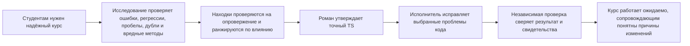

# HL — OOP_20261023-035651_R: Рефакторинг

> **Текущий файл:** `HL-OOP_20261023-035651_R.md`
> **Дата:** 2026-10-23
> **Автор:** Coordinator `codex:thread:local:01a166f4-62e9-7991-951b-ad139de83dff`
> **Название:** Refactoring · **Сокращение:** R
> **Статус:** 🔒 HL утверждён; подготовлена итерация исследования
> **Контракт:** 🔒 FROZEN — approved by roman 2026-10-23
> **Замороженные разделы после утверждения:** §1, §3, §4, §5, §6, §7
> **Свободные разделы:** §2, §7.2, §8, §9, §10, §11
> **Изменение замороженных разделов:** только через журнал поправок §12
> **Базовая версия:** коммиты фиксации по форме восстановления из `conventions.md` §3, правило 15
> **North Star проекта:** `NorthStar.md` — цель, опыт учащегося, оценивание, границы продукта, критерии успеха

## 1. Видение 🔒 ЗАМОРАЖИВАЕТСЯ

OOPoman остаётся простым локальным курсом ООП, который студент может проходить без аккаунта и серверной части. Главный результат этой задачи — исправленный код. Исследование должно отделить реальные ошибки и регрессии от предположений, выявить технические пробелы, проверить, есть ли дублирующиеся функции с ощутимой ценой сопровождения, а также найти вредные методы и обосновать безопасную замену. Подтверждённые приоритетные проблемы исправляются с сохранением согласованного поведения курса.

**Польза:** студентам надёжнее проходить курс; Роман и будущие сопровождающие видят, какие проблемы кода подтвердились, что исправлено и почему изменение оправдано.

> *Воображаемый сопровождающий-студент:* «Неисправность устранена, и понятно, почему это изменение не ломает привычный курс».

## 2. Текущее состояние (As-Is) 🟢 СВОБОДНЫЙ

- **Пользователи и применение.** `NorthStar.md` описывает курс для студентов второго курса; `TRACE.md` подтверждает разрешение на статическую публичную копию для однокурсников (2026-10-21). Фактическое число учащихся и уровень использования неизвестны; прогресс браузера не отправляется в проект.
- **Контракт продукта.** Доступны модули 1 и 2, модуль 3 закрыт. Есть уроки и лабораторные, тесты, чек-листы, локальный прогресс, баллы и ручная взаимопроверка. Нет аккаунтов, серверной части или исполнения кода (`NorthStar.md`, `course/README.md`). Исходные PDF в `OOP-course/` — только для чтения.
- **Подтверждённое расхождение документации.** `architecture/context.puml` утверждает, что модули 2–3 закрыты, страницы пусты, баллов и активности нет. `course/README.md`, `course/data.js`, `course/app.js` и `course/storage.js` описывают и реализуют доступные модули 1–2, заполненные страницы, баллы, прогресс и сброс. Это установленное несоответствие, но его полезность и приоритет ниже основной проверки кода.
- **Техническая форма.** Статические HTML/CSS/JavaScript. Основные файлы: `course/app.js` (453 строки), `course/data.js` (722), `course/storage.js` (130), `course/styles.css` (378); также 12 оболочек уроков и лабораторных. В `course/` 19 файлов, включая SVG. В `.tfw/project_config.yaml` не выбраны сборка и команда тестирования; на этапе планирования тесты не запускались.
- **Неизвестно.** Есть ли ошибки в реальных пользовательских сценариях; какие технические пробелы влияют на надёжность; дублируют ли функции одну и ту же ответственность; есть ли методы с подтверждаемым вредом; какие исправления поместятся в одну безопасную фазу.

## 3. Целевое состояние (To-Be) 🔒 ЗАМОРАЖИВАЕТСЯ

Провести ровно одну итерацию исследователя, чтобы проверить ошибки и регрессии, технические пробелы, функции с существенным дублированием и методы с конкретным вредным эффектом. Ранжировать находки по влиянию на учащегося и ценности исправления кода. Затем выполнить одну ограниченную фазу исправления, сосредоточенную на подтверждённых приоритетных проблемах. Рефакторинг, архитектурные или инструментальные изменения включать, только если данные показывают, что они нужны. Само по себе текстовое сходство функций не оправдывает их объединение: требуется общая ответственность и доказуемый риск сопровождения. «Вредный метод» должен иметь конкретное последствие — неверное поведение, потерю данных, угрозу безопасности или приватности, сбой доступности/совместимости либо существенную потерю производительности — и обоснованную более безопасную замену.

Любое изменение согласованного поведения или границ продукта возвращается Роману на отдельное решение. Точные файлы, критерии и объём фазы фиксируются в утверждённом после исследования TS.

### 3.1. Наглядный результат

Через полгода сопровождающий может проследить от подтверждённой проблемы к коду, исправлению и независимой проверке. Ни одна предполагаемая ошибка не выдаётся за найденную до исследования.

| Область | Подтверждено сейчас | Результат задачи |
|---|---|---|
| Ошибки и регрессии | Код ещё не проверен; конкретные ошибки не заявлены | Для каждой выбранной проблемы указаны источник, наблюдаемое последствие, обоснование исправления и результат проверки; опровергнутые подозрения помечены отдельно |
| Дубли и вредные методы | Кандидаты ещё не оценены | Объединение или замена только при подтверждённом риске и более безопасном решении с сохранением поведения |
| Карта архитектуры | Диаграмма утверждает, что сайт устроен иначе, чем текущая реализация | Исправить, только если после оценки задач кода это останется оправданным приоритетом |
| Опыт учащегося | Два доступных модуля, локальный прогресс и баллы | Согласованное поведение и границы сохранены |
| Передача результата | Свидетельства сейчас находятся в исходниках | RF и независимый REVIEW показывают, что изменено, что проверено и что осталось неопределённым |

### 3.2. Путь к ценности

## 4. Этапы 🔒 ЗАМОРАЖИВАЕТСЯ

Это задача с одной фазой реализации. Исследование — обязательный подготовительный этап, а не фаза реализации. Координатор задачи ведёт весь цикл; отдельный координатор фазы не требуется.

### 4.1. Выбор координации 🔒 ЗАМОРАЖИВАЕТСЯ

| Параметр | Выбор |
|---|---|
| Источник активации и владелец | Напрямую от владельца; owner-only; `roman` |
| Координатор задачи | `codex:thread:local:01a166f4-62e9-7991-951b-ad139de83dff` (`PLAN · R`, заголовок установлен и проверен) |
| Координатор фазы | Не нужен: одна фаза |
| Объём ролей | Одна итерация Researcher после утверждения HL; один Executor после утверждения TS; независимый Reviewer после RF. Каждую роль вручную запускает Роман. |
| Маршрут вверх | `owner:roman` |
| Диалог / отчётность | `tfw-gates-only` / `native-gates` |
| Модель и усилие рассуждения | Политика модели владельца; усилие выбирается отдельно для каждой роли |
| Исполнитель | Отдельное рабочее дерево; точный путь станет известен при создании |
| Полномочия на изменение продукта | Нет; решения о контракте продукта остаются за владельцем |
| Неизменяемый источник полномочий | `request.md @ 7f92099ef6643cf8edb75f195fee40bd30accd5e` |

Доступность механизмов Codex: создание задач для ролей — с участием владельца, поскольку он вручную запускает роли; адресная отправка — native; ожидание и чтение возврата — native; установка заголовка и точное чтение для проверки — native. Наличие механизма само по себе не выдаёт полномочия и не запускает роль.

### Фаза A: Исправление подтверждённых проблем кода 🔴

**Условие начала:** одна разрешённая итерация исследования завершена; Роман утвердил точный TS.

**Результаты:**

1. Ограниченный перечень исправлений приоритетных подтверждённых ошибок, регрессий и вредных технических решений. Для объединения дублирующихся функций и замены вредных методов указаны факты и последствия.
2. Исправленная карта архитектуры, только если она сохранена как обоснованный приоритет в TS.
3. Свидетельства и RF по каждому критерию утверждённого TS и точной версии Candidate.
4. Независимый REVIEW и передача Роману полного результата, замечаний и нерешённых вопросов.

Не добавлять авторский материал в курс, новые функции продукта, решение об открытии модуля, серверную часть, аккаунты или исполнение кода. Примеры, UML, упражнения по программированию и терминал проверки кода в уроках и лабораторных исключены согласно запросу владельца. TS заранее задаёт точные файлы, объём учёта, критерии и свидетельства.

## 5. Критерии завершения (DoD) 🔒 ЗАМОРАЖИВАЕТСЯ

1. Ровно одна итерация Researcher возвращает проверяемый RES, различающий подтверждённые находки, опровергнутые гипотезы и остаточную неопределённость. Дополнительная итерация требует нового решения Романа.
2. TS задаёт ограниченный приоритетный набор из RES, точный состав VALUE и знаменатель учёта, сохраняет контракт North Star и утверждён Романом до исполнения.
3. Executor возвращает согласованные исправления, RF и свидетельства для каждого критерия TS; поведение или границы продукта не меняются без разрешения.
4. Независимый Reviewer проверяет Candidate, RF, свидетельства, замороженный контракт и North Star и оставляет устойчивый вердикт.
5. Роман получает результат, замечания проверки, нерешённые вопросы и точные решения, которые ещё требуются от него.

## 6. Критерии неудачи (DoF) 🔒 ЗАМОРАЖИВАЕТСЯ

1. Candidate меняет согласованное поведение учащегося или границы продукта без решения владельца.
2. Существенная выбранная проблема не имеет источника, наблюдаемого основания или ограниченного критерия приёмки либо Candidate не выполняет критерий.
3. Исследование или реализация начинается до утверждения соответствующего HL или TS.
4. Ограничение одной итерации оставляет существенный вопрос нерешённым, но работа продолжается как будто вопрос решён.

**При неудаче:** остановить зависимую работу, сохранить фактический результат и неопределённость, вернуть Роману точный пробел и варианты. Не расширять объём молча и не объявлять проверку исчерпывающей.

## 7. Принципы 🔒 ЗАМОРАЖИВАЕТСЯ

1. **Сохранять контракт учащегося.** Не менять согласованный статический локальный курс, доступность модулей, баллы, прогресс, взаимопроверку и границы исходных материалов.
2. **Сначала свидетельства.** В TS включаются только находки с проверяемым основанием, последствием и причиной приоритета.
3. **Минимальное полное исправление.** Архитектурные и инструментальные изменения нужны только при подтверждённой пользе, соразмерной риску.
4. **Не скрывать неопределённость.** Подозрение без подтверждения не является дефектом; одна итерация не доказывает отсутствие других проблем.

### 7.2. Ссылки на проектные знания 🟢 СВОБОДНЫЙ

| Приоритет | Источник | Раздел | Применение |
|---|---|---|---|
| P0 | [NorthStar.md](../../../NorthStar.md) | Цель; опыт учащегося; оценивание; границы продукта; успех | Определяет учащихся, ожидаемое поведение курса и границы, которые сохраняются. |
| P1 | [TFW README](../../../.tfw/README.md) | NS2: цель прежде активности; принцип Сент-Экзюпери; вопросы до преждевременных ответов; проверка соразмерна риску | Требует выбирать только полезные исправления, проверять гипотезы и не раздувать работу ради самого рефакторинга. |
| P1 | [TFW README](../../../.tfw/README.md) | Ценности: честность; структурное закрепление; переносимость | Требует явно сообщать опровержения, привязывать изменения к доказательствам и сохранять решения в доступных файлах. |
| P1 | [TFW README](../../../.tfw/README.md) | Критерии успеха 1–4 | Требует устойчивой передачи ролей, оснований решений, проверки находок и понятного результата. |
| P2 | `knowledge/philosophy.md` | Отсутствует | Предписанный источник проверен; дополнительные принципы не домысливаются. |
| P3 | [KNOWLEDGE.md](../../../KNOWLEDGE.md) | §1 Карта архитектуры; архитектурные решения | Утверждения карты сверены с исходниками; принятое решение не разрешает менять North Star. Новые решения не предполагаются. |
| P4 | [TFW conventions](../../../.tfw/conventions.md) | Контракт HL; правила проектирования; запрещённые антипаттерны | Исследование начинается после утверждения HL, реализация — только по TS; критерии связаны с ценностью и доказательством. |
| P5 | `knowledge/convention.md` | Отсутствует | Каталог знаний проекта отсутствует; дополнительные соглашения не предполагаются. |
| P6 | `knowledge/process.md` | Отсутствует | Маршрут и утверждения определяются действующими правилами TFW и запросом владельца. |
| P7 | `knowledge/*.md`, `knowledge/records/` | Отсутствуют | Другие записи о предметной области, заинтересованных лицах и рисках не обнаружены; выводы из их отсутствия не делаются. |

## 8. Зависимости 🟢 СВОБОДНЫЙ

| Зависимость | Состояние |
|---|---|
| Роман утверждает HL до единственной итерации исследования | ✅ Утверждён 2026-10-23 |
| Одна итерация Researcher в рамках явного исключения из настроенного минимума 2 | ⬜ |
| Роман утверждает точный TS до исполнения | ⬜ |
| Код сайта `course/`; PDF в `OOP-course/` остаются только для чтения | ✅ Найдены |
| Отдельное рабочее дерево для исполнителя | ⬜ Создание с участием владельца на соответствующем шлюзе |

## 9. Риски 🟢 СВОБОДНЫЙ

| Риск | Вероятность | Влияние | Снижение риска |
|---|---|---|---|
| Одна итерация пропустит малозаметную регрессию | Средняя | Высокое | Зафиксировать неопределённость в RES; не заявлять, что доказано отсутствие проблем; при существенном пробеле спросить Романа о следующем цикле. |
| Исправление или структурный рефакторинг вызовет регрессию учащегося | Средняя | Высокое | Ограничить файлы и критерии в TS, собрать свидетельства, провести независимую проверку. |
| Смена инструментария увеличит стоимость сопровождения | Средняя | Среднее | Исследовать более простую альтернативу; включать изменение только для решения подтверждённой проблемы в пределах контракта. |
| Диаграмма окажется малоценной для сопровождающих | Низкая | Низкое | Считать её вторичной; менять лишь если польза выше приоритета исправлений кода и изменение вошло в TS. |

## 10. Основание исследования 🟢 СВОБОДНЫЙ

### Слепые зоны

- Реальное число учащихся и использование публичной копии неизвестны; серверная аналитика не предусмотрена.
- Команда сборки и тестирования проектом не настроена. На этапе планирования тесты не запускались; поведение в браузере пока не проверено.
- Кроме расхождения диаграммы, ошибки, регрессии и стоимость сопровождения ещё не подтверждены.

### Гипотезы

| № | Гипотеза, меняющая решение | Возможный случай опровержения и последствие |
|---|---|---|
| H1 | В сценариях учащегося есть существенная ошибка или регрессия. | Код и наблюдаемое поведение соответствуют согласованному контракту; тогда исправление поведения не предлагается. |
| H2 | Некоторые функции содержат дублирующуюся ответственность, которая создаёт риск расхождения или лишнюю стоимость изменений. | Похожий текст обслуживает разные правила или контексты; тогда функции не объединять. |
| H3 | Есть метод с конкретным вредным эффектом, для которого существует более безопасная замена. | Последствие не воспроизводится или замена несёт больший риск; метод не менять без новых свидетельств. |
| H4 | Есть технический пробел или ограничение архитектуры, из-за которого приоритетная проблема не решается локально и безопасно. | Локальное исправление достаточно; крупное изменение архитектуры/инструментария исключить. |
| H5 | Несоответствие карты архитектуры мешает текущему сопровождению настолько, что исправление нужно включить в TS. | Карта — неиспользуемый исторический набросок; оставить её вне реализации, даже если факт несоответствия сохраняется. |

### Риск отказа от исследования

Подтверждённое несоответствие карты останется, возможные ошибки кода будут неизвестны, а будущий сопровождающий может либо повторить проверку, либо менять код по неверной схеме. Без исследования есть риск как оставить существенную неисправность, так и без основания менять исправную часть сайта.

### Предлагаемый фокус исследования

1. Проверить основные пользовательские пути и переходы состояния, их источники данных и локальное хранение; сопоставить с утверждённым контрактом.
2. Найти и проверить возможные ошибки, регрессии и технические пробелы; сравнить функции по ответственности и эффекту, а не только по похожему тексту.
3. Для каждого кандидата указать точный источник, наблюдаемое последствие, затронутого пользователя, вероятную причину, приоритет, минимальное исправление и попытку опровержения.
4. Для вредных методов назвать конкретный риск и оценить более безопасные альтернативы. Отделить прямой долг сопровождения от новых функций.
5. Отдельно оценить практическую ценность исправления диаграммы. Выявить изменения, затрагивающие контракт локального статического продукта, и вынести их владельцу.

Разрешена ровно одна итерация Researcher (`request.md`); это явное исключение из `tfw.research.min_iterations: 2`. Если после возврата остаётся существенный открытый вопрос, остановиться и получить новое решение Романа, прежде чем планировать дополнительную итерацию.

### Почему не другой путь?

| Подход | Польза | Стоимость внедрения и сопровождения | Риски и компромиссы | Решение |
|---|---|---|---|---|
| Сначала доказательства, затем одна ограниченная фаза исправлений кода | Исправляет подтверждённые важные проблемы, сохраняя ожидания учащихся | Средняя: исследование, точный TS, исполнение и независимая проверка | Одна итерация может оставить менее приоритетный долг; даже локальное исправление может вызвать регрессию | Рекомендуется: прямо ставит исправление кода на первое место и не разрешает рефакторинг без причины. |
| Переписать сайт или сменить инструментарий заранее | Может упростить систему, если текущая архитектура действительно является причиной проблем | Высокая: перенос, совместимость и последующее сопровождение | Больше риска регрессий; пока нет данных, что нужен новый стек, сервер или переписывание | Не выбирать до исследования; рассматривать лишь при доказанной необходимости и сохранении контракта. |
| Оставить всё без изменений | Нет стоимости реализации | Нет дополнительной нагрузки | Возможные дефекты останутся неизвестны; карта уже противоречит сайту | Не рекомендуется: не отвечает на запрос исправить код. |

**Если ничего не менять:** все ошибки и регрессии кода останутся непроверенными; карта архитектуры продолжит расходиться с сайтом.

**Сильнейшее возражение:** широта аудита и ограничение одной итерации могут не сочетаться. Несколько связанных высокоприоритетных проблем невозможно безопасно уместить в один TS; напротив, если реальных проблем мало, широкая переработка будет лишней. Рекомендация неверна, если RES покажет, что ограниченный набор не даёт цельного и безопасного результата. Тогда следует вернуть Роману точный пробел, не расширять фазу молча и не объявлять аудит исчерпывающим.

## 11. Стратегические сведения на этапе планирования 🟢 СВОБОДНЫЙ

| № | Сведение | Категория | Источник |
|---|---|---|---|
| S1 | Роман разрешил рассматривать существенные архитектурные или инструментальные изменения при сохранении согласованного поведения и границ продукта; изменение контракта требует отдельного решения владельца. | решение владельца | Прямой ответ Романа в этой задаче, 2026-10-23; событие `journal/20261023-110207__gate_answer__7A4C.md`. |
| S2 | Главная задача — исправить код: различить ошибки, исследовать технические пробелы, проверить дубли функций и вредные методы, обосновать необходимые замены. | приоритет владельца | Прямое уточнение Романа в этой задаче, 2026-10-23; `journal/20261023-110515__gate_answer__C41F.md`. |

### Передача существенных сведений

| Автор / модуль | Источник / версия полномочий | Проверенный объём | Существенное или обоснованное отсутствие | Неопределённость | Продолжение / открытое решение |
|---|---|---|---|---|---|
| Coordinator `codex:thread:local:01a166f4-62e9-7991-951b-ad139de83dff` | Запрос владельца `request.md @ 7f92099ef6643cf8edb75f195fee40bd30accd5e`; текущая рабочая копия на этапе планирования | `NorthStar.md`, `README.md`, `KNOWLEDGE.md`, `TRACE.md`, `course/README.md`, `course/index.html`, `course/app.js`, `course/data.js`, `course/storage.js`, `course/styles.css`, `architecture/context.puml`, конфигурация и выбранные правила/шаблоны TFW | Подтверждено расхождение `architecture/context.puml`; дефекты кода и другие прямые технические проблемы пока не установлены. Записей проектной базы знаний нет. | Фактическое использование, выполнение в браузерах учащихся и обоснованность возможного рефакторинга ещё предстоит выяснить. | Ожидать решения Романа по HL; после утверждения — ровно одна итерация Researcher. Исследование и реализация не начинались. |

## 12. Журнал поправок 🟢 ТОЛЬКО ДОБАВЛЕНИЕ

Поправок нет.

---

*HL — OOP_20261023-035651_R: Рефакторинг | 2026-10-23*
