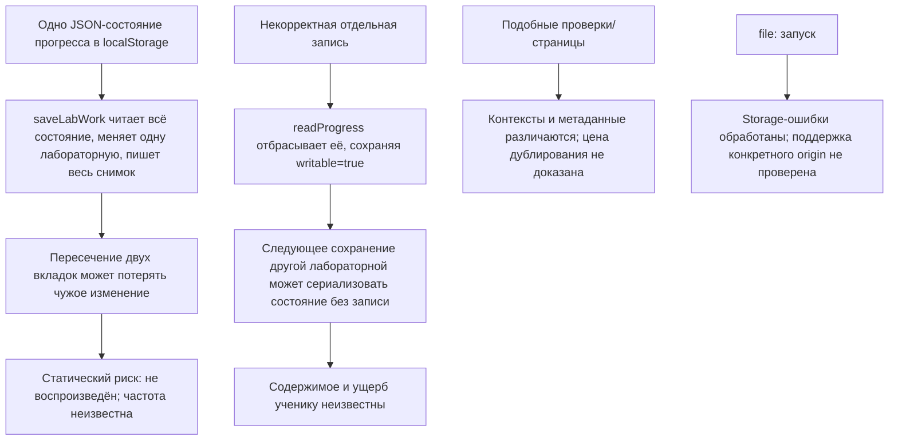

# RES — OOP_20261023-035651_R: Исследование ошибок и технических проблем сайта OOPoman

> **Date**: 2026-10-23
> **Author**: Researcher (Codex)
> **Status**: 🔬 RES — In progress
> **Parent HL**: [HL-OOP_20261023-035651_R](../../HL-OOP_20261023-035651_R.md)
> **Mode**: Pipeline
> **Producer unit**: `codex:thread:local:01a16764-0296-7550-8226-31c0c6068171`
> **Parent Coordinator**: `codex:thread:local:01a166f4-62e9-7991-951b-ad139de83dff`
> **Activation / dispatch source**: Owner-direct `/tfw-research OOP_20261023-035651_R`; `activation: owner-only`
> **Coordination authority**: `request.md @ 7f92099ef6643cf8edb75f195fee40bd30accd5e`
> **Originating proposer**: Roman (owner; unit not applicable)

---

## Research Context

Исследована кодовая база сайта OOPoman для выявления ошибок, технических ограничений, вредных методов и дублирования с ощутимой стоимостью сопровождения. Задача ограничена одной фазой исправлений, сохранением утверждённого поведения курса и рамками продукта; исследование было статическим, без браузерного воспроизведения и измерения пользовательского инцидента.

## Briefing

См. [1_briefing.md](1_briefing.md): цель, границы, focused-режим, вопросы и план итерации; владелец утвердил брифинг прямым ответом «да, подтверждаю».

## Decisions

| # | Decision | Rationale |
|---|----------|-----------|
| D1 | Выполнить одну focused-итерацию исследования; не менять код и замороженный HL | Прямое owner-only поручение, согласованный режим и Role Lock исследователя |
| D2 | Ранжировать подтверждённость, отделяя статический риск от доказанного пользовательского ущерба | Воспроизведение и телеметрия недоступны в пределах этой итерации; поведение продукта менять без шлюза нельзя |
| D3 | Применять SOLID как ориентир лишь там, где подтверждена конкретная польза | Прямое уточнение владельца: нарушение принципа само по себе не обосновывает рефакторинг или расширение объёма |
| D4 | Исправить в исследовательской матрице семантику альтернативы D и число shell-страниц | Challenge выявил ошибочное сужение 12 комбинаций и неточный диапазон страниц; Gather/Extract исправлены, HL не затронут |

## Open Questions

| # | Question | Status | Answer |
|---|----------|--------|--------|
| Q1 | Воспроизводится ли потеря записи при пересекающихся сохранениях из двух вкладок в целевом браузере? | Открыт | Возможность следует из структуры read–modify–write и модели localStorage, но воспроизведения и оценки частоты нет |
| Q2 | Может ли некорректная запись содержать восстанавливаемые ответы ученика и какая политика восстановления нужна? | Открыт | Кодовый путь удаления подтверждён статически; фактическое содержимое записи и пользовательский эффект неизвестны |
| Q3 | Является ли открытие через `file:` обязательным режимом в целевом Chrome? | Открыт | README описывает локальное открытие, но конкретное поведение браузера для этого проекта не проверялось |
| Q4 | Мешает ли расхождение архитектурной карты сопровождению сейчас? | Открыт / низкий приоритет | Само несоответствие известно, текущая стоимость или блокировка не установлены |

## Hypotheses (from HL §10)

| # | Hypothesis | HL Status | RES Status | Evidence |
|---|---|---|---|---|
| H1 | В сценариях учащегося есть существенная ошибка или регрессия. | open | 🟡 Частично подтверждён технический риск; ущерб не установлен | `storage.js`: некорректная отдельная запись отбрасывается из читаемого состояния при `writable:true`; последующее сохранение может перезаписать весь JSON без неё. Ответы ученика внутри записи не проверены. Межвкладочная гонка остаётся кандидатом до воспроизведения. |
| H2 | Некоторые функции содержат дублирующуюся ответственность, создающую риск расхождения или лишнюю стоимость изменений. | open | ⚪ Не подтверждена | Сходные проверки маршрутов/максимумов обслуживают контекстные правила; оценка централизована в `scoreFor()`. Доказательств ненужной стоимости объединения нет. |
| H3 | Есть метод с конкретным вредным эффектом, для которого существует более безопасная замена. | open | 🟡 Кандидат, эффект не воспроизведён; безопасная замена не выбрана | Полная запись localStorage может затереть параллельное изменение; HTML не обещает блокировку. Триггер структурно возможен, но ни эффект в целевом движке, ни приемлемое решение не проверены. |
| H4 | Есть технический пробел/ограничение архитектуры, мешающее решить приоритетную проблему локально и безопасно. | open | ⚪ Не подтверждена | Для найденных путей не доказана необходимость крупного архитектурного изменения; сценарий `file:` оставлен как проверочный вопрос. |
| H5 | Несоответствие архитектурной карты мешает текущему сопровождению настолько, что исправление нужно включить в TS. | open | ⚪ Не подтверждена | Несоответствие само по себе не показывает текущую цену или блокирующий эффект; дополнительно не исследовалось как инцидент сопровождения. |

## HL Update Recommendations

> Исследователь классифицирует, но не применяет и не выносит решение.

### Refinements — free sections, coordinator applies

| # | § | What to update | Source |
|---|---|----------------|--------|
| R1 | §10 | При следующем разрешённом пересмотре уточнить, что SOLID служит эвристикой для поиска конкретной подтверждённой цены изменений; не самостоятельным основанием для рефакторинга | Прямое owner-уточнение от 2026-10-23; записано в D3 и Strategic Insights. Координатор решает, требуется ли уточнение HL |
| R2 | §10 | Отразить как проверяемый кандидат риск конкурирующих сохранений полного состояния в разных вкладках; требовать проверки эффекта и критерия прежде, чем считать его подтверждённой проблемой | Challenge, C4; основание — структура `saveLabWork()` и спецификация localStorage; воспроизведение отсутствует |

### Amendment Proposals — frozen sections, resolved-ruler verdict required

**No amendment proposals.** Ни один результат этой итерации не обосновывает изменение замороженного контракта или поведения продукта.

## Fact Candidates

| # | Category | Candidate | Source | Confidence |
|---|----------|-----------|--------|------------|

Новых факт-кандидатов нет: наблюдения в коде доступны независимому читателю репозитория и потому не проходят Human-Only Test; прямое указание SOLID является решением/эвристикой владельца, а не новым проверяемым фактом проекта.

## Strategic Insights (Research)

| # | Category | Insight | Source | Confidence |
|---|----------|---------|--------|------------|
| SS1 | Конвенции реализации и архитектурные ориентиры | Оценивать SOLID там, где он помогает выявить конкретную стоимость изменений или риск; само формальное несоответствие не оправдывает рефакторинг и не расширяет фазу | Roman, прямое уточнение владельца в текущем исследовательском диалоге от 2026-10-23 (ответ: «Использовать как ориентир, где подтверждена польза») | ★★★ |

## Findings Map

Ранжирование для координатора: (1) пересекающиеся вкладки — наиболее значимый, но непроверенный риск; (2) отбрасывание malformed-записи — подтверждённый кодовый путь с неизвестной ценностью данных; (3) `file:` — совместимость как открытый вопрос. Дублирование и диаграмма не обоснованы как исправления этой фазы.

## Iteration Status

- **Iteration:** 1 of 1 (min) / 1 (max), согласно утверждённому для этой задачи `iterations.yaml`
- **Hypotheses tested:** H1 (частично подтверждён статический риск), H2 (не подтверждена), H3 (кандидат не воспроизведён), H4 (не подтверждена), H5 (не подтверждена)
- **Hypotheses deferred:** Ни одна гипотеза не отложена целиком; проверка браузера/содержимого malformed-записей/практической цены карты оставлена открытыми вопросами в рамках единственной итерации
- **Gaps discovered:** Нет браузерного воспроизведения, телеметрии или подтверждённого пользовательского инцидента; нет критерия приемки для межвкладочной согласованности; неизвестно, содержат ли malformed-записи восстанавливаемые ответы; режим `file:` не проверен. Пробел привязки источника экономики: инструменты текущей задачи не предоставили точный `session_meta.id`, путь/версию собственного rollout и диапазон `start`/`cutoff`; материал на извлечение не обнаружен и не извлекался, last-good неизвестен. Этот пробел не заполнен оценками или вымышленными данными.
- **Superseded decisions:** Нет; правки Gather/Extract устранили ошибку описания альтернативы D и вернули 12 ранее пропущенных конфигураций в отображение. Исправлен охват shell-страниц до 12 (`lesson-01..06.html`, `lab-01..06.html`).

### Open Threads (for next iteration)

| # | Thread | Why it matters | Suggested focus |
|---|--------|----------------|-----------------|
| 1 | Проверить конкурентные сохранения в целевом Chrome и зафиксировать приемочный критерий | Потенциальная потеря прогресса при межвкладочном пересечении | Воспроизводимый сценарий двух вкладок; оценить допустимую локальную стратегию, не полагаясь на повторное чтение как атомарную защиту |
| 2 | Установить политику обработки частично некорректной записи | Полная сериализация может удалить её из хранилища, а пригодность данных неизвестна | Проверить достижимые формы повреждения, ценность восстановления и UX; отделить это от верхнеуровневого отказа версии/JSON |
| 3 | Подтвердить поддерживаемый способ запуска курса | Спецификация допускает ограничения для opaque/file origins, а проектный Chrome-сценарий неизвестен | Сверить требование README/владельца с поведением целевого браузера до изменения способа запуска |

### Recommendation
- [x] **SUFFICIENT** — proceed to `/tfw-plan` to classify these recommendations and write TS
- [ ] **MORE NEEDED** —
- [ ] **BLOCKED** —

> Рекомендация означает достаточность для ограниченного решения на этапе Plan, а не подтверждение пользовательского ущерба. Координатор решает, вести ли риск как задачу проверки/критерий TS или исключить его из реализации.

## Conclusion

Одна focused-итерация статически проверила пять гипотез и дала координатору ранжированные кандидаты без изменения продукта: найден возможный межвкладочный конфликт записи и условный путь удаления отдельной некорректной записи, но их пользовательский эффект ещё не доказан; похожие функции и архитектурная карта не показали подтверждённой цены исправления. Внешние спецификации WHATWG поддерживают границы вывода о localStorage, однако не заменяют воспроизведение в целевом Chrome. SOLID учтён по указанию владельца как практический ориентир, а не формальный повод для расширения объёма. Самокритика: без runtime-проверки исследование не может ранжировать частоту и тяжесть двух storage-рисков, поэтому дальнейшее планирование должно явно сохранить эту неопределённость.

### Material handover at this return

- **Producer/unit:** Researcher `codex:thread:local:01a16764-0296-7550-8226-31c0c6068171`; parent Coordinator `codex:thread:local:01a166f4-62e9-7991-951b-ad139de83dff`.
- **Source/epoch and cutoff:** код курса в рабочем дереве на базе Git `2daa9a40f2278802145496934fadf0c5830734e3`, состояние на 2026-10-23 11:39:39 +05:00 (2026-10-23 06:39:39 UTC); проверка `git status --short -- course` не показала локальных изменений файлов курса. Экономический источник/rollout binding недоступен, см. пробел выше.
- **Inspected scope:** `course/README.md`, `course/app.js`, `course/storage.js`, `course/data.js`, `course/index.html`, `course/lesson-04.html`, `course/lab-04.html`; листинг shell-файлов уроков 01–06 и лабораторных 01–06; утверждённые HL и проектные TFW/knowledge инструкции. Внешние первичные источники: [WHATWG HTML — localStorage](https://html.spec.whatwg.org/multipage/webstorage.html#dom-localstorage-dev), [WHATWG URL — origin](https://url.spec.whatwg.org/#origin), [WHATWG HTML — setItem](https://html.spec.whatwg.org/multipage/webstorage.html#dom-storage-setitem-dev), [WHATWG HTML — Web Storage model](https://html.spec.whatwg.org/multipage/webstorage.html#introduction).
- **Material returned:** this RES and stage trace files [1_briefing.md](1_briefing.md), [2_gather.md](2_gather.md), [3_extract.md](3_extract.md), [4_challenge.md](4_challenge.md). Числовая проверка матрицы: 63 показанных конфигурации из 64, базовая A/A/A скрыта согласно правилу сжатия; все пары альтернатив проверены, несовместимые пары не найдены. Число shell-страниц — 12. Рантайм-измерения/проверки не выполнялись; количественного вклада в экономику нет.
- **Uncertainty and continuation:** межвкладочная потеря и пользовательский ущерб не воспроизведены; материал/инциденты отсутствуют; неизвестны критерии запуска через `file:` и восстановимость malformed-записи. Передать ранжирование и открытые потоки координатору для решения на `/tfw-plan`; дальнейшая исследовательская итерация этой задачей не разрешена.
- **Knowledge handover:** новых проверенных фактов для базы знаний нет. Технические находки относятся к исследованию кандидатов, SOLID-направление — owner-sourced strategic insight; новых независимых записей знания не создавалось.

---

*RES — OOP_20261023-035651_R: Исследование ошибок и технических проблем сайта OOPoman | 2026-10-23*
