# HL — OOP_20261027-201313_WEEK3: Наполнение курса OOPoman — неделя 3

> **Date**: 2026-10-28
> **Author**: Codex Plan Coordinator
> **Title**: Наполнение курса OOPoman — неделя 3
> **Abbreviation**: WEEK3
> **Status**: 🔒 FROZEN — approved by Roman 2026-10-28
> **Contract**: 🔒 FROZEN — approved by roman 2026-10-28
> **Frozen**: §1 · §3 · §4 · §5 · §6 · §7 — locked on owner approval
> **Free**: §2 · §7.2 · §8 · §9 · §10 · §11 — research updates these directly
> **Append-only**: §12 Amendment Log — the only channel for changing a frozen section
> **Baseline**: freeze commits — recovery form in `conventions.md` §3 rule 15
>
> **Project North Star**: `NorthStar.md` · `.tfw/README.md` #ns1 · #ns2 · #ns3

## 1. Vision 🔒 FROZEN

Неделя 3 завершает трёхнедельный курс связной последовательностью: студент понимает, как объекты состыковываются, как передают работу и как эти решения отражаются в архитектуре. Каждая лекция ведёт к лабораторной с теми же моделями, а статические пары кода и вывода помогают заранее увидеть ожидаемое поведение без запуска кода на сайте.

**Impact:** появляются шесть согласованных страниц для модуля 3; учащийся связывает объяснения ООП с практическими задачами и видит, где те же принципы применяются в интеграции программ. Roman может осматривать модуль на локальном сайте в процессе работы и решать вопрос о распространении только после приёмки полного результата.

> **Воображаемая реплика студента:** «Теперь я понял, как обычные классы помогают программам работать с разными API: по схеме видно роли, а в полном примере — конкретный результат».

## 2. Current State (As-Is) 🟢 FREE

- **Наблюдение:** `NorthStar.md` задаёт локальный статический курс на три недели, без серверного выполнения кода, регистрации и автоматической оценки. По прямому указанию Roman модуль 3 открыт для локального preview во время разработки; незаконченные материалы не публикуются. Обязательное ядро занятия и практики — до 60 минут с необязательным углублением.
- **Наблюдение:** `course/data.js`, `course/app.js`, `course/styles.css` и оболочки реализуют занятия 1–6. Для 7–9 нет уроков, лабораторных или оболочек. `module3.available` сейчас жёстко задан как `false`; навигация и прямые URL проверяют доступность модуля. Текущее условие нужно согласовать с owner preview в ходе реализации.
- **Наблюдение:** существующий `diagram` показывает списки «до/после», а не UML-отношения классов и последовательность взаимодействия. Блок `example` не задаёт структурированную пару полного кода и ожидаемого вывода.
- **Наблюдение:** лекции 1–6 используют преимущественно JavaScript; PDF лабораторных 7–9 и все шесть PDF недели 3 используют Python. Roman подтвердил Python на всех шести новых страницах. Это выбор языка примеров только для недели 3, не решение о runtime.
- **Наблюдение:** PDF лекций 7–9 указывают 90 минут, лабораторных 7–9 — 135 минут; веб-курс ограничивает обязательное ядро 60 минутами и допускает необязательное углубление. Исходные PDF остаются неизменными.
- **Наблюдение:** исходная лабораторная 7 — 135-минутная задача о платёжном шлюзе городского транспорта: адаптер legacy-банка, три декоратора (таймер, повтор при таймауте, кэш стоп-листа), терминальный фасад оплаты и тесты. Сфокусированное исследование двух итераций показало, что Plaid Sandbox даёт mock-сведения о связанных счетах и cached balance, а Bank of Canada Valet — публичные финансовые ряды и indicative FX, не платёжные операции. Ни один кандидат не является API списания/эквайринга из исходной лабораторной; оба могут быть только источником формы контракта для локального фиктивного примера.
- **Неизвестно и зарезервировано владельцу:** нужно ли сохранить исходный смысл лабораторной 7 (платёжный шлюз/транспорт) и моделировать вымышленный платёжный контракт локально, или допустимо переформулировать кейс как чтение данных о счетах либо публичной финансовой статистики. Это решение должно предшествовать фиксации TS.
- **Допущение для реализации:** три пары страниц можно создать в одном согласованном цикле с одним task Coordinator; общая схема готовности пригодится для безопасного открытия модуля.
- **Неизвестно:** как читатели воспримут SVG-диаграммы на малых экранах и при отключённой загрузке изображений; это проверяется визуально и на доступность при реализации.
- **Owner direction, 2026-10-28:** локальный preview открыт только для личной проверки Roman; экзамены относятся к будущим задачам. Объяснения должны быть доступными, сложные темы можно разбирать простыми словами, а кодовые блоки должны быть полными и самодостаточными.

## 3. Target State (To-Be) 🔒 FROZEN

Создать в локальном курсе шесть страниц недели 3: лекции и лабораторные 7, 8, 9. На всех страницах использовать Python, доступно объяснять сложные темы и определять технические термины простым русским языком при первом употреблении. Для каждой темы дать полную самодостаточную статическую программу/заготовку и соответствующий ожидаемый вывод, а также содержательную UML-диаграмму. Учебное ядро укладывается в 60 минут; дополнительные подробности вынесены в необязательное углубление. Модуль 3 открыт на локальном сайте во время разработки для личной проверки Roman; незаконченная версия не публикуется. Независимый Review и явная owner acceptance остаются gate принятия готового набора.

### 3.1 Result Visualization

**Как выглядит курс после завершения** — схематические примеры содержания, не фактический готовый код:

```text
OOPoman · Неделя 3                         локальный просмотр разработки: открыт
┌────────────────────────┐  ┌────────────────────────┐
│ 7 · Стыковка объектов  │  │ Лабораторная 7        │
│ Adapter / Decorator /  │→ │ учебная API-интеграция │
│ Facade: объяснение,    │  │ полная программа →     │
│ UML классов + пара     │  │ UML взаимодействия    │
│ Python: код → вывод    │  │ чек-лист и 5 вопросов │
└────────────────────────┘  └────────────────────────┘
┌────────────────────────┐  ┌────────────────────────┐
│ 8 · Передача работы    │  │ Лабораторная 8        │
│ Chain + Observer       │→ │ фиктивный запрос и     │
│ UML классов + пара     │  │ локальное событие      │
│ Python: код → вывод    │  │ код → вывод + UML      │
└────────────────────────┘  └────────────────────────┘
┌────────────────────────┐  ┌────────────────────────┐
│ 9 · Границы архитектуры│  │ Лабораторная 9        │
│ Clean Architecture,    │→ │ небольшая локальная    │
│ правило зависимостей   │  │ задача с разнесением   │
│ UML классов + пара     │  │ ответственности       │
│ Python: код → вывод    │  │ код → вывод + UML      │
└────────────────────────┘  └────────────────────────┘
       обязательное ядро: до 60 минут на страницу/маршрут
       дополнительные примеры и разбор: необязательное углубление

Во время реализации: локальная неделя 3 открыта для проверки владельцем.
После Review + явной приёмки всех 6 страниц: Candidate принят к дальнейшему
проектному решению о распространении; незаконченный сайт не публикуется.
```

Все названия и фрагменты в макете — иллюстративные направления, не готовый код. Лекция 7 показывает, как Adapter, Decorator и Facade помогают организовать интеграцию с внешним API; выбор API, sandbox и учебной глубины обосновывается исследованием. Никаких реальных платёжных данных, учётных данных или советов о production-безопасности. Лекция 8 ограничивается Chain и Observer, нужными для соответствующей лабораторной. Лекция 9 объясняет границы чистой архитектуры через малую локальную задачу. Экзамены и их формат не входят в scope. Каждая лабораторная сохраняет формат курса: практика, чек-лист и пять вопросов.

**Ценность в результате:** студент видит реальную пользу ООП для проектирования взаимодействия программ и один принцип в объяснении, диаграмме, полной программе и упражнении; Roman может проверять сайт по мере разработки.

### 3.2 Value Flow

```mermaid
flowchart LR
  N[Понятия и модели ООП] -->|практическое применение исследовано| R[Реальные API и паттерны] --> L[Лекция 7, 8 или 9]
  L -->|UML показывает роли и связи| U[Диаграмма классов / взаимодействия]
  U -->|та же идея в малом примере| P[Python: стартовый код → ожидаемый вывод]
  P -->|студент применяет модель| Lab[Парная лабораторная]
  Lab -->|проверка понимания без автозапуска| Q[Чек-лист и 5 вопросов]
  Q -->|готовые шесть страниц и независимая проверка| Gate[Явная приёмка владельца]
  Gate -->|незаконченная версия не распространяется| M[После приёмки — решение о распространении]
  Build[Страницы и общий интерфейс в разработке] --> Preview[Локальный модуль открыт для Roman]
  Preview -->|ранняя обратная связь| Build
```



## 4. Phases 🔒 FROZEN

Одна фаза: подготовить полный набор, выполнить независимую проверку и передать владельцу на приёмку. Разделение на лекции/лабораторные как отдельные фазы создало бы три координационных цикла на взаимосвязанный материал и не сокращает зависимость открытия от полного набора.

### 4.1 Coordination Selection 🔒 FROZEN

| Activation source | Accountable owner | Task Coordinator unit | Phase Coordinator rule | Mandate scope / role reach | Upward route | Dialogue | Reporting | Reservations / controls | Amendment authority | Immutable epoch |
|---|---|---|---|---|---|---|---|---|---|---|
| owner-direct | Roman | `codex:thread:local:01a17ea0-4eee-7350-af2c-eec0b91464c7` | none; one phase | Plan Coordinator; owner вручную запускает отдельные Researcher, Executor и Reviewer на соответствующих gates; каждая роль имеет отдельный адрес | owner:roman | tfw-gates-only | native-gates | HL, TS, выбор стратегии, приёмка всех шести страниц и любое распространение остаются за владельцем; локальный preview открыт по его прямому указанию; без неразрешённой публикации, PR и push | none | `request.md @ 1d67e285bc8210e5a69e2081b489ec61745b6c6f` |

Фактические средства Codex на старте: provision — native; адресная отправка — native; wait/readback — native; title write + exact readback — native. Эти возможности не дают мандата и не запускают роли. Coordinator вручную ждёт утверждения HL, затем создаёт TS и проходит нужные gates. Владелец вручную запускает роль только после получения её точной команды `/tfw-* OOP_20261027-201313_WEEK3`; выбор модели и reasoning effort фиксируется при первом запуске роли по доступному профилю. Смена адреса/контейнера отражается в статусе и журнале после фактического readback.

### Phase A: Week 3 research, pages, review and owner acceptance 🔴
- **Deliverables:** один ограниченный RES о реальном применении ООП во внешних/banking API и подходящем безопасном учебном примере; три лекции 7–9 и три лабораторные 7–9; локальные UML assets и переиспользуемый рендер при небольшом охвате; на каждой странице — структурированная пара, где кодовая часть представляет полную самодостаточную Python-программу, а вторая часть даёт её ожидаемый вывод; открыть модуль на локальном сайте для проверки Roman в ходе разработки; независимый RF/REVIEW; итоговый TFW Economics-отчёт по задаче при закрытии после принятых результатов; обновить пользовательские описания, NorthStar и CHANGELOG согласно принятому состоянию.
- **Не входит:** браузерный терминал, исполнение кода на сайте, подключение к реальному API/банковским счетам, реальные платежи или учётные данные, автопроверка качества кода, изменение PDF, решение о языке runtime, экзаменационная программа/формат, переработка недель 1–2 без дешёвого общего рендера, публикация незаконченного модуля.

## 5. Definition of Done (DoD) 🔒 FROZEN

- ✅ 1. В `course/data.js` и соответствующих оболочках доступны три лекции и три лабораторные 7–9, правильно попарно связанные и включённые в навигацию.
- ✅ 2. Все шесть страниц используют Python. Каждый кодовый блок является полным, самодостаточным фрагментом/программой без пропущенных импортов, определений или вызова; где он показан как code/output pair, отдельно дан согласованный ожидаемый вывод. Сайт не запускает код.
- ✅ 3. Уроки связаны с соответствующими лабораторными; в лекционном обязательном ядре выдержана 60-минутная структура с отделённым необязательным углублением.
- ✅ 4. Для занятий 7–9 есть понятные UML-диаграммы классов; лабораторные содержат диаграммы взаимодействия, соответствующие теме, в том числе требуемую последовательность для занятия 8. Диаграммы доступны как статические локальные активы с текстовым пояснением/альтернативой.
- ✅ 5. Сохранённые из PDF термины объяснены простым русским языком при первом применении; аналогии поддерживают формальную модель и затем явно связываются с ней.
- ✅ 6. Учебные примеры используют фиктивные локальные данные, без сетевого вызова и реального платежа. RES может изучать официальные API-документы и retry/cache только если это улучшает преподавание; он не выдаёт производственную рекомендацию.
- ✅ 7. Курс сохраняет формат лабораторий (пять вопросов, чек-лист и локальный peer-check, как требует текущая модель); обещания десятинедельного курса не перенесены.
- ✅ 8. Модуль доступен на локальном сайте уже во время разработки, чтобы Roman лично проверял фактический UI и навигацию. Незаконченная версия не публикуется. До Candidate остаются видимы незавершённые страницы; после независимого Review и явной приёмки владельца готового набора материал считается принятым к дальнейшему проектному решению о распространении.
- ✅ 9. README курса, NorthStar и тексты интерфейса согласованы с реальным состоянием доступности; соответствующие архитектурные сведения актуальны. `CHANGELOG.md` получает truthful task-history запись после принятого результата. PDF источники сохранены побайтно.
- ✅ 10. Executor возвращает Candidate с воспроизводимыми evidence; независимый Reviewer проверяет соответствие TS/DoD/DoF и оставляет RF/REVIEW. Владелец принимает все шесть страниц. Нет публикации, PR или push.
- ✅ 11. При закрытии задачи проведена экономика по `.tfw/workflows/economics.md`: цель и принятый результат связаны с фактически возвращёнными экономическими captures ожидаемых units; расходы, совместимые типы длительности и покрытие указаны с точными источниками и диапазонами. Стоимость оценивается по сохранённому официальному ценовому basis, если источник и условия доступны. Пропуски отражены как gaps, не как нули. Отчёт и поддерживающие basis/returns сохранены в task root и результат передан владельцу.

## 6. Definition of Failure (DoF) 🔒 FROZEN

- ❌ 1. Незаконченный модуль публикуется/распространяется как готовый курс, либо локальный preview мешает Roman видеть незавершённое состояние на сайте.
- ❌ 2. UML не различает роли/отношения или взаимодействие, код и ожидаемый вывод не соответствуют друг другу, либо пары фактически исполняются страницей курса.
- ❌ 3. Страница перегружает студента необъяснённым жаргоном, выходит за 60-минутное обязательное ядро без маркировки дополнительного материала или не ведёт из лекции к парной лабораторной.
- ❌ 4. Пример выглядит как безопасная производственная рекомендация для банковских/платёжных операций, делает сетевые обращения или использует реальные/чувствительные данные.
- ❌ 5. Добавляется экзаменационная программа или обещание экзамена; меняются исходные PDF; язык примеров считается решением о будущем terminal runtime; незаконченный модуль публикуется; создаётся неразрешённый PR/push.
- ❌ 6. Готовность кода выдаётся за принятие владельцем либо владелец теряет требуемые task traces, evidence и основание результата.
- ❌ 7. Экономический отчёт заявляет неполное покрытие как полный замер, подставляет нулевые ресурсы за отсутствующие данные, использует незафиксированные цены или смешивает длительности разных типов.

**On failure:** не публиковать модуль и не маркировать незаконченный результат принятым; сохранять локальный preview для проверки, если он работает безопасно. Записать несоответствие и evidence в TRACE; исправить через Executor и независимый повторный Review. Если замена утверждённого HL необходима — сначала применить §12. Не удалять исходные PDF.

## 7. Principles 🔒 FROZEN

1. **Сначала понимание:** каждое понятие вводится в контексте задачи, показывается на схеме и затем применяется в коде; паттерны не остаются списком названий.
2. **Русские определения при первом употреблении:** каждый технический термин, который остаётся из источников, получает простое точное объяснение; ненужные темы исключаются.
3. **Примеры на Python:** все шесть страниц недели 3 используют Python по явному выбору владельца. Это не определяет язык будущего runtime и не меняет страницы 1–6.
4. **Локальный безопасный курс:** фиктивные объекты, статические примеры, без исполнения кода, backend, автогрейдинга, сети и стороннего сервиса.
5. **Показать структуру и общение объектов:** локальные UML показывают роли классов и взаимодействия, доступны с пояснением и используются в обучении.
6. **Preview для ранней обратной связи:** модуль открыт на локальном сайте в разработке для личной проверки Roman. Это не распространение незаконченного курса; независимый Review и явная приёмка всех шести страниц остаются обязательными.
7. **Сдержанный объём:** 60 минут обязательного ядра, дополнительные ветви явно необязательны; темы PDF сокращаются до связанного трёхнедельного курса.
8. **Полный и доступный пример:** ни один кодовый блок не полагается на скрытые определения или многоточия; программы самодостаточны, сложные идеи объяснены простым языком без потери точности.
9. **Сохранить источники и трассу:** исходные PDF неизменны; локальный результат имеет проверяемые trace/evidence. PR, push и публикация требуют отдельного решения и не входят в эту работу.
10. **Экономику по фактам:** на закрытии связать только принятый результат с фактически возвращёнными ресурсами; цены и условия источников сохранять отдельно, неизвестные значения явно показывать.

### 7.2 Knowledge Citations 🟢 FREE

| # | Source | Item | How it applies |
|---|--------|------|----------------|
| 1 | `NorthStar.md` (P0) | Product intent and boundaries; current lock before acceptance | Курс остаётся локальным и статическим. Локальный owner preview разрешён во время разработки; распространение незаконченного результата запрещено. |
| 2 | `.tfw/README.md` (P1) | #ns1, #ns2, #ns3 — метод, цель/ценность, success criteria | Сохраняем trace-first постановку и ясное проверяемое качество вместо одной выдачи страниц. |
| 3 | `.tfw/knowledge/philosophy.md` (P2) | N/A — отсутствует в проекте | Файл отсутствовал при проверке; иной P2 источник не назначен. |
| 4 | `KNOWLEDGE.md` §1 (P3) | Описание курса, открытие owner preview и приёмка модуля | Обновить знание после принятия результата: локальный preview разрешён владельцу в ходе разработки; незаконченный результат нельзя распространять, готовый набор требует Review и явной приёмки владельца. |
| 5 | `.tfw/conventions.md` §3 (P4) | HL contract, trace/evidence, amendment rules | Свободные выводы исследования обновляют текущий HL; замороженные выборы не переписываются, изменения проходят amendment. |
| 6 | `.tfw/conventions.md` §10.1 | Human-knowledge categories | Доменные, процессные, constraint и convention решения владельца собраны в §11. |
| 7 | `KNOWLEDGE.md` §§2–4 (P5–P7) | Проверены на применимые открытые решения | Нет применимых текущих решений об экзамене или терминальном runtime; не переносить обещание недели 10 и не выводить runtime из языка примеров. |
| 8 | `research/iter1/RES.md` §Evidence Synthesis | [Capital One Open Banking](https://developer.capitalone.co.uk/docs/), [Plaid Sandbox](https://plaid.com/docs/sandbox/), [GitHub REST best practices](https://docs.github.com/en/rest/using-the-rest-api/best-practices-for-using-the-rest-api), [Open-Meteo API](https://open-meteo.com/) | Первичные источники различают TPP/consent-доступ, mock sandbox с dashboard keys, публичные REST-ограничения и no-auth GET. Их факты полезны только вместе с источниковыми ограничениями; шаблоны OOP — учебный вывод, а не требование провайдера. |
| 9 | `research/iter2/RES.md` §Decisions and Evidence | [Plaid Accounts API](https://plaid.com/docs/api/accounts/), [Bank of Canada Valet](https://www.bankofcanada.ca/valet-api-how-to/), [Valet docs](https://www.bankofcanada.ca/valet/docs), [FX backgrounder](https://www.bankofcanada.ca/rates/exchange/background-information-on-foreign-exchange-rates/) | Plaid описывает связанные счета и кэшированные остатки, Valet — публичные датированные статистические наблюдения и indicative FX, не транзакционный benchmark. Ни один не заменяет автоматически платёжный API исходной лабораторной; ключевой контекст зарезервирован владельцу. |
| 10 | `.tfw/workflows/economics.md`, `.tfw/economics/README.md`, `.tfw/templates/economics.md` | Task-bound economics contract | В конце задачи требуется отдельный TFW Economics-отчёт по принятым результатам и реально измеримым ресурсам. Исследовательская привязка экономики не состоялась: RES сохраняет точный pre-extraction gap и не утверждает нулевой расход. |

## 8. Dependencies 🟢 FREE

| Dependency | Status |
|------------|--------|
| Лекция 7: `OOP-course/01_Лекции/Лекция_07_Структурные_паттерны_GoF_Adapter_Decorator_Facade.pdf` | ✅ прочитана как исходный материал; оставить неизменной |
| Лабораторная 7: `OOP-course/02_Лабораторные/Лабораторная_07_Адаптер_банка_Декораторы_кэша_и_Терминальный_фасад.pdf` | ✅ прочитана; курс-полезный API-кейс уточнить через сфокусированный RES |
| Лекция 8: `OOP-course/01_Лекции/Лекция_08_Поведенческие_паттерны_GoF_Strategy_Observer_Chain.pdf` | ✅ прочитана как исходный материал; оставить неизменной |
| Лабораторная 8: `OOP-course/02_Лабораторные/Лабораторная_08_Цепочка_обязанностей_и_Наблюдатели_мониторинга.pdf` | ✅ прочитана как исходный материал; оставить неизменной |
| Лекция 9: `OOP-course/01_Лекции/Лекция_09_Чистая_архитектура_Clean_Architecture_Рефакторинг.pdf` | ✅ прочитана; удалить неприменимые обещания десятинедельного курса |
| Лабораторная 9: `OOP-course/02_Лабораторные/Лабораторная_09_Clean_Architecture_и_симулятор_смены_автобуса.pdf` | ✅ прочитана; сузить к трёхнедельному локальному курсу |
| `course/data.js`, `course/app.js`, `course/styles.css`, course wrappers, `scripts/build-site.mjs` | ✅ локальная структура и точки изменения исследованы |
| Независимый Reviewer и явное owner acceptance | ⬜ запустить вручную владельцем после Candidate и evidence |
| Task-bound economics по `.tfw/workflows/economics.md`, `.tfw/economics/README.md` и `.tfw/templates/economics.md` | ✅ контракты прочитаны; итоговый отчёт нужен на close после принятых результатов |

## 9. Risks 🟢 FREE

| Risk | Probability | Impact | Mitigation |
|------|-------------|--------|------------|
| Python нарушит непрерывность после JS-примеров 1–6 | Medium | Medium | Владелец подтвердил Python для всех страниц 7–9; не редактировать 1–6; первые примеры короткие и поясняют синтаксис по месту. |
| Уменьшение объёма PDF потеряет нужную глубину | Medium | High | Сохранить связность темы и необязательное углубление; Reviewer проверяет покрытие парных целей, не объём PDF. |
| SVG/диаграммы недоступны или плохо выглядят на телефоне | Medium | Medium | Локальные SVG, подписи и текстовое объяснение; визуально проверить крупный и узкий экран. |
| Проверка «все страницы существуют» окажется слабой | Medium | High | Проверять схему данных и контентные поля каждой страницы; отдельно требовать независимый Review и owner acceptance. |
| Примеры будут восприняты как production/payment совет | Medium | High | Использовать официальные источники только для объяснения реального контекста; демонстрация фиктивная, локальная, без платежей/секретов; обозначить границы примера. |
| Изменения доступности расходятся между домашним экраном, роутером и README | Medium | High | Единый критерий readiness, проверить URL/навигацию и связанный текст; обновить продуктовые документы одной задачей. |
| Общий UML рендер раздует scope недель 1–2 | Medium | Low | Включать перенос на страницы 1–6 только если он действительно переиспользуем без существенного расширения; иначе только 7–9. |

## 10. RESEARCH Case 🟢 FREE

### Blind Spots
- Roman лично проверит вид SVG на узком экране через локальный preview.
- Различие между исходной платёжной лабораторной и исследованными источниками требует owner direction до фиксации TS: Plaid описывает счета, Valet — публичную статистику, ни один не описывает исходный платёжный шлюз.
- Ни исследование, ни источники не измеряют, какой паттерн и какая нагрузка лучше усваиваются в 60-минутном ядре.

### Hypotheses

| # | Hypothesis | Status |
|---|----------|--------|
| H1 | Единый UML renderer в курсе может показать локальные SVG с подписью и responsive-размером без крупного расширения системы. | Проверить при реализации и визуальной проверке; ложность меняет технический способ, не учебный результат. |
| H2 | Локальный preview может показывать частично заполненные страницы, не выдавая их за принятые/готовые к распространению. | Проверить при реализации и лично владельцем; если неверно, явно маркировать draft/preview в UI. |
| H3 | Официальный API/sandbox источник позволит показать пользу объектного посредника и границы интеграции без реальных платежей или секретов. | Две итерации RES условно подтвердили безопасный локальный API/data-boundary пример на фиктивных данных, но не подтвердили соответствие исходному платёжному шлюзу или образовательный эффект. Курс-контекст зарезервирован владельцу. |

### Research Result and Remaining Decision

Сфокусированный RES завершён в двух итерациях. Официальные источники дают достоверные границы для локальных фиктивных ответов; факты провайдеров не обязывают использовать Adapter/Facade/Decorator и не доказывают учебный эффект. Сопоставление с исходной лабораторной 7 выявило, что Plaid и Valet не дают платёжный API транспорта. До TS Roman должен выбрать: (A) сохранить платёжно-транспортный смысл и использовать явно вымышленный локальный банковский контракт, или (B) разрешить учебный сдвиг к банковским сведениям о счетах/остатках либо к публичным финансовым данным. Если выбран вариант B, нужно уточнить приемлемый тип данных; Plaid требует ключи/токен и несёт кэш-ограничения, Valet доступен без ключа, но его курсы indicative и не предназначены для транзакционного расчёта.

### Risks of Not Researching

Этот риск закрыт проведённой проверкой официальных API-контрактов и исходного PDF. Остаточный риск — принять provider context или форму интеграции за платёжный кейс без фактической опоры, а также перегрузить обязательный 60-минутный маршрут паттернами и resilience-механизмами. В TS следует зафиксировать только owner-approved контекст, полный самостоятельный Python-код, локальные фиктивные данные, простые объяснения терминов и ограниченную обязательную глубину; дополнительные детали оставить необязательными.

### Proposed RESEARCH Focus

Два сфокусированных RES-итерационных прохода завершены; минимум `min_iterations: 2` выполнен. Третья итерация не рекомендуется, пока после owner direction не появится конкретный недостающий вопрос по первичному источнику. Координатор передаёт Roman обнаруженное различие платёжного шлюза и API чтения финансовых данных перед подготовкой TS.

### Why Not Just...?

| Approach | Value | Adoption / operating burden | Risks / tradeoffs | Decision and reason |
|---|---|---|---|---|
| **Рекомендация:** подготовить связанные лекции и лабораторные 7–9 после owner direction по смыслу лабораторной 7; использовать локальные фиктивные данные, полные Python-программы и локальный preview | Связывает объяснение ООП с понятной моделью и позволяет Roman проверять сайт по ходу работы | После решения курса — ограниченные UI/data изменения; без runtime/backend | Исходный PDF значительно шире 60-минутного ядра; его нельзя переносить целиком без отбора | Выбран общий формат шести страниц; конкретный API/payment/data сценарий остаётся за владельцем до TS |
| Три независимые мини-задачи по одной паре лекция/лабораторная | Можно доставлять части раньше | Три запуска и повторные изменения общей навигации | Риск несовместимого формата и поздней проверки preview | Не выбрано: пары связаны общим интерфейсом и модулем |
| Оставить модуль закрытым до конца и проверять только готовый набор | Не видно незаконченного материала | Владелец не сможет проверять сайт в ходе разработки | Ошибки навигации и чтения обнаружатся позднее | Не выбрано: Roman попросил открыть локальный preview; это не разрешает публикацию |

**Leave unchanged:** обещание практической связи ООП с реальными внешними контрактами и локальный preview для владельца. Неизменными остаются no-network, фиктивные данные, отсутствие реальных платежей/секретов и запрет публикации незавершённого модуля.

**Critical challenge:** исследованный account/statistics API может не соответствовать платёжному шлюзу исходной лабораторной; короткий маршрут может потерять обещанную учебную цель. До TS требуется явный ответ владельца о сохранении либо сдвиге смысла. Даже после ответа включать в обязательное ядро только полный минимальный пример и одну ясную объектную границу; отсутствие evidence по образовательному эффекту не выдавать за доказанную эффективность.

## 11. Strategic Insights (Planning) 🟢 FREE

| # | Insight | Category | Source |
|---|---------|----------|--------|
| S1 | Аналогия допустима только как вход в модель: студент должен затем увидеть точные классы/отношения и границы аналогии. | convention | Roman, `request.md`: analogies support, not replace, model |
| S2 | Для курса важна полезная глубина, но обязательный маршрут должен помещаться в 60 минут, а расширение быть отдельным выбором. | domain | Roman, `request.md`: stepwise connected explanations and optional depth |
| S3 | Все шесть страниц недели 3 должны говорить на одном выбранном языке примеров — Python; это не выбирает язык будущего runtime. | domain / constraint | Roman, ответ на вопрос о языке: «Python на всех шести страницах (рекомендую)» |
| S4 | Модуль должен быть открыт на локальном сайте во время разработки, чтобы владелец лично проверял его; это preview и не разрешение публикации. | process / constraint | Roman, Coordinator chat, 2026-10-28 |
| S5 | Ролевые чаты запускаются вручную на этапных gates; трассы и evidence приоритетны, внешний PR/push не входит. | process / convention | Roman, `request.md` |
| S6 | Исследовать реальные API-практики, если они помогают курсу; никаких реальных платежей, секретов или подключений не требуется. | domain / constraint | Roman, Coordinator chat, 2026-10-28 |

| S7 | Сложные идеи следует объяснять доступным языком; все кодовые блоки должны быть полными и самодостаточными. | convention / constraint | Roman, Coordinator chat, 2026-10-28 |
| S8 | Экзаменационные темы и формат относятся к будущим задачам и исключены из этого scope. | constraint | Roman, Coordinator chat, 2026-10-28 |
| S9 | В конце задачи требуется отдельная экономика принятых результатов и реально использованных ресурсов. | process / constraint | Roman, Coordinator chat, 2026-10-28 |
## 12. Amendment Log 🟢 APPEND-ONLY

**No amendments.**

### Material handover at this return

- **Producer/unit:** Codex Plan Coordinator, `codex:thread:local:01a17ea0-4eee-7350-af2c-eec0b91464c7`.
- **Source/epoch:** owner-direct `request.md`, git object `1d67e285bc8210e5a69e2081b489ec61745b6c6f`, plus direct owner direction in the Coordinator chat on 2026-10-28, incorporated while HL is still DRAFT.
- **Inspected scope:** NorthStar, TFW README/conventions, project knowledge references, course data/render/CSS/wrappers/build, all six week3 PDF sources; PDF sources remain unchanged.
- **Material:** six-page outcome, Python choice, full code/output pairs, accessible explanations, focused real-API research, local development preview, one-phase route, independent Review/owner acceptance, final task economics, no exam scope, no publication of unfinished work.
- **Uncertainty:** suitable official API/sandbox and whether failure/retry/cache has direct teaching value require RES; renderer accessibility and preview presentation need implementation-time evidence.
- **Continuation:** owner reviews this HL. On approval, freeze and commit baseline, then author TS; no role starts before its gate. Owner manually launches the Coordinator and role chats as authorized.
- **Unresolved owner decision:** approval of this HL and subsequent TS; role model/reasoning settings are selected at each manual launch. No external publication or GitHub action is authorized.

---

*HL — OOP_20261027-201313_WEEK3: Наполнение курса OOPoman — неделя 3 | 2026-10-28*
