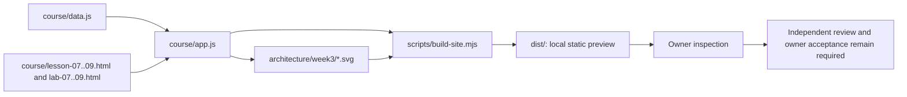

# RF — OOP_20261027-201313_WEEK3: Наполнение курса OOPoman — неделя 3

> **Date**: 2026-10-28
> **Author**: Executor (owner-direct Codex task)
> **Status**: 🟢 RF — Complete
> **Parent HL**: [HL OOP_20261027-201313_WEEK3](HL-OOP_20261027-201313_WEEK3.md)
> **TS**: [TS OOP_20261027-201313_WEEK3](TS__OOP_20261027-201313_WEEK3.md)
> **Producer unit**: `codex:thread:local:01a18144-86e0-7d81-818f-5e2e1fb13816`
> **Parent Coordinator**: `codex:thread:local:01a17ea0-4eee-7350-af2c-eec0b91464c7`
> **Activation / dispatch source**: Owner-direct `/tfw-handoff OOP_20261027-201313_WEEK3`, received in this Codex task; no delegation dispatch
> **Coordination authority**: `request.md @ 1d67e285bc8210e5a69e2081b489ec61745b6c6f`
> **Originating proposer**: `{principal: roman, unit: owner:roman}`
> **Current selection**: `activation: owner-only`, `dialogue: tfw-gates-only`, `reporting: native-gates`, `selection_ref: baseline`; complete routing spine read from task `status.md`
> **Launch observation**: Requested model/effort and effective settings were not observed; delivery was the current Codex task; owner-direct activation was valid; implementation completed as Candidate `933519a335313792f2fb8b7bffc7af042f1f8af0`. Minor Lab 09 question wording was corrected before the final build and Candidate; no material scope rework.

---

## 1. What Was Done

Added the three approved lesson/lab pairs for OOPoman week 3. Lessons and labs present complete static Python examples with expected output, accessible Russian explanations and matching UML assets. The local preview enables Module 3 while keeping the public distribution boundary closed. Documentation describes the local-only state.

### Actual Value-Bearing Accounting

| Fact | Actual result |
|---|---|
| TS approval ref | `387ed93abf976b0c730045750d465b276c067fad`; owner gate `journal/20261028-113628__gate_answer__7F3A.md` |
| Baseline / Candidate | `621e25173357b008b6f9bf3595e1db8f88dadd3c` / `933519a335313792f2fb8b7bffc7af042f1f8af0` |
| VALUE membership | Exactly the 19 approved paths in TS §4. The per-path action, VALUE class and semantic reason are recorded in [EV E-accounting](evidence/EV__OOP_20261027-201313_WEEK3.md#e-accounting). `git diff` membership matches the selector; no deviations. |
| Arithmetic | 437 additions + 10 deletions = 447 touched text LOC; 19 logical VALUE files; no binary/non-text member (N/A individually, none). |
| Phase attribution | Valid: the one approved HL Phase A, “Week 3 research, pages, review and owner acceptance.” No phase split. The Candidate contains exactly the TS VALUE paths. |
| Trigger disposition | Cause: deliver the approved six-page set and necessary build/docs constituents. Cost: 19 files / 447 LOC. Assurance: successful static build and manual local browser inspection. Split: one phase, no decomposition. Authority: exact owner-approved TS/denominator preceded execution. Terminal: below escalation thresholds (38 files / 4,800 LOC), no scope expansion or planned-zero dimension; no escalation required. |
| Authority and timing | Owner approval of TS, exact selector and immutable 19-file / 2,400-LOC denominator occurred before the owner-direct Executor activation. No post-work adjustment. |
| Reproduction | Exact approved NUL-safe PowerShell selector and commands are in EV E-accounting; they use `git diff --name-status --find-renames=50% -z` and `git diff --numstat --find-renames=50% -z` over the approved paths, Baseline and Candidate. |

### New Files

| File | Description |
|---|---|
| `course/lesson-07.html`, `course/lesson-08.html`, `course/lesson-09.html` | Direct entry shells for the three lessons. |
| `course/lab-07.html`, `course/lab-08.html`, `course/lab-09.html` | Direct entry shells for the three labs. |
| `architecture/week3/lesson-07.svg`, `architecture/week3/lesson-08.svg`, `architecture/week3/lesson-09.svg` | Lesson diagrams with SVG titles/descriptions and page text alternatives. |
| `architecture/week3/lab-07.svg`, `architecture/week3/lab-08.svg`, `architecture/week3/lab-09.svg` | Lab interaction/class diagrams with SVG titles/descriptions and page text alternatives. |
| `evidence/EV__OOP_20261027-201313_WEEK3.md` | Per-criterion observations and exact accounting. |

### Modified Files

| File | Changes |
|---|---|
| `course/data.js` | Added lessons/labs 7–9, complete static examples/outputs, explanations, checks and UML references; Module 3 is available only in a local preview. |
| `course/app.js` | Renders expected output, UML with caption/alt, optional external references and lab example/diagram while keeping code static. |
| `course/styles.css` | Adds the Module 3 visual treatment and responsive example/UML presentation. |
| `scripts/build-site.mjs` | Prepares localhost preview selection and copies the six UML assets to `dist/`. |
| `course/README.md` | Documents the local development preview and static examples. |
| `NorthStar.md` | Records local-only availability until independent review and owner acceptance. |
| `CHANGELOG.md` | Records the implementation as task history, not a release/deployment. |

## 2. Key Decisions

1. Kept the Lab 7 contract fictional and local: the adapter changes formats for an in-memory object; approved/declined results and an explicit timeout stop are shown without network calls, provider SDKs, secrets or real payment data.
2. Kept Stripe and Adyen behavior in an optional, cited comparison. Their documented lifecycle/result and idempotency details are provider-specific and are not presented as the course contract or universal retry advice.
3. Preserved the approved one-phase scope. `dist/` is derived output; it was not committed as an independent product.
4. Corrected the Lab 09 question to “От чего зависит FinishShift?” and aligned its answer choices before the final build and Candidate.

## 3. Acceptance Criteria

- [x] **AC-1:** Six pages appear in the local Module 3 navigation and at direct local URLs. Each has Python code and expected output, Russian explanations, matching diagrams and text alternatives; each lab has the required 60-minute practice, checklist and exactly five questions. Existing course pages and source PDFs are not changed.
- [x] **AC-2:** Core routes are bounded to 60 minutes, with extra depth marked optional. Lab 7 uses the fictional local transit boundary and stop/error case without core retries/idempotency; lesson/lab pairs 08 and 09 align. No student outcome/time-fit claim is reported as measured.
- [x] **AC-3:** Static build succeeded; the local preview showed the module and UML assets. Narrow viewport inspection found no horizontal overflow. Python remains static text. No public publish/deploy, PR or push occurred.
- [x] **AC-4 Executor deliverables:** README, NorthStar and changelog changes match the local-preview boundary. The rest of AC-4—independent review, explicit Roman acceptance and final Economics close report—is reserved downstream and remains deferred; see EV E5.

Affected baseline obligations are preserved: the one-phase scope, source-PDF preservation, local-only operation, no public release before independent review and owner acceptance, exact accounting, independent review and final economics remain in force. No HL amendment was needed.

## 4. Verification

- Lint (`build.lint`): N/A; no lint command is configured in `.tfw/project_config.yaml`.
- Tests (`build.test`): Not run; approved TS explicitly prohibits adding/running automated tests absent a separate request.
- Static build: PASS — bundled Node.js v24.22.1 ran `scripts/build-site.mjs`; output reported 18 source PDFs, six UML diagrams and the course site in `dist/`.
- Manual preview: PASS — desktop module navigation and all six page routes opened at localhost. At 390×844, page/document widths did not exceed the viewport; all six SVGs loaded when in view. The final Lab 09 page at Candidate displayed “От чего зависит FinishShift?” and its expected output.
- Source boundary: PASS — inspected code and rendered pages show static examples; no Python execution was added. No network/payment/publication action was performed.

## 5. Evidence

See [EV__OOP_20261027-201313_WEEK3.md](evidence/EV__OOP_20261027-201313_WEEK3.md).

Evidence verdict: 5/6 VERIFIED, 1 DEFERRED, 0 BLOCKED, 0 N/A.

Task-owned resources and disposition:

- Managed Executor worktree: `C:\Users\tata2\.codex\worktrees\oop-week3-exec\weboop`, detached at Candidate; retain for independent review and owner inspection.
- `dist/` in that worktree: generated DERIVED local preview output, not committed; retain for Roman’s local inspection through review/acceptance, then Coordinator may remove it during close.
- Temporary preview server at `127.0.0.1:8765`: stopped. This Executor’s task-scoped `%TEMP%\tfw\OOP_20261027-201313_WEEK3\` logs, helper script, screenshots and PDF-extraction scratch were removed before return.
- CUA preview tabs: turn-temporary; no user data was changed.
- No branch, PR, push, public deployment or external service session was created.

A later VALUE change requires a new Candidate and affected independent checks.

## 6. Observations (out-of-scope, not modified)

No observations.

## 7. Fact Candidates

No fact candidates.

## 8. Strategic Insights (Execution)

No strategic insights.

## 9. Diagrams

### Material handover at this return

- **Producer/unit:** Executor `codex:thread:local:01a18144-86e0-7d81-818f-5e2e1fb13816`; parent Coordinator `codex:thread:local:01a17ea0-4eee-7350-af2c-eec0b91464c7`; owner Roman.
- **Source/epoch:** Owner-direct `/tfw-handoff OOP_20261027-201313_WEEK3`; approved TS `387ed93abf976b0c730045750d465b276c067fad`; Baseline `621e25173357b008b6f9bf3595e1db8f88dadd3c`; Candidate `933519a335313792f2fb8b7bffc7af042f1f8af0`; final role-return observation cutoff `2026-10-28 21:43 +05:00` (2026-10-28 16:43 UTC).
- **Inspected scope:** complete Phase A Executor deliverables: the approved TS and task routing/approval lineage; six named source PDFs and `research/iter3/RES.md`; selected code/build/docs paths; the rendered module, six direct pages, code/output, navigation and UML; value accounting; the current native economics capture surface.
- **Material:** Candidate implementation and EV, exact 19-path accounting, local build/preview observations, six-page content pairing, official provider references and the publication/acceptance boundary. Reusable task context remains in the approved TS, RES and task records; no new independent project knowledge claim is proposed.
- **Uncertainty:** The executor rollout locator, `session_meta.id`, source version and bounded range start are unavailable from the current native tools. Known unit/task identity does not provide that binding. No extraction was attempted; no numeric file/failure receipt exists; last-good returned numeric file/hash is none. Coverage and token total are unknown, not zero. No compatible duration or price basis can be calculated from this gap. Recheck at Coordinator close if the exact source becomes available.
- **Continuation:** EV and Candidate are ready for the Coordinator’s independent Reviewer route. Reviewer must assess the exact Candidate and EV; any VALUE correction changes Candidate. The Coordinator then handles the review return and asks Roman for explicit acceptance. Only after those gates should the Coordinator prepare the final task-root Economics report from actual available role captures; preserve this Executor binding gap there if still unresolved.
- **Unresolved owner decision:** Roman’s explicit acceptance of the complete reviewed result remains reserved and unrecorded. No other scope decision is requested from the Executor.

---

*RF — OOP_20261027-201313_WEEK3: Наполнение курса OOPoman — неделя 3 | 2026-10-28*
