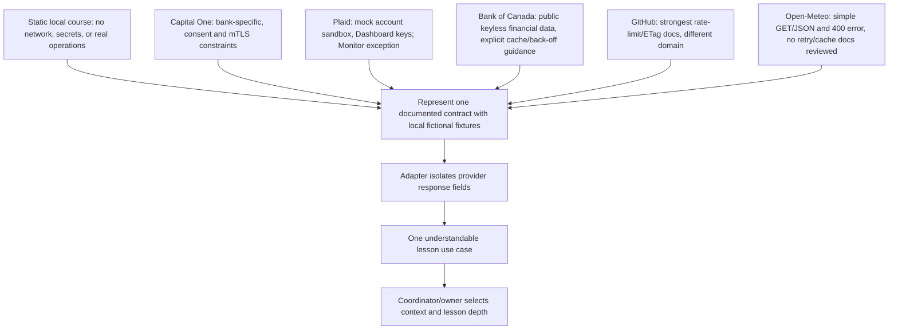

# RES — OOP_20261027-201313_WEEK3: Практическое применение ООП во внешних API и учебный кейс недели 3

> **Date**: 2026-10-28
> **Author**: Codex Researcher
> **Status**: 🔬 RES — In progress (Iteration 1 synthesized; task remains open)
> **Parent HL**: [HL-OOP_20261027-201313_WEEK3](../../HL-OOP_20261027-201313_WEEK3.md)
> **Mode**: Pipeline — focused
> **Producer unit**: `codex:thread:local:01a17ed3-0b75-7c73-8252-a0711bbc8f8f`
> **Parent Coordinator**: `codex:thread:local:01a17ea0-4eee-7350-af2c-eec0b91464c7`
> **Activation / dispatch source**: Owner-direct `/tfw-research OOP_20261027-201313_WEEK3`; stage continuations were authorized by task-local gate answers at `fb52dd6ca3f4f0d2e0f71063db86635a72183eb8`, `a0230c5fcee34950f983f7d7a336bcfc18d4fa07`, and `bc1bdc51477e73b5cb1fea7c6c079c6ccba47738`.
> **Coordination authority**: `request.md @ 1d67e285bc8210e5a69e2081b489ec61745b6c6f`; current selection `reporting: native-gates`, `selection_ref: baseline`.
> **Originating proposer**: `{principal: roman, unit: owner:roman}`

---

## Research Context

Iteration 1 tests H3: whether official API or sandbox documentation can ground a practical OOP integration lesson without real payments, real account data, secrets, network use, or production-payment guidance. The frozen HL requires a static local course, while lab 7 starts from a bank API and asks about Adapter, Decorator, cache, and a terminal Facade. This research compares official provider boundaries and documented error/freshness behavior; it does not select the course API or class architecture, and it does not measure learning outcomes.

## Briefing

[Briefing](1_briefing.md) records the owner-selected `focused` mode, approved H3 scope, questions, and the economics binding gap. The owner confirmed continuing into Gather; subsequent stage transitions were governed by immutable Coordinator gate answers. Research scope remained limited to official first-party documentation and local modeling, with no API calls.

## Evidence Synthesis

| Candidate/source | First-party evidence | Course-model implication | Limit or uncertainty |
|---|---|---|---|
| **Capital One UK Open Banking** | Sandbox reflects production API for TPP onboarding. Data access uses mutual TLS plus an OAuth access token tied to a consent; account/balance reads are GET. Docs describe a 429 in a particular rate-limit condition. | A local fake response can represent a real bank account/balance contract and show why provider fields need a boundary. | The interface is for FCA-registered AISP/CBPII providers. Reviewed docs do not establish access for an ordinary class, prove every sandbox record is synthetic, specify a retry delay, or document ETag/conditional GET support. No student-run connection is appropriate under the frozen course boundary. [Interface](https://developer.capitalone.co.uk/docs/), [sandbox](https://developer.capitalone.co.uk/docs/sandboxTesting), [data access](https://developer.capitalone.co.uk/docs/dataAccess). |
| **Plaid Sandbox** | Plaid documents a free sandbox with mock/test accounts, test data, and test scenarios. Sandbox API keys come from its Dashboard; sandbox requests use HTTPS POST. The sandbox is not fully representative of every institution or production behavior. The docs identify Monitor watchlists as an exception that can use real watchlist data. | It is a plausible source for a bank-data integration model if examples use only local fixtures, no Dashboard keys, no external calls, and exclude Monitor/live-data paths. | It adds account/API-key setup and domain complexity to a static course. It is a newly surfaced candidate outside Gather/Extract and needs comparison against the exact lesson goal. [Sandbox overview](https://plaid.com/docs/sandbox/), [Sandbox vs. Production](https://support.plaid.com/hc/en-us/articles/16110110883479-How-are-Sandbox-Production-Trial-plan-and-Limited-Production-different). |
| **Bank of Canada Valet API** | Its official guide says no registration or access key is needed, documents JSON/CSV/XML retrieval, and recommends careful back-off after failures plus caching data such as once-daily exchange rates. | It is a clear, public financial-data example for a response Adapter and a narrowly modeled cache/back-off behavior, with no customer account or payment flow. | It is a central-bank statistics API, not a bank-account API or sandbox. Whether that subject fits the owner’s intended lab remains unresolved. [Valet guide](https://www.bankofcanada.ca/valet-api-how-to/), [endpoint docs](https://www.bankofcanada.ca/valet/docs). |
| **GitHub REST public repository endpoint** | Public-resource GET requests may be unauthenticated. Official docs cover 403/429 rate limits, `Retry-After`/reset guidance, ETag/conditional GET and `304 Not Modified`. The primary-rate-limit exemption for a 304 requires an authorized request. | It offers the clearest documented example of rate-limit-aware waiting and conditional GET, which can be represented with local fixtures. | It shifts the example away from banking; the course must not claim an unauthenticated conditional request earns the quota exemption. [Endpoint](https://docs.github.com/en/rest/repos/repos), [best practices](https://docs.github.com/en/rest/using-the-rest-api/best-practices-for-using-the-rest-api), [rate limits](https://docs.github.com/en/rest/using-the-rest-api/rate-limits-for-the-rest-api). |
| **Open-Meteo forecast API** | Its docs describe unauthenticated HTTP GET/JSON for non-commercial use and a structured HTTP 400 response for malformed parameters. | It is a simple external-API boundary and error-object example. | The reviewed pages do not establish rate-limit retry or conditional-cache behavior; the 400 example is a client validation error, not a retry case. It is not a sandbox or financial context. [API overview](https://open-meteo.com/), [forecast docs](https://open-meteo.com/en/docs). |

Across the sources, an Adapter can be used as a course-design choice to translate provider-specific response fields into a small lesson object. A Facade can expose one named course operation, and a Decorator can wrap one optional behavior around a stable client. Provider documents do not require these patterns, and no source reviewed establishes that these patterns improve learning. Combining Adapter, Facade, Decorator, retry, and cache in one required exercise could turn the lesson into a pattern list rather than a clear integration boundary; that is a teaching risk to verify with the Coordinator and owner.

**Technical trace note:** focused mode used one pass per stage. The Challenge stage used seven search queries, two above the configured soft limit of five, to cross-check newly surfaced first-party financial API candidates; this is recorded in `4_challenge.md`. No live API request, code execution, or sandbox account was used.

## Decisions

| # | Decision | Rationale |
|---|----------|-----------|
| — | No API, sandbox, class architecture, retry policy, or cache TTL is selected by this Researcher. | Available sources support competing candidates with different access and teaching tradeoffs. Course selection remains with the Coordinator/owner. |
| — | The course remains limited to a documented contract represented with fictional local data and no network call. | This is a frozen HL boundary, not a new research decision. |

## Open Questions

| # | Question | Status | Answer |
|---|----------|--------|--------|
| 1 | Should the week-3 case center mock bank-account data (Plaid Sandbox), keyless central-bank financial data (Valet), or another provider context? | Open | This iteration surfaced viable alternatives but did not determine which meaning of “real API” best fits lab 7. |
| 2 | Which single object boundary or pattern best serves the 60-minute lesson without overloading it? | Open | Provider contracts show boundaries; no educational outcome evidence establishes the best pattern combination. |
| 3 | Which one error/freshness behavior belongs in the required core, if any? | Open | Back-off/cache guidance is provider-specific; no generic retry count or TTL is supported across the candidates. |

## Hypotheses (from HL §10)

| # | Hypothesis | HL Status | RES Status | Evidence |
|---|-----------|-----------|------------|----------|
| H3 | An official API/sandbox source can show the value of an object boundary and integration limits without real payments or secrets. | Open | 🟡 Conditionally supported | Capital One documents a real but restricted banking contract; Plaid documents mock bank-data sandbox paths that still require Dashboard keys; Bank of Canada documents a keyless public financial-data API. All can inform a local fixture, but the course-context choice and learning benefit remain unproven. |

## HL Update Recommendations

> The Researcher classifies these updates; the Coordinator applies them. No frozen HL claim is changed here.

### Refinements — free sections, coordinator applies

| # | § | What to update | Source |
|---|---|---------------|--------|
| R1 | §2 | Replace the single unresolved bank-sandbox question with the bounded alternatives and their access conditions: Capital One Open Banking, Plaid mock sandbox, and Bank of Canada public financial data. Keep course-context selection open. | Gather G1; Challenge C1 |
| R2 | §7.2 | Add the official Plaid Sandbox and Bank of Canada Valet sources, and retain the GitHub/Open-Meteo sources for provider-specific error/cache comparisons. | Extract E1–E2; Challenge C1–C2 |
| R3 | §10 | Mark H3 conditionally supported, while preserving uncertainty about the best course context and the unmeasured pedagogical benefit. Consider a second iteration to compare Plaid Sandbox with Valet against lab 7’s purpose. | Challenge C1–C2 |

### Amendment Proposals — frozen sections, resolved-ruler verdict required

**No amendment proposals.** The findings fit the existing static, fictional-data, no-network contract; no evidence supports widening or changing frozen sections.

## Fact Candidates

**None.** This iteration produced technical findings from provider documentation, not new human-sourced project facts. Owner-supplied decisions remain in the approved HL and were not duplicated here.

## Strategic Insights (Research)

**No strategic insights.** No new human-sourced domain direction was provided during the research briefings.

## Findings Map

The arrows from provider contracts to Adapter/use-case roles are teaching-design inferences; the provider documentation supports the API facts, not the educational effect.

## Iteration Status

- **Iteration:** 1 of 2 (minimum) / 3 (maximum)
- **Hypotheses tested:** H3 — conditionally supported; safe local modeling sources exist, but the target course context remains unresolved.
- **Hypotheses deferred:** None.
- **Gaps discovered:** suitability of Plaid or Valet for the exact lab-7 goal; student access/key burden for Plaid; Capital One sandbox eligibility and synthetic-data status; best single pattern and required resilience depth; learning outcomes not measured; researcher economics source binding unavailable before extraction.
- **Superseded decisions:** None.

### Open Threads (for next iteration)

| # | Thread | Why it matters | Suggested focus |
|---|--------|---------------|-----------------|
| 1 | Compare Plaid Sandbox and Bank of Canada Valet as source contexts for the lab-7 API case. | One preserves mock bank-account data with setup keys; the other is keyless public financial data with documented back-off/cache guidance but no account-access flow. | Use official docs to assess scope fit, student setup, read-only/mock-data boundaries, one response shape, and which material can be modeled with local fixtures; record the candidate tradeoff without selecting architecture. |
| 2 | Decide how much resilience behavior belongs in the 60-minute core. | Sources do not support one universal retry or cache rule, and the no-network course can only demonstrate deterministic local behavior. | Compare a visible error/stop example with one source-specific back-off or cache example; identify what must be optional and what requires owner/course judgment. |

### Recommendation

- [ ] **SUFFICIENT** — proceed to `/tfw-plan` to classify these recommendations and write TS
- [x] **MORE NEEDED** — the configured minimum is two research iterations; ask the Coordinator to prepare an iteration-2 pending entry with a bounded focus based on the open threads above.
- [ ] **BLOCKED** — {specify blocker}

> The Coordinator decides whether to continue or proceed. This Researcher recommends another iteration and does not select a course context or architecture.

## Conclusion

Iteration 1 found official sources for realistic API boundaries and for specific error/cache behavior, with material differences in student access and domain fit. Plaid’s mock sandbox and Bank of Canada’s public financial-data API are the strongest new candidates for a bounded second comparison; Capital One remains the most directly bank-specific but has significant access constraints. The frozen no-network course can only model a documented response locally. Research therefore conditionally supports H3 but does not select an API, a pattern stack, retry rule, or TTL, and no source demonstrates the learning effect of combining them. The main self-critique is that focused research exceeded the soft web-query budget by two searches to verify the new financial candidates, and the “best” instructional case still needs owner/course judgment.

### Material handover at this return

- **Producer/unit:** Researcher `codex:thread:local:01a17ed3-0b75-7c73-8252-a0711bbc8f8f`; parent Coordinator `codex:thread:local:01a17ea0-4eee-7350-af2c-eec0b91464c7`.
- **Scope/epoch:** Iteration 1, H3, focused mode; official first-party Capital One, Plaid, Bank of Canada, GitHub, and Open-Meteo docs inspected on 2026-10-28 Asia/Qyzylorda. No API calls or sandbox account were used. Briefing and stages preserve the source links and individual limitations.
- **Material outcome:** H3 is conditionally supported for a local fictional-data model. Plaid and Valet are additional candidates outside the original matrix; the Coordinator should decide whether to include them in the required second iteration. No architecture or owner decision is implied.
- **Economics binding gap:** Under `.tfw/economics/README.md` → Codex rollout recipe, the exact source must be bound by its own `session_meta.id`. The current task tools expose the Researcher task address but no rollout locator or metadata. Exact source ID, source version, range start, and offset timestamp are unavailable; extraction was not attempted; last-good returned numeric file/hash: none. No usage JSONL, numeric zero, cutoff, or coverage range is asserted. This is an attributable pre-extraction binding gap, recorded first in [Briefing](1_briefing.md); numeric coverage remains unmeasured.
- **Continuation:** Iteration 1 RES is complete. Iteration 2 cannot begin until the Coordinator prepares its pending `iterations.yaml` entry and routes the same Researcher through the existing gate. No task lifecycle status change was made.

---

*RES — OOP_20261027-201313_WEEK3 | 2026-10-28*
