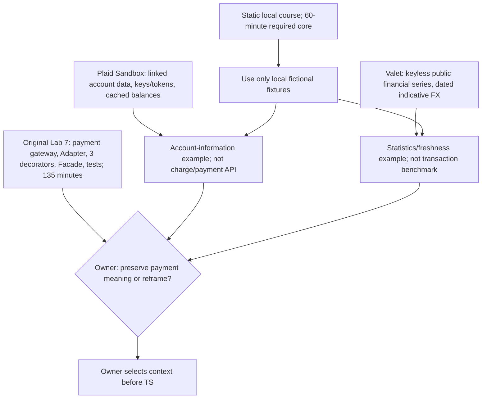

# RES — OOP_20261027-201313_WEEK3: API-контекст лабораторной 7

> **Date**: 2026-10-28
> **Author**: Codex Researcher
> **Status**: 🔬 RES — In progress (Iteration 2 synthesized; task remains open)
> **Parent HL**: [HL-OOP_20261027-201313_WEEK3](../../HL-OOP_20261027-201313_WEEK3.md)
> **Mode**: Pipeline — focused
> **Producer unit**: `codex:thread:local:01a17ed3-0b75-7c73-8252-a0711bbc8f8f`
> **Parent Coordinator**: `codex:thread:local:01a17ea0-4eee-7350-af2c-eec0b91464c7`
> **Activation / dispatch source**: Owner-direct `/tfw-research OOP_20261027-201313_WEEK3`; iteration-2 continuation and stage transitions authorized by task-local gate answers, culminating in synthesis authorization `journal/20261028-095120__gate_answer__E24C.md @ 1a4c40f0cc582bed641b488fda3fd76be2201043`.
> **Coordination authority**: `request.md @ 1d67e285bc8210e5a69e2081b489ec61745b6c6f`; current selection `reporting: native-gates`, `selection_ref: baseline`.
> **Originating proposer**: `{principal: roman, unit: owner:roman}`

---

## Research Context

Iteration 2 compared official Plaid Sandbox and Bank of Canada Valet documentation against Lab 7’s purpose and the approved static, no-network, 60-minute-core course boundary. Both providers can inform a local fictional response fixture, but they represent different data and neither is the payment-acquiring API described in the original Lab 7. The comparison identifies fit and constraints; it does not decide whether the owner wants to preserve payment/transit semantics or reframe the lesson around reading financial data, and it does not select an API or architecture.

## Briefing

[Iteration-2 Briefing](1_briefing.md) was confirmed by the Coordinator before Gather. It scoped work to official Plaid Sandbox and Valet documentation, local fixtures, one response boundary, and at most one source-specific error/freshness behavior. No API call, credential, account or real data was used.

## Decisions

| # | Decision | Rationale |
|---|----------|-----------|
| — | No course context or architecture is selected by this Researcher. | The owner-reserved choice remains between preserving the payment/transit goal and reframing the lesson around account data or public financial observations. Neither evidence set resolves that strategic fit. |
| — | Any researched provider contract used in the web course must be represented by local fictional data. | The frozen HL requires a static, no-network course. A live Plaid or Valet student connection is outside that boundary. |
| — | This bounded comparison is complete at iteration 2; a third iteration is not recommended unless the owner chooses a new research question. | The configured minimum of two iterations is met. The remaining key issue is owner intent, not a missing provider-document fact within this comparison. |

## Open Questions

| # | Question | Status | Answer |
|---|----------|--------|--------|
| 1 | Should Lab 7 preserve the original payment-gateway/transit meaning, or may the course reframe it around account information or public financial statistics? | Owner-reserved; unresolved | Plaid is account-shaped, not a payment gateway; Valet is public statistics and expressly not a transaction benchmark. Coordinator/owner must direct this before TS locks the lesson context. |
| 2 | Which single object boundary belongs in the 60-minute core? | Unresolved | An Adapter-like translation fits either local fixture as a design inference. Provider docs do not require Adapter/Facade/Decorator and no learning-outcome evidence was found. |
| 3 | Which one source-specific behavior, if any, belongs in the required core? | Unresolved | Plaid supports an “as of last update” caveat for cached account balances; Valet supports dated daily observations and qualitative cache/back-off guidance. Neither supports a universal TTL or exact retry count here. |

## Hypotheses (from HL §10)

| # | Hypothesis | HL Status | RES Status | Evidence |
|---|-----------|-----------|------------|----------|
| H3 | An official API/sandbox source can show the value of an object boundary and integration limits without real payments or secrets. | Open | 🟡 Conditionally supported | Plaid’s mock account contract and Valet’s public series can ground local fixtures and show boundaries without real operations. But neither API is the payment gateway in the source Lab 7, and the educational benefit of either reframing is unmeasured. |

## HL Update Recommendations

> The Researcher classifies these updates; the Coordinator applies them. No frozen HL claim is changed here.

### Refinements — free sections, coordinator applies

| # | § | What to update | Source |
|---|---|---------------|--------|
| R1 | §2 | Record the evidence-based mismatch: Plaid Sandbox represents linked mock accounts and has key/token plus cached-balance limitations; Valet offers keyless public financial series, not customer accounts or payment operations. Preserve the payment-vs-data context decision as open for the owner. | Gather G1–G3; Challenge C1–C3 |
| R2 | §7.2 | Add the official Plaid Sandbox/Accounts and Bank of Canada Valet/FX source references, including the FX “indicative/not a transaction benchmark” caveat. | Extract E1–E2; Challenge C2–C3 |
| R3 | §10 | Mark H3 conditionally supported. State that local fixtures can demonstrate documented response boundaries without secrets/network, while neither candidate establishes payment-gateway fidelity or learning outcomes. | Challenge C1–C4 |

### Amendment Proposals — frozen sections, resolved-ruler verdict required

**No amendment proposals.** The findings preserve the static, fictional-data, no-network boundary and do not justify changing frozen claims.

## Fact Candidates

**None.** The work produced provider-document findings and observations from an existing task PDF, not newly supplied human-only project facts. The owner-reserved context remains a decision, not a Researcher fact candidate.

## Strategic Insights (Research)

**No new strategic insights.** This iteration received no new human-sourced domain direction beyond the already approved HL and the bounded Coordinator continuation.

## Findings Map

Arrows from provider contracts to an Adapter-shaped lesson are teaching-design inferences. Provider documentation supports the API facts, not learning impact.

## Iteration Status

- **Iteration:** 2 of 2 (minimum) / 3 (maximum)
- **Hypotheses tested:** H3 — conditionally supported for safe local-data modeling; not established for the source lab’s payment-gateway semantics or educational effect.
- **Hypotheses deferred:** None.
- **Gaps discovered:** owner decision on payment vs financial-data lesson context; the intended single core pattern; whether one source-specific behavior belongs in the core; actual student learning/time load unmeasured; researcher economics source binding unavailable before extraction.
- **Superseded decisions:** None.

### Open Threads (for next iteration)

| # | Thread | Why it matters | Suggested focus |
|---|--------|---------------|-----------------|
| 1 | Owner/Coordinator chooses whether the course must preserve the source Lab 7 payment-gateway meaning or may reframe it around financial-data retrieval. | Plaid and Valet have materially different domains, and neither is the payment-processing endpoint in the source PDF. A TS cannot quietly treat them as equivalent. | Resolve at planning/owner gate; only commission iteration 3 if a specific unanswered evidence question remains after the strategic choice. |
| 2 | Select the 60-minute core boundary and optional depth after context is chosen. | The source PDF spans 135 minutes and multiple patterns; the course contract requires a smaller core. | Use the approved HL and owner choice to plan one object boundary and at most one source-specific behavior; no new research needed unless the choice depends on unknown evidence. |

### Recommendation

- [x] **SUFFICIENT** — the bounded Plaid/Valet comparison is complete and the configured minimum is met. Proceed to `/tfw-plan` for the Coordinator to route the owner-reserved context choice and classify refinements before TS.
- [ ] **MORE NEEDED** — no third research iteration is recommended absent a new, bounded evidence question after the owner decision.
- [ ] **BLOCKED** — {specify blocker}

> The Coordinator decides whether to continue or proceed. This Researcher has not selected the course context, architecture or TS.

## Conclusion

Iteration 2 established that Plaid Sandbox and Bank of Canada Valet offer teachable but non-equivalent data contracts for a static local course: Plaid preserves linked-account semantics while requiring Dashboard/API credentials and carrying cached-balance limits; Valet is publicly accessible and offers dated daily financial series, but its exchange rates are indicative and not transactional benchmarks. Challenging both against the actual Lab 7 source exposed the main decision the first iteration did not settle: the original 135-minute lab models a transit payment gateway, while the HL requires a 60-minute core and the researched providers do not expose that payment contract. Research supplies a clear basis for the owner to preserve or reframe the lesson; it cannot choose the intent or prove learning outcomes. The focused pass used seven web search queries total across the three stages (five in Gather and two in Extract; Challenge re-opened official pages without additional searches) and inspected the existing Lab 7 source PDF. No live API or sandbox was used.

### Material handover at this return

- **Producer/unit:** Researcher `codex:thread:local:01a17ed3-0b75-7c73-8252-a0711bbc8f8f`; parent Coordinator `codex:thread:local:01a17ea0-4eee-7350-af2c-eec0b91464c7`.
- **Scope/epoch:** Iteration 2, H3, focused mode; official Plaid Sandbox/Accounts and Bank of Canada Valet/FX documentation checked on 2026-10-28 Asia/Qyzylorda. Existing Lab 7 task PDF inspected for its context and workload. No API call, credential, account, or real data was used. The four stage files preserve links, comparisons and limits.
- **Material outcome:** H3 is conditionally supported only for demonstrating a documented API/data boundary with local fixtures. Plaid is account-information, Valet is public statistics, and neither is the payment-gateway API in the original Lab 7. This mismatch and the owner-reserved strategy choice must remain explicit through planning.
- **Economics binding gap:** The Codex rollout recipe requires the exact source to be bound by its own `session_meta.id`. Current task tools expose no rollout locator or metadata. Exact source ID, source version, range start and offset timestamp are unavailable; extraction was not attempted; last-good returned numeric file/hash: none. No usage JSONL, numeric zero, cutoff or coverage range is asserted. This is the previously recorded attributable pre-extraction binding gap; numeric coverage remains unmeasured.
- **Continuation:** Iteration 2 is complete and the configured minimum is met. The Coordinator must route the owner-reserved context choice before writing TS or continuing to implementation. No task lifecycle/status change was made.

---

*RES — OOP_20261027-201313_WEEK3 | 2026-10-28*

