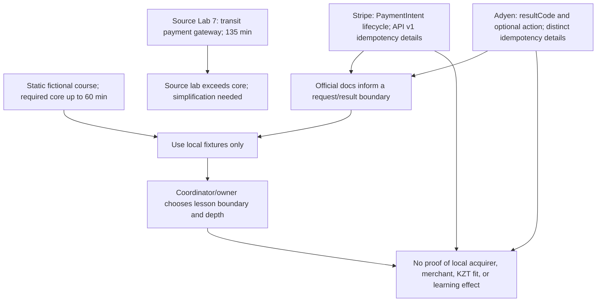

# RES — OOP_20261027-201313_WEEK3: Платёжный контракт для лабораторной 7

> **Date**: 2026-10-28
> **Author**: Codex Researcher
> **Status**: 🔬 RES — In progress (Iteration 3 synthesized; task remains open)
> **Parent HL**: [HL-OOP_20261027-201313_WEEK3](../../HL-OOP_20261027-201313_WEEK3.md)
> **Mode**: Pipeline — focused
> **Producer unit**: `codex:thread:local:01a17ed3-0b75-7c73-8252-a0711bbc8f8f`
> **Parent Coordinator**: `codex:thread:local:01a17ea0-4eee-7350-af2c-eec0b91464c7`
> **Activation / dispatch source**: Owner-direct `/tfw-research OOP_20261027-201313_WEEK3`; iteration-3 authorization `journal/20261028-100159__gate_answer__D2BC.md @ 49c7dd3ead19a89239a72377191753896a2f71a7`; Synthesis authorization `journal/20261028-101107__gate_answer__D2C0.md @ b4dfb30854b740eecf23d34d73c8620a4e49e2f5`.
> **Coordination authority**: `request.md @ 1d67e285bc8210e5a69e2081b489ec61745b6c6f`; current selection `reporting: native-gates`, `selection_ref: baseline`.
> **Originating proposer**: `{principal: roman, unit: owner:roman}`

---

## Research Context

The owner selected preserving the original payment/transit meaning of Lab 7. This final iteration checked whether official payment API documentation can ground a safe, fictional local request/result lesson inside the static course boundary. It compares documented Stripe and Adyen examples without selecting either provider or a course architecture. The original Lab 7 is a 135-minute payment-gateway exercise, while the required web-course core is limited to 60 minutes; research cannot establish the learning value of any simplification.

## Briefing

[Iteration-3 Briefing](1_briefing.md) was authorized for official Stripe and Adyen documentation, local fictional fixtures, and one bounded repeat/error behavior. The Coordinator recorded the owner’s direction to preserve payment/transit semantics. No API or sandbox call, account, credential, real payment, or real data was used.

## Decisions

| # | Decision | Rationale |
|---|----------|-----------|
| — | No commercial provider, architecture, response lifecycle, or retry/idempotency policy is selected by this Researcher. | The Coordinator’s synthesis gate explicitly reserves these choices; provider documentation does not decide course design. |
| — | Any payment example remains fictional, local, and clearly distinct from a provider implementation. | The approved HL requires a static course and excludes live operations and real secrets/data. |
| — | The final configured research iteration is complete; planning can classify the findings and route remaining choices. | Stripe and Adyen provide enough official evidence to describe a bounded request/result analogy and its limits; provider/local fit and learning outcomes remain unresolved. |

## Open Questions

| # | Question | Status | Answer |
|---|----------|--------|--------|
| 1 | Which local fictional response boundary should the lesson teach: a simple result or a visible non-final state? | Owner/Coordinator planning choice | Docs show distinct alternatives: Stripe’s PaymentIntent lifecycle and Adyen’s result/action variants. Neither mandates a classroom model. |
| 2 | Should the 60-minute core include any idempotency behavior? | Owner/Coordinator planning choice | A single explicit error-and-stop fixture is possible. If idempotency is included, its semantics must be labeled provider-specific; no generic retry rule is supported. |
| 3 | Does a representative PSP example fit the owner’s intended local payment/transit story, including any local merchant or currency requirements? | Unverified; requires a bounded decision or future evidence | Stripe and Adyen documentation does not establish Halyk/Kaspi/acquirer compatibility, local merchant eligibility, or KZT availability. No provider was selected or locally verified. |
| 4 | Does the chosen lesson fit student needs and the 60-minute core? | Unmeasured | No student trial or learning-outcome evidence was in scope. |

## Hypotheses (from HL §10)

| # | Hypothesis | HL Status | RES Status | Evidence |
|---|-----------|-----------|------------|----------|
| H3 | An official API/sandbox source can show the value of an object boundary and integration limits without real payments or secrets. | Open | 🟡 Conditionally supported | Official Stripe and Adyen docs describe payment request/result objects and test boundaries that can inform local fictional fixtures. Their schemas, states, and idempotency behavior differ; neither proves local provider fit or educational benefit. |

## HL Update Recommendations

> These are classifications for the Coordinator. No HL claim is changed here.

### Refinements — free sections, coordinator applies

| # | § | What to update | Source |
|---|---|---------------|--------|
| R1 | §2 | Record that official Stripe and Adyen payment APIs can ground a clearly fictional request/result example, while the original payment/transit semantics and the 135-minute source lab remain distinct from the static 60-minute course core. | Iteration 3 Gather G1–G3 and Challenge consistency check; Lab 7 source context recorded in task HL. |
| R2 | §7.2 | Add official Stripe PaymentIntent creation, testing, and API v1 idempotency references, plus Adyen Checkout `/payments`, testing, authentication, and idempotency references. Preserve the distinction between documentation and local/provider compatibility. | Iteration 3 Gather G1–G3; Challenge rechecked the official operation and idempotency pages. |
| R3 | §10 | Mark H3 conditionally supported: official docs can inform local fixtures without live payments or secrets, but do not establish local merchant/KZT/acquirer fit or learning outcomes. | Iteration 3 Extract C1–C7 and Challenge. |

### Amendment Proposals — frozen sections, resolved-ruler verdict required

**No amendment proposals.** The evidence does not justify changing a frozen HL claim.

## Fact Candidates

**None.** Findings concern public provider documentation and the existing task source; no new human-only project fact was supplied in this iteration.

## Strategic Insights (Research)

**No new strategic insights.** The owner’s direction to preserve payment/transit meaning was already recorded in the approved task-local gate; this iteration adds no new human-sourced strategic context.

## Findings Map

Provider contract facts support the examples; selecting a local object shape, status lifecycle, or teaching depth is a course-design choice.

## Iteration Status

- **Iteration:** 3 of 2 (minimum) / 3 (maximum)
- **Hypotheses tested:** H3 — conditionally supported for grounding a safe local fictional request/result boundary; not established for local provider fit or educational effect.
- **Hypotheses deferred:** None.
- **Gaps discovered:** provider/local merchant/KZT/acquirer fit is unverified; provider, response lifecycle, architecture, and retry/idempotency inclusion remain planning/owner choices; learning value and time load are unmeasured; exact economics source binding was unavailable before extraction.
- **Superseded decisions:** None.

### Open Threads (for next iteration)

No further research iteration is configured. The following choices belong in planning; new research should be scoped only if a specific decision depends on missing external evidence.

| # | Thread | Why it matters | Suggested focus |
|---|--------|---------------|-----------------|
| 1 | Choose a fictional local response boundary and whether any provider-specific behavior belongs in the required core. | Stripe and Adyen document different states and idempotency behavior; a generic retry rule would misstate both. | Coordinator classifies the free-section refinements and routes unresolved owner choices before TS. |
| 2 | Decide whether local provider/currency fit must be verified before authoring. | This evidence set establishes no local acquirer, merchant eligibility, or KZT support. | If required by the intended lesson, define the provider and the exact claim first, then plan bounded official-source research. |
| 3 | Check the simplified lesson’s time and learning value. | Source Lab 7 is 135 minutes and the required core is 60 minutes; documentation cannot measure student outcomes. | Keep depth optional as needed and validate through the course’s planned review/acceptance process. |

### Recommendation

- [x] **SUFFICIENT** — this is the maximum configured iteration. Proceed to `/tfw-plan` to classify recommendations and route remaining decisions before TS.
- [ ] **MORE NEEDED** — no further iteration is configured; any new inquiry needs a separately bounded question.
- [ ] **BLOCKED** — no blocker to this bounded research return.

> The Coordinator decides whether to proceed or commission separately scoped work. This Researcher has not selected provider, architecture, response lifecycle, or retry policy.

## Conclusion

This final iteration found that official Stripe and Adyen documentation can inform a safe local fictional payment request/result example while keeping live operations, accounts, credentials, and real data out of the course. It also exposed why the teaching contract must stay explicit: Stripe’s PaymentIntent is lifecycle-oriented, Adyen can return a result or additional-action shape, and their idempotency rules differ in scope and behavior. Neither documentation set establishes compatibility with the local transit acquirer, merchant eligibility, KZT support, or student learning value. Research adds a grounded comparison and a boundary against presenting provider-specific replay semantics as a universal retry policy; it cannot make the remaining course-design choices. The 135-minute source lab still needs deliberate reduction for the 60-minute core. As in earlier iterations, the exact economics rollout locator and `session_meta.id` were not exposed; extraction was not attempted, and no numeric zero, cutoff, or coverage is asserted.

### Material handover at this return

- **Producer/unit:** Researcher `codex:thread:local:01a17ed3-0b75-7c73-8252-a0711bbc8f8f`; parent Coordinator `codex:thread:local:01a17ea0-4eee-7350-af2c-eec0b91464c7`.
- **Scope/epoch:** Iteration 3, H3, focused mode; official Stripe and Adyen payment, testing, authentication, and idempotency documentation reviewed on 2026-10-28 Asia/Qyzylorda. No API call, test account, credential, payment, or real data was used. Stage files `1_briefing.md`–`4_challenge.md` preserve sources and analysis.
- **Material outcome:** H3 conditionally supported for a local fictional request/result lesson. Provider-specific response and idempotency semantics remain distinct. Owner’s payment/transit direction is preserved; no provider or architecture is selected.
- **Uncertainty/decision:** Local merchant/acquirer/KZT fit, classroom response lifecycle, retry/idempotency inclusion, and learning/time fit remain unverified or owner/Coordinator planning choices.
- **Economics binding gap:** No exact Codex rollout locator or `session_meta.id` was exposed. Numeric extraction was not attempted; no numeric zero, cutoff, or coverage is asserted.
- **Continuation:** Iteration 3 of 3 is complete and recommended sufficient for planning. The Coordinator should classify refinements and route the remaining choices before TS. No lifecycle/status change was made.

---

*RES — OOP_20261027-201313_WEEK3 | 2026-10-28*
