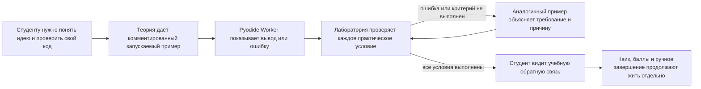
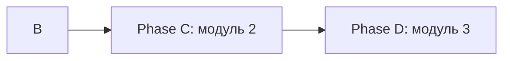

# HL — OOP_20261029-184453_RT: Рабочие терминалы

> **Date**: 2026-10-29
> **Author**: Coordinator
> **Title**: Рабочие терминалы
> **Abbreviation**: RT
> **Status**: 🔬 RES — master contract frozen; research is in progress
> **Contract**: 🔒 FROZEN — approved by roman 2026-10-29
> **Frozen**: §1 · §3 · §4 · §5 · §6 · §7 — locked on owner approval
> **Free**: §2 · §7.2 · §8 · §9 · §10 · §11 — research updates these directly
> **Append-only**: §12 Amendment Log — the only channel for changing a frozen section
> **Baseline**: freeze commits — recovery form in `conventions.md` §3 rule 15

> **Project North Star**: [NorthStar.md](../../../NorthStar.md) §Purpose · §Learner experience · §Assessment contract · §Product boundaries · §Success

## 1. Vision 🔒 FROZEN

Студенты проходят все три модуля OOPoman в рабочих терминалах: читают и запускают примеры теории, редактируют заготовки лабораторных и сразу видят вывод, ошибки и проверку практических критериев. Терминал реализуется на Pyodide dedicated Worker; для этого rollout владелец разрешил модульную интеграцию без эмпирической валидации рантайма. Интерфейс и документация явно сообщают, что совместимость, браузерное поведение и сетевые ограничения Pyodide не подтверждены запуском. Терминал не меняет баллы и завершение лаборатории.

**Impact:** Студент получает быструю проверяемую обратную связь по практическому коду и может учиться на близком по смыслу примере, если застрял. Roman сохраняет исходные формулировки заданий и контроль над учебным прогрессом; новые ограничения запуска должны быть явно показаны до первой попытки.

> *Воображаемая цитата студента:* «Я вижу, что именно не сработало, могу попробовать ещё раз, а если застрял — разобрать похожий пример и вернуться к своему решению».

## 2. Current State (As-Is) 🟢 FREE

- В `course/data.js` находятся девять теорий и девять лабораторных. В теориях модулей 1 и 2 есть шесть статических фрагментов кода; в теориях 4–9 кодовых блоков нет. Лабораторные 1–6 не содержат полных runnable-примеров; лабораторные 7–9 показывают статические пары Python-кода и ожидаемого вывода.
- `course/app.js` отображает фрагменты в `<pre><code>`. Сейчас сайт не выполняет Python. `course/README.md` и North Star называют сайт статическим, локальным и не исполняющим/не оценивающим код.
- Баллы лабораторных считаются по квизу и галочкам; завершение требует ответов на вопросы и подтверждения ручной взаимопроверки. Терминал не должен менять эту логику или сохранённые данные.
- Источники PDF лежат в `OOP-course/` и должны остаться нетронутыми. Примеры, критерии и задания берутся из теорий и практической части соответствующих PDF.
- Найдены расхождения между PDF и текущими лабораторными: ЛР 7 сужена до локального фиктивного платёжного шлюза без сетевых вызовов; ЛР 8 на сайте использует два условия и два обработчика вместо четырёх узлов цепочки и трёх наблюдателей из PDF; ЛР 9 сведена к `Shift`/`Repository`/`FinishShift` вместо более широкой интеграции из PDF. Терминальные сценарии не должны незаметно восстанавливать удалённый объём; эти различия нужно сверить при подготовке критериев.
- Встроенный просмотр страницы `http://127.0.0.1:8765/course/index.html` сейчас возвращает 404, а `file://` заблокирован политикой встроенного браузера. Вывод о текущем продукте основан на исходниках и уже сохранённых артефактах проекта; текущее визуальное состояние страницы в браузере не подтверждено.
- Docker рассматривался как исходный вариант, но owner-approved выбор заменил его на Pyodide Worker после обязательной валидации. Проверить ограничения сетевых Web API, CSP, ресурсов и совместимость примеров на целевой матрице.
- Итерация 1 исследования установила, что требования PDF смешивают детерминированные тест-кейсы и человеческую оценку; автоматизировать следует только практические критерии с явным наблюдаемым оракулом. Отчёт, архитектурное суждение и устная защита не становятся автоматически пройденными из-за вывода программы.
- Исследователь нашёл альтернативу для сравнения: Pyodide в отдельном Web Worker убирает связь публичного HTTPS-сайта с loopback-helper, но сам по себе не доказывает блокировку сетевых Web API, ограничения памяти/CPU или устойчивость checker. Для локальной копии документированный путь может потребовать localhost-обслуживания статических assets; прямой `file://` запуск требует отдельного доказательства.
- Итерация 2 подтвердила, что в этой среде не обнаружены браузерный executable/version, Docker CLI/daemon или Python runtime package Pyodide; доступны только документация и исходники. Поэтому RES не содержит фактического запуска кода, браузерной проверки, замера скорости или безопасности.
- Владелец подтвердил: Pyodide вместо Docker только после проверок; доверенный загрузчик может запрашивать необходимые Pyodide runtime/package resources, но сетевые вызовы кода студентов запрещены; offline-копия использует локальные assets через static-only localhost launcher.
- **Новые owner-approved решения от 2026-10-29:** Pyodide Worker заменяет Docker после проверок; Pyodide разрешено загружать всё необходимое для корректной работы, student Python остаётся без сети; локальная offline-копия использует static-only localhost launcher с локальными assets и без remote fallback. Код студентов не загружается в backend, база данных не добавляется.
- **Решения владельца в этой задаче:** исходные строки уже существующих блоков кода не менять; в них разрешено добавлять только Python-комментарии `#`. В лаборатории кнопка по запросу показывает полное решение. Терминал даёт учебную обратную связь, но не влияет на баллы/завершение. Автопроверка охватывает только практически исполняемые критерии; устная защита остаётся ответственностью студента.

## 3. Target State (To-Be) 🔒 FROZEN

Во всех трёх модулях каждая теория и лабораторная имеет рабочий двухпанельный терминал. Теория содержит запускаемый пример с комментариями; существующие блоки сохраняют все исходные строки и получают только добавленные `#` комментарии. Для отсутствующих примеров автор добавляет новые блоки по материалам теории. Лаборатория содержит стартовую заготовку, учебные сценарии и критерии практической проверки из её задания; кнопка готового результата раскрывает полное решение. При синтаксической ошибке, исключении, таймауте или невыполнении хотя бы одного обязательного практического критерия терминал сообщает «не пройдено» и показывает подходящий аналог с поясняющими комментариями. Успешная проверка подтверждает только практические проверки терминала и не меняет квиз, баллы, чек-лист, взаимопроверку или завершение.

Python запускается локально в Pyodide dedicated Web Worker; доверенный Pyodide loader может запрашивать сетевые resources, необходимые выбранной версии runtime и разрешённому набору пакетов, а код студента в реализации ограничивается от сетевых вызовов и произвольной установки с URL. Владелец разрешил модульную реализацию без браузерного proof; поэтому фактическая совместимость и эффективность сетевых ограничений остаются непроверенными, а интерфейс и README не должны заявлять их подтверждёнными. Для локальной offline-копии static-only localhost launcher обслуживает курс и поставляемые assets без удалённого fallback; launcher не принимает и не запускает Python и не хранит данные. Версия runtime и состав пакетов фиксируются в коде/документации; таймаут завершает Worker, вывод ограничивается, прогресс остаётся в browser localStorage.

### 3.1 Result Visualization

Иллюстративный макет одной теории и одной лаборатории; реальные подписи и код берутся из материалов курса.

```text
ТЕОРИЯ · Модуль N · Тема
┌─ Код: редактируй и запускай ───────────────┬─ Терминал ───────────────────┐
│ # Комментарий объясняет назначение метода │ [Запустить]                   │
│ class Adapter:                             │ Вывод:                        │
│     # Метод переводит запрос в нужный вид  │ Запрос принят                 │
│     def request(self): ...                 │                               │
└───────────────────────────────────────────┴───────────────────────────────┘

ЛАБОРАТОРНАЯ · Практика
┌─ Твоя заготовка ───────────────────────────┬─ Результат и проверка ────────┐
│ # Выполни критерии из задания              │ [Запустить] [Проверить]       │
│ class Bank:                                 │ Критерии: 2/3                 │
│     ...                                     │ Не пройдено: комиссия списана │
│ [Показать полное решение]                  │ Аналог: класс Car с методами  │
│                                             │ и комментариями, зачем нужны  │
│                                             │ лимит и проверка ошибки      │
└───────────────────────────────────────────┴───────────────────────────────┘
```

После исправления всех проверок: `Все практические проверки пройдены`. Это учебный результат; баллы и завершение лаборатории остаются такими же, как сейчас.

### 3.2 Value Flow



## 4. Phases 🔒 FROZEN

Модульная работа разбита на три последовательные фазы в существующем checkout. Отдельная Phase A runtime validation отложена и не является prerequisite для модулей; эмпирическая проверка Pyodide не входит в этот rollout и остаётся неподтверждённой. Roman запускает роли на соответствующих TFW-gates; фазовые координаторы получают отдельные ограниченные циклы.

### Phase A: Runtime validation (deferred; not a module prerequisite) ⚪
- Не выполнять в текущем rollout. Факт отсутствия браузерной/runtime проверки сохранять в EV/RF и пользовательских материалах.
- Возобновить отдельной owner-authorized задачей, если потребуется подтверждённая browser matrix, offline closure, сетевое разделение или resource behavior.

### Phase B: Терминалы модуля 1 🔴
- Добавить терминалы к теориям и лабораторным 1–3, взять содержание и практические критерии из курса/PDF.
- Сохранить все строки существующих блоков кода, добавив к ним только `#` комментарии; новые примеры и аналоги снабдить обучающими комментариями.

### Phase C: Терминалы модуля 2 🟡
- Добавить терминалы к теориям и лабораторным 4–6 по тем же учебным правилам и практическим критериям.
- Сохранить текущие границы и 60-минутный маршрут материалов; разрешать расхождения с PDF только явно указанным решением владельца.

### Phase D: Терминалы модуля 3 и согласованность курса 🟡
- Добавить терминалы к теориям и лабораторным 7–9; согласовать критерии с сужениями и границами текущих лабораторных.
- Сохранить фиктивный локальный платёжный шлюз ЛР 7, локальное превью модуля 3 и действующий gate публикации.
- Убедиться, что терминал не меняет баллы/завершение, PDF остаются read-only, а документы курса описывают versioned runtime, его необходимые загрузки и узкое разрешение static-only localhost launcher.

### Phase Dependencies



| Phase | Depends on | Shared files | Can run in parallel with |
|-------|-----------|--------------|--------------------------|
| B | Independent of deferred runtime validation | `course/data.js`, `course/app.js`, общие terminal/worker files | — |
| C | B | `course/data.js`, `course/app.js` | — |
| D | C | `course/data.js`, `course/app.js`, `course/README.md` | — |

## 5. Definition of Done (DoD) 🔒 FROZEN

- ✅ 1. Все девять теорий и девять лабораторных имеют терминал с редактируемым кодом слева и выводом/проверкой справа.
- ✅ 2. В теориях есть комментированные примеры; в лабораториях — заготовка, практические сценарии/критерии, полное решение по кнопке и аналог с комментарием о необходимости условий.
- ✅ 3. Каждая существующая строка кода до и после остаётся идентичной; разрешены только добавленные к существующим блокам Python-комментарии `#`.
- ✅ 4. Ошибка синтаксиса, runtime-ошибка, таймаут или хотя бы один неисполненный практический критерий всегда даёт отрицательный результат; успех выдаётся только после прохождения всех применимых критериев.
- ✅ 5. Pyodide интегрирован в dedicated Worker для всех трёх модулей; реализация ограничивает student code от сети и произвольных URL/package installs, offline-копия использует локальные assets без remote fallback. Владелец принимает, что runtime/browser/security behavior не проверены эмпирически; UI и docs явно маркируют этот статус. Модульные фазы не ждут Phase A.
- ✅ 6. Терминальный статус не меняет баллы, прогресс, взаимопроверку и завершение лаборатории; ручная устная защита остаётся за студентом.
- ✅ 7. Исходные PDF не изменены; материалы курса и локальные инструкции описывают версию runtime, необходимые загрузки loader, проектный запрет student-code network, ограничения совместимости, отсутствие эмпирической runtime-валидации и static-only localhost launcher как узкое исключение для обслуживания файлов, а не backend/code server.
- ✅ 8. Расхождения ЛР 7–9 с PDF отражены в критериях без скрытого расширения объёма; локальный preview и gate публикации модуля 3 сохранены.

## 6. Definition of Failure (DoF) 🔒 FROZEN

- ❌ 1. Student code может выполнять host-команды, читать файлы хоста, обращаться к сети или инициировать произвольные установки с внешних URL.
- ❌ 2. Проверка может принять решение с неверным обязательным практическим критерием, ошибкой, таймаутом или неполным запуском.
- ❌ 3. Любой существующий код изменён иначе, чем добавлением `#` комментариев; изменён PDF или нарушены оценки/завершение.
- ❌ 4. Сайт заявляет подтверждённую поддержку Pyodide/browser/security, хотя runtime не был проверен, либо лабораторный критерий не имеет однозначной исполняемой проверки.
- ❌ 5. Student code получает сеть; trusted loader запрашивает источники, не требуемые выбранными runtime/packages; либо offline-запуск требует удалённой загрузки assets.

**On failure:** остановить затронутую фазу; выключить runner-вызов по умолчанию и вернуть находку Координатору. Критерии, требующие интерпретации, возвращать Roman до автоматизации. Сохранять действующий курс и ручное прохождение, пока безопасная и корректная обратная связь не подтверждена.

## 7. Principles 🔒 FROZEN

1. **Сохранность авторских примеров** — существующие строки кода неизменны; добавляются только комментарии `#`.
2. **Практика без подмены оценки** — кодовая проверка помогает учиться и не меняет действующие баллы или завершение.
3. **Отрицательный результат честен** — любая ошибка или незакрытый обязательный критерий не может выглядеть успехом.
4. **Ограниченный запуск** — Pyodide в отдельном Worker; trusted loader может загружать необходимые выбранному runtime и разрешённым пакетам assets, код студентов в реализации ограничивается от сети и произвольных URL installs; используются ограничения времени/вывода и static-only localhost launcher с локальными offline assets. Эмпирическая граница рантайма остаётся непроверенной, это не должно называться подтверждённой изоляцией.
5. **Объяснение ведёт обратно к задаче** — аналог показывает похожую концепцию и комментирует, зачем нужно каждое значимое условие.

### 7.2 Knowledge Citations 🟢 FREE

| # | Source | Item | How it applies |
|---|--------|------|----------------|
| P0 | [NorthStar.md](../../../NorthStar.md) | Purpose, Learner experience, Assessment contract, Product boundaries, Success | Ограничивает сценарий курсом и оценивание без backend. Owner-approved TS может внести только узкое уточнение: localhost launcher обслуживает статические course/runtime assets и не принимает/исполняет student code. |
| P1 | [.tfw/README.md](../../../.tfw/README.md#ns1--purpose) | NS1 — Purpose | Результат должен быть понятен и продолжим, а не просто добавлять интерактивность. |
| P1 | [.tfw/README.md](../../../.tfw/README.md#ns2--principles) | NS2 — Principles | Явные неопределённости, человеческие решения и пропорциональная проверка определяют план. |
| P2 | `knowledge/philosophy.md` | Отсутствует | Отдельной проверенной философии проекта нет. |
| P3 | [KNOWLEDGE.md](../../../KNOWLEDGE.md) §1 Architecture Decisions | Архитектурных решений пока не квалифицировано | Не выдавать исследовательский вариант исполнения за уже принятую архитектуру. |
| P4 | [.tfw/conventions.md](../../../.tfw/conventions.md) | `HL (High Level)`, `Design Rules`, `Anti-patterns (prohibited)` | Сохранять одно авторитетное frozen направление, не смешивать предложения и решения, не добавлять контроль без защищаемой ценности. |
| P5 | [MDN — CSP in workers](https://developer.mozilla.org/en-US/docs/Web/HTTP/Reference/Headers/Content-Security-Policy#csp_in_workers) | CSP контекст обычного Worker | Обычный Worker обычно использует CSP из ответа своего скрипта, а не наследует policy документа; blob/data workers являются исключением. Проверить фактическую топологию и заголовки. |
| P5–P7 | `knowledge/convention.md`, `knowledge/process.md`, прочие `knowledge/*.md` | Источники отсутствуют в проекте | Применимых дополнительных согласованных правил и средовых записей не обнаружено. |

P0 application after owner decision: Roman разрешил узкое исключение для static-only localhost launcher, обслуживающего offline course/Pyodide assets; он не выполняет код, не хранит progress и не добавляет backend/database. Исполнитель должен согласовать формулировку `NorthStar.md` с этим точным исключением в рамках утверждённого TS; это не разрешает application server или code-upload service.

**Technical sources (documentary evidence, not proof of product behavior):** [Chrome Local Network Access](https://developer.chrome.com/docs/modern-web-guidance/guides/security/local-network-access); [Docker Windows requirements](https://docs.docker.com/desktop/setup/install/windows-install/); [Docker security](https://docs.docker.com/engine/security/); [Docker container run options](https://docs.docker.com/reference/cli/docker/container/run); [Docker resource limits](https://docs.docker.com/engine/containers/resource_constraints/); [Pyodide overview](https://pyodide.org/en/stable/); [Pyodide Workers](https://pyodide.org/en/latest/usage/webworker.html); [Pyodide Wasm constraints](https://pyodide.org/en/stable/usage/wasm-constraints.html); [Pyodide file restrictions](https://pyodide.org/en/stable/usage/file-system.html); [Pyodide package compatibility](https://pyodide.org/en/stable/usage/packages-in-pyodide.html); [Pyodide CORS/worker notes](https://pyodide.org/en/stable/usage/quickstart.html); [WebAssembly security](https://webassembly.org/docs/security/); [CSP for Workers](https://developer.mozilla.org/en-US/docs/Web/HTTP/Reference/Headers/Content-Security-Policy#csp_in_workers); [CORS and file origins](https://developer.mozilla.org/en-US/docs/Web/HTTP/Guides/CORS/Errors/CORSRequestNotHttp); [Worker termination](https://developer.mozilla.org/en-US/docs/Web/API/Web_Workers_API/Using_web_workers).

## 8. Dependencies 🟢 FREE

| Dependency | Status |
|------------|--------|
| Доступные PDF 9 лабораторных и теоретические блоки в `course/data.js` | ✅ Инспектированы как источники; точное распределение критериев требует исследования по фазам. |
| Pyodide Worker и необходимые runtime/package downloads | ⬜ Требуются проверка фактических loader requests, worker/CSP/network separation и browser matrix; отдельное ограничение origin не предписано владельцем. |
| Static-only localhost launcher для локальной копии | ✅ Разрешён владельцем только для обслуживания локальных course/runtime assets; проверка границ и узкое уточнение North Star включены в план. |
| Исполняемая модель практических проверок | ⬜ Для каждого критерия нужен явный oracle; проверки в том же Python-контексте можно подменить, поэтому вердикт остаётся advisory. |
| Pyodide package/code compatibility, CSP и пределы Worker | ⬜ Нужен прототип на реальных snippets, проверка worker-specific CSP/сетевых попыток, памяти/вывода и поведения целевого браузера. |
| Доступность browser/Pyodide runtime для эмпирической проверки | ⬜ Iter2 host не имел браузерного executable/version или локального Pyodide package; iteration 3 требует executable browser-equipped стенд с записанными версиями и origins. |
| Сетевое исключение Pyodide | ✅ Владелец разрешил Pyodide загружать всё необходимое для runtime/packages; сетевые вызовы student code запрещены. Phase A должна зафиксировать фактические destinations, проверить границу и исключить произвольные загрузки по запросу student code. |
| Local offline launch | ✅ Владелец разрешил static-only localhost launcher с локальными assets; launcher не принимает/не исполняет code и не предоставляет backend. Проверить это и внести узкое уточнение NorthStar в implementation TS. |

## 9. Risks 🟢 FREE

| Risk | Probability | Impact | Mitigation |
|------|-------------|--------|------------|
| Pyodide Worker не отделит необходимые runtime/package downloads от сетевых вызовов student code | Medium | High | Зафиксировать фактические destinations и проверить оба потока canary; если разделение не подтверждено — остановить интеграцию. |
| Offline asset bundle неполон | Medium | High | Проверить локальную поставку assets выбранной версии/пакетов и запуск без remote fallback. |
| Студент намеренно подменит результаты или обойдёт проверку | Medium | High | Проверять наблюдаемое поведение через изолированный runner и независимые критерии; исследовать границы Python checker и не называть локальную проверку защитой от академического мошенничества. |
| Pyodide Worker не отделит необходимые runtime/package requests от сетевых вызовов кода студентов | Medium | High | Проверить CSP именно worker script, все фактические loader requests, student-code network canaries и остаточные браузерные APIs; не считать Wasm доказательством zero-egress. |
| Worker не имеет подтверждённого жёсткого per-worker memory/CPU ceiling | Medium | High | Измерить поведение на разрешённой матрице, ограничить время/вывод и перезапускать Worker; сохранить как unresolved DoF до доказательства приемлемого поведения. |
| Pyodide CDN/package fetch недоступен офлайн или использует меняющийся asset | Medium | High | Исследовать pinned/versioned/self-hosted distribution и точный origin list; не обещать offline behavior, пока локальная asset topology не проверена. |
| Прямой `file://` origin блокирует загрузку Pyodide Worker/Wasm либо CORS | Medium | High | Offline flow использует owner-approved static-only localhost launcher; проверить его на конкретной целевой матрице. |
| Поддерживаемый Pyodide пакет или native extension отсутствует | Medium | Medium | Сверить все утверждённые snippets/labs с Pyodide compatibility inventory и сообщать ограничения; native Docker CPython остаётся отдельным вариантом. |
| Фрагменты теории неполны и ошибочно выглядят сломанными | High | Medium | Давать подготовленный контекст/fixture отдельно от исходного блока, не редактируя его строки; явно сообщать диагностический контекст. |
| Автоматизация вернёт ложный успех при одном плохом критерии | Medium | High | Требовать успех всех mandatory assertions; syntax/runtime/timeout/checker failure всегда fail closed; покрыть это независимой проверкой до приёмки. |
| Полное решение уменьшит самостоятельную практику | Medium | Medium | Кнопка раскрывает решение только по явному выбору; перед этим показывать сценарий/аналог и объяснение. |

## 10. RESEARCH Case 🟢 FREE

### Blind Spots

- Какие браузеры/версии и Windows/macOS/Linux должны поддерживаться; какая система фактически используется у студентов.
- Нужен ли доступ к публичному сайту из Интернета во время локального запуска, или локальный launcher может обслуживать весь терминал.
- Какие из практических критериев в PDF можно надёжно выразить как наблюдаемые Python assertions, особенно для архитектурных заданий.
- Можно ли обеспечить одинаковое состояние стартового кода в страницах и отсутствие изменений его исходных строк после интеграции.

### Owner decisions resolved; Phase A validation waived for this rollout

- **Runtime:** Pyodide Worker replaces Docker; owner waived Phase A validation as a module-integration prerequisite and accepted an explicit unvalidated-runtime disclosure.
- **Network:** Pyodide may fetch the runtime/package resources required for correct operation; student code has no network access and cannot request arbitrary URL installs. Offline copies use local assets without remote fallback.
- **Offline launch:** static-only localhost launcher is approved to serve course/runtime files. It must never receive or execute student code, expose a backend, or store progress. The implementation TS must make a narrow NorthStar/course-doc clarification for this exception.
- **Research boundary:** iteration 3 completed documentary analysis. Phase A runtime validation remains NOT PERFORMED / UNVALIDATED; Roman approved module implementation without that proof and accepted this limitation. Do not imply successful browser compatibility or security validation in product UI/docs. No further research iteration is requested.

### Hypotheses

| # | Hypothesis | Status |
|---|----------|--------|
| H1 | Локальный помощник может безопасно и достаточно просто связывать статическую страницу с Docker на согласованной матрице браузеров; ложность означает переход к локальному launcher либо ограничение поддержки. | superseded by owner-approved Pyodide runtime; Docker helper is not selected |
| H2 | Для каждого практического критерия лабораторной можно определить наблюдаемый oracle либо явно оставить его ручным; только oracle-backed критерии получают автоматическую учебную обратную связь, устная защита остаётся студенту. | iteration 2: карта oracle создана; fixtures и false outcomes не проверены |
| H3 | Полные решения и аналоги можно добавить, сохраняя все существующие строки кода и не расширяя суженный объём ЛР 7–9; ложность означает вернуть конкретные спорные критерии Roman. | iteration 2: scope conflicts найдены; сравнение сохранности строк не запускалось |
| H4 | Одноразовые контейнеры без сети/mounts с ресурсными лимитами достаточно безопасны и отзывчивы для учебных задач на поддерживаемых машинах; ложность означает не запускать код в клиентском Docker до смены модели. | superseded as the selected path; retain only as fallback if Pyodide validation fails |
| H5 | Pyodide в отдельном Worker может запускать требуемые snippets при подходящем worker-specific CSP, ограниченном протоколе и целевой браузерной матрице без недопустимого host/network доступа; ложность исключает замену Docker этим путём. | Iteration 3 documentary-only; empirical runtime behavior remains unvalidated, owner waives this proof as a rollout prerequisite |

### Risks of Not Researching

Без проверки мы можем предложить терминалы, которые не открываются из HTTPS/локального браузера, предъявляют студентам неожиданную установку или ошибочно принимают лабораторную. Изоляция, которую нельзя продемонстрировать, превратит основной риск продукта в неподтверждённое обещание.

### Proposed RESEARCH Focus

1. **Gather**: зафиксировать точный browser/OS и доступность browser-equipped стенда; при доступном стенде определить необходимые runtime/package requests, startup, timeout, output и package behavior; при недоступности чётко ограничить вывод документальными свидетельствами.
2. **Extract**: проверить approved snippets и fixed fixtures на выбранном runtime, дать каждой практической проверке exact observable oracle либо ручной disposition, без затрагивания квиза/баллов/checklist/completion.
3. **Challenge**: тестировать только согласованную начинающим learner threat model: случайное зависание, обычные ошибки, большой вывод и случайные browser requests; отдельно проверить offline/local-copy ограничения, не обещать hard memory/absolute sandbox и вернуть frozen-boundary решения владельцу.

### Why Not Just...?

| Approach | Value | Adoption / operating burden | Risks / tradeoffs | Decision and reason |
|---|---|---|---|---|
| **Выбранный владельцем: Pyodide в Worker, runtime unvalidated** | Интеграция терминалов во все модули по текущим исходникам/PDF без Docker/helper | Поставлять versioned runtime/packages, реализовать static-only localhost launcher и offline assets; compatibility и security limitations clearly disclosed | Worker/CSP separation, package compatibility, browser behavior and hard memory ceiling remain unverified | Владелец разрешил модульную реализацию без Phase A proof; продукт не должен называть runtime validated |
| Docker helper + контейнер | Нативный CPython и контейнерные network/resource controls | Docker Desktop, privileged helper и loopback permission; существенные системные требования | Helper/daemon остаются отдельной привилегированной границей; эту архитектуру владелец не выбрал | Возможный fallback только после отчёта о провале Phase A и возврата решения владельцу |
| **Оставить статические блоки и ручной запуск** | Нулевой новый рантайм, сохраняется текущая простота проекта | Студенты вручную ставят/запускают Python и сопоставляют вывод | Не даёт запрошенной обратной связи/автопроверки | Не решает пользовательскую потребность; оставить лишь fallback при недоступном runner |

**Leave unchanged:** теории остаются без блоков в 4–9, фрагменты не исполняются, критерии практики не проверяются терминалом; обратная связь зависит от Python на машине студента и взаимопроверки.

**Critical challenge:** Pyodide выбран владельцем, но документация не доказывает сетевое разделение trusted loader и student code, работу offline asset bundle, совместимость учебных snippets или приемлемые resource limits. Owner waiver позволяет продолжать кодовую интеграцию, но не доказывает эти свойства. Не ослаблять реализационный запрет на сеть student code; маркировать runtime как непроверенный и не заявлять совместимость или подтверждённую изоляцию. Static-only launcher не должен становиться backend/code server.

## 11. Strategic Insights (Planning) 🟢 FREE

| # | Insight | Category | Source |
|---|---------|----------|--------|
| S1 | Roman хочет, чтобы ошибки обучали через аналог, а не выдавали только вердикт; критерий ценности — понимание задачи и причины каждого условия. | Product value | User, исходное описание терминала |
| S2 | Полное решение должно быть доступно по явному действию; приёмка практики остаётся отдельно от терминала и устной защиты. | Assessment boundary | User, ответы на уточнения |
| S3 | Название задачи фиксировано как «Рабочие терминалы», а одобренная аббревиатура — `RT`. | Naming | User, явный выбор ID |
| S4 | Roman выбрал Pyodide Worker вместо Docker при условии проверок; до успешного runner validation модульная интеграция не начинается. | Runtime choice | User, ответы на amendment gate 2026-10-29 |
| S5 | Roman разрешил Pyodide загружать всё необходимое для корректной работы, сохранив запрет сетевых вызовов student code; offline-копия использует local assets через static-only localhost launcher. | Runtime and offline boundaries | User, ответ на уточнение Coordinator 2026-10-29 |
| S6 | Roman описал студентов как начинающих, а не злоумышленников: UX защищает прежде всего от обычных ошибок, зависания и чрезмерного вывода, но network denial остаётся явным техническим ограничением. | Learner threat model | Researcher RES iter2 SS2–SS3, owner-originated direction |

## 12. Amendment Log 🟢 APPEND-ONLY

| # | Date | § | Type | Proposer | Proposed change | Evidence | Cost | Alternatives considered | Verdict |
|---|------|---|------|----------|-----------------|----------|------|------------------------|---------|
| A1 | 2026-10-29 | §3 | `SUPERSEDE` | Researcher, iter1 | Заменить фиксированный Docker путь на pinned Pyodide в dedicated Worker для явно утверждённой браузерной матрицы; требовать worker-specific CSP, bounded protocol/output, timeout/restart и сохранить ограничения host/network до их проверки. Применять только после подтверждения совместимости реальных примеров и сети/ресурсов. | `research/iter1/RES.md` H1/H4, E1–E3, C1–C4: удаляется loopback-helper/LNA путь, но доступны Web APIs и hard memory/zero-egress не доказаны. | Пиновать и обслуживать runtime assets, изменить UI/worker protocol/CSP, провести browser/security/resource/snippet tests, определить package support; текущие результаты не дают замеров. | Оставить frozen Docker с отдельной проверкой helper/daemon; оставить ручной локальный Python как fallback, сохранив риск отсутствия встроенной обратной связи. | `PROPOSED` |
| A2 | 2026-10-29 | §4 Phase A | `SUPERSEDE` | Researcher, iter1 | Заменить Phase A Docker helper deliverables на bounded runner validation: Pyodide Worker prototype, pinned assets, worker CSP/network canaries, timeout/output/memory trials, поддерживаемая browser matrix и испытание static-only localhost launcher для локальной копии. Остановиться при невыполнении DoF; module phases не стартуют до принятого runner contract. | `research/iter1/RES.md` D1–D4, E1–E3, C1–C5; эмпирических прототипных результатов нет. | Добавляет runtime/hosting/security прототип и проверку локального запуска; может потребоваться scope/architecture review; не гарантирует, что Worker сможет удовлетворить ограничения. | Сохранить Phase A для Docker — точнее frozen HL, но требует установки, привилегированного helper и LNA; либо оставить ручной fallback. | `PROPOSED` |
| A3 | 2026-10-29 | §3, §5, §7 | `SUPERSEDE` | roman | Заменить Docker execution contract на Pyodide в dedicated Worker для hosted static и offline local copy. Приложение использует только закреплённые runtime/package origins; student code не имеет сети. Локальный launcher обслуживает только статические course/runtime assets, не исполняет code, не загружает его в backend; scoring/progress/completion остаются прежними. Условие запуска модульных фаз: успешная Phase A validation. Это owner-approved replacement scope для Researcher proposals A1/A2 из iter1. | Прямой ответ владельца в Coordinator thread: «Разрешить Pyodide вместо Docker, внедрять только после проверок»; [RES итерации 2](research/iter2/RES.md) H5, E1–E3, C1–C4. | Поставлять pinned assets, настроить worker isolation/CSP, реализовать launcher и ограничения вывода/времени, проверить snippets/fixtures и browser matrix; hard memory cap не обещается до доказательства. | Docker helper с native CPython; ручное выполнение у студента без встроенного терминала. | `✅ APPROVED — roman, 2026-10-29` |
| A4 | 2026-10-29 | §4 Phase A; §5.7 | `SUPERSEDE` | roman | Phase A валидирует Pyodide Worker, pinned local/hosted assets и выбранный offline localhost static-only launcher; проверяет сетевой запрет для student code, startup, timeout, output cap, fixtures и поддерживаемые browser/OS versions. Ни одна module phase не начинает интеграцию до успешной проверки. В implementation-TS включить узкое уточнение NorthStar: разрешён локальный static asset launcher, который не является code/backend server. Это owner-approved resolution to Researcher proposal A2 from iter1. | Прямой ответ владельца в Coordinator thread: Pyodide только после проверок и разрешён localhost launcher с assets для offline; [RES итерации 2](research/iter2/RES.md) Q2/Q3, Open Threads 1–3. | Требует asset bundle, local launcher, browser-based experiments, actual criteria fixtures and a narrow product-boundary documentation change. | Сохранить direct `file://` mode без runner либо ограничить execution hosted-only; оба не соответствуют выбранному владельцем offline localhost flow. | `✅ APPROVED — roman, 2026-10-29` |
| A5 | 2026-10-29 | §6 | `EXTEND` | roman | Разрешить только закреплённые runtime/package origins для загрузки Pyodide assets; student-submitted code остаётся без сетевых запросов. Для offline copy эти assets поставляются локально; remote asset fallback не должен быть обязателен для offline запуска. Не разрешать arbitrary outbound access, code upload или OOPoman backend. | Прямой ответ владельца в Coordinator thread: «Только закреплённые runtime/package origins; скриптам студентов сеть закрыта», уточнённый локальным offline-launch решением; [RES итерации 2](research/iter2/RES.md) A3, Q1. | Нужны явный origin/package allowlist, pin/checksum policy и proof, что submitted Python не может использовать worker network APIs; это ограничивает динамические install/import сценарии. | Запретить сети также runtime и пакетам (требует полностью поставляемых локальных assets); либо разрешить student egress — отклонено владельцем. | `✅ APPROVED — roman, 2026-10-29` |
| A6 | 2026-10-29 | §3, §4 Phase A, §5, §6, §7 | `SUPERSEDE` | roman | Заменить owner-approved правило только pinned runtime/package origins: trusted Pyodide loader may fetch resources needed for correct operation of the selected runtime and permitted package set, even when those requests are not limited to the former pinned-origin allowlist. Student Python network calls and arbitrary URL/package installs remain forbidden. Phase A must record actual destinations/request classes, test separation, and confirm the local offline bundle has all required assets with no remote fallback. Keep static-only launcher, no backend/code upload/database, and the requirement to pass Phase A before module integration. | Прямой ответ владельца на вопрос Coordinator 2026-10-29: «Разрешить Pyodide загружать всё необходимое, но сетевые вызовы кода студентов запретить»; owner gate A5 and iter3 `3_extract.md` @ `5b47e196e088be8b28e20acf4c8af957c1f12f21` identify the existing boundary and untested loader/code separation. | Увеличивает поверхность сетевой загрузки; требуется знать реальные request destinations, исключить student-triggered arbitrary URLs, доказать запрет сети Python и проверить офлайн-полноту assets. | Оставить только pinned origins (владелец заменил это правило); разрешить сеть student code (владелец явно запретил). | `✅ APPROVED — roman, 2026-10-29` |

| A7 | 2026-10-29 | §1, §3, §4, §5, §6, §7 | `SUPERSEDE` | roman | Отложить empirical Phase A validation и убрать её как prerequisite для module implementation. Разрешить начать модули 1–3 последовательно по текущим source files/PDF. Pyodide/browser/security/runtime behavior остаётся NOT VALIDATED; UI/docs обязаны раскрывать этот статус и не заявлять подтверждённую совместимость или изоляцию. Сохранить все остальные owner rules: no student-code network or arbitrary URL installs, loader только для нужных runtime/разрешённых packages, offline assets без remote fallback, static-only launcher, preservation of existing code lines except added `#` comments, no scoring/completion changes. | Прямой ответ Roman на Coordinator gate 2026-10-29: «Снять gate amendment’ом: перейти к модульной реализации по файлам/PDF; рантайм останется непроверенным». Итерация 3 RES `research/iter3/RES.md` подтверждает документальный evidence boundary и 404, но не runtime failure. | Runtime compatibility, CSP/network separation, package/offline closure and resource behavior are accepted as unverified; work may need later corrective TS if browser use fails. | Сохранить Phase A как prerequisite (владелец снял gate); разрешить student Python network (владелец не разрешал). | `✅ APPROVED — roman, 2026-10-29` |

### Material handover at this return

Источник задачи — owner-direct запрос Roman в Coordinator thread `codex:thread:local:01a183ac-e789-7d81-a69a-00c4032013be`; делегированного мандата нет. Исследование завершено тремя итерациями; [RES итерации 3](research/iter3/RES.md) commit `f85c929178125e7d113f178e1fcfbbf30d985de9` фиксирует documentary-only вывод, runtime unvalidated и единственный HTTP 404. Owner amendments A3–A7 approved: Pyodide Worker выбран; trusted loader может загружать нужные runtime/package resources, student Python остаётся без сети; offline localhost launcher обслуживает локальные assets без remote fallback; A7 снимает Phase A как prerequisite и разрешает последовательную реализацию модулей по source/PDF с явным disclosure непроверенного runtime. Версии/совместимость браузеров, сетевое разделение и offline behavior не заявляются подтверждёнными. NorthStar clarification включена в TS. Продуктовый код здесь не менялся.

---

*HL — OOP_20261029-184453_RT: Рабочие терминалы | 2026-10-29*
