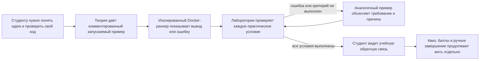
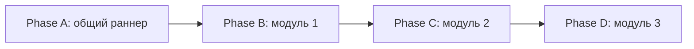

# HL — OOP_20261029-184453_RT: Рабочие терминалы

> **Date**: 2026-10-29
> **Author**: Coordinator
> **Title**: Рабочие терминалы
> **Abbreviation**: RT
> **Status**: 🔬 RES — master contract frozen; research is in progress
> **Contract**: 🔒 FROZEN — approved by roman 2026-10-29
> **Frozen**: §1 · §3 · §4 · §5 · §6 · §7 — locked on owner approval
> **Free**: §2 · §7.2 · §8 · §9 · §10 · §11 — research updates these directly
> **Append-only**: §12 Amendment Log — the only channel for changing a frozen section
> **Baseline**: freeze commits — recovery form in `conventions.md` §3 rule 15

> **Project North Star**: [NorthStar.md](../../../NorthStar.md) §Purpose · §Learner experience · §Assessment contract · §Product boundaries · §Success

## 1. Vision 🔒 FROZEN

Студенты проходят все три модуля OOPoman в рабочих терминалах: читают и запускают примеры теории, редактируют заготовки лабораторных и сразу видят вывод, ошибки и проверку практических критериев. Код исполняется локально в ограниченных Docker-контейнерах; терминал помогает учиться, но не меняет баллы и завершение лаборатории.

**Impact:** Студент получает быструю проверяемую обратную связь по практическому коду и может учиться на близком по смыслу примере, если застрял. Roman сохраняет исходные формулировки заданий и контроль над учебным прогрессом; новые ограничения запуска должны быть явно показаны до первой попытки.

> *Воображаемая цитата студента:* «Я вижу, что именно не сработало, могу попробовать ещё раз, а если застрял — разобрать похожий пример и вернуться к своему решению».

## 2. Current State (As-Is) 🟢 FREE

- В `course/data.js` находятся девять теорий и девять лабораторных. В теориях модулей 1 и 2 есть шесть статических фрагментов кода; в теориях 4–9 кодовых блоков нет. Лабораторные 1–6 не содержат полных runnable-примеров; лабораторные 7–9 показывают статические пары Python-кода и ожидаемого вывода.
- `course/app.js` отображает фрагменты в `<pre><code>`. Сейчас сайт не выполняет Python. `course/README.md` и North Star называют сайт статическим, локальным и не исполняющим/не оценивающим код.
- Баллы лабораторных считаются по квизу и галочкам; завершение требует ответов на вопросы и подтверждения ручной взаимопроверки. Терминал не должен менять эту логику или сохранённые данные.
- Источники PDF лежат в `OOP-course/` и должны остаться нетронутыми. Примеры, критерии и задания берутся из теорий и практической части соответствующих PDF.
- Найдены расхождения между PDF и текущими лабораторными: ЛР 7 сужена до локального фиктивного платёжного шлюза без сетевых вызовов; ЛР 8 на сайте использует два условия и два обработчика вместо четырёх узлов цепочки и трёх наблюдателей из PDF; ЛР 9 сведена к `Shift`/`Repository`/`FinishShift` вместо более широкой интеграции из PDF. Терминальные сценарии не должны незаметно восстанавливать удалённый объём; эти различия нужно сверить при подготовке критериев.
- Встроенный просмотр страницы `http://127.0.0.1:8765/course/index.html` сейчас возвращает 404, а `file://` заблокирован политикой встроенного браузера. Вывод о текущем продукте основан на исходниках и уже сохранённых артефактах проекта; текущее визуальное состояние страницы в браузере не подтверждено.
- Docker-раннер возможен локально через помощника на loopback, но браузерный доступ зависит от origin, разрешения, пользовательского жеста и CORS. Для Windows Docker Desktop на WSL2 требует поддерживаемые версии Windows, WSL2, SLAT, 8 GB RAM и аппаратную виртуализацию; доступность Docker и требования к установке нужно проверить на целевой матрице. `--network none`, read-only filesystem, отсутствие host mounts, непривилегированный пользователь и лимиты снижают риск, но не доказывают абсолютную изоляцию.
- Итерация 1 исследования установила, что требования PDF смешивают детерминированные тест-кейсы и человеческую оценку; автоматизировать следует только практические критерии с явным наблюдаемым оракулом. Отчёт, архитектурное суждение и устная защита не становятся автоматически пройденными из-за вывода программы.
- Исследователь нашёл альтернативу для сравнения: Pyodide в отдельном Web Worker убирает связь публичного HTTPS-сайта с loopback-helper, но сам по себе не доказывает блокировку сетевых Web API, ограничения памяти/CPU или устойчивость checker. Для локальной копии документированный путь может потребовать localhost-обслуживания статических assets; прямой `file://` запуск требует отдельного доказательства.
- Итерация 2 подтвердила, что в этой среде не обнаружены браузерный executable/version, Docker CLI/daemon или Python runtime package Pyodide; доступны только документация и исходники. Поэтому RES не содержит фактического запуска кода, браузерной проверки, замера скорости или безопасности.
- Владелец сообщил Researcher, что студент — начинающий, а не атакующий: приоритет — обычные ошибки, зависание и чрезмерный вывод, а не защита от целенаправленного обхода. Также в RES записано прямое направление разрешить сеть, нужную Pyodide, сохранив статический сайт и отсутствие базы данных; точная область этого исключения и его статус относительно замороженного контракта ещё требуют явного решения.
- **Решения владельца в этой задаче:** исходные строки уже существующих блоков кода не менять; в них разрешено добавлять только Python-комментарии `#`. В лаборатории кнопка по запросу показывает полное решение. Терминал даёт учебную обратную связь, но не влияет на баллы/завершение. Автопроверка охватывает только практически исполняемые критерии; устная защита остаётся ответственностью студента.

## 3. Target State (To-Be) 🔒 FROZEN

Во всех трёх модулях каждая теория и лабораторная имеет рабочий двухпанельный терминал. Теория содержит запускаемый пример с комментариями; существующие блоки сохраняют все исходные строки и получают только добавленные `#` комментарии. Для отсутствующих примеров автор добавляет новые блоки по материалам теории. Лаборатория содержит стартовую заготовку, учебные сценарии и критерии практической проверки из её задания; кнопка готового результата раскрывает полное решение. При синтаксической ошибке, исключении, таймауте или невыполнении хотя бы одного обязательного практического критерия терминал сообщает «не пройдено» и показывает подходящий аналог с поясняющими комментариями. Успешная проверка подтверждает только практические проверки терминала и не меняет квиз, баллы, чек-лист, взаимопроверку или завершение.

Локальный помощник запускает код в одноразовом контейнере фиксированного образа: без сети и host mounts, с read-only корнем, временным ограниченным каталогом, непривилегированным пользователем, сброшенными Linux capabilities, включённым seccomp и ограничениями времени, памяти, CPU и процессов. Сайт не получает Docker socket и не может задавать образ, mount или произвольные параметры контейнера. Помощник слушает только loopback, проверяет разрешённый origin и ограниченный формат запроса; реализация этих границ должна быть подтверждена исследованием и испытаниями.

### 3.1 Result Visualization

Иллюстративный макет одной теории и одной лаборатории; реальные подписи и код берутся из материалов курса.

```text
ТЕОРИЯ · Модуль N · Тема
┌─ Код: редактируй и запускай ───────────────┬─ Терминал ───────────────────┐
│ # Комментарий объясняет назначение метода │ [Запустить]                   │
│ class Adapter:                             │ Вывод:                        │
│     # Метод переводит запрос в нужный вид  │ Запрос принят                 │
│     def request(self): ...                 │                               │
└───────────────────────────────────────────┴───────────────────────────────┘

ЛАБОРАТОРНАЯ · Практика
┌─ Твоя заготовка ───────────────────────────┬─ Результат и проверка ────────┐
│ # Выполни критерии из задания              │ [Запустить] [Проверить]       │
│ class Bank:                                 │ Критерии: 2/3                 │
│     ...                                     │ Не пройдено: комиссия списана │
│ [Показать полное решение]                  │ Аналог: класс Car с методами  │
│                                             │ и комментариями, зачем нужны  │
│                                             │ лимит и проверка ошибки      │
└───────────────────────────────────────────┴───────────────────────────────┘
```

После исправления всех проверок: `Все практические проверки пройдены`. Это учебный результат; баллы и завершение лаборатории остаются такими же, как сейчас.

### 3.2 Value Flow



## 4. Phases 🔒 FROZEN

Работа разбита на четыре последовательных фазы: общий раннер меняет общие страницы и модель данных, поэтому фазы выполняются последовательно в существующем checkout без веток и worktrees. Roman запускает роли на соответствующих TFW-gates; фазовые координаторы получают отдельные ограниченные циклы.

### Phase A: Локальный Docker-раннер и контракт терминала 🔴
- Исследовать loopback-связь браузера, требования к локальному запуску и контейнерные ограничения; выбрать безопасный поддерживаемый путь для локальной копии и публичной HTTPS-копии сайта.
- Подготовить локальный помощник и фиксированный контейнерный протокол; исключить произвольные docker-параметры, сетевой доступ, host mounts и изменение существующей логики баллов.
- Определить исполняемый формат критериев и надёжное поведение таймаутов, ошибок и невалидных запросов.

### Phase B: Терминалы модуля 1 🔴
- Добавить терминалы к теориям и лабораторным 1–3, взять содержание и практические критерии из курса/PDF.
- Сохранить все строки существующих блоков кода, добавив к ним только `#` комментарии; новые примеры и аналоги снабдить обучающими комментариями.

### Phase C: Терминалы модуля 2 🟡
- Добавить терминалы к теориям и лабораторным 4–6 по тем же учебным правилам и практическим критериям.
- Сохранить текущие границы и 60-минутный маршрут материалов; разрешать расхождения с PDF только явно указанным решением владельца.

### Phase D: Терминалы модуля 3 и согласованность курса 🟡
- Добавить терминалы к теориям и лабораторным 7–9; согласовать критерии с сужениями и границами текущих лабораторных.
- Сохранить фиктивный локальный платёжный шлюз ЛР 7, локальное превью модуля 3 и действующий gate публикации.
- Убедиться, что терминал не меняет баллы/завершение, PDF остаются read-only, а документы курса описывают локального помощника и реальные требования запуска.

### Phase Dependencies



| Phase | Depends on | Shared files | Can run in parallel with |
|-------|-----------|--------------|--------------------------|
| A | Independent | `course/app.js`, новая общая интеграция и локальные runner-файлы | — |
| B | A | `course/data.js`, `course/app.js` | — |
| C | B | `course/data.js`, `course/app.js` | — |
| D | C | `course/data.js`, `course/app.js`, `course/README.md` | — |

## 5. Definition of Done (DoD) 🔒 FROZEN

- ✅ 1. Все девять теорий и девять лабораторных имеют терминал с редактируемым кодом слева и выводом/проверкой справа.
- ✅ 2. В теориях есть комментированные примеры; в лабораториях — заготовка, практические сценарии/критерии, полное решение по кнопке и аналог с комментарием о необходимости условий.
- ✅ 3. Каждая существующая строка кода до и после остаётся идентичной; разрешены только добавленные к существующим блокам Python-комментарии `#`.
- ✅ 4. Ошибка синтаксиса, runtime-ошибка, таймаут или хотя бы один неисполненный практический критерий всегда даёт отрицательный результат; успех выдаётся только после прохождения всех применимых критериев.
- ✅ 5. Исполнение работает локально в Docker с утверждёнными ограничениями контейнера; браузер не получает доступ к Docker API/socket и помощник принимает только разрешённые запросы от курса.
- ✅ 6. Терминальный статус не меняет баллы, прогресс, взаимопроверку и завершение лаборатории; ручная устная защита остаётся за студентом.
- ✅ 7. Исходные PDF не изменены; материалы курса и локальные инструкции точно описывают установку/запуск, ограничения совместимости и ошибки помощника.
- ✅ 8. Расхождения ЛР 7–9 с PDF отражены в критериях без скрытого расширения объёма; локальный preview и gate публикации модуля 3 сохранены.

## 6. Definition of Failure (DoF) 🔒 FROZEN

- ❌ 1. Код может выполнить команды, получить сеть/файлы хоста, управлять Docker-параметрами или помощник принимает посторонние browser origins.
- ❌ 2. Проверка может принять решение с неверным обязательным практическим критерием, ошибкой, таймаутом или неполным запуском.
- ❌ 3. Любой существующий код изменён иначе, чем добавлением `#` комментариев; изменён PDF или нарушены оценки/завершение.
- ❌ 4. Сайт обещает поддержку запуска, которая не подтверждена на целевых браузерах/системах, либо лабораторный критерий не имеет однозначной исполняемой проверки.

**On failure:** остановить затронутую фазу; выключить runner-вызов по умолчанию и вернуть находку Координатору. Критерии, требующие интерпретации, возвращать Roman до автоматизации. Сохранять действующий курс и ручное прохождение, пока безопасная и корректная обратная связь не подтверждена.

## 7. Principles 🔒 FROZEN

1. **Сохранность авторских примеров** — существующие строки кода неизменны; добавляются только комментарии `#`.
2. **Практика без подмены оценки** — кодовая проверка помогает учиться и не меняет действующие баллы или завершение.
3. **Отрицательный результат честен** — любая ошибка или незакрытый обязательный критерий не может выглядеть успехом.
4. **Безопасный локальный запуск** — фиксированный контейнер, минимальные права, без сети/host mounts и с ограничением ресурсов.
5. **Объяснение ведёт обратно к задаче** — аналог показывает похожую концепцию и комментирует, зачем нужно каждое значимое условие.

### 7.2 Knowledge Citations 🟢 FREE

| # | Source | Item | How it applies |
|---|--------|------|----------------|
| P0 | [NorthStar.md](../../../NorthStar.md) | Purpose, Learner experience, Assessment contract, Product boundaries, Success | Ограничивает сценарий курсом, работу оценивания и непрерывность без серверной оценки. |
| P1 | [.tfw/README.md](../../../.tfw/README.md#ns1--purpose) | NS1 — Purpose | Результат должен быть понятен и продолжим, а не просто добавлять интерактивность. |
| P1 | [.tfw/README.md](../../../.tfw/README.md#ns2--principles) | NS2 — Principles | Явные неопределённости, человеческие решения и пропорциональная проверка определяют план. |
| P2 | `knowledge/philosophy.md` | Отсутствует | Отдельной проверенной философии проекта нет. |
| P3 | [KNOWLEDGE.md](../../../KNOWLEDGE.md) §1 Architecture Decisions | Архитектурных решений пока не квалифицировано | Не выдавать исследовательский вариант исполнения за уже принятую архитектуру. |
| P4 | [.tfw/conventions.md](../../../.tfw/conventions.md) | `HL (High Level)`, `Design Rules`, `Anti-patterns (prohibited)` | Сохранять одно авторитетное frozen направление, не смешивать предложения и решения, не добавлять контроль без защищаемой ценности. |
| P5–P7 | `knowledge/convention.md`, `knowledge/process.md`, прочие `knowledge/*.md` | Источники отсутствуют в проекте | Применимых дополнительных согласованных правил и средовых записей не обнаружено. |

**Technical sources (documentary evidence, not proof of product behavior):** [Chrome Local Network Access](https://developer.chrome.com/docs/modern-web-guidance/guides/security/local-network-access); [Docker Windows requirements](https://docs.docker.com/desktop/setup/install/windows-install/); [Docker security](https://docs.docker.com/engine/security/); [Docker container run options](https://docs.docker.com/reference/cli/docker/container/run); [Docker resource limits](https://docs.docker.com/engine/containers/resource_constraints/); [Pyodide overview](https://pyodide.org/en/stable/); [Pyodide Workers](https://pyodide.org/en/latest/usage/webworker.html); [Pyodide Wasm constraints](https://pyodide.org/en/stable/usage/wasm-constraints.html); [Pyodide file restrictions](https://pyodide.org/en/stable/usage/file-system.html); [Pyodide package compatibility](https://pyodide.org/en/stable/usage/packages-in-pyodide.html); [Pyodide CORS/worker notes](https://pyodide.org/en/stable/usage/quickstart.html); [WebAssembly security](https://webassembly.org/docs/security/); [CSP for Workers](https://developer.mozilla.org/en-US/docs/Web/HTTP/Reference/Headers/Content-Security-Policy#csp_in_workers); [CORS and file origins](https://developer.mozilla.org/en-US/docs/Web/HTTP/Guides/CORS/Errors/CORSRequestNotHttp); [Worker termination](https://developer.mozilla.org/en-US/docs/Web/API/Web_Workers_API/Using_web_workers).

## 8. Dependencies 🟢 FREE

| Dependency | Status |
|------------|--------|
| Доступные PDF 9 лабораторных и теоретические блоки в `course/data.js` | ✅ Инспектированы как источники; точное распределение критериев требует исследования по фазам. |
| Docker Desktop/WSL2 и loopback-доступ браузера к помощнику | ⬜ Windows prerequisites и Chrome LNA известны документально; целевая матрица и UX не подтверждены на устройствах студентов. |
| Допустимость static-only localhost launcher для локальной копии | ⬜ Требуется решение владельца относительно изменения текущего прямого открытия `index.html` и границы North Star «без project-owned server». |
| Исполняемая модель практических проверок | ⬜ Для каждого критерия нужен явный oracle; проверки в том же Python-контексте можно подменить, поэтому вердикт остаётся advisory. |
| Pyodide package/code compatibility, CSP и пределы Worker | ⬜ Нужен прототип на реальных snippets, проверка worker-specific CSP/сетевых попыток, памяти/вывода и поведения целевого браузера. |
| Доступность browser/Docker/Pyodide runtime для эмпирической проверки | ⬜ Iter2 host не имел браузерного executable/version, Docker CLI/daemon или локального Pyodide package; нужен стенд с записанной версией и origins. |
| Сетевое исключение Pyodide | ⬜ RES сообщает направление владельца разрешить нужную Pyodide сеть; нужен явный ответ: какие assets/origins разрешены и имеет ли исполняемый код внешние запросы. |

## 9. Risks 🟢 FREE

| Risk | Probability | Impact | Mitigation |
|------|-------------|--------|------------|
| Установка Docker и помощника слишком сложна для части студентов | High | High | Исследовать минимальный локальный запуск, показать требования до терминала и сохранить инструкции для ручного локального Python как fallback. |
| HTTPS-сайт не может бесшовно обратиться к HTTP loopback в браузере пользователя | Medium | High | Исследовать secure-context/local-network permission и сравнить с локальным launcher, который обслуживает сайт и помощник совместно. |
| Уязвимость контейнера или ошибочная конфигурация даст доступ к хосту/сети | Low | Critical | Защита в глубину, отсутствие mount/socket, `--network none`, фиксированный образ, права/лимиты и независимая проверка границ. |
| Локальный helper с доступом к Docker daemon станет привилегированным deputy | Medium | Critical | Фиксированный allowlist и параметры контейнера, loopback bind, строгая проверка origin/host/request, без socket в browser scope; независимо проверить helper boundary. |
| Студент намеренно подменит результаты или обойдёт проверку | Medium | High | Проверять наблюдаемое поведение через изолированный runner и независимые критерии; исследовать границы Python checker и не называть локальную проверку защитой от академического мошенничества. |
| Pyodide Worker может отправлять запросы через доступные Web API, а CSP страницы не обязательно применяется к отдельному Worker | Medium | High | Проверить CSP именно worker script, self-hosted/pinned assets, сетевые canary, сообщения/вывод и остаточные браузерные APIs; не считать Wasm доказательством zero-egress. |
| Worker не имеет подтверждённого жёсткого per-worker memory/CPU ceiling | Medium | High | Измерить поведение на разрешённой матрице, ограничить время/вывод и перезапускать Worker; сохранить как unresolved DoF до доказательства приемлемого поведения. |
| Pyodide CDN/package fetch недоступен офлайн или использует меняющийся asset | Medium | High | Исследовать pinned/versioned/self-hosted distribution и точный origin list; не обещать offline behavior, пока локальная asset topology не проверена. |
| Прямой `file://` origin блокирует загрузку Pyodide Worker/Wasm либо CORS | Medium | High | До обещаний тестировать конкретную конфигурацию; локальный static launcher остаётся неразрешённым изменением North Star. |
| Поддерживаемый Pyodide пакет или native extension отсутствует | Medium | Medium | Сверить все утверждённые snippets/labs с Pyodide compatibility inventory и сообщать ограничения; native Docker CPython остаётся отдельным вариантом. |
| Фрагменты теории неполны и ошибочно выглядят сломанными | High | Medium | Давать подготовленный контекст/fixture отдельно от исходного блока, не редактируя его строки; явно сообщать диагностический контекст. |
| Автоматизация вернёт ложный успех при одном плохом критерии | Medium | High | Требовать успех всех mandatory assertions; syntax/runtime/timeout/checker failure всегда fail closed; покрыть это независимой проверкой до приёмки. |
| Полное решение уменьшит самостоятельную практику | Medium | Medium | Кнопка раскрывает решение только по явному выбору; перед этим показывать сценарий/аналог и объяснение. |

## 10. RESEARCH Case 🟢 FREE

### Blind Spots

- Какие браузеры/версии и Windows/macOS/Linux должны поддерживаться; какая система фактически используется у студентов.
- Нужен ли доступ к публичному сайту из Интернета во время локального запуска, или локальный launcher может обслуживать весь терминал.
- Какие из практических критериев в PDF можно надёжно выразить как наблюдаемые Python assertions, особенно для архитектурных заданий.
- Можно ли обеспечить одинаковое состояние стартового кода в страницах и отсутствие изменений его исходных строк после интеграции.

### Owner decisions required before another research dispatch

- **Runtime contract:** rule or retain the existing Docker baseline versus Pyodide Worker (§3/§4); Researcher proposals remain proposals until the owner resolves them.
- **Network boundary:** name runtime/package origins and decide whether student-submitted snippets may make network requests (§6); the returned owner direction was summarized but no exact allowlist or code-egress rule was specified.
- **Local/offline launch:** say whether `file://` and offline use remain mandatory, whether static-only localhost launch is allowed under NorthStar, or whether terminal execution may be limited to hosted HTTPS.

Iteration 2 is complete. A third iteration is not prepared or dispatched until these owner decisions and an executable test environment are available or explicitly deemed unnecessary.

### Hypotheses

| # | Hypothesis | Status |
|---|----------|--------|
| H1 | Локальный помощник может безопасно и достаточно просто связывать статическую страницу с Docker на согласованной матрице браузеров; ложность означает переход к локальному launcher либо ограничение поддержки. | iteration 2: только документация, локального helper/browser нет |
| H2 | Для каждого практического критерия лабораторной можно определить наблюдаемый oracle либо явно оставить его ручным; только oracle-backed критерии получают автоматическую учебную обратную связь, устная защита остаётся студенту. | iteration 2: карта oracle создана; fixtures и false outcomes не проверены |
| H3 | Полные решения и аналоги можно добавить, сохраняя все существующие строки кода и не расширяя суженный объём ЛР 7–9; ложность означает вернуть конкретные спорные критерии Roman. | iteration 2: scope conflicts найдены; сравнение сохранности строк не запускалось |
| H4 | Одноразовые контейнеры без сети/mounts с ресурсными лимитами достаточно безопасны и отзывчивы для учебных задач на поддерживаемых машинах; ложность означает не запускать код в клиентском Docker до смены модели. | iteration 2: документально, Docker и целевой стенд недоступны |
| H5 | Pyodide в отдельном Worker может запускать требуемые snippets при подходящем worker-specific CSP, ограниченном протоколе и целевой браузерной матрице без недопустимого host/network доступа; ложность исключает замену Docker этим путём. | iteration 2: документальная кандидатура; runtime/CSP/network/browser не запускались |

### Risks of Not Researching

Без проверки мы можем предложить терминалы, которые не открываются из HTTPS/локального браузера, предъявляют студентам неожиданную установку или ошибочно принимают лабораторную. Изоляция, которую нельзя продемонстрировать, превратит основной риск продукта в неподтверждённое обещание.

### Proposed RESEARCH Focus

1. **Gather**: если владелец разрешит итерацию 3 и будет доступен browser-equipped стенд, зафиксировать точный browser/OS, закреплённые runtime/package origins, startup, timeout, output и package behavior; иначе ограничить вывод documentary evidence.
2. **Extract**: проверить approved snippets и fixed fixtures на выбранном runtime, дать каждой практической проверке exact observable oracle либо ручной disposition, без затрагивания квиза/баллов/checklist/completion.
3. **Challenge**: тестировать только согласованную начинающим learner threat model: случайное зависание, обычные ошибки, большой вывод и случайные browser requests; отдельно проверить offline/local-copy ограничения, не обещать hard memory/absolute sandbox и вернуть frozen-boundary решения владельцу.

### Why Not Just...?

| Approach | Value | Adoption / operating burden | Risks / tradeoffs | Decision and reason |
|---|---|---|---|---|
| **Рекомендуемый для проверки: Pyodide в Worker** | Для hosted static page убирает Docker/helper/LNA hop; код исполняется в браузере, прогресс остаётся локальным | Пиновать runtime/packages; разрешить нужную сеть; подтвердить local/offline копию и browser matrix | Web APIs остаются доступны, нет подтверждённого hard memory ceiling; CSP/origins/file:// и runtime behavior не тестировались; замена Docker и сетевое исключение требуют owner amendment | Условный выбор для дальнейшей проверки по reported owner direction; не внедрять до действительного verdict и подтверждений |
| Docker helper + контейнер (текущий frozen baseline) | Нативный Python CPython и сетево-отключаемые jobы | Docker Desktop, локальный helper, loopback разрешение; особенно значимы Windows/WSL2 требования | Docker daemon и helper привилегированы; security профиль и целевой browser/OS не тестировались | Сохранить без amendments, если Pyodide path или network/offline policy не пройдёт проверку |
| **Оставить статические блоки и ручной запуск** | Нулевой новый рантайм, сохраняется текущая простота проекта | Студенты вручную ставят/запускают Python и сопоставляют вывод | Не даёт запрошенной обратной связи/автопроверки | Не решает пользовательскую потребность; оставить лишь fallback при недоступном runner |

**Leave unchanged:** теории остаются без блоков в 4–9, фрагменты не исполняются, критерии практики не проверяются терминалом; обратная связь зависит от Python на машине студента и взаимопроверки.

**Critical challenge:** Pyodide проще для hosted static page, но нужный runtime/package network, network access student code, offline expectation и local file launch — разные границы. Пользовательское направление на Pyodide/network пришло в Researcher task; frozen HL пока не изменён. Без точного ответа о сетевых origins и local mode мы рискуем тихо разрешить egress либо сломать offline курс. Если никакая схема не удовлетворит одобренному local/offline/device matrix, терминал нельзя обещать; сохраняется Docker baseline или ручная локальная практика. Все такие frozen changes требуют owner-originated verdict.

## 11. Strategic Insights (Planning) 🟢 FREE

| # | Insight | Category | Source |
|---|---------|----------|--------|
| S1 | Roman хочет, чтобы ошибки обучали через аналог, а не выдавали только вердикт; критерий ценности — понимание задачи и причины каждого условия. | Product value | User, исходное описание терминала |
| S2 | Полное решение должно быть доступно по явному действию; приёмка практики остаётся отдельно от терминала и устной защиты. | Assessment boundary | User, ответы на уточнения |
| S3 | Название задачи фиксировано как «Рабочие терминалы», а одобренная аббревиатура — `RT`. | Naming | User, явный выбор ID |
| S4 | В ходе исследовательских checkpoint Roman разрешил рассмотреть не-Docker путь, если он безопаснее и корректнее, и адаптировать сайт под его требования; это разрешение исследовать, не утверждение amendment к HL. | Architecture option | Researcher RES iter1 §Strategic Insights (человеческое указание, переданное в возвращённом RES) |
| S5 | Roman описал студентов как начинающих, а не злоумышленников: первый UX должен предотвращать обычные случайные ошибки, зависание и большой вывод; он также направил разрешить сеть, необходимую Pyodide, сохранив локальный курс без базы данных. Это снижает предполагаемую угрозу до случайного misuse, но не меняет frozen failure boundary до отдельного решения. | Learner threat model | Researcher RES iter2 SS2–SS3, владельческие направления, возвращённые в durable RES |

## 12. Amendment Log 🟢 APPEND-ONLY

| # | Date | § | Type | Proposer | Proposed change | Evidence | Cost | Alternatives considered | Verdict |
|---|------|---|------|----------|-----------------|----------|------|------------------------|---------|
| A1 | 2026-10-29 | §3 | `SUPERSEDE` | Researcher, iter1 | Заменить фиксированный Docker путь на pinned Pyodide в dedicated Worker для явно утверждённой браузерной матрицы; требовать worker-specific CSP, bounded protocol/output, timeout/restart и сохранить ограничения host/network до их проверки. Применять только после подтверждения совместимости реальных примеров и сети/ресурсов. | `research/iter1/RES.md` H1/H4, E1–E3, C1–C4: удаляется loopback-helper/LNA путь, но доступны Web APIs и hard memory/zero-egress не доказаны. | Пиновать и обслуживать runtime assets, изменить UI/worker protocol/CSP, провести browser/security/resource/snippet tests, определить package support; текущие результаты не дают замеров. | Оставить frozen Docker с отдельной проверкой helper/daemon; оставить ручной локальный Python как fallback, сохранив риск отсутствия встроенной обратной связи. | `PROPOSED` |
| A2 | 2026-10-29 | §4 Phase A | `SUPERSEDE` | Researcher, iter1 | Заменить Phase A Docker helper deliverables на bounded runner validation: Pyodide Worker prototype, pinned assets, worker CSP/network canaries, timeout/output/memory trials, поддерживаемая browser matrix и испытание static-only localhost launcher для локальной копии. Остановиться при невыполнении DoF; module phases не стартуют до принятого runner contract. | `research/iter1/RES.md` D1–D4, E1–E3, C1–C5; эмпирических прототипных результатов нет. | Добавляет runtime/hosting/security прототип и проверку локального запуска; может потребоваться scope/architecture review; не гарантирует, что Worker сможет удовлетворить ограничения. | Сохранить Phase A для Docker — точнее frozen HL, но требует установки, привилегированного helper и LNA; либо оставить ручной fallback. | `PROPOSED` |

### Material handover at this return

Источник задачи — owner-direct запрос Roman в текущем Coordinator thread `codex:thread:local:01a183ac-e789-7d81-a69a-00c4032013be`; делегированного мандата нет. Возвраты Researcher находятся в [RES итерации 1](research/iter1/RES.md) (landed `9ee4b44822c1fd93682b861bebded8fcf9862c1e`) и [RES итерации 2](research/iter2/RES.md) (producer commit `364d36081b99c78d590393262e87003437cedf44`), producer `codex:thread:local:01a187f0-5141-7a03-ad0b-99812be36c8f`. Оба покрывают проектные источники, девять PDF и официальные Chrome/Docker/Pyodide/Wasm/CSP материалы. Ни один не исполнял snippets и не проверял браузер, Docker daemon, network policy или target device. H1/H3/H4 не подтверждены; H2 имеет только candidate map без fixtures; H5 документален. Researcher сообщает owner directions к Pyodide и нужной ему сети, но точная amendment граница требует нашего текущего owner gate. Действующий Docker contract остаётся frozen. Итерация 2 завершена; продолжение ожидает решения по §3/§4 runtime, §6 network exception и обязательному local/offline запуску. Предложения Researcher итерации 2 не применены; HL §12 A1/A2 остаются `PROPOSED`.

---

*HL — OOP_20261029-184453_RT: Рабочие терминалы | 2026-10-29*
