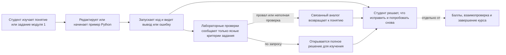

# HL — OOP_20261029-184453_RT/phase-b: Терминалы модуля 1

> **Date**: 2026-10-29
> **Author**: Coordinator, phase-b · `codex:thread:local:01a188ab-5190-7ce1-ab81-e572ebbbebc2`
> **Title**: Phase B: Терминалы модуля 1
> **Status**: 🟡 TS_DRAFT — Awaiting approval
> **Contract**: 🔒 FROZEN — approved by roman 2026-10-29
> **Parent task**: `OOP_20261029-184453_RT` · lifecycle `PHASES`
> **Parent HL**: [HL-OOP_20261029-184453_RT.md](../HL-OOP_20261029-184453_RT.md) · frozen baseline `23637e22ce1c4242b904b7a8b9f92cfbd81f2b56`
> **Parent TS**: [TS__OOP_20261029-184453_RT.md](../TS__OOP_20261029-184453_RT.md) · owner-approved content `f597148f95ed37e139fbfb9c036a35c324cff0a6`; approval and denominator confirmed by parent transition `c04f6856e837624ee8668684e9920b949b5068b9`
> **Phase status**: [status.md](status.md) · `HL_DRAFT` · owner-only / tfw-gates-only / native-gates · `selection_ref: baseline`
> **Parent route**: `coordinator:codex:thread:local:01a183ac-e789-7d81-a69a-00c4032013be`
> **Frozen**: §3 outcome and §4 deliverables; owner approval recorded at `../journal/20261029-223938__gate_answer__phase-b.md @ f7c2602c7b8f412dbdda4d998d2ce1417f839beb` of this phase, derived within the frozen §§1, 3–7 and approved TS of the parent task
> **Free**: §2 · §8 · §9 · §10 · §11
> **Append-only**: §12 Amendment Log

> **Phase contract boundary** — этот документ не содержит отдельные §1, §5, §6 или §7. Цель и ценность задачи, её DoD, DoF и принципы остаются только в родительском HL. Одобрение фазового HL не расширяет их.

> **Project North Star**: [NorthStar.md](../../../../NorthStar.md) · Purpose, Learner experience, Assessment contract, Product boundaries, Success

---

## 2. Current State (As-Is) 🟢 FREE

- В модуле 1 есть три страницы лекций и три страницы лабораторных. Их содержание и действующие критерии лабораторных хранятся в [`course/data.js`](../../../../course/data.js): лекции 1–3 находятся в начале файла, лабораторные 1–3 — в первом массиве лабораторных. Страницы отображает `course/app.js`.
- Сейчас курс показывает примеры как текст и предлагает запускать код в собственном Python-проекте. Сайт не исполняет и не проверяет студенческий код; прогресс и баллы отдельно хранятся существующим механизмом курса. См. [`course/README.md`](../../../../course/README.md), [`course/app.js`](../../../../course/app.js) и [`course/storage.js`](../../../../course/storage.js).
- Лекции модуля 1 охватывают инкапсуляцию и инварианты, отношения между объектами и полиморфные контракты. Лабораторные посвящены инвариантам домена Avtobys, композиции в движке тарифов и полиморфному диспетчеру событий. Текущий сайт отводит каждой лабораторной маршрут на 60 минут. В исходных PDF описаны более широкие задания на 135 минут; утверждённая задача задаёт текущий объём `course/data.js` как границу терминала и использует PDF как источник материала, а не как разрешение расширять страницу.
- В проверенном диапазоне лекций модуля 1 есть Python-примеры и нет JavaScript-примеров. Поэтому правило A8 применяется только если в действующем исходнике действительно обнаружится существующий JavaScript-пример; эта фаза не добавляет отдельный объём JavaScript.
- Владелец утвердил Pyodide в dedicated Worker и узкий static-only localhost launcher, а Phase A не является prerequisite модульной работы. Совместимость браузеров, offline-поведение runtime и изоляция эмпирически не проверены. В утверждённом TS эти свойства должны быть раскрыты как непроверенные, а не заявлены доказанными.

## 3. Target State (To-Be) 🔒 DERIVED

Шесть страниц модуля 1 используют общий терминал на основе модели курса. Студент может изменить и запустить Python-пример в лекции или начать лабораторное упражнение и увидеть вывод, ошибки и только те практические проверки, для которых есть однозначный oracle. Проваленная или неполная проверка остаётся провалом и предлагает связанный учебный аналог; полное решение лабораторной открывается по запросу. Существующие исполняемые строки, баллы, отметки чек-листа, прогресс, взаимопроверка и правила завершения лабораторной остаются такими, как закреплено в родительских HL и TS. Интерфейс и документация сообщают, что поведение runtime и браузера не проходило эмпирическую проверку.

### 3.1 Result Visualization

Иллюстративный макет для модуля 1; подписи и наблюдения ниже — примеры, а не фактическое поведение готового продукта.

```text
МОДУЛЬ 1 · ЛЕКЦИЯ 1                      ТЕОРИЯ · ИНКАПСУЛЯЦИЯ
┌─────────────────────────────────────┬─────────────────────────────┐
│ Редактируемый пример Python         │ Вывод                       │
│                                     │                             │
│ class TransitCard:                  │ Баланс после тарифа: 250 ₸  │
│     ...                             │                             │
│                                     │ [Запустить]                 │
└─────────────────────────────────────┴─────────────────────────────┘

ЛАБОРАТОРНАЯ 1 · ПРАКТИЧЕСКАЯ ПРОВЕРКА
┌─────────────────────────────────────┬─────────────────────────────┐
│ Заготовка и условие задачи          │ Результат                   │
│ [Запустить] [Проверить критерии]    │ Пройдено: 2 · Не пройдено: 1│
│                                     │ Провалено: баланс не должен │
│                                     │ меняться после отказа       │
│                                     │                             │
│                                     │ Аналог: защищайте остаток   │
│                                     │ инвентаря так же, как       │
│                                     │ баланс транспортной карты. │
│                                     │ [Показать полное решение]   │
└─────────────────────────────────────┴─────────────────────────────┘
Баллы курса, прогресс и завершение лабораторной от результата терминала не меняются.
```

### 3.2 Value Flow



## 4. Phase B Scope and Deliverables 🔒 DERIVED

Phase B — первый цикл реализации. Он охватывает общую основу терминала и только модуль 1. Фазы C и D остаются отдельными последующими циклами; этот план не даёт предварительного разрешения на их содержание или изменения.

1. Подключить общий двухпанельный терминал к лекциям и лабораторным 1–3, используя утверждённую границу Worker/runtime и существующую модель данных курса.
2. Сохранить все имеющиеся исполняемые строки; добавить запускаемые учебные примеры Python, комментированные заготовки лабораторных, явные проверки с отрицательными случаями там, где критерии курса дают oracle, полные решения по запросу и предметные аналоги при ошибках.
3. Включить только необходимые закреплённые runtime-assets, утверждённый static-only launcher и интеграцию сборки, а также согласованные обновления README и disclosure. Доказательство совместимости runtime/браузера и изоляции не входит в этот rollout.
4. Оставить функцию терминала вне текущих правил баллов, прогресса квиза/чек-листа, взаимопроверки и завершения лаборатории.
5. Применять только VALUE-пути родительского TS, необходимые Phase B. Общую терминальную основу и начальный delta общих файлов отнести к Phase B; будущие фазы используют отдельные последовательные Candidate и добавляют собственные delta без повторного счёта. Знаменатель родителя остаётся единым для задачи: 16 VALUE файлов / 4 000 затронутых текстовых LOC; не создавать фазовый лимит и не суммировать дельты фаз как новый знаменатель.

## 8. Dependencies 🟢 FREE

| Dependency | Status |
|------------|--------|
| Замороженный baseline task HL `23637e22ce1c4242b904b7a8b9f92cfbd81f2b56` | ✅ Управляющая authority |
| Утверждённые владельцем task TS и знаменатель, approval записан в переходе родителя | ✅ Управляющий scope; содержимое TS на `f597148f95ed37e139fbfb9c036a35c324cff0a6` |
| Валидация runtime в Phase A | ✅ Явно отложена и не является prerequisite для Phase B |
| Phase C | ⬜ Следующая фаза зависит от возвращённого RF Phase B и решения Task Coordinator о готовности |
| Phase D | ⬜ Последующая фаза зависит от Phase C и остаётся вне этой фазы |
### Coordinator return — 2026-10-30

- **Disposition:** RF Phase B получен и прочитан; исправление AC-1 в RF/EV сохраняет статическую проверку как `VERIFIED`, а эмпирическую browser/runtime/isolation проверку как `DEFERRED`, как задано в одобренном TS. Отдельного фазового знаменателя нет; Candidate остаётся в общем task contract.
- **Exact return refs:** `RF__phase-b__терминалы_модуля_1.md` и `evidence/EV__phase-b__терминалы_модуля_1.md` на `80bd2369e6c25bddd00d02917711d3577392f632`; authoritative local `status.md` там же — `RF`. Переход `ONB → RF` и его event находятся в `journal/20261029-235635__transition__1626.md @ d03df8990984a165c5b7e8d27d45e62ed90d688e`.
- **Owner inspection branch:** codex/phase-b-owner-review at C:\Users\tata2\.codex\worktrees\phase-b-owner-review\weboop, detached-free branch pointer at Candidate 6af207b52d36cd674fcc9dbf804a22b637b71a41; this exposes the complete Candidate tree and adds no product commit.
- **Result:** Candidate `6af207b52d36cd674fcc9dbf804a22b637b71a41`; 16 parent VALUE files, 1,019 additions + 12 deletions = 1,031 touched text LOC, below the immutable 16/4,000 denominator; two binary assets are per-file N/A. Executor reports terminal tests 6/6, storage regression 4/4, syntax checks and build passed. These are Executor evidence; independent review remains open.
- **Remaining conditions:** Task Coordinator selects independent review and decides phase readiness/successor. No browser/runtime compatibility, offline completeness or isolation proof is claimed. The Executor recorded a pre-extraction economics binding gap; numeric measurement remains unavailable, with no invented zero.

## 9. Risks 🟢 FREE

| Risk | Probability | Impact | Mitigation |
|------|-------------|--------|------------|
| Проверка заявляет больше, чем может наблюдать, или зависит от кода студента | Средняя | Высокий | Требовать конкретный oracle и отрицательный случай; неоднозначные и незащищённые критерии оставить ручными и никогда не отмечать пройденными. |
| Студент принимает результат терминала за оценку или завершение курса | Средняя | Высокий | Визуально отделить результат терминала от баллов, прогресса, взаимопроверки и завершения; сохранить утверждённый disclosure. |
| PDF на 135 минут воспринимают как разрешение расширить текущий 60-минутный маршрут сайта | Средняя | Средний | Выводить объём страницы из действующей границы `course/data.js`; использовать PDF как источник материала в рамках утверждённого TS. |
| Общий runtime выглядит проверенным в браузере, несмотря на waiver Phase A | Средняя | Высокий | Явно показывать непроверенный статус в UI и документации; не делать утверждений о подтверждённой изоляции или совместимости. |
| RF_READY `6f08f10a47a904ef43560c22866ad3ba03c78ab1` вернул RF, пока локальный статус остаётся ONB без перехода ONB → RF; TS AC-1 помечает evidence DEFERRED, но EV считает 0 DEFERRED | Средняя | Средний | Executor должен сохранить собственный truthful ONB → RF переход и выровнять EV/RF disposition с TS (AC-1 evidence остаётся DEFERRED для реальной browser/runtime проверки) до повторного RF_READY; Coordinator проверяет exact commits. |

### Owner finding and correction gate — 2026-10-30

Владелец Roman сообщает после просмотра Candidate `6af207b52d36cd674fcc9dbf804a22b637b71a41`, что страницы лекций выглядят пустыми, а терминалы не видны в лабораторных; он не может принять результат для проверки и просит того же Executor исправить всё найденное. Независимое воспроизведение рендера Coordinator не завершил, поэтому это пока owner-observed finding, а не утверждение Coordinator о подтверждённой причине.

**Next authorized route:** после RF материалный дефект должен быть подтверждён и классифицирован независимым Reviewer в live REVIEW. Если verdict даст rung-1 REVISE в пределах текущего TS, Task Coordinator задаёт bound в REVIEW, затем тот же Executor получает `/tfw-handoff` continuation. До такого REVIEW ruling Executor не переписывает Candidate; модули 2–3 остаются приостановлены до явного подтверждения владельца.
## 10. RESEARCH Case 🟢 FREE

### Blind Spots

- Точный oracle каждого критерия лабораторных надо сверить с действующим материалом курса во время реализации. Критерий без независимого однозначного наблюдения остаётся ручным.
- Совместимость браузеров, поведение runtime при ресурсной нагрузке и фактическая сетевая изоляция намеренно не проверяются в этом rollout; Phase B не должна превращать этот известный пробел в заявление об успехе.

### Hypotheses

Новых фазовых гипотез для исследования нет. Родительская задача завершила исследование, владелец утвердил границу реализации, а Phase A явно снята как prerequisite модулей.

### Risks of Not Researching

Дополнительное исследование runtime повторно открыло бы решённый выбор владельца, не меняя полномочия этой фазы. Существенная оставшаяся неопределённость касается качества oracle при реализации; критерии, которые нельзя честно проверить, нужно вернуть как ручные, а не расширять исследование или обещать успех.

### Proposed RESEARCH Focus

В этой фазе исследования не требуется. Использовать утверждённые HL/TS и доказательства реализации; любое изменение scope или authority направлять через Task Coordinator.

### Why Not Just...?

| Approach | Value | Adoption / operating burden | Risks / tradeoffs | Decision and reason |
|---|---|---|---|---|
| Применить общий терминал к шести страницам модуля 1 и автоматизировать только ясные критерии | Немедленный вывод и ограниченная практическая обратная связь в одном курсовом интерфейсе | Одна общая основа runtime/interface и шесть записей данных; следующие фазы смогут её использовать | Проверки на клиенте могут быть неполными; runtime не проверен эмпирически | Выбрано замороженным родительским HL и утверждённым TS; эта фаза выводит из них срез модуля 1. |
| Оставить примеры модуля 1 статическими и просить студентов запускать их отдельно | Не добавлять в эти страницы непроверенный runtime | Минимальные начальные изменения; студенту приходится переключаться в локальный редактор и среду тестов | Не достигается утверждённая обратная связь внутри курса; ошибки отделены от учебного материала | Владелец не выбрал этот вариант в утверждённом плане; он зафиксирован как последствие сохранения текущего состояния, а не как повторный выбор архитектуры. |

**Leave unchanged:** студент продолжает читать статические примеры, а запуск кода и практическую диагностику выполняет вне OOPoman без немедленного вывода и обратной связи на странице курса.

**Critical challenge:** зелёная отметка вредна, если oracle неполный или управляется кодом студента. Если критерий нельзя независимо проверить по текущему заданию, терминал должен обозначить его как непроверенный/ручной; уменьшить число автоматических проверок безопаснее, чем показывать ложное завершение. Это следует из fail-closed acceptance contract родительского TS.

## 11. Strategic Insights (Planning) 🟢 FREE

Новых человеческих стратегических сведений для этой фазы не получено. Цель владельца, граница оценивания, выбор Pyodide, waiver Phase A и решения о scope остаются в указанном родительском HL и утверждённом task TS; этот фазовый план не выдаёт их за новую authority.

## 12. Amendment Log 🟢 APPEND-ONLY

Изменений нет.

### Material handover at this return

- **Producer/unit:** Phase Coordinator `codex:thread:local:01a188ab-5190-7ce1-ab81-e572ebbbebc2`; родительский Coordinator `codex:thread:local:01a183ac-e789-7d81-a69a-00c4032013be`.
- **Source/epoch:** активация фазы из `journal/20261029-221843__dispatch__c34b.md @ 54a5d3059eb92102c0e792d449660b9d5ee6c46d`; событие создания фазы `journal/20261029-221843__created__a87e.md @ 54a5d3059eb92102c0e792d449660b9d5ee6c46d`; текущий Plan return — этот draft artifact.
- **Inspected scope:** phase status и journal, текущий task status, утверждённые родительские HL/TS, North Star OOPoman и TFW PV 0–4, текущие материалы курса модуля 1 и PDF лабораторных 1–3.
- **Material:** сейчас модуль 1 содержит три статические страницы теории и три статических маршрута лабораторных; сайт ещё не запускает код. В исходном worktree не было записей о фазе, поэтому их точные байты перенесены из cited dispatch commit после отказа Git fast-forward на read-only metadata worktree. Ни phase status, ни journal event не редактировались.
- **Economics binding gap (TRACE):** доступные инструменты не показывают точный `session_meta.id` этого Coordinator, native source locator или ограниченный диапазон Codex rollout. Адрес unit и task scope известны, но source ID и начало/конец диапазона не проверяемы; числовые токены и длительность не заявляются. Этот пробел относится к Phase Coordinator и остаётся неизмеренным, пока не станет доступен разрешённый механизм точной привязки источника.
- **Uncertainty / continuation:** этот производный HL ещё не одобрен и не разрешает реализацию. Task Coordinator должен проверить точный фазовый артефакт и провести требуемое owner approval HL. После подтверждённого одобрения нужно заморозить точный derivative перед написанием phase TS, затем получить одобрение точного TS и его фазового accounting до любого Executor dispatch.

---

*HL — OOP_20261029-184453_RT/phase-b: Терминалы модуля 1 | 2026-10-29*
