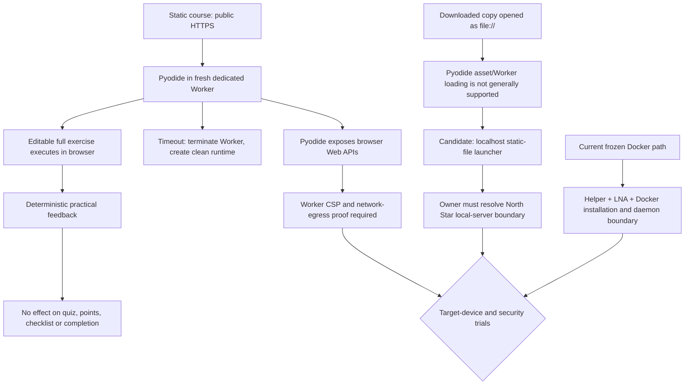

# RES — OOP_20261029-184453_RT: Рабочие терминалы

> **Date**: 2026-10-29
> **Author**: Researcher
> **Status**: 🔬 RES — Iteration 1 complete; Coordinator decision pending
> **Parent HL**: [HL-OOP_20261029-184453_RT](../../HL-OOP_20261029-184453_RT.md)
> **Mode**: Pipeline — focused
> **Producer unit**: `codex:thread:local:01a187f0-5141-7a03-ad0b-99812be36c8f`
> **Parent Coordinator**: `codex:thread:local:01a183ac-e789-7d81-a69a-00c4032013be`
> **Activation / dispatch source**: Owner-direct `/tfw-research OOP_20261029-184453_RT`; continued in this same Researcher unit at user stage checkpoints
> **Coordination authority**: `HL-OOP_20261029-184453_RT.md @ e408df4237a1aaad5bd016175f2462e3dbb8262d`
> **Originating proposer**: none

---

## Research Context

Task `OOP_20261029-184453_RT` seeks editable, runnable terminals and practical feedback across nine lessons/labs while preserving static-site/local-first operation, unchanged points/completion, unchanged source PDFs, and the frozen execution contract. Iteration 1 checked current browser access to loopback, Docker restrictions and requirements, course/PDF criteria, a browser-native Pyodide/WebAssembly alternative, and the failure cases of both approaches. Research did not run student code, perform browser tests on target devices, or inspect a runner implementation; the result is a sourced candidate and a bounded validation plan, not a security verdict.

## Briefing

See [1_briefing.md](1_briefing.md). Gather, Extract and Challenge are recorded in [2_gather.md](2_gather.md), [3_extract.md](3_extract.md) and [4_challenge.md](4_challenge.md).

## Decisions

| # | Decision | Rationale |
|---|---|---|
| D1 | Put Pyodide in a fresh dedicated Web Worker on a static HTTPS origin on the candidate list for Phase A review. Do not treat it as selected or implemented. | It can remove Docker Desktop and the public-page-to-loopback-helper edge. Wasm isolates host access behind browser APIs, and a Worker can be terminated for timeout; Pyodide also exposes Web APIs, and its hard memory/network limits are not yet proven. |
| D2 | For a downloaded local copy, evaluate a static-only localhost launcher that serves HTML/JS/Wasm assets; keep code execution in the browser. Do not promise direct `file://` execution with Pyodide. | Browser same-origin rules prevent the documented Pyodide loading path from reading local `file:` assets. A local HTTP origin is a UX and North Star boundary question. |
| D3 | Design practical checks as advisory feedback, never as lab grading, completion or an anti-cheating control. | Submitted code can change its interpreter/checker environment; multiple PDF criteria are architectural/reporting/oral rather than a unique runtime output. Existing HL keeps points/completion and peer/oral checks separate. |
| D4 | Preserve Docker as the currently approved baseline until the authorized Coordinator and owner resolve any frozen-contract change. | User direction authorizes research into alternatives and site adaptation, but Researcher authority does not amend HL §3/§4 or decide whether a local static server fits North Star. |

## Open Questions

| # | Question | Status | Answer |
|---|---|---|---|
| Q1 | What browser/version and OS matrix is required for students? | Owner input and device validation needed | HL names no approved matrix. Docker Desktop and Pyodide both have platform/version conditions; no student-device observations were available. |
| Q2 | Is a local static-file HTTP launcher acceptable for a downloaded course copy, given North Star's no-project-owned-server boundary? | Owner interpretation needed | The candidate launcher would serve assets only and never receive/execute Python, but it is still a local server process and changes the direct-open flow. |
| Q3 | Is blocking all network access from submitted code acceptance-critical, or is host-OS containment with advisory feedback sufficient? | Threat-model decision and technical proof needed | Pyodide exposes Web APIs. CSP can block common connection APIs, but the worker policy and runtime bootstrap must be tested; no zero-egress proof was produced. |
| Q4 | What startup, execution, memory and output limits are acceptable? | Experiment needed | No measurements or per-worker hard memory ceilings were established. |

## Hypotheses (from HL §10)

| # | Hypothesis | HL Status | RES Status | Evidence |
|---|---|---|---|---|
| H1 | Локальный помощник может безопасно и достаточно просто связывать статическую страницу с Docker на согласованной матрице браузеров; ложность означает переход к локальному launcher либо ограничение поддержки. | open | 🟡 Unresolved; current Chrome adds LNA permission requirements for public HTTPS → loopback. | [Gather G1–G2](2_gather.md); Chrome LNA and Docker Desktop primary docs. No target-browser/helper test. |
| H2 | Практические критерии всех девяти лабораторных можно выразить полным набором наблюдаемых проверок без оценки устной защиты; ложность означает оставить отдельные критерии ручными и показать это явно. | open | ⚠️ Too broad as written; machine-observable subsets exist, but reports, architecture judgment and oral defense need human review. | [Gather G3](2_gather.md), [Extract E2](3_extract.md); all nine source PDFs and task HL boundary. |
| H3 | Полные решения и аналоги можно добавить, сохраняя все существующие строки кода и не расширяя суженный объём ЛР 7–9; ложность означает вернуть конкретные спорные критерии Roman. | open | 🟡 Plausible, not implemented or verified; keep lab 7–9 scope mismatches explicit. | [Gather G3](2_gather.md), [Extract E2](3_extract.md), HL §2/§3/§4; no diff or preservation test performed. |
| H4 | Одноразовые контейнеры без сети/mounts с ресурсными лимитами достаточно безопасны и отзывчивы для учебных задач на поддерживаемых машинах; ложность означает не запускать код в клиентском Docker до смены модели. | open | 🟡 Unresolved; controls exist, but their application profile, helper boundary, device availability and responsiveness are untested. | [Gather G2](2_gather.md), [Challenge C4](4_challenge.md); Docker docs describe controls and residual kernel/daemon risk. |

## HL Update Recommendations

> **The researcher classifies, never applies or rules.** Recommendations below do not alter HL. The two amendment rows are candidate proposals with evidence, cost and alternatives; they remain `PROPOSED` until the authorized ruler acts through HL §12.

### Refinements — free sections, coordinator applies

| # | § | What to update | Source |
|---|---|---|---|
| R1 | §2 | Record that Chrome public-HTTPS → loopback can require LNA permission (Chrome 142 rollout), and that the Windows Docker Desktop WSL2 path has concrete OS/virtualization/resource requirements. Note that no student machine/browser was tested. | [Gather G1–G2](2_gather.md); [Chrome LNA](https://developer.chrome.com/docs/modern-web-guidance/guides/security/local-network-access); [Docker Windows requirements](https://docs.docker.com/desktop/setup/install/windows-install/). |
| R2 | §7.2 | Add current primary citations for Pyodide browser/Worker and file-loading behavior, WebAssembly embedding security, Worker CSP/termination, and Docker container controls. State their exact applicability and remaining proof gaps. | [Gather](2_gather.md), [Extract E1](3_extract.md), [Challenge C1–C4](4_challenge.md). |
| R3 | §8 | Add unresolved target browser/OS matrix, local static-copy serving choice, Pyodide package compatibility, worker CSP/asset-hosting requirements and acceptance-critical network policy. | [Gather G5](2_gather.md), [Challenge C2–C3](4_challenge.md). |
| R4 | §9 | Add risk entries for worker memory/output exhaustion, Pyodide JavaScript/Web API exposure, ineffective CSP on the worker script, local-file incompatibility, helper/Docker-daemon authority and advisory-checker tampering. | [Challenge C1–C4](4_challenge.md). |
| R5 | §10 | Narrow H2 so only criteria with a deterministic observable oracle are automated; keep structural/design/oral criteria explicitly human. Keep H1/H4 open pending target-system proof; record H3 as conditional on source preservation and scope checks. | [Gather G3](2_gather.md), [Challenge C5](4_challenge.md), hypotheses table above. |
| R6 | §11 | Add the owner's current preference to consider a non-Docker runtime and adapt the website if that is necessary for safe, correct execution; record the local-start UX and frozen-contract decision as unresolved. | User direction at the Extract and Challenge checkpoints; [Extract E3](3_extract.md), [Challenge checkpoint](4_challenge.md). |

### Amendment Proposals — frozen sections, resolved-ruler verdict required

| # | § | Type | Proposed change | Evidence | Cost | Alternatives considered |
|---|---|---|---|---|---|---|
| A1 | §3 | `SUPERSEDE` | Replace the frozen fixed-Docker execution path with a pinned browser Pyodide/WebAssembly runtime in a disposable dedicated Worker for the explicitly approved browser matrix. Require a worker-scoped CSP, bounded message/output handling and hard timeout/worker restart; retain the existing rule that feedback does not alter scores/completion and retain host/network-access DoF until tested. Adoption is conditional on proving the required network policy, target-browser behavior, acceptable resource limits and compatibility with actual course snippets. | Pyodide documents browser CPython, Web API access and Worker use; WebAssembly documents embedder-mediated access; browsers can terminate Workers; CSP can restrict connection APIs but must apply to the Worker; Pyodide documents local-file restrictions. See [Extract E1](3_extract.md), [Challenge C1–C3](4_challenge.md) and official sources linked there. These are capability sources, not empirical proof that the proposed product is safe. | Vendor and pin the runtime/assets; adapt the UI, worker protocol and CSP/hosting; define package support; measure startup and run performance; test timeouts, memory/output pressure, network policy and browsers; change local-copy instructions or supply another verified mode. No measured asset size or timing is available. | Keep Docker/helper as frozen: preserves native CPython and HL but requires Docker installation, LNA permission for public HTTPS, careful handling of a powerful local daemon/helper and target-device tests. Native CPython requires OS-specific sandboxes. Manual local run is simpler but does not meet in-page execution/feedback. |
| A2 | §4 Phase A | `SUPERSEDE` | Replace Phase A's Docker helper/container deliverables with a bounded runner-validation phase: Pyodide Worker prototype; pinned assets; strict worker CSP/network-canary tests; timeout, memory/output and checker-isolation trials; approved browser matrix; static-only local serving prototype if allowed. Phase A must stop and return if current DoF cannot be met; dependent module phases start only after the accepted runner contract is established. | Same sources and explicit gaps as A1; [Challenge C1–C4](4_challenge.md). No prototype or target-device test exists yet. | Adds browser runtime and deployment/security work; local copies may need a start command; library/CPython compatibility is narrower; if worker memory/effectiveness fails, a Docker path remains or the task returns for another owner decision. | Existing Phase A is contract-aligned and directly uses Docker but keeps installation, local-helper privilege and browser-LNA burden. A cloud runner violates the local/no-project-server direction. |

No amendment proposal is made for §6: the current failure definition (no host/network access and only truthful supported claims) remains a hard acceptance condition. If a Pyodide design cannot prove it, reject that candidate rather than weaken §6 within this research.

## Fact Candidates

No project-derived agent observation needs human-knowledge qualification. Technical/browser claims remain cited research evidence; the owner's preference is recorded below as a strategic insight, not promoted as a project fact.

| # | Category | Candidate | Source | Confidence |
|---|---|---|---|---|
| — | — | None | — | — |

## Strategic Insights (Research)

| # | Category | Insight | Source | Confidence |
|---|---|---|---|---|
| SS1 | stakeholder | Roman is open to replacing Docker if another approach can provide safe and correct terminal behavior, and is willing to adapt the website to its requirements. This makes setup flow negotiable; it does not lower the safety/correctness bar or approve changes to frozen HL claims. | User, Gather→Extract/Challenge continuation messages, 2026-10-29 | ★★★ |

## Findings Map

## Iteration Status

- **Iteration:** 1 of 2 (min) / 3 (max)
- **Hypotheses tested:** H1 (unresolved), H2 (too broad; partially refuted), H3 (plausible but unverified), H4 (unresolved)
- **Hypotheses deferred:** None; all four were examined at documentary/design level, none received target-device validation.
- **Gaps discovered:** Approved browser/OS matrix; local static launcher interpretation; worker CSP and strict egress proof; hard memory/output/startup limits; Pyodide compatibility with complete lesson/lab snippets; concrete per-lab oracle and fixtures; no native economics binding for this Researcher unit.
- **Superseded decisions:** None. No frozen HL decision has been changed.

### Open Threads (for next iteration)

| # | Thread | Why it matters | Suggested focus |
|---|---|---|---|
| 1 | Validate the surviving browser-native candidate against actual supported student devices and the unchanged §6 DoF. | Documentation does not prove no egress, acceptable memory pressure, compatibility, responsiveness or correct feedback in the course. | Coordinator obtains the target browser/OS matrix and decides whether a bounded prototype/independent security test is authorized. Test Pyodide Worker CSP/network canaries, timeout/restart, memory/output stress, all 18 page examples and deterministic lab fixtures; report observed failures and measured startup/run conditions. |
| 2 | Resolve local-copy launch behavior and classify each criterion for automation. | Direct `file:` mode is not supported by the candidate loading path; the project prohibits a server, and PDF oral/architecture criteria cannot be equated with runtime checks. | Owner/Coordinator decides if a static-only localhost launcher is within North Star; map every frozen in-scope practical criterion to a deterministic oracle or explicit human-only disposition without widening labs 7–9. |

### Recommendation
- [ ] **SUFFICIENT** — proceed to `/tfw-plan` to classify these recommendations and write TS
- [x] **MORE NEEDED** — perform at least one additional iteration; mandatory target-device/runtime and security evidence is missing, and the configured minimum is two iterations.
- [ ] **BLOCKED** — specify blocker

> Coordinator decides whether to continue or proceed. Researcher recommends but does NOT decide.

## Conclusion

Iteration 1 found a plausible way to remove Docker from the execution path: run pinned Pyodide in a dedicated browser Worker, terminate and recreate the Worker after timeouts, keep checks advisory, and consider a local static-file launcher for downloaded copies. This may reduce setup and helper/daemon exposure, but it is not yet proven to meet the frozen no-host/no-network failure boundary; worker-level CSP, browser API exposure, memory pressure, package/course compatibility, target browser behavior and the local-server interpretation all remain open. Docker remains the approved baseline until the Coordinator routes an owner ruling on the proposed frozen-section changes. The research prevented “WebAssembly is safe” and “Docker flags prove isolation” from being treated as evidence, and separated automatic runtime oracles from human assessment. No implementation, target-device experiment or independent security review was performed; iteration 2 should close those gaps before a TS selects a runner.

### Material handover at this return

- **Producer/unit:** Researcher `codex:thread:local:01a187f0-5141-7a03-ad0b-99812be36c8f`, owner-direct under `roman`; parent Coordinator `codex:thread:local:01a183ac-e789-7d81-a69a-00c4032013be`.
- **Authority and epoch:** task `status.md` routing spine, `selection_ref: baseline`, frozen HL `e408df4237a1aaad5bd016175f2462e3dbb8262d`; owner-only, `tfw-gates-only`, `native-gates`.
- **Inspected scope:** task status/journal/control, frozen HL §2–§10 and §7.2 sources; project North Star, `.tfw/README.md`, `KNOWLEDGE.md` and `course/README.md`; `course/data.js`/related terminal and progress references; nine lab PDFs; official Chrome LNA, Docker, Pyodide, WebAssembly and CSP/Worker documentation. No relevant `knowledge/records/` directory exists. PDF exports were temporary under `%TEMP%\tfw\OOP_20261029-184453_RT` and were removed after inspection.
- **Material and continuation:** stage files and this RES preserve findings, source URLs, uncertainties, conditional non-Docker candidate, amendments for the authorized Coordinator/owner, and specific iteration-2 work. No HL, config, code, PDF or task lifecycle/status was modified.
- **Economics binding gap:** at activation/continuation and final return, no native source ID/path, bound numeric source range/start, or usage export was exposed to this Researcher unit. Known facts: task `OOP_20261029-184453_RT`, owner `roman`, role Researcher, unit address above, timezone `Asia/Qyzylorda` (UTC+05:00), observed gap at `2026-10-29T19:13:21+05:00`. Missing: exact source namespace/ID and numeric path, source version, bound range start/end and native source epoch. Reason: current Codex task tools expose no per-unit usage stream/file or source/range selector; no local binding file was supplied in the task context. Extraction was not attempted; no invalid JSONL, failure receipt, measured zero or last-good measurement exists. No task economics file was fabricated. Coordinator can reconcile this attributable pre-extraction gap separately from measurement.

---

*RES — OOP_20261029-184453_RT: Рабочие терминалы | 2026-10-29*
