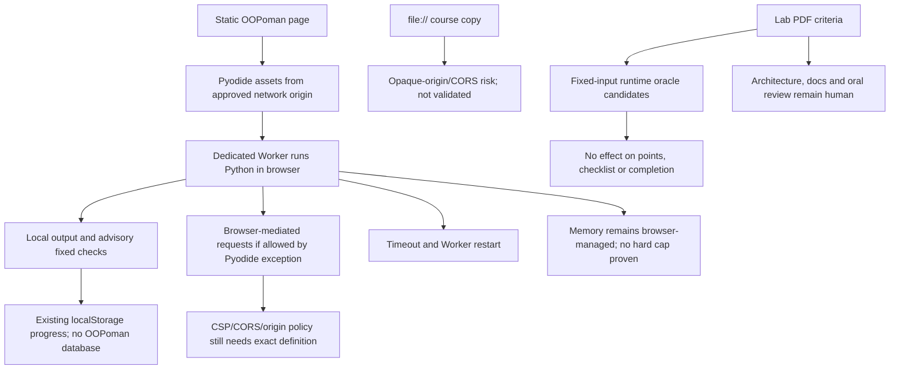

# RES — OOP_20261029-184453_RT: Рабочие терминалы

> **Date**: 2026-10-29
> **Author**: Researcher
> **Status**: 🔬 RES — Iteration 2 complete; Coordinator decision pending
> **Parent HL**: [HL-OOP_20261029-184453_RT](../../HL-OOP_20261029-184453_RT.md)
> **Mode**: Pipeline — focused
> **Producer unit**: `codex:thread:local:01a187f0-5141-7a03-ad0b-99812be36c8f`
> **Parent Coordinator**: `codex:thread:local:01a183ac-e789-7d81-a69a-00c4032013be`
> **Activation / dispatch source**: owner-direct Researcher activation, continued in the same unit by Coordinator message `/tfw-research OOP_20261029-184453_RT research/iterations.yaml @ f42220bbd28d8522d6d9ac319f446f6c62d1b723`; cited control file blob verified against that commit.
> **Coordination authority**: `HL-OOP_20261029-184453_RT.md @ e408df4237a1aaad5bd016175f2462e3dbb8262d`
> **Originating proposer**: none for task inception. The separate network-exception amendment direction originated with owner Roman (`owner:roman`) during this research continuation.

---

## Research Context

Iteration 2 compared a browser Pyodide Worker with the frozen Docker-helper direction for the OOPoman static course, examined nine source lab PDFs and current course criteria, and separated deterministic execution checks from human assessment. Roman clarified the audience is novice students rather than malicious actors, asked for basic accidental-misuse guardrails, and directed a Pyodide-specific network exception for everything needed for correct operation while keeping the course local and without a database. The direction makes the hosted static-page path simpler to consider, but target-browser execution, `file://` behavior, resource behavior, exact network origins and frozen-HL amendments remain unverified. No runner or course code was implemented.

## Briefing

See [1_briefing.md](1_briefing.md). The same-unit continuation, prior-iteration handover, owner clarifications, scope, hypotheses and investigation plan are recorded there.

## Decisions

| # | Decision | Rationale |
|---|---|---|
| D5 | Keep Pyodide in a dedicated browser Worker as the simplest non-Docker candidate for a hosted static course. It is a candidate, not a selected or accepted runtime. | It avoids Docker installation and a browser-to-loopback helper for the hosted page. Official documentation supports Worker use and browser execution, but this host could not execute Pyodide or validate browser behavior. |
| D6 | Record the owner's requested Pyodide-only network exception as an amendment direction. Keep the site static and course progress local; add no OOPoman database or code-upload endpoint. | Pyodide loads runtime assets and its browser APIs use browser-mediated network behavior. The exception's exact origins and whether any current course snippet needs outbound requests still need to be specified and evidenced. Frozen HL §6 remains in force pending the valid amendment route. |
| D7 | For a first teaching-console concept, use one editable program buffer, fresh execution state, timeout/Worker restart, capped output, a curated pinned package set and no native-folder mount. Keep feedback advisory and separate from scores/progress/completion. | These controls address common novice mistakes without adding a local privileged daemon; they do not create a hard memory limit or prove security isolation. |
| D8 | Do not promise direct `file://` support or approve a localhost launcher. | Pyodide and MDN document file-origin restrictions; no exact local-copy topology was tested. North Star excludes a project-owned server, and the local static launcher is not authorized by the iteration control. |
| D9 | Keep objective checks limited to explicit runtime outcomes; leave design rationale, README/UML quality, coverage quality and oral defense for human review. Preserve current task scoring and source-PDF scope. | The nine lab PDFs mix observable behavior, structural/design criteria and human judgment. Labs 7–9 in `course/data.js` are narrower than corresponding PDF scope. No oracle fixture was run or independently validated. |

## Open Questions

| # | Question | Status | Answer |
|---|---|---|---|
| Q1 | What exact network origins and package resources does the Pyodide exception need, and do any in-scope student examples require outbound requests? | Owner has directed an exception for everything needed for Pyodide to work; implementation-level origin and exercise list still needed. | Pyodide's runtime and packages use browser asset/network mechanisms; browser-mediated program requests are subject to CSP/CORS. The current site version of Lab 7 uses a local fictional gateway with no network; no other current sample network dependency was demonstrated. The exception should be limited to the resources/use cases the approved course actually needs. |
| Q2 | Must a downloaded course copy open by double-click (`file://`), or may students use an already-available HTTP(S) origin? | Owner input and browser validation needed. | Static HTTPS needs no OOPoman database. A direct-file copy may fail CORS/Worker loading; a localhost static server would add a project-owned process contrary to current North Star unless amended. |
| Q3 | Which browser/OS versions and acceptable first-run/execution/output/memory behavior define support? | Owner/device input and experiment needed. | No target matrix or resource thresholds are in the task record. Current Pyodide documentation recommends recent browsers but is not this course's 2026 support decision. |
| Q4 | Which site/PDF scope governs Labs 7–9 and which exact fixtures define each checker? | Coordinator/owner scope decision and authoring needed. | Lab 7 omits the PDF's real external adapter/decorator scope; Lab 8 has fewer nodes/observers; Lab 9 is a smaller Shift/repository analogy. Do not restore PDF-only scope silently. |
| Q5 | Can Pyodide initialize and run all approved samples with the proposed network exception, timeout, output cap and supported browsers? | Browser experiment needed. | No browser, Docker daemon or local Pyodide Node package was available here. Node 24.22.1 exists, but `pyodide` was absent from bundled `node_modules`; no runtime or sample executed. |

## Hypotheses (from HL §10)

| # | Hypothesis | HL Status | RES Status | Evidence |
|---|---|---|---|---|
| H1 | Локальный помощник может безопасно и достаточно просто связывать статическую страницу с Docker на согласованной матрице браузеров; ложность означает переход к локальному launcher либо ограничение поддержки. | open | 🟡 Unresolved | Docker docs establish resource controls and daemon authority; no local Docker/helper or target browser was available. [Gather G1](2_gather.md), [Extract E3](3_extract.md). |
| H2 | Для каждого практического критерия лабораторной можно определить наблюдаемый oracle либо явно оставить его ручным; только oracle-backed критерии получают автоматическую учебную обратную связь, устная защита остаётся студенту. | iteration 2: карта критериев и проверка oracle | 🟡 Candidate map complete; fixtures unvalidated | [Extract E2](3_extract.md) maps all nine PDF/site rubrics to candidate behavioral oracles and manual disposition; Labs 7–9 scope mismatches are explicit. No reference implementation or checker was run. |
| H3 | Полные решения и аналоги можно добавить, сохраняя все существующие строки кода и не расширяя суженный объём ЛР 7–9; ложность означает вернуть конкретные спорные критерии Roman. | open | 🟡 Unresolved | No code or course source was changed; scope conflicts for Labs 7–9 are returned as owner/Coordinator decisions. No line-preservation comparison was performed. |
| H4 | Одноразовые контейнеры без сети/mounts с ресурсными лимитами достаточно безопасны и отзывчивы для учебных задач на поддерживаемых машинах; ложность означает не запускать код в клиентском Docker до смены модели. | open | 🟡 Documentary only; unresolved | Docker documents cgroups and daemon risks, but neither Docker nor a target machine was available. [Gather G1](2_gather.md), [Challenge C4](4_challenge.md). |
| H5 | Pyodide в отдельном Worker может запускать требуемые snippets при подходящем worker-specific CSP, ограниченном протоколе и целевой браузерной матрице без недопустимого host/network доступа; ложность исключает замену Docker этим путём. | iteration 2: ограниченный прототип and adversarial checks | 🟡 Candidate for hosted static page; runtime/browser/network behavior unresolved | Pyodide docs support browser Workers and document compatibility/network limits; user requested a Pyodide network exception. No package, snippet, CSP, timeout, output or browser test ran. See [Extract E1–E3](3_extract.md) and [Challenge C1–C3](4_challenge.md). |

## HL Update Recommendations

> **The researcher classifies, never applies or rules.** The Coordinator transcribes amendment proposals into append-only §12 as `PROPOSED`, preserves the owner origin and routes under `.tfw/conventions.md` → `HL Contract` rule 8. Frozen sections remain unchanged until a valid terminal verdict.

### Refinements — free sections, coordinator applies

| # | § | What to update | Source |
|---|---|---|---|
| R1 | §2 | State that this host exposed Python/Node but no Docker CLI/daemon or browser executable/version on PATH; the findings are documentary/source-based, not a target-device verdict. | [Gather G1](2_gather.md), [Challenge C1–C3](4_challenge.md); 2026-10-29 host capability check. |
| R2 | §7.2 | Add current official Pyodide distribution, Worker, filesystem, WebAssembly-constraint, CSP/CORS and Docker security/resource references, labeling them documentary evidence rather than product tests. | [Gather G1–G2](2_gather.md), [Extract E1/E3](3_extract.md), [Challenge C1–C3](4_challenge.md). |
| R3 | §8 | Record unresolved origin modes (`https`, direct `file://`, already-available localhost), target browser/OS matrix, Pyodide asset/package origins and local/offline expectations. | [Gather G4](2_gather.md), [Challenge C1–C2](4_challenge.md), owner directions in Briefing/Challenge. |
| R4 | §9 | Add risks for Pyodide asset-origin/CSP configuration, browser-mediated requests from submitted code, CDN/package availability, memory growth before timeout, output volume, file-origin incompatibility and unsupported native modules. | [Extract E1/E3](3_extract.md), [Challenge C1–C3](4_challenge.md). |
| R5 | §10 | Mark H2 as candidate oracle map pending fixtures; keep H1/H3/H4 unresolved; mark H5 as documented candidate with no runtime or target-browser proof. Carry the six-dimension matrix and open questions. | [Extract E2–E3](3_extract.md), [Challenge checkpoint](4_challenge.md). |
| R6 | §11 | Capture Roman's preference for a non-Docker, beginner-oriented runtime and Pyodide-specific network exception while preserving a local static site with no database; this is direction, not an implemented HL decision. | User direction recorded in [Briefing](1_briefing.md) and [Challenge](4_challenge.md), 2026-10-29. |

### Amendment Proposals — frozen sections, resolved-ruler verdict required

> These proposals continue iteration 1's proposed Docker-to-Pyodide changes and add the owner's network-exception direction. Origin for the exception: Roman (`owner:roman`), direct user instruction in this Researcher task on 2026-10-29. Researcher does not issue the §12 verdict or edit HL.

| # | § | Type | Proposed change | Evidence | Cost | Alternatives considered |
|---|---|------|-----------------|----------|------|------------------------|
| A1 | §3 | `SUPERSEDE` | Replace the fixed Docker/helper execution path with Pyodide in a dedicated browser Worker for the approved static-site origin(s). Execute locally in the browser; use pinned runtime/package assets, bounded request/output protocol, timeout and Worker restart; do not mount native host folders or send code to an OOPoman backend. Keep all scoring/progress/peer-check behavior unchanged. Conditional on a named browser/OS matrix, course-snippet compatibility, asset/network behavior and functional checks. | Pyodide documents browser Worker use, CPython/Wasm distribution, browser Web API access and platform limitations; MDN documents Worker termination and CSP/CORS behavior. [Extract E1/E3](3_extract.md), [Challenge C1–C3](4_challenge.md). No product experiment exists. | Pin/host runtime assets and permitted packages; create Worker protocol and timeout/output UX; configure/test CSP/origins; reconcile direct-file copy; validate examples and error mapping; accept narrower CPython compatibility and no hard memory guarantee. | Keep current Docker/helper baseline, retaining native CPython and network-disabled containers but requiring Docker/helper setup and loopback/browser validation. Manual local Python needs separate setup and does not provide in-page execution. |
| A2 | §4 Phase A | `SUPERSEDE` | Replace Phase A's Docker-helper/container deliverables with a bounded Pyodide Worker validation phase: pinned asset/package set, approved local/hosted launch modes, network-origin behavior, compatibility for approved course snippets, timeout/output behavior, target-browser matrix and criterion fixtures. Do not proceed to module integrations until the runner contract and manual criteria are accepted. Treat a localhost static launcher as a separate North Star amendment, not implicit scope. | Iteration 2 could not run the runtime; docs and course/PDF mapping specify the validation gates. [Gather G1–G4](2_gather.md), [Extract E1–E3](3_extract.md), [Challenge C1–C4](4_challenge.md). | Adds browser runtime packaging, compatibility/CSP work and target-device experiments; local-copy behavior may need a separate path; memory and unsupported modules remain product limits. | Keep the existing Phase A Docker implementation, or stay with manual execution if no browser runner meets the approved contract. |
| A3 | §6 item 1 | `EXTEND` | Add a Pyodide-only exception to the no-network failure rule for network resources required to initialize and correctly run the approved Pyodide distribution/packages and any explicitly approved in-scope course examples. Keep host filesystem access prohibited; add no site backend, database or code-upload endpoint. The approved origin/package set and user-code network use must be stated in TS/owner ruling; the exception does not grant unrestricted networking to Docker or every future snippet by default. | Owner direction at Challenge and follow-up: allow the network needed for Pyodide to function while keeping the site local/no database. Official Pyodide docs document CDN/distribution assets and browser-mediated network requests subject to CSP/CORS. [Challenge C1–C2](4_challenge.md), [Pyodide quickstart](https://pyodide.org/en/stable/usage/quickstart.html), [Pyodide network constraints](https://pyodide.org/en/latest/usage/wasm-constraints.html), [MDN CORS/file origins](https://developer.mozilla.org/en-US/docs/Web/HTTP/Guides/CORS/Errors/CORSRequestNotHttp). | Defines a deliberate exception to the current failure contract; external asset requests and any permitted student-code requests depend on Internet/CORS and can reach the named origins. Requires pinning, exact allowlist/use cases, user-facing disclosure for offline/local copies and behavior checks. No new application server/database is required for client-side execution. | Keep network disabled and use Docker; or allow only pinned runtime assets while excluding student-code network requests (which may need a separated loader/policy and must be tested). A broader arbitrary Internet exception is not supported by current course requirements or evidence. |

## Fact Candidates

No human-only fact candidate is proposed. Source-code and PDF observations are project-derived and remain in this RES; Roman's input is preserved as strategic insight, not promoted as a verified project fact.

| # | Category | Candidate | Source | Confidence |
|---|----------|-----------|--------|------------|
| — | — | None | — | — |

## Strategic Insights (Research)

| # | Category | Insight | Source | Confidence |
|---|----------|---------|--------|------------|
| SS1 | stakeholder | Roman is open to replacing Docker if another approach can provide safe and correct terminal behavior, and is willing to adapt the website to its requirements. This makes setup flow negotiable without lowering the correctness bar or implicitly approving frozen-HL changes. | User, iteration 1 direction retained from [iter1 RES](../iter1/RES.md), 2026-10-29 | ★★★ |
| SS2 | stakeholder | Roman says the learners are beginners, not malicious actors, so the first design should address accidental infinite loops, excessive output and ordinary runtime failures rather than adversarial isolation. This supports a smaller browser-oriented teaching console but does not remove the current host-file/network failure clause until the exception is resolved. | User, Gather checkpoint, 2026-10-29 | ★★★ |
| SS3 | stakeholder | Roman directs allowing whatever network Pyodide needs to work while keeping the course site local and without a database. This points toward client-side execution and static local progress rather than code upload/server evaluation; the precise required origins and whether in-scope student code needs outbound requests still require evidence. | User, Challenge checkpoint and follow-up, 2026-10-29 | ★★★ |

## Findings Map

## Iteration Status

- **Iteration:** 2 of 2 (min) / 3 (max)
- **Hypotheses tested:** H1 (documentary only, unresolved), H2 (candidate-oracle/manual map created, fixtures unvalidated), H3 (unverified, Labs 7–9 scope gaps surfaced), H4 (Docker controls documented, local behavior unresolved), H5 (Pyodide candidate supported by docs, runtime/network/browser behavior unresolved).
- **Hypotheses deferred:** None at documentary/source-mapping level; all direct runtime and target-device evidence remains unperformed.
- **Gaps discovered:** No browser/Docker execution environment or local Pyodide Node package; Pyodide Worker startup and sample compatibility; exact allowed asset/package origins and whether current student snippets require egress; direct `file://` support; owner decision on a project-owned localhost launcher; browser/OS and resource budget; fixture-level test vectors; Labs 7–9 PDF/site scope; no hard Worker memory ceiling; native economics binding absent for this Researcher unit.
- **Superseded decisions:** None. The user has given an owner-originated direction to allow Pyodide-required network activity, but no HL amendment has been filed/resolved and no frozen claim has changed.

### Open Threads (for next iteration)

| # | Thread | Why it matters | Suggested focus |
|---|--------|---------------|-----------------|
| 1 | Run bounded functional checks on a browser-equipped target with the named Pyodide network exception. | Documentation cannot establish that Worker startup, approved egress, timeout/restart, output cap, current snippets or first-run behavior work together. | Pin Pyodide/package versions; test existing runnable snippets and fixed fixtures; measure startup and ordinary execution; check timeout and output behavior for accidental cases; record exact browser/OS and CORS/origin outcomes. No deliberate exploit campaign is required under the agreed learner threat model. |
| 2 | Resolve the required local-copy launch mode. | Hosted HTTPS and downloaded `file://` are different origins; the latter may fail Worker/Wasm loading. A localhost launcher conflicts with the current North Star. | Decide whether students may use an existing HTTPS/HTTP origin, direct file-open is mandatory, or a separate server exception must be routed. Test the selected path before promising it. |
| 3 | Finalize the nine-lab oracle set and disposition for Labs 7–9. | False green feedback or silently expanded assignment scope would harm learning and violate the task contract. | Authors define bounded fixtures and expected outputs/state for deterministic items; retain architecture/docs/defense for humans; Roman/Coordinator resolve PDF versus site scope differences. |

### Recommendation
- [ ] **SUFFICIENT** — proceed to `/tfw-plan` to classify these recommendations and write TS
- [x] **MORE NEEDED** — one bounded, non-adversarial browser validation iteration is still needed because this host could not run Pyodide or a browser and the direct-file/network/resource behavior remains unknown.
- [ ] **BLOCKED** — specify blocker

> Coordinator decides whether to continue or proceed. Researcher recommends but does NOT decide.

## Conclusion

Iteration 2 narrows the simplest non-Docker direction to Pyodide in a Worker for a hosted static page, with a compact single-buffer console, pinned dependencies, timeout/restart, output cap and fixed advisory checks; the course can remain client-side and database-free. Owner direction supports a Pyodide-only network exception, but it is not an applied §6 amendment and must be bounded to the resources and examples the course needs. Direct `file://` support, local launcher authority, target compatibility, network policy, memory behavior and exact checker fixtures remain open. The research also found that several PDF criteria are human judgments and Labs 7–9 on the site are narrower than the PDFs. This work provides a clearer owner decision surface than the plausible-runtime discussion in iteration 1, but no snippet, browser, Docker or network test ran, so it cannot claim correctness or recommend deployment. Continue to `/tfw-plan` for Coordinator review and a decision on the amendment proposals or a bounded third research iteration.

### Material handover at this return

- **Producer/unit:** Researcher `codex:thread:local:01a187f0-5141-7a03-ad0b-99812be36c8f`; parent Coordinator `codex:thread:local:01a183ac-e789-7d81-a69a-00c4032013be`; task owner `roman`.
- **Authority/epoch:** `status.md` remains owner-only, `dialogue: tfw-gates-only`, `reporting: native-gates`, `selection_ref: baseline`; frozen HL authority is `e408df4237a1aaad5bd016175f2462e3dbb8262d`. Iteration control remains Coordinator-owned and pending; no status, iteration YAML, journal or HL change was made.
- **Repository/evidence epoch:** repository HEAD `f42220bbd28d8522d6d9ac319f446f6c62d1b723`. Research outputs are current untracked worktree files; hashes at handover: `1_briefing.md` SHA-256 `2e4893723322f732f43364955013580877363d66cd32b363fccba7db2630f826`; `2_gather.md` `ca491038a5088d0bf661cc6a387907582a35a11f8cb3f6b004e84ac736448611`; `3_extract.md` `8f8223451671a97d1256d14f1809033ac6f90d393d440c5c96b6e928bb60246d`; `4_challenge.md` `7194022eb5263792f150d1401ebe080b83f4adc2708be3cb653386fedcd67c74`. These identify the files as inspected before this RES was written; the current RES itself is at `research/iter2/RES.md` in the shared worktree.
- **Inspected scope:** task status and `research/iterations.yaml`; frozen HL §1, §3, §6, §10 and §7.2 sources; North Star product boundaries; `KNOWLEDGE.md` (no applicable `knowledge/records/` found); `course/data.js`, `course/app.js`, course README; all nine source lab PDFs enumerated in [Gather](2_gather.md); official Pyodide, Docker and MDN documentation. No target browser, Docker runner, Pyodide package, student snippet, prototype, network canary or resource test was executed. No external code/service was contacted by the website.
- **Coverage and uncertainty:** documentary/runtime architecture, host/tool availability, compatibility feature inventory, per-lab candidate oracle/manual map, cross-configuration conflicts and owner amendment direction are preserved in iteration stage files and this RES. Product proof, target-browser support, exact network exception/asset list, `file://` topology, memory behavior, timings, fixtures and Labs 7–9 scope ruling remain open. Temporary PDF text exports were removed from `%TEMP%\tfw\OOP_20261029-184453_RT`.
- **Economics binding gap:** final return observed at `2026-10-29T20:31:16+05:00`. Known binding facts: task `OOP_20261029-184453_RT`, owner `roman`, role Researcher, unit `codex:thread:local:01a187f0-5141-7a03-ad0b-99812be36c8f`, timezone `Asia/Qyzylorda` (UTC+05:00). No native usage source locator, source ID/version, numeric JSONL path or bound range was exposed to this unit; task tools provide no per-unit usage selector/export and no binding file was supplied. Extraction was not attempted. There is no measured zero, invalid JSONL or actual failure receipt. This is an attributable pre-extraction binding gap, not a token measurement or proof of zero use.

---

*RES — OOP_20261029-184453_RT: Рабочие терминалы | 2026-10-29*
