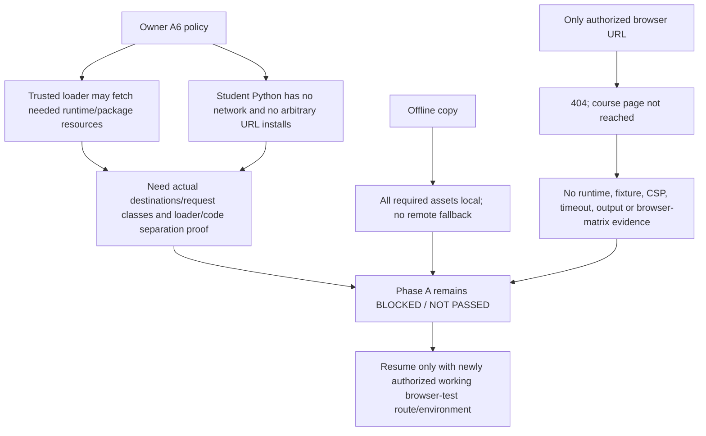

# RES — OOP_20261029-184453_RT: Рабочие терминалы

> **Date**: 2026-10-29
> **Author**: Researcher
> **Status**: 🔬 RES — Iteration 3 complete; Phase A runtime validation BLOCKED / NOT PASSED
> **Parent HL**: [HL-OOP_20261029-184453_RT](../../HL-OOP_20261029-184453_RT.md) _(pipeline only)_
> **Mode**: Pipeline — focused
> **Producer unit**: `codex:thread:local:01a187f0-5141-7a03-ad0b-99812be36c8f`
> **Parent Coordinator**: `codex:thread:local:01a183ac-e789-7d81-a69a-00c4032013be`
> **Activation / dispatch source**: Owner-direct Researcher task, continued by Coordinator gates `journal/20261029-205052__gate_answer__c4a7.md @ f85e9bf6442ab5713e886bc9068e3ef02823769a` and `journal/20261029-212919__gate_answer__5d1a.md @ 4eee4d40c82cf7e048197cd003fafb620ea157a0`.
> **Coordination authority**: `status.md` → `HL-OOP_20261029-184453_RT.md @ 9760d4da26ceaf6a6beca2a67c8c2fd377328cbd`
> **Originating proposer**: `roman` (`owner:roman`) for owner-ratified runtime/network direction; owner-direct task inception.

---

## Research Context

Iteration 3 was tasked with validating the owner-selected Pyodide Worker and offline static launcher in a browser-equipped environment. The only Coordinator-authorized HTTP(S) route, `http://127.0.0.1:8765/course/index.html`, returned 404, and the owner allowed only that one attempt; no other test route or browser surface is currently available. The work therefore completed a documentary Challenge, not Phase A execution. The owner-ratified A6 network policy allows the trusted loader to fetch resources needed by the selected Pyodide runtime and permitted package set, while denying network calls and arbitrary URL/package installs to student Python. The route failure blocks proof; it does not show Pyodide fails.

## Briefing

Iteration 3 scope and plan are in [1_briefing.md](1_briefing.md). The Gather, Extract and Challenge stage records are [2_gather.md](2_gather.md), [3_extract.md](3_extract.md), and [4_challenge.md](4_challenge.md). Together they preserve the one authorized 404, the documentary Pyodide v314.0.7 candidate, source/PDF fixture mapping, and the unresolved runtime evidence.

## Decisions

| # | Decision | Rationale |
|---|----------|-----------|
| D1 | **Owner decision (A6):** trusted Pyodide loader may fetch what the selected runtime and permitted package set require; student Python network calls and arbitrary URL/package installs remain forbidden. | Gate answer `5d1a` and current frozen HL supersede owner-approved pinned-origin-only rule A5. Actual request destinations/classes and separation still require Phase A proof. |
| D2 | **Owner decision:** offline copy uses complete local assets through a static-only localhost launcher, with no remote fallback, backend, code upload or database. | Local hosting is a narrow file-serving exception; it does not execute Python or store course data. |
| D3 | **Research disposition:** Pyodide remains conditional on successful Phase A; module integration is not authorized by documentary evidence. | Worker CSP, network separation, packages, examples, fixtures and resource behavior were not tested. |
| D4 | **Research disposition:** record Phase A runtime validation as BLOCKED / NOT PASSED for this iteration, not as a Pyodide failure. | The sole approved target returned 404 and no alternative browser-test route is available. |

## Open Questions

| # | Question | Status | Answer |
|---|----------|--------|--------|
| Q1 | What newly authorized browser-test route and browser-equipped environment can actually serve the course? | Blocked; no current route | The only owner-authorized HTTP(S) attempt returned 404. Resume only after a route is provided and explicitly authorized, with a usable browser test environment. |
| Q2 | Can a selected Worker policy and Python-visible API boundary allow required loader requests while preventing network calls and arbitrary URL installs from submitted code? | Not tested | MDN shows the parent page CSP generally does not govern a normal Worker; the Worker script response policy matters. Pyodide `jsglobals` is a candidate only. A runtime canary and request observation are needed. |
| Q3 | Which version/package manifest, browser/OS matrix, fixtures and resource limits meet the accepted Phase A contract? | Not tested | Stable documentation identifies candidate features, but only browser execution can validate package closure, samples, oracle behavior, timeout/restart, output cap and offline completeness. |

## Hypotheses (from HL §10)

| # | Hypothesis | HL Status | RES Status | Evidence |
|---|---|---|---|---|
| H2 | Для каждого практического критерия лабораторной можно определить наблюдаемый oracle либо явно оставить его ручным; только oracle-backed критерии получают автоматическую учебную обратную связь, устная защита остаётся студенту. | Open; iteration 2 candidate map | 🟡 Candidate map, runtime fixtures unvalidated | Iteration 2 mapped PDF/site criteria; this iteration proposed narrow Lab 7–9 behaviors while preserving current site scope. No fixture, false outcome or checker protocol ran. [iter2 Extract](../iter2/3_extract.md), [Challenge C4](4_challenge.md). |
| H3 | Полные решения и аналоги можно добавить, сохраняя все существующие строки кода и не расширяя суженный объём ЛР 7–9; ложность означает вернуть конкретные спорные критерии Roman. | Open; scope conflicts recorded | 🟡 Unresolved | Existing Lab 7–9 scope differences remain visible; no implementation or before/after source comparison was authorized or performed. [iter2 RES](../iter2/RES.md), [Challenge C4](4_challenge.md). |
| H5 | Pyodide в отдельном Worker может запускать требуемые snippets при подходящем worker-specific CSP, ограниченном протоколе и целевой браузерной матрице без недопустимого host/network access; ложность исключает замену Docker этим путём. | Owner-selected candidate; Phase A gate | 🔴 Empirical validation BLOCKED / NOT PASSED; not disproved | Official docs describe a Worker path and relevant limits, but this task reached no course page and executed no runtime, snippet, package, network or resource check. [Gather G3–G6](2_gather.md), [Extract E1–E5](3_extract.md), [Challenge C1–C6](4_challenge.md). |

## HL Update Recommendations

> The researcher classifies; the Coordinator applies or routes any change. No frozen-section amendment is proposed because owner amendment A6 already resolves the network rule.

### Refinements — free sections, coordinator applies

| # | § | What to update | Source |
|---|---|---|---|
| R1 | §7.2 | Add the precise MDN finding: ordinary Workers generally use CSP from the Worker script response rather than inheriting the creator document's policy; blob/data workers are an exception. This makes the existing “worker-specific CSP” citation operationally specific. | [Challenge C1](4_challenge.md), MDN CSP in workers. |

### Amendment Proposals — frozen sections, resolved-ruler verdict required

**No amendment proposals.** Owner amendments A3–A6 already cover the runtime, offline launcher and loader/student-code network boundary. No new evidence supports changing frozen sections.

## Fact Candidates

No human-only project fact candidate. The owner policy is already preserved in the current HL and immutable gate answer; source-observable repository facts remain in this RES and the stage files.

| # | Category | Candidate | Source | Confidence |
|---|---|---|---|---|
| — | — | None | — | — |

## Strategic Insights (Research)

| # | Category | Insight | Source | Confidence |
|---|---|---|---|---|
| SS1 | stakeholder | Roman allows the trusted loader to fetch whatever the selected Pyodide runtime and approved packages require while keeping student Python offline; the site remains local/static with no database. This makes loader/code separation and an explicit local offline asset closure the central proof obligations before integration. | User, network clarification captured in [owner gate answer](../../journal/20261029-212919__gate_answer__5d1a.md) | ★★★ |

## Findings Map

## Iteration Status

- **Iteration:** 3 of 2 (min) / 3 (max)
- **Hypotheses tested:** H2 (candidate oracle map reviewed; fixtures not run), H3 (scope constraints reviewed; line preservation not run), H5 (documentary candidate stress-tested; empirical validation blocked).
- **Hypotheses deferred:** Empirical claims for H2/H3/H5 remain deferred until an authorized browser-test route and capable environment are available; no hypothesis is marked false by the 404.
- **Gaps discovered:** No working authorized browser route; no target browser/OS/version; no actual loader request capture or student-code network canary; no pinned runtime/package manifest or local dependency closure; no Worker CSP/`jsglobals` execution proof; no snippet/fixture, timeout, output, reset, memory or startup measurement; economics source binding unavailable before extraction.
- **Superseded decisions:** Owner A6 supersedes owner-approved A5's pinned-origin-only limit for trusted loader downloads. Student Python network denial, no arbitrary URL/package installs, offline local assets/no fallback, static-only launcher and Phase A gate remain in force.

### Open Threads (for next iteration)

| # | Thread | Why it matters | Suggested focus |
|---|--------|---------------|-----------------|
| 1 | Obtain a newly authorized, working browser-test route and browser-equipped environment. | Without a course page and browser, Phase A cannot test CSP, loader/code separation, packages, fixtures or resource behavior. The current owner allowed only one URL attempt, which returned 404. | Coordinator to route an available target and fresh explicit authorization; then test the Phase A matrix under current HL A6. Current `iterations.yaml` is at its maximum (3), so any further research iteration requires a Coordinator-owned control revision. |

### Recommendation

- [ ] **SUFFICIENT** — proceed to `/tfw-plan` to classify these recommendations and write TS
- [ ] **MORE NEEDED** — specify
- [x] **BLOCKED** — Phase A empirical validation cannot proceed until a newly authorized working browser-test route and browser-capable environment are available. The 404 is an environment/route blocker, not a failed Pyodide result. No production integration should start before successful Phase A.

## Conclusion

This iteration identified the exact evidence boundary for the selected Pyodide Worker: current official docs support it as a plausible browser runtime, but do not prove OOPoman's loader/student-code network separation, offline asset completeness, fixtures or resource controls. The owner resolved the network policy in A6, permitting necessary trusted loader requests while keeping student Python networkless; that decision is not itself a runtime test. The only authorized local HTTP target returned 404, and no alternative route is currently available, so Phase A is BLOCKED / NOT PASSED for this iteration. This does not disprove Pyodide. The main limitation of this research is that it could only challenge documentary claims; no executable browser evidence was obtainable.

### Economics binding checkpoint

- **Observed at:** `2026-10-29T20:56:22+05:00` (`Asia/Qyzylorda`), carried from the iteration 3 Briefing.
- **Known:** task `OOP_20261029-184453_RT`; owner `roman`; role Researcher; producer `codex:thread:local:01a187f0-5141-7a03-ad0b-99812be36c8f`; this local Codex task.
- **Unavailable before extraction:** exact native usage source ID/version, numeric source path, bound range and cutoff are not exposed by current task tools or task files. The unit address is not treated as a usage-source ID.
- **Disposition:** extraction was not attempted; no numeric JSONL, measured zero, failed extraction or last-good receipt is claimed. This is an attributable pre-extraction binding gap; a later available own-source capture remains owed. This qualitative research does not satisfy a numeric usage gate.

### Material handover at this return

Producer/unit: `codex:thread:local:01a187f0-5141-7a03-ad0b-99812be36c8f`, Researcher. Bounded evidence epoch: current task authority `HL @ 9760d4da26ceaf6a6beca2a67c8c2fd377328cbd`; owner gate A6 `journal/20261029-212919__gate_answer__5d1a.md @ 4eee4d40c82cf7e048197cd003fafb620ea157a0`; stage records `1_briefing.md`, `2_gather.md`, `3_extract.md`, and `4_challenge.md @ 04cd3d5f07f03292d7da4c9b5c2dd8a452282c10`. Inspected scope: current task/HL, iteration 2 RES and Extract, current source course files, official Pyodide stable documentation v314.0.7 and MDN CSP/Worker references; one authorized URL attempt with 404. Material: owner A6 policy, conditional Pyodide candidates, CSP Worker-response caveat, and the precise empirical blocker. Uncertainty: runtime/network/fixtures/offline/resource/browser behavior remain untested; no product files changed. Continuation: existing task Coordinator owns the next route decision; resume Phase A only when a newly authorized route actually serves the course in a browser-equipped test environment. The task is at iteration 3/3 and no next research iteration is authorized by the current control.

---

*RES — OOP_20261029-184453_RT: Рабочие терминалы | 2026-10-29*
