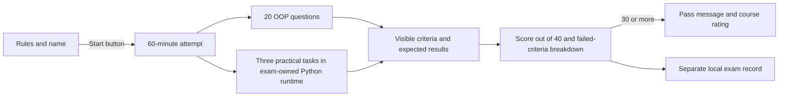

# HL — OOP_20261030-091045_EXAM: Экзамен курса OOPoman

> **Date**: 2026-10-30
> **Author**: Coordinator, `PLAN · EXAM`, owner-direct (`codex:thread:local:01a18b01-85ef-7772-84f6-535c59379865`)
> **Title**: Экзамен курса OOPoman
> **Abbreviation**: EXAM
> **Status**: 🟡 TS_DRAFT — master contract re-frozen after owner-approved amendment A2
> **Contract**: 🔒 FROZEN — approved by roman 2026-10-30
> **Frozen**: §1 · §3 · §4 · §5 · §6 · §7 — locked on owner approval
> **Free**: §2 · §7.2 · §8 · §9 · §10 · §11 — research updates these directly
> **Append-only**: §12 Amendment Log
> **Baseline**: freeze commits — recovery form in `conventions.md` §3 rule 15

> **Project North Star**: `README.md` introduction designates `NorthStar.md` §§Purpose, Learner experience, Assessment contract, Product boundaries, Success.

---

## 1. Vision 🔒 FROZEN

A student chooses their name, reads clear exam rules and completes a 60-minute OOPoman exam covering all three course modules. The result explains the score and every failed practical criterion; a score of at least 30/40 records successful completion of the exam and course. This task produces no certificate.

**Impact:** Students can demonstrate what they learned and see how their work met the course criteria, while their exam record remains in their browser and their existing course progress stays separate.

> **Explicitly imagined stakeholder quote:** “Я вижу, за что получил каждый балл, что ещё стоит разобрать и почему мой результат означает успешную сдачу курса.”

## 2. Current State (As-Is) 🟢 FREE

- OOPoman is a static, local-first course with three modules and no project-owned server, registration or authentication. The exam is a separate page with its own tasks and runtime; exam entry does not depend on module-page availability.
- The nine lecture and nine lab PDFs are the source material for the module topics. The current browser content is authored in `course/data.js`; each module maps to three lessons and three labs.
- The completed PDF-only research iteration found enough taught material for the approved 8/7/5 question map and 4/6/10 practical candidates. It did not establish 60-minute feasibility or atomic point rubrics for every practical criterion.
- The course stores learning progress under `oopoman.progress.v1`. Existing course scores, progress and completion behavior are outside this task's authority and must not change.
- The new exam page will execute Python with an exam-owned browser runtime. It requires a hosted HTTP(S) origin and the runtime's version-pinned CDN files; `file://` use is not supported. Questions, grading checks and code remain inspectable in a static client.
- `scripts/build-site.mjs` recursively copies `course/` into `dist/`; a teacher key stored outside `course/` is not part of the generated site. Client-side grading code and its correct-answer behavior remain inspectable by students.

### Source coverage

The proposed assessment is limited to topics in the current three modules and their labs:

- **Module 1:** procedural versus object-oriented design; class/object state and behavior; encapsulation and invariants; association, aggregation and composition; composition versus inheritance; polymorphism, duck typing, ABC, Protocol and event dispatch.
- **Module 2:** SRP, OCP, cohesion/coupling, LSP, ISP, DIP and dependency injection; Factory Method and Builder.
- **Module 3:** Adapter, Decorator, Facade, Proxy, Strategy, Observer, Command, State, Chain of Responsibility and Clean Architecture.

The detailed source mapping is the nine course lesson/lab pairs in `course/data.js` and `OOP-course/01_Лекции/` plus `OOP-course/02_Лабораторные/` PDFs, numbered 01–09.

## 3. Target State (To-Be) 🔒 FROZEN

Add one standalone exam page to OOPoman, separate from the module pages, with exactly 20 single-answer multiple-choice questions and exactly three executable practical tasks: лёгкая, средняя and продвинутая. It covers all three modules, treats OOP as the main subject, runs practical work in its own in-browser Python runtime, and compares student code with explicit criteria and expected results. This task does not issue or generate a certificate.

The exam has a maximum of 40 points and passes at 30 points or higher. The owner-approved distribution is 1 point per test question, split 8/7/5 across Modules 1/2/3, and 4/6/10 points for the лёгкая/средняя/продвинутая practical tasks. Each practical point must map to a discrete, visible criterion. A syntax/runtime error or unmet criterion displays the concrete failure and awards no point for that criterion. Partial credit is limited to separately listed criteria that pass. A task remains incomplete whenever any mandatory criterion fails, even if other criteria earn partial points.

Before starting, show the rules, state that no materials are allowed, and show the structure, 60-minute limit, maximum and pass score. The timer begins only after “Начать экзамен”; at timeout, auto-submit the current answers and finish the attempt. The student chooses one of exactly three names: Мухитов Арсений, Куандыков Жасулан, Саржан Аубакиров. Do not offer free-text name entry.

The result shows the chosen name, score out of 40, pass/fail status, test and practical breakdown, and failed criteria. After a pass, show the owner-approved message: “Поздравляем, [Имя]! Вы успешно сдали экзамен и завершили курс OOPoman. Результат: [баллы]/40.” Then offer a 1–5 star course rating. Do not create, display, download, or award a certificate in this task. The exam record and rating use a separate local browser key, proposed as `oopoman.exam.v1`; they are not sent to an external service and do not alter `oopoman.progress.v1`.

A separate teacher key with correct answers, rationales, practical solutions and rubrics stays outside `course/` and is excluded from `dist/`. Because the grader runs in the browser, students can inspect the questions, correct-answer behavior and practical checks. Neither the UI nor the result may claim anti-cheating protection, secret client-side answers, authenticated identity or independent verification.

The exam is an independent course page with its own entry point, assignments, grading checks and Python runtime. It has no dependency on module-page availability, terminal phases or a shared terminal interface. Its browser-side code and checks remain inspectable; do not claim that the runtime provides a secure or independently verified exam environment.

### 3.1 Result Visualization

**Illustrative before/after:**

| Before | After |
|---|---|
| A learner completes lessons and labs but has no single exam or course-level result. | The learner opens a dedicated exam page, sees the rules, selects an allowed name, starts the timer, completes 20 questions and three Python tasks in the exam's own runtime, then receives an explained result and pass status at 30/40 or higher. The page identifies failed criteria instead of presenting a partially passed task as complete. |

**Illustrative results page (32/40):**

```text
[Имя из утверждённого списка]                   32 / 40
ЭКЗАМЕН СДАН                                      от 30
Тестовые вопросы                                  16 / 20
Практика 1 · лёгкая                                4 / 4   завершена
Практика 2 · средняя                               5 / 6   не завершена
  Провалено: критерий 6 — ожидаемый вывод не получен
Практика 3 · продвинутая                           7 / 10  не завершена
  Провалены: критерии 3, 8, 9
Поздравляем, [Имя]! Вы успешно сдали экзамен и завершили курс OOPoman. Результат: [баллы]/40.
Оцените курс: ☆ ☆ ☆ ☆ ☆
```

The sample is illustrative only: 16 + 4 + 5 + 7 = 32. Passing the exam does not mark an individual task complete when its required criteria failed. The result is a local exam record, not a certificate or independently verified credential.

### 3.2 Value Flow



## 4. Phases 🔒 FROZEN

One phase: **Exam experience**. A single task Coordinator owns the complete exam cycle; no separate Phase Coordinator is needed. The phase delivers a standalone exam page, rules/start screen, test and practical assessment in an exam-owned in-browser Python runtime, result and rating experience, separate teacher key, and evidence that the exam leaves existing course progress unchanged. It produces no certificate.

### 4.1 Coordination Selection 🔒 FROZEN

| Activation source | Accountable owner | Task Coordinator unit | Phase Coordinator rule | Mandate scope / role reach | Upward route | Dialogue | Reporting | Reservations / controls | Amendment authority | Immutable epoch |
|---|---|---|---|---|---|---|---|---|---|---|
| owner-direct | roman | `codex:thread:local:01a18b01-85ef-7772-84f6-535c59379865` | none; one phase | this task only; owner starts any Researcher, Executor and independent Reviewer at their gates | `owner:roman` | `tfw-gates-only` | `native-gates` | owner starts chats manually; configured Codex model, reasoning effort chosen for the work; current project checkout only, no branch/worktree, serial mutations; exam owns its page, assignments and Python runtime; name, score distribution, materials and congratulations remain owner decisions until explicitly approved | none | Initial owner choice recorded in this HL; exact draft commit is bound from `status.md` after commit; the HL never names its own SHA |

The title `PLAN · EXAM` was set and read back. The task-only sidebar section `OOP · EXAM` was created and membership was read back. Native task tools expose provision, addressed send, wait/readback and title/readback; manual role starts remain the owner's choice. No agent principal or delegation is selected. Future role IDs and titles are unknown until the owner starts those tasks.

### Phase A: Exam experience 🔴

- **Requires:** approved TS rev2.
- **Deliverables:** standalone exam page and course-home link; exam rules and exact name dropdown; 20 questions with approved source/topic map; three practical tasks with executable rubrics in an exam-owned Python runtime; 40-point result and pass threshold; local result/rating storage separate from course progress; teacher key outside the public build; evidence that existing progress, scoring and completion remain unchanged. No certificate is produced.
- **Do not include:** a server/account system, external result submission, claims that client-side checks or local results are secure or verified, or changes to course progress and lesson/lab behavior.

## 5. Definition of Done (DoD) 🔒 FROZEN

- ✅ 1. The exam contains exactly 20 multiple-choice questions, each with one justified correct answer and plausible balanced distractors; correct-option positions have no visible pattern.
- ✅ 2. The exam contains exactly three practical tasks, one лёгкая, one средняя and one продвинутая, based only on course material from Modules 1–3.
- ✅ 3. The maximum is 40 points and the pass threshold is 30; the owner approves the final distribution before the Task Spec is frozen.
- ✅ 4. Every practical point has a separately stated criterion and expected result; failed criteria and syntax/runtime errors are shown concretely, partial credit is limited to passed criteria, and any task with a failed mandatory criterion remains incomplete.
- ✅ 5. The pre-start rules show the time, structure, maximum, threshold, name choices and approved materials. The timer starts only on “Начать экзамен” and auto-submits current answers at 60 minutes.
- ✅ 6. The result displays name, score, pass/fail, test/practical breakdown and failed criteria. On a pass it shows the owner-approved congratulation and offers a 1–5 star rating. No certificate is produced.
- ✅ 7. Exam results and rating use a separate local browser key; no external transmission or changes to course score, progress or completion occur.
- ✅ 8. The teacher answer/rationale/solution file is outside `course/` and absent from the generated `dist/` site. Client-side grading visibility is disclosed honestly and no security or authenticity claim is made.
- ✅ 9. Practical execution runs Python code in the exam's own in-browser runtime on the standalone exam page; the runtime exposes clear loading, execution and error states and does not send attempts or results to a service.
- ✅ 10. Independent review confirms the exact result, key exclusion from the site build, expected-code outcomes, failed-criterion behavior and unchanged course progress against the approved TS and North Star.

## 6. Definition of Failure (DoF) 🔒 FROZEN

- ❌ 1. A question has multiple defensible answers, a cue reveals the answer, or it tests a topic not in the completed course material.
- ❌ 2. The exam's Python runtime cannot load or execute a submitted answer and the page fails to report that condition clearly.
- ❌ 3. The task cannot show a concrete criterion failure or expected result, or a failed mandatory criterion is shown as a fully solved task.
- ❌ 4. Exam state leaks into course scores/progress/completion, or any result/rating is transmitted externally without a new owner-approved scope.
- ❌ 5. The answer key file enters `dist/` or browser-loaded resources, or product text claims answer secrecy, identity verification or certificate authenticity that the static client cannot provide.

**On failure:** stop the affected scope, preserve current course state and exam data, record the exact criterion and observable failure in the Executor result, and return for the owner decision. Do not claim a pass or complete the task until the failed condition is resolved.

## 7. Principles 🔒 FROZEN

1. **Course fidelity** — test only concepts and practical criteria actually taught in the three modules and their labs.
2. **Observable grading** — every point follows a visible question key or an atomic practical criterion with an expected outcome.
3. **Honest result** — distinguish exam score and task completeness; do not imply authentication or anti-cheating, and do not produce a certificate in this task.
4. **Separate state** — exam records and ratings cannot change course progress, points or completion.
5. **Exam-owned execution** — run practical answers in the exam's own browser-side Python runtime; disclose its availability and client-side limits without claiming isolation, security or verification.
6. **Clear student control** — explain rules before timing, allow only the approved names, and show specific feedback after submission.

### 7.2 Knowledge Citations 🟢 FREE

| # | Source | Item | How it applies |
|---|---|---|---|
| P0 | [README.md](../../../README.md) → [NorthStar.md](../../../NorthStar.md) | Project purpose, learner experience, assessment contract and product boundaries | Keep the exam local-first, aligned to the three-week OOP course, with no server, authentication or changes to course progress. |
| P1 | [.tfw/README.md](../../../.tfw/README.md) | Methodology values: Candor Over Flattery, Structural Enforcement, Portability; Success Criteria | State client-side limitations honestly; make timer, scoring, failed criteria and data separation observable; keep the key outside the site build. |
| P2 | `knowledge/philosophy.md` | N/A — file not present in the project after the required scan | No additional project philosophy source is available for this decision. |
| P3 | [KNOWLEDGE.md](../../../KNOWLEDGE.md) | §1, OOPoman local course shell and assessment contract | Preserve local browser progress and no project backend; keep exam state and scoring separate from course state. |
| P4 | [.tfw/conventions.md](../../../.tfw/conventions.md) | `HL Contract`, `Design Rules`, `Anti-patterns (prohibited)` | Freeze only owner-approved purpose and criteria; keep runtime mechanics in TS and wait for its exact approval. |
| P5–P7 | `knowledge/{convention,process,domain,...}.md` | N/A — no `knowledge/` directory or applicable qualified project record exists | The course PDFs are selected educational sources in §2, not qualified knowledge records. |
| P8 | [Pyodide getting started](https://pyodide.org/en/stable/usage/quickstart.html), [web worker guide](https://pyodide.org/en/stable/usage/webworker.html), [FAQ](https://pyodide.org/en/stable/usage/faq.html), [interrupt guide](https://pyodide.org/en/stable/usage/keyboard-interrupts.html) | Official Pyodide documentation, version 314.0.7 as observed 2026-10-30 | Pin the CDN runtime; run it in a module worker to keep the page responsive; serve from HTTP(S), not `file://`; do not promise hard interruption without SharedArrayBuffer headers or security isolation. |

## 8. Dependencies 🟢 FREE

| Dependency | Status |
|---|---|
| Owner approval of test split 8/7/5, practical split 4/6/10, no allowed materials and exact congratulations text | ✅ Confirmed in planning replies; still subject to final HL approval |
| Exam-owned Python runtime loads on the hosted static page | ⬜ To be specified in TS rev2; version-pinned CDN availability and network access are required |
| Separate exam storage key and no external transfer | ✅ Owner selected local browser storage under a separate exam key |
| Timer expiry behavior | ✅ Owner selected automatic submission of current answers at 60 minutes |
| Static grading and certificate scope | ✅ Owner selected automatic client-side checking and acknowledged answer visibility; amendment A1 removes certificates from this task |
| Manual role starts, owner-only activation and native-gates reporting | ✅ Owner selected |

## 9. Risks 🟢 FREE

| Risk | Probability | Impact | Mitigation |
|---|---|---|---|
| Client-side answers or checks can be inspected or changed | High | Medium | Keep the separate key out of the site build and disclose that the grader is inspectable. |
| Pyodide CDN cannot load in the student's browser | Medium | High | Show runtime loading and failure states; require the hosted HTTP(S) page and available CDN access before practical execution. |
| Long or non-terminating student code delays evaluation | Medium | High | Execute in a dedicated worker, bound each evaluation and terminate the worker on timeout; disclose that this is a client-side execution boundary, not a hardened sandbox. |
| Exam points leak into course progress | Low | High | Use a separate storage key and verify existing progress key/value remains unchanged. |
| Questions repeat lab quiz wording or test unlearned subtopics | Medium | Medium | Map each question to a specific lesson/lab source and independently review the set for validity and cues. |
| Local storage is cleared or differs by browser profile | Medium | Low | Explain that results are browser-local; do not promise cross-device persistence. |
| Practical labs exceed the 60-minute exam and block-level points do not specify every atomic criterion | High | High | Narrow tasks, author visible pass/fail oracles, and verify duration before public availability; do not present a full 135-minute lab as an exam task. |
| Lab 2's shorthand `− Discount` is reused without defining its amount or order of calculation | Medium | Medium | If a numeric item is selected, state the full equation and verify it against the PDF's stated 50% student discount and expected examples; otherwise avoid tariff arithmetic. |

## 10. RESEARCH Case 🟢 FREE

### Blind Spots

- Whether the original lecture and lab PDFs alone provide enough clear, taught material to build the approved question and practical assessment across all modules.
- Which specific lecture/lab concepts and exercises support each module's allocated question count and practical task criteria, and where the source material leaves ambiguity.
- Which course-material gaps must remain out of the exam rather than be filled from website copy or implementation details.

### Hypotheses

| # | Hypothesis | Status |
|---|---|---|
| H1 | The original lecture and laboratory PDFs alone contain enough clear, assessable OOP material across all three modules to author the approved 20 questions and three practical tasks. | supported with constraints; one iteration found a candidate map, not a timed or atomic-rubric-validated exam |

**Iteration bound:** The owner explicitly selected exactly one research iteration in a direct reply on 2026-10-30. The Coordinator records the task override as `min_iterations: 1` and `max_iterations: 1`; a second iteration is outside this selection.

**Coordinator validation of RES:** The PDF-only candidate map is useful for TS authoring, subject to the timing and rubric limits above. RES proposals A1–A4 claim the owner had instructed the task to omit certificates; no such instruction existed when RES was produced, and the owner-approved HL then required a local certificate. The owner's later direct instruction on 2026-10-30 now removes the certificate from this task through amendment A1; this does not validate RES's earlier attribution retroactively. The Lab 2 source describes a 50% discount from the calculated fare and examples give expected outcomes, but TS must state a precise formula if any numerical tariff question is used.

### Risks of Not Researching

If exam content is inferred from website pages instead of the taught lecture and laboratory materials, students could be tested on material they were not taught or on wording that does not match the course.

### Proposed RESEARCH Focus

1. **Gather** only the original PDFs in `OOP-course/01_Лекции/` and `OOP-course/02_Лабораторные/`; map taught OOP concepts and exercises to each module.
2. **Extract** source-backed candidates for the approved 8/7/5 question split and 4/6/10 practical split, with precise file/page or section references.
3. **Challenge** whether each candidate is actually taught, sufficiently specified and gradable from the materials; identify gaps without consulting site pages, `course/data.js` or `dist/`.

### Why Not Just...?

| Approach | Value | Adoption / operating burden | Risks / tradeoffs | Decision and reason |
|---|---|---|---|---|
| **Recommended: standalone static exam page with its own Pyodide runtime; local result** | Students can complete one course-level exam and receive immediate criterion-based feedback on a dedicated page. | No accounts or backend; requires browser support and loading the pinned runtime from its CDN. | Correct answers and tests can be inspected; student code executes client-side and identity is not verified. No certificate is included in this task. | Fits NorthStar and the owner's explicit selection, provided runtime limits remain visible. |
| Trusted server-side grader and verified certificate | Can protect grading logic and support independently validated results. | Adds server, identity/data handling and operational work. | Conflicts with current NorthStar; stores personal results unless separately designed and approved. | Not selected; requires a separate owner-approved product-boundary change. |
| Teacher-only manual grading | Keeps the answer key out of browser resources. | Requires a human to receive and grade attempts; no immediate automatic result. | Does not meet the requested self-service code assessment and risks creating a separate submission channel. | Not selected for this task. |

**Leave unchanged:** students have no single exam or course-level result to mark the work they completed.

**Critical challenge:** a fixed name dropdown is not authentication, and a local result can be copied or altered. The recommendation is wrong if stakeholders expect proof of identity; the consequence would be to stop this static implementation and ask the owner to authorize a trusted verification design. The owner has deferred certificate consideration to future tasks.

## 11. Strategic Insights (Planning) 🟢 FREE

| # | Insight | Category | Source |
|---|---|---|---|
| S1 | The student should be able to pass an exam and receive a certificate that recognizes the effort and signifies successful course completion; the owner later deferred certificates to future tasks. | stakeholder | Owner, direct request and later direct scope change in this planning session, 2026-10-30 |

## 12. Amendment Log 🟢 APPEND-ONLY

| A1 | 2026-10-30 | §1, §3 (incl. §3.1–§3.2), §4, §5, §7 | `RESTRICT` | owner `roman` | Remove certificate generation, display, download and award from this exam task; retain exam score, pass/fail result, course-completion message and rating. Certificate may be considered in future tasks. | Owner's direct instruction: “я отказываюсь от сертификата и думаю применить его в будущих задачах”; received 2026-10-30. Baseline: initial freeze `2117aa25a57b2ca8ff8586d00c4c773ade5fce6a`. | Drops the certificate deliverable from this task and defers its design/verification; the passing result remains. | Keep the approved local certificate for this exam; owner explicitly withdrew that choice for this task. | `✅ APPLIED — no owner verdict required` |
| A2 | 2026-10-30 | §3 (incl. §3.1–§3.2), §4 (incl. §4.1 and Phase A), §5, §6, §7 | `SUPERSEDE` | owner `roman` | Make the exam an independent page with its own assignments and its own in-browser Python runtime; remove dependency on module-terminal phases, shared terminal readiness and module-page availability gates. | Owner's direct clarification: “Экзамен идет отдельно от модулей, это отдельная страница в ней свои задания. Вам не нужно смотреть на фазы б и с”; followed by the explicit runtime choice “Исполнять Python-код внутри экзамена; добавить отдельный runtime”. | Adds a dedicated Python runtime and its loading, worker lifecycle, visible runtime errors and runtime availability behavior; revises the VALUE selector and touched-LOC denominator in TS rev2. The static client still exposes checks and cannot verify identity or prevent code inspection. | Keep waiting for the course terminal and its phase readiness; owner directly clarified that this exam is separate and selected an exam-owned runtime. | `✅ APPROVED — roman, 2026-10-30` |

### Material handover at this return

Producer/unit: Coordinator, `codex:thread:local:01a18b01-85ef-7772-84f6-535c59379865`. Source epoch: project baseline `a2015a16099913be77a6c522c288bd6d0a02d7d2`; amendment A2 is recorded at `991e102`, with the re-frozen HL to be bound by task status. Inspected scope: North Star, course shell/storage/build boundary, original lecture and lab PDFs, and official Pyodide documentation. Material: standalone exam page and runtime, exact scoring and source-mapped practical blueprint, separate local exam state, teacher key outside the build. Uncertainty: runtime timeout handling, CDN availability and 60-minute fit remain for TS/implementation evidence. Recipient/continuation: owner `roman` reviews TS rev2 and its proposed denominator; after approval, the owner starts the Executor chat. No product code or tests were changed or run.

---

*HL — OOP_20261030-091045_EXAM: Экзамен курса OOPoman | 2026-10-30*
