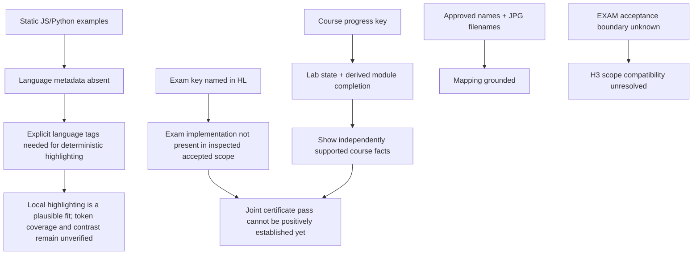

# RES — OOP_20261103-190652_DESIGN: Дизайн интерфейса OOPoman

> **Date**: 2026-11-03
> **Author**: Codex Researcher
> **Status**: 🔬 RES — In progress
> **Parent HL**: [HL-OOP_20261103-190652_DESIGN](../../HL-OOP_20261103-190652_DESIGN.md)
> **Mode**: Pipeline — focused
> **Producer unit**: `codex:thread:local:01a1a1d7-e37d-78a2-9df0-0d924a659578`
> **Parent Coordinator**: `codex:thread:local:01a1a1a2-cf43-7872-bfb3-c0c2e16409c4`
> **Activation / dispatch source**: owner-rooted dispatch `journal/20261103-193737__dispatch__91fd.md @ a656312541ea09d515569db3cd3136873621a35f`
> **Coordination authority**: `HL-OOP_20261103-190652_DESIGN.md @ 5b72172600de8512a04e7766f019cc30366e4d84`
> **Originating proposer**: `{principal: roman, unit: owner:roman}`

---

## Research Context

Итерация исследовала, как подсветить существующие JavaScript/Python-примеры без недостоверной диагностики, какие локальные сигналы курса и экзамена пригодны для прогресса и совместного условия сертификата, и насколько подтверждены три сопоставления имён с JPG. Область исследования ограничена утверждённым DESIGN HL; реализация, изменение HL и изменение отдельного EXAM не выполнялись. Главный доказательный пробел: в проверенной и принятой части проекта нет реализации экзамена, поэтому точная форма `oopoman.exam.v1`, pass-предикат и граница после его приёмки не установлены.

## Briefing

Источник полного плана, scope, вопросов, существующих знаний и экономики: [1_briefing.md](1_briefing.md). Дополнительная проверка source binding по разрешению владельца и её результат приведены там же и в Gather.

## Decisions

| # | Decision | Rationale |
|---|----------|-----------|
| D1 | Считать локальную подсветку статических примеров достаточной рабочей гипотезой для этого курса; не считать её проверенной до точного определения языка блоков и проверки требуемых токенов/контраста. | Примеры статичны, отдельный Python runner уже существует, а базовая подсветка обязательна. Gather/Challenge выявили отсутствие языковой метки и формульный блок; живую диагностику подсветка не доказывает. Sources: `2_gather.md` G1–G2, `3_extract.md` E3, `4_challenge.md` C1. |
| D2 | Сохранять чтение состояний курса и экзамена независимым; положительное условие сертификата не выводить, пока оба источника не дают распознанные положительные предикаты. | Код курса подтверждает только свои локальные сигналы. Экзаменационная схема и критерий сдачи отсутствуют в просмотренной принятой реализации. Sources: `3_extract.md` E1–E2, `4_challenge.md` C3. |
| D3 | Использовать владельческий mapping `Арсений Мухитов → certificate_arseniy.jpg`, `Жасулан Куандыков → certificate_jasulan.jpg`, `Санжар Аубакиров → certificate_sanjar.jpg` как утверждённое требование этой задачи; пока не делать вывода о совместимости с будущей приёмкой EXAM. | Имена и файлы закреплены в утверждённом HL и файлы присутствуют; фактическая форма/граница принятия EXAM не проверялась. Sources: approved HL §3, `3_extract.md` E2, `4_challenge.md` C4. |

## Open Questions

| # | Question | Status | Answer |
|---|----------|--------|--------|
| Q1 | Какова схема `oopoman.exam.v1`, pass threshold и обработка отсутствующего/невалидного состояния в принятом EXAM? | Unresolved | Не обнаружены в проверенных course scripts; необходим точный авторизованный результат/граница принятого EXAM. Не трактовать пустое состояние как сданное или проваленное. |
| Q2 | Остаются ли «Саржан» → «Санжар» и mapping трёх файлов в scope после приёмки EXAM? | Unresolved | Утверждённый DESIGN контракт включает исправление и mapping, но отдельный EXAM пока не принят; его фактическая приёмка не проверена. Не менять EXAM задним числом. |
| Q3 | Можно ли получить точную собственную rollout-привязку для требуемого economics capture? | Unavailable | Владелец разрешил поиск только точного rollout имени этого Researcher в стандартном каталоге. Совпадений не найдено; путь, `session_meta.id`, версия источника и numeric range start недоступны. Capture не выполнялся, last-good numeric result отсутствует; coverage не измерено. |

## Hypotheses (from HL §10)

| # | Hypothesis | HL Status | RES Status | Evidence |
|---|-----------|-----------|------------|----------|
| H1 | Lightweight local highlighting is sufficient; a full editor is not worth its added complexity for this course. | open | 🟡 Partially supported | Read-only examples and the separate runner make a full editor unnecessary to meet the stated presentation need; Prism/Highlight.js offer local two-language highlighting. Actual token coverage, contrast and maintenance cost were not measured. Language metadata is missing; automatic language choice is not grounded. Sources: `2_gather.md` G1–G2; `3_extract.md` E3; `4_challenge.md` C1–C2. |
| H2 | `oopoman.progress.v1` and `oopoman.exam.v1` contain stable signals for progress and the joint certificate gate. | open | ⚪ Unresolved | Course store has useful local fields and derived module completion; the exam store and passing predicate were not in the inspected/accepted course implementation. The joint condition cannot yet be verified. Sources: `3_extract.md` E1–E2; `4_challenge.md` C3. |
| H3 | The «Саржан» correction and three JPG mappings fit a separate post-EXAM task without changing accepted EXAM scope. | open | ⚪ Unresolved | Approved DESIGN scope and filename mapping are clear, but EXAM acceptance has not established the future boundary. Sources: `3_extract.md` E2; `4_challenge.md` C4. |

## HL Update Recommendations

> Классификация исследователя; Coordinator решает, применять ли свободные уточнения. Замороженный §3 не нуждается в предложении изменения по этой итерации.

### Refinements — free sections, coordinator applies

| # | § | What to update | Source |
|---|---|----------------|--------|
| R1 | §2 | Уточнить, что проверенная реализация курса подтверждает локальные лабораторные сигналы и производное завершение модулей, но не содержит проверяемой реализации экзамена; точный exam pass state остаётся открытым. | `3_extract.md` E1–E2; `4_challenge.md` C3 |
| R2 | §7.2 | При желании добавить технические ссылки на WHATWG Web Storage, Prism и Highlight.js как источники для отдельного чтения origin-local state, явной языковой маркировки и ограничений regex-based highlighting. Не превращать документацию в доказательство пользовательской пригодности. | `3_extract.md` E1, `4_challenge.md` C1; [WHATWG](https://html.spec.whatwg.org/multipage/webstorage.html), [Prism](https://prismjs.com/), [Highlight.js](https://highlightjs.org/usage/) |
| R3 | §10 | Обновить H1 как частично поддержанную рабочую гипотезу; H2/H3 оставить открытыми до получения принятой EXAM схемы и scope. | This RES, H1–H3 evidence above |

### Amendment Proposals — frozen sections, resolved-ruler verdict required

**No amendment proposals.** Findings do not establish a need to change the frozen HL requirements; the outstanding issues are missing implementation/acceptance evidence.

## Fact Candidates

No new Fact Candidates. The owner-supplied mapping and correction are already captured in the approved HL; implementation observations are discoverable in the inspected project and belong in technical research/reference if later selected.

## Strategic Insights (Research)

No new strategic insights. Owner messages in this iteration authorized workflow gates; they added no separate domain strategy beyond the approved task contract.

## Findings Map

## Iteration Status

- **Iteration:** 1 of 2 (min) / 3 (max)
- **Hypotheses tested:** H1 (partially supported); H2 (unresolved: exam schema/pass predicate absent from inspected accepted scope); H3 (unresolved: EXAM acceptance boundary unavailable)
- **Hypotheses deferred:** None; all three were investigated to the extent supported by available scope.
- **Gaps discovered:** exact exam state/pass predicate and malformed/missing semantics; accepted EXAM boundary for name correction; language metadata and unmeasured token/contrast coverage; exact own-session rollout locator and numeric range unavailable, so economics coverage unmeasured.
- **Superseded decisions:** None.

### Open Threads (for next iteration)

| # | Thread | Why it matters | Suggested focus |
|---|--------|----------------|-----------------|
| 1 | Obtain the exact accepted EXAM state/pass contract and scope boundary through its authorized return. | Needed to evaluate H2/H3 and whether a certificate gate can be computed without guessing. | Inspect only the accepted, authorized EXAM artifact/return; map absent, malformed and positive-pass cases without modifying EXAM. |
| 2 | Establish deterministic language labels and verify a candidate's token categories/contrast against actual course snippets. | H1 remains provisional because current code blocks have no language metadata and no visual/token coverage was measured. | Use the exact course snippets and explicit language identity; compare the lightest compatible local option without adding diagnostic claims. |
| 3 | Resolve own-unit economics source locator if an authorized native mechanism becomes available. | Required numeric coverage remains unmeasured; current evidence does not provide a bindable source. | Reuse the built-in collector only after exact path, source ID/version and range start are observable; never substitute another unit's source. |

### Recommendation

- [ ] **SUFFICIENT** — proceed to `/tfw-plan` to classify these recommendations and write TS
- [x] **MORE NEEDED** — iterate once more, prioritizing accepted EXAM evidence for H2/H3 and language/token contrast evidence for H1; retain the economics gap unless the exact own-source binding becomes available.
- [ ] **BLOCKED** — not recommended; the identified gaps can be carried into another authorized iteration.

> Coordinator decides whether to continue or proceed. Researcher recommends but does NOT decide.

## Conclusion

This focused iteration supports treating lightweight local syntax highlighting as the leading fit for static course examples, but does not prove token coverage or contrast and does not justify live syntax diagnostics. The course store exposes concrete lab progress and derived module completion, while the exam predicate remains unverified; therefore the project can only show independently supported course state until a separate accepted exam state establishes the second certificate condition. The approved JPG mapping is clear, but compatibility with EXAM acceptance is unresolved. The main self-critique is that the absent EXAM implementation prevents a full H2/H3 answer, and the scoped own-session locator check left economics usage unmeasured. These findings expose exactly which next evidence is needed without changing code, HL, or EXAM.

### Material handover at this return

- **Producer/unit:** Researcher `codex:thread:local:01a1a1d7-e37d-78a2-9df0-0d924a659578`; parent Coordinator `codex:thread:local:01a1a1a2-cf43-7872-bfb3-c0c2e16409c4`; iteration 1.
- **Source/epoch:** stage files `1_briefing.md` through `4_challenge.md`, current owner-approved authority `HL-OOP_20261103-190652_DESIGN.md @ 5b72172600de8512a04e7766f019cc30366e4d84`; RES synthesis authorized by `journal/20261103-210805__gate_answer__e90c.md @ 42ed02a6b71684cb2649b44386fb20765550b053`.
- **Inspected scope:** course storage, rendering and progress paths; approved HL; named certificate filenames; official WHATWG, Prism and Highlight.js docs; existing accepted terminal-runtime knowledge record. No unaccepted EXAM implementation was inspected.
- **Material:** course-local progress signals and their conservative invalid-state behavior; no grounded exam schema/pass predicate; approved name/file mapping; missing language metadata; candidate consistency findings.
- **Uncertainty/continuation:** H2/H3 need accepted EXAM state and scope; H1 needs explicit language identity and measured token/contrast coverage. Economics is an attributable pre-extraction binding gap: exact own rollout path, `session_meta.id`, source version and numeric range start unavailable; no capture attempted, no last-good numeric result, coverage unmeasured. Continue through the Coordinator's iteration control; this Researcher does not change `iterations.yaml` or decide the lifecycle.

---

*RES — OOP_20261103-190652_DESIGN: Дизайн интерфейса OOPoman | 2026-11-03*
