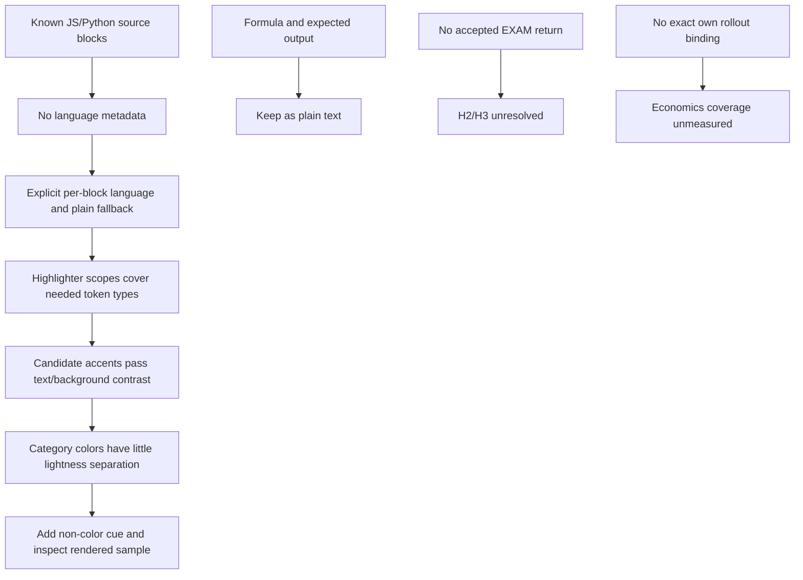

# RES — OOP_20261103-190652_DESIGN: Дизайн интерфейса OOPoman

> **Date**: 2026-11-03
> **Author**: Codex Researcher
> **Status**: 🔬 RES — In progress
> **Parent HL**: [HL-OOP_20261103-190652_DESIGN](../../HL-OOP_20261103-190652_DESIGN.md)
> **Mode**: Pipeline — focused
> **Producer unit**: `codex:thread:local:01a1a1d7-e37d-78a2-9df0-0d924a659578`
> **Parent Coordinator**: `codex:thread:local:01a1a1a2-cf43-7872-bfb3-c0c2e16409c4`
> **Activation / dispatch source**: owner-rooted dispatch `journal/20261103-193737__dispatch__91fd.md @ a656312541ea09d515569db3cd3136873621a35f`; iteration-2 continuation in Coordinator-prepared `research/iterations.yaml @ b2a823fc2b0e0a1989981a8b810bde2dcbc37e8b`.
> **Coordination authority**: `HL-OOP_20261103-190652_DESIGN.md @ 5b72172600de8512a04e7766f019cc30366e4d84`
> **Originating proposer**: `{principal: roman, unit: owner:roman}`

---

## Research Context

Эта итерация проверила на фактических примерах, как назначить язык для блоков JavaScript, Python и формулы, сопоставить нужные синтаксические категории, оценить палитру и сравнить пути интеграции. Исследование подтверждает существующие кодовые фрагменты и измеряет контраст выбранных цветов относительно реальных code backgrounds, но не строит и не отображает тему. Простая локальная подсветка остаётся соразмерным кандидатом; полнота и читаемость категорий не доказаны до проверки отображённого результата. Экзаменационный и economics пробелы сохранены без домыслов.

## Briefing

План, рамки, гипотезы и точная итерационная инструкция: [1_briefing.md](1_briefing.md). Исследовательская последовательность: [2_gather.md](2_gather.md) → [3_extract.md](3_extract.md) → [4_challenge.md](4_challenge.md). Каждый stage файл содержит его источники, результат и checkpoint.

## Decisions

| # | Decision | Rationale |
|---|----------|-----------|
| D1 | Для известных программных блоков детерминированная явная метка языка — предпочтительный вход для локальной подсветки; формулу, ожидаемый вывод и неизвестный тип следует пропускать через plain-text путь. | В источнике есть 10 JS и 7 Python examples, 5 Python `type: "code"` фрагментов, одна формула и output strings, но `language`-метаданных сейчас нет. Язык известен автору, поэтому autodetection не добавляет установленного факта. Sources: Gather G1–G2, Extract E1–E2, Challenge C2. |
| D2 | Рассматривать лёгкий локальный highlighter как ведущий fit-for-purpose вариант; не включать диагностику синтаксиса и не объявлять H1 окончательно подтверждённой до отображённой проверки токенов и различимости категорий. | Prism/Highlight.js имеют нужные стандартные scopes; несколько цветов проходят порог text/background contrast, но светлотное различие между ними мало. Project-owned правила также возможны для ограниченного набора фрагментов, но требуют контекстных правил для имён, строк, комментариев и f-строк. Sources: Gather G3–G4, Extract E1–E4, Challenge C1–C4. |
| D3 | В примерах JavaScript считать `constructor` именем метода, а не ключевым словом. | ECMAScript specification перечисляет keywords/reserved words; `constructor` в inspected class example — имя метода. Исправляет shorthand в Gather и Extract этой итерации. Source: Challenge C1, [ECMAScript lexical grammar](https://tc39.es/ecma262/multipage/ecmascript-language-lexical-grammar.html). |
| D4 | Сохранить курс и экзамен отдельными источниками, а экзаменационную часть H2/H3 оставить открытой до появления принятого и авторизованного результата EXAM. | Итерационный гейт не разрешал читать EXAM drafts, и нового accepted EXAM return не было. Sources: iteration-1 `RES.md`, iteration-2 Briefing, Challenge C5. |

## Open Questions

| # | Question | Status | Answer |
|---|----------|--------|--------|
| Q1 | Подтверждает ли принятый EXAM сигнал в `oopoman.exam.v1`, проходной результат и семантику отсутствующего/невалидного состояния? | Unresolved | Не было нового разрешённого принятого EXAM результата; не читать черновики и не выводить predicate из отсутствующего кода курса. H2 остаётся открытой. |
| Q2 | Укладываются ли «Саржан» → «Санжар» и три certificate mappings в scope после приёмки EXAM? | Unresolved | Утверждённый HL содержит mapping и коррекцию; будущая граница приёмки отдельного EXAM остаётся неизвестной. H3 остаётся открытой. |
| Q3 | Какой из оставшихся способов подсветки даёт читаемое и различимое отображение требуемых категорий? | Partially answered | Контраст каждого candidate foreground/background проходит 4.5:1, но межцветная светлотная разница 1.10:1–1.32:1 мала, и rendered token/style mapping не оценивался. Нужен визуально проверяемый кандидат с дополнительным нецветовым cue, если различие категорий иначе опирается только на цвет. |

## Hypotheses (from HL §10)

| # | Hypothesis | HL Status | RES Status | Evidence |
|---|-----------|-----------|------------|----------|
| H1 | Lightweight local highlighting is sufficient; a full editor is not worth its added complexity for this course. | open | 🟡 Partially supported | Actual snippets are static and the separate Python runner already exists. Prism/Highlight.js expose suitable JS/Python token categories, and candidate site accents exceed 4.5:1 against all three code backgrounds. Category-to-category accessibility and actual rendered f-string/token behavior remain unverified; color-only variants are not sufficiently supported. CodeMirror remains possible but requires a browser bundler/loader and supplies more editor surface than the static examples require. Sources: `2_gather.md` G1–G4, `3_extract.md` E1–E4, `4_challenge.md` C1–C4. |
| H2 | `oopoman.progress.v1` and `oopoman.exam.v1` contain stable signals for progress and the joint certificate gate. | open | ⚪ Unresolved | Iteration 1 grounded course-only signals; no accepted exam schema or pass predicate became available in iteration 2. Sources: iteration-1 `RES.md` Q1/H2; iteration-2 Briefing and `4_challenge.md` C5. |
| H3 | The «Саржан» correction and three JPG mappings fit a separate post-EXAM task without changing accepted EXAM scope. | open | ⚪ Unresolved | The owner-approved DESIGN requirement and filenames remain grounded, but no accepted EXAM boundary was supplied. Sources: iteration-1 `RES.md` Q2/H3; iteration-2 Briefing and `4_challenge.md` C5. |

## HL Update Recommendations

> Исследователь классифицирует рекомендации; свободные уточнения применяет Coordinator. Frozen требования не менять по этой итерации.

### Refinements — free sections, coordinator applies

| # | § | What to update | Source |
|---|---|----------------|--------|
| R1 | §2 | Исправить токенную характеристику JS `constructor`: в примерах это имя метода, а не keyword. Кратко отметить, что ни candidate token colors, ни категориями отображение не проверялись визуально. | Iteration-2 `4_challenge.md` C1/C3; ECMAScript specification |
| R2 | §7.2 | Добавить ссылки на первичные документы, если они нужны для решения: W3C WCAG 2.2 SC 1.4.3/1.4.1, Prism token reference, Highlight.js scopes/usage, CodeMirror reference и ECMAScript lexical grammar. Они поддерживают технические ограничения, не доказывая качество будущего изображения. | `2_gather.md` G3–G4; `3_extract.md` E2–E4; `4_challenge.md` C1/C3–C4 |
| R3 | §10 | Обновить H1 как частично поддержанную; оставить H2/H3 открытыми до accepted EXAM return и explicit scope resolution. | This RES, hypotheses table |

### Amendment Proposals — frozen sections, resolved-ruler verdict required

**No amendment proposals.** Evidence не требует менять frozen §3: базовая читаемая JS/Python подсветка остаётся выполнимой гипотезой; её конкретный вариант и непроверенная визуальная ясность относятся к evidence/реализации.

## Fact Candidates

No Fact Candidates. Нового человеческого факта или доменного утверждения не появилось; owner gates разрешали этапы и задавали их границы. Технические наблюдения обнаруживаются в исходниках и документации.

## Strategic Insights (Research)

No strategic insights. Человеческие ответы этой итерации касались разрешений на стадии исследования, а не нового стратегического направления.

## Findings Map

## Iteration Status

- **Iteration:** 2 of 2 (min) / 3 (max)
- **Hypotheses tested:** H1 (partially supported; rendered category distinction remains unverified); H2 (unresolved, exam evidence unavailable under current scope); H3 (unresolved, accepted EXAM boundary unavailable)
- **Hypotheses deferred:** H2/H3 implementation-level retest until an accepted and authorized EXAM return is available; no EXAM draft inspection was authorized.
- **Gaps discovered:** explicit language metadata absent; category scopes need rendered validation, including f-string treatment; candidate colors have high text/background contrast but modest pairwise lightness difference; no accepted EXAM schema/pass state or scope boundary; own-session economics source binding missing.
- **Superseded decisions:** D3 corrects the earlier research shorthand that grouped JavaScript `constructor` under keywords; it is a method name in the inspected class examples. No project/HL decision is superseded.

### Open Threads (for next iteration)

| # | Thread | Why it matters | Suggested focus |
|---|--------|----------------|-----------------|
| 1 | Obtain the exact accepted EXAM state/pass contract and scope boundary if that result becomes available through an authorized return. | Needed to resolve H2/H3 and validate the certificate conjunction without guessing. | Inspect only the accepted authorized return; otherwise preserve the unresolved boundary. |
| 2 | Decide whether an authorized rendered sample is needed to settle H1's token and non-color cue behavior. | Current palette math does not show how categories appear in context, especially f-strings and class/function names. | If research is continued, scope a candidate visual check explicitly; no rendering or code change was performed here. |
| 3 | Resolve exact own-unit economics binding if a native locator becomes available. | Usage remains unmeasured and the required numeric contribution cannot be fabricated. | Use the built-in collector only after exact source path, ID/version, range and timezone binding are observable. |

### Recommendation

- [ ] **SUFFICIENT** — proceed to `/tfw-plan` to classify these recommendations and write TS
- [x] **MORE NEEDED** — the task's full H2/H3 questions remain unresolved pending accepted EXAM evidence, and H1's non-color category cues have not been viewed in a rendered sample. Coordinator should decide whether to use the remaining iteration only when one of those exact evidence dependencies becomes actionable; do not read EXAM drafts.
- [ ] **BLOCKED** — not recommended; the gaps are bounded and can be carried through the authorized Coordinator route.

> Coordinator decides whether to continue or proceed. Researcher recommends but does NOT decide.

## Conclusion

Iteration 2 narrows a technically plausible highlighting approach to explicit language labels, a plain fallback for formulas/output, standard JS/Python token scopes, and category styling that adds a non-color cue to the color palette. The existing accents have ample text/background contrast, but that alone does not show categories are visually distinguishable, so H1 remains partial and no editor or diagnostics decision is proven. The review also corrected `constructor` from keyword to method name. H2/H3 stay unresolved because the authorized accepted EXAM source did not appear. Research contributed concrete language, token, palette and boundary facts that were not captured by the broad iteration-1 alternatives; its main limit is that no candidate was rendered and the scoped own-session economics locator remains unavailable.

### Material handover at this return

- **Producer/unit:** Researcher `codex:thread:local:01a1a1d7-e37d-78a2-9df0-0d924a659578`; parent Coordinator `codex:thread:local:01a1a1a2-cf43-7872-bfb3-c0c2e16409c4`; iteration 2.
- **Source/epoch:** `1_briefing.md`, `2_gather.md`, `3_extract.md`, `4_challenge.md`; approved authority `HL-OOP_20261103-190652_DESIGN.md @ 5b72172600de8512a04e7766f019cc30366e4d84`; RES synthesis authorized by `journal/20261103-215119__gate_answer__c921.md @ 383a478097093a6089fd70b79f4d4389e0537a58`.
- **Inspected scope:** actual `course/data.js` code/example/output fields, `course/app.js` static rendering, relevant `course/styles.css` backgrounds/palette; official W3C WCAG, Prism, Highlight.js, CodeMirror, ECMAScript documentation. No EXAM data/drafts inspected in this iteration.
- **Material:** 10 JS and 7 Python code examples; six `type: "code"` blocks (five Python, one formula); no language field or renderer class; JS `constructor` is a method name; candidate foreground/background contrast ratios and low pairwise lightness ratios; no false-diagnostic or editor necessity proven.
- **Economics pre-extraction gap:** exact current Researcher rollout file path and source ID were unavailable. Under the earlier owner-authorized narrow lookup, `CODEX_HOME` was unset, default `C:\Users\tata2\.codex\sessions` existed, and the exact worker-named file `rollout-01a1a1d7-e37d-78a2-9df0-0d924a659578.jsonl` was not found. `CODEX_SESSION_ID`/`CODEX_THREAD_ID` matching the task address does not prove `session_meta.id`; exact source version and numeric range start are also missing. Extraction was not attempted. **Last-good numeric file/hash:** none. **Cutoff/coverage:** no numeric capture; coverage unmeasured. Task timezone observed in status context: `Asia/Qyzylorda`. No other session's rollout was inspected or used.
- **Uncertainty/continuation:** H1 needs a rendered category-cue check if still required. H2/H3 depend on an accepted, authorized EXAM return and its acceptance boundary. Economics remains an attributable pre-extraction binding gap. Continue only through Coordinator iteration control; this Researcher did not change HL, code, EXAM or `iterations.yaml`.

---

*RES — OOP_20261103-190652_DESIGN: Дизайн интерфейса OOPoman | 2026-11-03*
